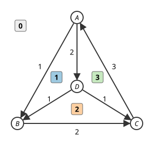

# Nowhere-zero 흐름

# 개요

**nowhere-zero 흐름(nowhere-zero flow)** 은 그래프의 간선마다 방향과 $0$ 이 아닌 정수를 주어, 모든 정점에서 들어오는 값의 합과 나가는 값의 합이 같게 한 것이다. 평면에 그린 지도에서 이웃한 두 나라에 다른 색을 주는 문제를 생각한다. 색을 $0,1,2,3$ 같은 수로 놓고 국경선마다 양쪽 나라의 수의 차를 적으면, 차는 $0$ 이 아니고 국경선이 만나는 점마다 들어오는 값과 나가는 값이 맞아떨어진다. 이 대응으로 지도 색칠의 물음이 간선 위의 수를 정하는 물음으로 바뀌고, 평면에 그릴 수 없는 그래프에도 같은 물음을 던질 수 있다.

# 직관

[평면 그래프](planar-graphs.md)는 평면을 면으로 나누고, 면을 나라로 보면 지도다. 아래 그림은 삼각형 $ABC$ 안에 정점 $D$ 를 두고 세 꼭짓점과 이은 완전 그래프 $K_4$ 다. 면은 넷이고 어느 두 면도 간선 하나를 사이에 두고 맞닿으므로, 면을 칠하려면 색이 넷 든다. 네모 안의 수가 면의 색이다. 바깥 면이 $0$, 면 $ABD$ 가 $1$, 면 $BCD$ 가 $2$, 면 $CAD$ 가 $3$ 이다.

간선마다 양쪽 면의 색 가운데 큰 쪽이 왼쪽에 오게 화살표를 긋고, 두 색의 차를 적은 것이 화살표 옆의 수다. 간선 $AB$ 는 바깥 면 $0$ 과 면 $ABD$ 의 $1$ 사이에 있어 $1$ 을 받는다.

정점 $D$ 에는 $A$ 에서 $2$ 가 들어오고, $B$ 와 $C$ 로 $1$ 씩 나간다. 정점 $A$ 에는 $C$ 에서 $3$ 이 들어오고 $B$ 와 $D$ 로 $1$ 과 $2$ 가 나간다. $B$, $C$ 에서도 들어오는 합과 나가는 합이 같다. 한 정점을 한 바퀴 돌며 만나는 면의 색의 차를 더하면 처음 면으로 돌아와 합이 $0$ 이 되기 때문에 이 등식이 생긴다.

이웃한 두 면의 색이 다르므로 간선의 수는 $0$ 이 아니고, 색이 $0$ 부터 $3$ 까지이므로 절댓값이 $3$ 이하다. 거꾸로 이런 수가 주어지면 바깥 면에 $0$ 을 주고 간선을 하나 넘을 때마다 그 수를 더하거나 빼서 면의 색을 되찾는다. 그래서 이 지도를 네 색으로 칠하는 것은 간선에 절댓값 $1$ 이상 $3$ 이하의 수를 흐름 보존이 성립하게 주는 것과 같다.

# 정의

## nowhere-zero 흐름

그래프 $G$ 의 간선마다 방향을 하나씩 정한다. 정점 $v$ 로 들어오는 간선의 집합을 $\delta^-(v)$, 나가는 간선의 집합을 $\delta^+(v)$ 라 한다. 정수 $k\ge 2$ 에 대해 함수 $f:E\to\mathbb Z$ 가

$$
\sum_{e\in\delta^-(v)}f(e)=\sum_{e\in\delta^+(v)}f(e)\quad(\forall v\in V)
$$

와 $0\lt\vert f(e)\vert\lt k$ 를 만족하면 $f$ 를 **nowhere-zero $k$ 흐름(nowhere-zero k-flow)** 이라 한다. 첫 조건은 [네트워크 흐름](network-flow.md)의 흐름 보존을 모든 정점에 요구한 것이다. 간선의 방향을 뒤집고 값의 부호를 바꾸면 같은 조건이 유지되므로, 흐름의 존재는 방향을 어떻게 정하는지와 무관하다.

직관 절의 그림은 $K_4$ 의 nowhere-zero $4$ 흐름이다. 값이 $1,2,3$ 이고 모든 정점에서 흐름 보존이 성립한다.

## 군 값 흐름

정수 대신 아벨 군(abelian group) $A$ 의 원소를 값으로 주고, 흐름 보존을 $A$ 에서의 합으로 요구하며, 모든 값이 $A$ 의 항등원이 아닌 것을 **nowhere-zero $A$ 흐름** 이라 한다. 직관 절의 값을 $4$ 로 나눈 나머지로 보면 $\mathbb Z\_4$ 흐름이 된다.

## 흐름수

$G$ 가 nowhere-zero $k$ 흐름을 가지는 가장 작은 $k$ 를 **흐름수(flow number)** 라 한다.

# 성질

## 다리

다리(bridge), 곧 지우면 그래프가 갈라지는 간선이 있는 그래프에는 nowhere-zero 흐름이 없다. 정점 집합 $S$ 에서 흐름 보존을 모두 더하면 $S$ 안의 간선은 한 번씩 들어오고 나가서 지워지고, $S$ 와 바깥을 잇는 간선의 값만 남아 그 합이 $0$ 이다. 다리 $e$ 의 한쪽 조각을 $S$ 로 두면 $S$ 와 바깥을 잇는 간선은 $e$ 하나이므로 $f(e)=0$ 이다.

## 정수 흐름과 군 값 흐름

Tutte 는 다음을 증명했다[^1].

- $G$ 가 nowhere-zero $k$ 흐름을 가지는 것과 nowhere-zero $\mathbb Z\_k$ 흐름을 가지는 것은 동치다.
- 크기가 $k$ 인 아벨 군 $A$ 에 대해 nowhere-zero $A$ 흐름의 개수는 $A$ 의 구조와 무관하게 $k$ 의 다항식으로 정해진다. 이 다항식이 흐름 다항식(flow polynomial)이고 [Tutte 다항식](tutte-polynomial.md)의 특수화다.

둘째 사실에서 $\mathbb Z\_4$ 흐름과 $\mathbb Z\_2^2$ 흐름은 하나가 있으면 다른 하나도 있다.

## 면 색칠과의 쌍대성

다리가 없는 평면 그래프 $G$ 의 면을 $k$ 색으로 칠할 수 있는 것은 $G$ 가 nowhere-zero $k$ 흐름을 가지는 것과 동치다[^1]. 한 방향은 직관 절의 구성이다. 다른 방향은 바깥 면에서 시작해 간선을 넘을 때마다 값을 더해 면에 $\mathbb Z\_k$ 의 원소를 주는 것이다. 어느 닫힌 경로로 돌아와도 넘은 간선의 값의 합이 $0$ 이므로 면의 값은 경로와 무관하다.

쌍대 그래프(dual graph)로 옮기면 평면 그래프의 정점 $k$ 색칠은 그 쌍대의 nowhere-zero $k$ 흐름과 대응한다. [4색 정리](four-color-theorem.md)는 다리 없는 평면 그래프가 모두 nowhere-zero $4$ 흐름을 가진다는 진술이 된다.

## 작은 흐름수

- nowhere-zero $2$ 흐름이 있는 것은 모든 정점의 차수가 짝수인 것과 동치다. 값이 $\pm 1$ 이면 흐름 보존은 들어오는 간선 수와 나가는 간선 수가 같다는 조건이 된다. 차수가 짝수이면 연결 성분마다 [Euler 회로](eulerian-circuits.md)가 있고, 그 회로의 방향으로 간선을 놓으면 이 조건이 성립한다.
- 3 정칙 그래프가 nowhere-zero $3$ 흐름을 가지는 것은 이분 그래프인 것과 동치다.
- 3 정칙 그래프가 nowhere-zero $4$ 흐름을 가지는 것은 간선 3 색칠을 가지는 것과 동치다. $\mathbb Z\_2^2$ 의 $0$ 이 아닌 세 원소 $01,10,11$ 을 세 색으로 보면, 한 정점의 세 간선이 서로 다른 세 원소를 받는 것과 셋의 합이 $00$ 인 것이 같다. 그래서 [snark](snarks.md)는 nowhere-zero $4$ 흐름이 없는 3 정칙 그래프이고, [Petersen 그래프](petersen-graph.md)의 흐름수는 $5$ 다.

## 흐름수의 상한

Tutte 는 다리가 없는 그래프가 모두 nowhere-zero $5$ 흐름을 가진다고 추측했다. 이것이 Tutte 의 5 흐름 추측(5-flow conjecture)이다[^1]. Petersen 그래프가 보여 주듯 $5$ 는 더 줄일 수 없다.

다리가 없는 그래프는 nowhere-zero $8$ 흐름을 가지고(Jaeger)[^2], nowhere-zero $6$ 흐름을 가진다([Seymour 6 흐름 정리](seymour-6-flow-theorem.md))[^3]. Jaeger 의 증명은 간선을 짝수 차수 부분그래프 셋으로 덮고 각 부분그래프에 $\mathbb Z\_2$ 흐름을 주어 $\mathbb Z\_2^3$ 흐름을 만든다.

Tutte 는 간선 연결도가 $4$ 이상인 그래프가 nowhere-zero $3$ 흐름을 가진다고도 추측했다. 이것이 [Tutte 3 흐름 추측](tutte-3-flow-conjecture.md)이다. 간선 연결도가 $6$ 이상이면 nowhere-zero $3$ 흐름이 있다는 것이 증명되었다[^4].

# 활용

- 4색 정리와 [Grötzsch 정리](grotzsch-theorem.md). 면 색칠과의 쌍대성으로 평면 그래프의 색칠 정리가 쌍대 그래프의 흐름 정리로 바뀐다. Grötzsch 정리에서 간선 연결도가 $4$ 이상인 평면 그래프가 nowhere-zero $3$ 흐름을 가진다는 것이 나온다.
- 3 정칙 그래프의 간선 색칠. 3 정칙 그래프에서 nowhere-zero $4$ 흐름이 있는 것은 [Vizing 정리](vizing-theorem.md)의 1 종인 것과 같다. 그래서 Tutte 의 간선 색칠 추측(Tutte's edge-colouring conjecture)은 Petersen 그래프를 마이너로 갖지 않는 다리 없는 3 정칙 그래프가 nowhere-zero $4$ 흐름을 가진다는 진술이다.
- 흐름 다항식. nowhere-zero 흐름의 개수는 Tutte 다항식의 값으로 계산되고, 평면 그래프에서는 쌍대의 채색 다항식과 같다.

[^1]: W. T. Tutte, "A contribution to the theory of chromatic polynomials", *Canadian Journal of Mathematics* 6 (1954), 80–91.
[^2]: F. Jaeger, "Flows and generalized coloring theorems in graphs", *Journal of Combinatorial Theory, Series B* 26 (1979), 205–216.
[^3]: P. D. Seymour, "Nowhere-zero 6-flows", *Journal of Combinatorial Theory, Series B* 30 (1981), 130–135.
[^4]: L. M. Lovász, C. Thomassen, Y. Wu, C.-Q. Zhang, "Nowhere-zero 3-flows and modulo k-orientations", *Journal of Combinatorial Theory, Series B* 103 (2013), 587–598.

# 연관 문서

## 선수지식

- [네트워크 흐름](network-flow.md)
- [평면 그래프](planar-graphs.md)

## 더 알아보기

- [Seymour 6 흐름 정리](seymour-6-flow-theorem.md)
- [순환 이중 덮개 추측](cycle-double-cover-conjecture.md)
- [Tutte 3 흐름 추측](tutte-3-flow-conjecture.md)

#graph_theory #combinatorics
