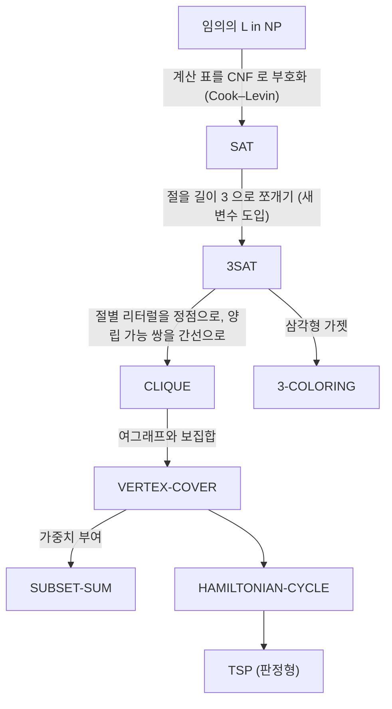

# NP-완전성과 Cook–Levin 정리

# 개요

**NP-완전성(NP-completeness, nondeterministic polynomial time)** 은 답을 확인하기는 쉬운 문제들 가운데 가장 어려운 것들이 갖는 성질이다. 도시 수천 개를 한 번씩 도는 경로 가운데 길이가 정해진 값 이하인 것이 있는지 묻는 문제는, 경로 하나를 받으면 길이를 더해 바로 확인되지만 모든 순서를 시험해 찾으면 도시 수의 계승만큼 걸린다. NP-완전성은 문제를 다른 문제로 바꾸는 환원(reduction)으로 이런 문제들을 묶어, 그 가운데 하나만 빨리 풀려도 전부가 빨리 풀린다는 것을 보이고 [P 대 NP 문제](p-np.md)를 개별 문제의 물음으로 바꾼다.

# 직관

경로 그래프 $1-2-3$ 에서 서로 이웃하지 않는 정점을 고르면 $\lbrace 1,3\rbrace$ 이 가장 크고, 모든 간선의 끝 하나를 덮는 정점을 고르면 $\lbrace 2\rbrace$ 가 가장 작다. 두 집합은 서로의 여집합이다. 어느 그래프에서나 정점 집합 $S$ 가 서로 이웃하지 않는 것과 $S$ 의 여집합이 모든 간선을 덮는 것은 동치이므로, "크기 $k$ 의 [독립집합 문제](independent-set.md)" 는 "크기 $n-k$ 의 [정점 덮개 문제](vertex-cover.md)" 로 바뀐다. 이 바꾸기는 수 $k$ 를 $n-k$ 로 고치는 것뿐이어서 금방 끝난다.

그러면 정점 덮개를 빨리 푸는 방법이 있으면 독립집합도 빨리 풀린다. 정점 덮개가 독립집합보다 쉬울 수 없다는 것을, 두 문제를 직접 풀지 않고 바꾸기 하나로 알게 된다. 이런 바꾸기를 환원이라 한다.

답이 주어지면 빨리 확인되는 문제들, 곧 $\mathrm{NP}$ 의 문제들 모두가 환원되는 문제 하나가 있으면, 그 문제 하나만 빨리 풀려도 $\mathrm{NP}$ 전체가 빨리 풀린다. 답을 확인하는 계산은 칸마다 정해진 규칙을 되풀이하는 표로 적히고, 칸마다의 규칙은 참과 거짓을 정하는 변수들의 논리식으로 적힌다. 그래서 "확인을 통과하는 답이 있다" 는 "이 논리식을 참으로 만드는 변수 값이 있다" 로 바뀐다.

# 정의

## 다항시간 환원

언어 $A$, $B$ (알파벳 위의 문자열 집합)에 대해 다항시간에 계산되는 함수 $f$ 가 존재하여 모든 $w$ 에 대해

$$
w \in A \iff f(w) \in B
$$

일 때 $A$ 는 $B$ 로 **다항시간 many-one 환원(polynomial-time many-one reduction)** 된다고 하고 $A \le_p B$ 로 쓴다. Karp 환원(Karp reduction)이라고도 한다. $f$ 가 전단사일 필요도, 역이 계산 가능할 필요도 없다. 직관의 바꾸기 $f(G,k)=(G,n-k)$ 가 독립집합에서 정점 덮개로 가는 다항시간 환원이다.

## NP-난해와 NP-완전

$\mathrm{NP}$ 는 다항 길이의 증거를 받아 다항시간에 확인하는 검증기가 있는 언어의 부류다. 언어 $B$ 가 **NP-난해(NP-hard)** 라는 것은 모든 $A \in \mathrm{NP}$ 에 대해 $A \le_p B$ 라는 것이다. $B$ 가 NP-난해이면서 $B \in \mathrm{NP}$ 이면 $B$ 는 **NP-완전(NP-complete)** 이다.

NP-난해인 언어는 $\mathrm{NP}$ 안에 있을 필요가 없다. [정지 문제](halting-problem.md)는 NP-난해이지만 [계산 가능성](computability.md)의 뜻으로 결정 가능하지 않다. 최소 정점 덮개의 크기를 구하는 최적화 판본도 NP-난해이지만 판정 문제가 아니므로 NP-완전이라 부르지 않는다.

## SAT 와 3SAT

명제 변수 $x_1,\dots,x_n$ 에 대해 리터럴(literal)은 변수 또는 그 부정이고, 절(clause)은 리터럴들의 논리합이며, **연언 표준형(conjunctive normal form, CNF)** 논리식은 절들의 논리곱이다. 각 절의 리터럴이 정확히 세 개인 CNF 를 3CNF 라 한다.

- $\mathrm{SAT}=\lbrace\text{충족가능한 명제논리식}\rbrace$ 를 **충족가능성 문제(satisfiability problem, SAT)** 라 한다.
- $\mathrm{3SAT}=\lbrace\text{충족가능한 3CNF 논리식}\rbrace$ 이다.

$(x_1\vee x_2\vee x_3)\wedge(\neg x_1\vee\neg x_2\vee x_3)$ 은 $x_3$ 을 참으로 두면 참이므로 3SAT 에 속한다. $x_1\wedge\neg x_1$ 은 어떤 값으로도 참이 되지 않으므로 SAT 에 속하지 않는다. 두 언어 모두 $\mathrm{NP}$ 에 속한다. 증거는 변수 값이고, 검증기는 값을 대입해 참인지 선형 시간에 확인한다.

# 성질

## 환원의 추이성

보조정리. $\le_p$ 는 반사적이고 추이적이다. $A \le_p B$ 이고 $B \in \mathrm P$ 이면 $A \in \mathrm P$ 이며, $B \in \mathrm{NP}$ 이면 $A \in \mathrm{NP}$ 다.

증명의 요지. 다항식의 합성은 다항식이다. $A$ 의 판정은 $f$ 를 적용한 뒤 $B$ 의 판정기를 돌리면 되고, 총 시간은 다항식 둘의 합성이다.

따라서 NP-완전 문제 하나가 $\mathrm P$ 에 속하면 $\mathrm P=\mathrm{NP}$ 이고, $\mathrm P \ne \mathrm{NP}$ 이면 어떤 NP-완전 문제도 다항시간 알고리즘을 갖지 않는다.

## Cook–Levin 정리

정리(Cook–Levin). SAT 는 NP-완전이다. S. A. Cook 이 1971 년에, L. Levin 이 1973 년에 독립적으로 증명했다[^1]. Levin 은 같은 결과를 탐색 문제(search problem)의 꼴로 얻었다.

증명의 요지. $L \in \mathrm{NP}$ 를 잡으면 시간 $p(n)$ 의 비결정적 Turing 기계 $M$ 이 $L$ 을 판정한다. 입력 $w$ (길이 $n$)에 대해 $M$ 의 한 실행을 $p(n) \times p(n)$ 크기의 계산 표(tableau)로 적는다. $i$ 번째 행이 시각 $i$ 의 테이프 구성(각 칸의 기호, 헤드 위치, 상태)이다. 시간이 $p(n)$ 이므로 헤드는 $p(n)$ 칸을 넘어 움직이지 못하고, 표의 폭도 $p(n)$ 이면 된다.

변수 $x\lbrack i,j,s\rbrack$ 를 "시각 $i$ 에 칸 $j$ 의 내용이 기호 $s$ 다" 로 둔다($s$ 는 테이프 기호이거나 상태와 기호의 쌍). 변수 개수는 $O(p(n)^2)$ 이다. 다음 네 묶음의 절을 만든다.

1. 칸 일관성. 각 $(i, j)$ 에 대해 정확히 하나의 $s$ 만 참이다. "적어도 하나" 는 $s$ 에 대한 논리합 하나, "많아야 하나" 는 쌍마다 $(\neg x\lbrack i,j,s\rbrack \vee \neg x\lbrack i,j,t\rbrack)$ 이다.
2. 시작. $0$ 번 행이 시작 상태와 입력 $w$, 나머지 공백을 나타내도록 해당 변수들을 단위 절로 고정한다.
3. 수용. 어떤 $(i,j)$ 에서 수용 상태가 나타난다. 그 변수들의 논리합 한 절이다.
4. 전이. 표의 모든 $2\times3$ 창(window)이 $M$ 의 전이 규칙에 비추어 합법이다. 창 하나의 합법적 내용은 알파벳과 상태 집합에만 의존하는 유한 개이므로, 불법 내용마다 그것을 금지하는 절을 쓰면 창마다 상수 개의 절이다.

Turing 기계의 한 걸음은 헤드 주변만 바꾸므로 연속한 두 행이 정합적이라는 조건이 창마다 확인되고, 표 전체의 정합성은 $O(p(n)^2)$ 개 창 조건의 논리곱과 같다. 이렇게 만든 CNF 논리식 $\varphi_w$ 는 크기가 $O(p(n)^2)$ 이고 $w$ 로부터 다항시간에 구성되며 다음을 만족한다.

$$
\varphi_w \text{ 가 충족가능} \iff M \text{ 이 } w \text{ 를 받아들이는 실행을 갖는다} \iff w \in L
$$

충족 할당에서 합법적인 계산 표를 읽어 낼 수 있고, 역으로 받아들이는 실행이 표를 통해 할당을 준다. 따라서 $L \le_p \mathrm{SAT}$ 이다.

## 환원의 사슬

NP-완전성을 새로 증명할 때는 Cook–Levin 의 표를 다시 만들지 않는다. 이미 NP-완전인 $B$ 에서 새 문제 $C$ 로 가는 $B \le_p C$ 를 만들고 $C \in \mathrm{NP}$ 를 확인하면, 추이성으로 $C$ 도 NP-완전이다. $C \le_p B$ 를 보이면 아무것도 증명되지 않는다. R. M. Karp 는 1972 년에 SAT 에서 출발하는 환원으로 조합 문제 21 개가 NP-완전임을 보였다[^2].

그림의 문제는 각각 [클릭 문제](clique-problem.md), 정점 덮개 문제, [그래프 색칠](graph-coloring.md)의 3-색칠, [부분합 문제](subset-sum.md), [Hamilton 순환](hamiltonian-cycles.md), [외판원 문제](traveling-salesman-problem.md)의 판정형이다.

## SAT 에서 3SAT 로

절 $(l_1 \vee l_2 \vee \cdots \vee l_k)$ 에 대해 $k \ge 4$ 이면 새 변수 $y_1, \ldots, y_{k-3}$ 을 도입해

$$
(l_1 \vee l_2 \vee y_1) \wedge (\neg y_1 \vee l_3 \vee y_2) \wedge \cdots \wedge (\neg y_{k-3} \vee l_{k-1} \vee l_k)
$$

로 바꾼다. $k\le2$ 이면 리터럴을 되풀이하거나 더미 변수로 채운다. 원래 절이 어떤 할당에서 참이면, 참인 리터럴 $l_i$ 를 기준으로 $y_1,\dots,y_{i-2}$ 를 참, 나머지를 거짓으로 두어 모든 새 절이 참이다. 모든 $l_i$ 가 거짓이면 새 절들이 $y_1$ 부터 차례로 참을 강요하다 마지막 절이 거짓이 된다. 변환은 원래 식의 크기에 선형이다. 일반 논리식은 먼저 같은 방법으로 새 변수를 도입해 충족가능성이 같은 CNF 로 바꾼다.

## 3SAT 에서 클릭으로

3CNF 논리식이 절 $m$ 개 $C_1, \ldots, C_m$ 을 가질 때 [그래프](graphs.md) $G$ 를 만든다. 정점은 각 절의 각 리터럴, 곧 $3m$ 개다. 두 정점은 서로 다른 절에 속하고 하나가 $x$, 다른 하나가 $\neg x$ 인 꼴이 아닐 때 간선으로 잇는다.

주장. 논리식이 충족가능한 것과 $G$ 가 크기 $m$ 의 클릭(clique)을 갖는 것은 동치다.

증명의 요지. 충족 할당이 있으면 절마다 참인 리터럴을 하나씩 고른다. 서로 다른 절에서 왔고 같은 할당에서 모두 참이므로 모순 쌍이 없어 크기 $m$ 의 클릭이다. 역으로 크기 $m$ 의 클릭은 같은 절 안에 간선이 없으므로 절마다 정확히 한 정점을 쓰고, 모순이 없으므로 그 리터럴들을 참으로 만드는 할당이 존재한다.

## 클릭에서 정점 덮개로

$G$ 의 정점 집합 $S$ 가 클릭인 것과, 여그래프 $G'$ (같은 정점, 간선을 뒤집음)에서 $V\setminus S$ 가 정점 덮개인 것은 동치다. 따라서 "$G$ 에 크기 $k$ 의 클릭이 있는가" 는 "$G'$ 에 크기 $\lvert V\rvert-k$ 의 정점 덮개가 있는가" 와 같다. 직관의 독립집합도 같은 여집합 관계로 묶인다. 세 문제는 서로 환원되지만 근사 가능성은 다르다. 정점 덮개는 2-근사가 다항시간에 되지만, 클릭은 $\mathrm P\ne\mathrm{NP}$ 이면 $n^{1-\varepsilon}$ 배 이내로 근사되지 않는다.

## NP-완전성이 말하지 않는 것

- 최악의 경우에 대한 진술이다. 현대 SAT 풀이기(SAT solver)는 변수가 수백만 개인 산업 인스턴스를 처리한다.
- 특수한 입력 구조, 예를 들어 나무폭이 작은 그래프나 이분 그래프에서는 NP-완전 문제가 다항시간에 풀리는 경우가 많다.
- 근사의 어려움은 따로 증명한다. PCP(probabilistically checkable proof) 정리가 그 도구이고, 같은 NP-완전 문제라도 근사 가능성이 다르다.
- $\mathrm P\ne\mathrm{NP}$ 이면 [Ladner 정리](ladner-theorem.md)로 $\mathrm P$ 에도 속하지 않고 NP-완전도 아닌 NP-중간(NP-intermediate) 문제가 존재한다. [그래프 동형](graph-isomorphism.md) 문제와 소인수분해([RSA 암호](rsa-cryptosystem.md)의 기반)가 그런 후보로 거론된다.
- NP-완전 문제는 모두 결정 가능하며 지수 시간에 풀린다. [Rice 정리](rice-theorem.md)가 다루는 결정 불가능성과 다르다.

# 활용

## 실무에서의 쓰임

- 문제를 SAT 로 옮겨 풀기. 하드웨어 검증, 소프트웨어 모델 검사, 일정 계획, 패키지 의존성 해결이 CNF 로 옮겨져 SAT 풀이기에 넘겨진다. Cook–Levin 정리로 모든 $\mathrm{NP}$ 문제가 SAT 로 환원되므로 이 방법이 어느 $\mathrm{NP}$ 문제에나 통한다.
- 정수계획법. [선형계획법](linear-programming.md)은 다항시간에 풀리지만 변수에 정수 조건을 붙인 [정수계획법](integer-programming.md)은 NP-난해다. 분기한정(branch and bound)이 이 문제에 쓰인다.
- 암호의 전제. 암호의 안전성은 평균적 경우의 어려움을 요구한다. NP-완전성은 최악의 경우만 말하므로 암호의 안전성 가정으로 그대로 쓰이지 않는다.
- 어려움의 증명. 새 문제를 만나면 알려진 NP-완전 문제에서 오는 환원을 찾는다. M. R. Garey 와 D. S. Johnson 의 목록이 오래 참고되었다[^3].

## 이론적 확장

- 다른 환원. Karp 환원 대신 신탁 질의를 여러 번 허용하는 Turing 환원(Turing reduction)을 쓰면 NP-난해의 범위가 넓어진다. 최적화 문제와 판정 문제를 함께 다룰 때 쓴다.
- 다른 부류의 완전 문제. $\mathrm{PSPACE}$(polynomial space)에는 한정 불 논리식(quantified Boolean formula, QBF)의 참 판정, $\mathrm{coNP}$ 에는 항진식 판정, $\char35{}\mathrm P$ 에는 영구식(permanent) 계산이 완전 문제다.
- 상대화 장벽. 신탁을 붙여도 그대로 성립하는 논증으로는 $\mathrm P$ 와 $\mathrm{NP}$ 를 분리할 수 없다(Baker–Gill–Solovay). P 대 NP 문제에 대해 알려진 첫 번째 장벽 결과다.

[^1]: S. A. Cook, The Complexity of Theorem-Proving Procedures, STOC 1971, https://dl.acm.org/doi/10.1145/800157.805047
[^2]: R. M. Karp, Reducibility Among Combinatorial Problems, 1972, https://cs.brown.edu/people/jsavage/book/pdfs/Karp1972.pdf
[^3]: M. R. Garey, D. S. Johnson, Computers and Intractability: A Guide to the Theory of NP-Completeness, 1979, https://archive.org/details/computersintract0000gare

# 연관 문서

## 선수지식

- [P 대 NP 문제](p-np.md)

## 더 알아보기

### 복잡도 부류

- [다항 계층](polynomial-hierarchy.md)
- [공간 복잡도](space-complexity.md)
- [셈 복잡도](counting-complexity.md)
- [대화형 증명](interactive-proofs.md)

### 구조와 근사

- [Ladner 정리](ladner-theorem.md)
- [Valiant–Vazirani 정리](valiant-vazirani.md)
- [근사 알고리즘](approximation-algorithms.md)
- [매개변수 복잡도](parameterized-complexity.md)
- [클릭 문제](clique-problem.md)

#complexity #computation
