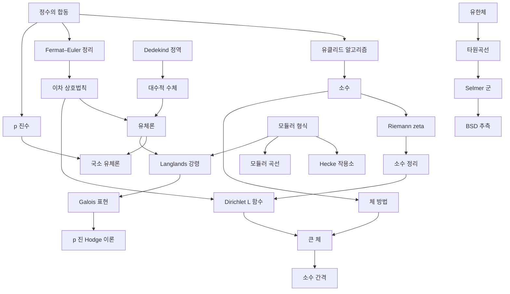

# 정수론 개관

# 개요

정수론(number theory)은 정수와 그 확장(대수적 정수, $p$ 진수, 아델)에서 나눗셈, 소수, 합동, 방정식의 정수해를 묻는 분야다. 물음은 초등적이지만 답은 대수, 해석, 기하, 표현론을 전부 동원한다. 정수론의 갈래는 합동과 소수에서 시작하는 초등 정수론, 난해성을 안전성의 근거로 삼는 공개키 암호, 유리수 근사가 해의 유한성을 통제하는 Diophantine 근사, $p$ 진수와 이차형식, 정수환의 아이디얼로 아벨 확대를 분류하는 대수적 수체와 유체론, $\zeta$ 와 $L$ 함수로 소수를 세는 해석적 정수론, 모듈러 형식, 타원곡선과 BSD(Birch–Swinnerton-Dyer) 추측, 이 모두를 표현론으로 통합하는 Langlands 강령, 대상을 Galois 군의 표현으로 바꿔 읽는 Galois 표현과 $p$ 진 Hodge 이론이다.

처음 읽는다면 [정수의 합동](modular-arithmetic.md)에서 시작해 [Fermat 소정리와 Euler 정리](fermat-euler-theorem.md), [이차 상호법칙](quadratic-reciprocity.md)까지 가면 초등 정수론의 기본이 잡힌다. 그 다음 갈림길은 셋이다. 대수 쪽으로 [Dedekind 정역](dedekind-domains.md)과 [대수적 수체](algebraic-number-fields.md), 해석 쪽으로 [소수 정리](prime-number-theorem.md), 기하 쪽으로 [타원곡선](elliptic-curves.md)이다. 셋은 [유체론](class-field-theory.md)과 [모듈러 형식](modular-forms.md)을 거쳐 [Langlands 강령](langlands-program.md)에서 다시 만난다.

# 지도

핵심 문서 사이의 선수관계다. 화살표는 실제 간선이고, 위에서 아래로 갈수록 깊어진다.

# 갈래

처음 읽는 사람은 합동과 소수, 연분수와 Diophantine 근사, p 진수와 이차형식, 대수적 수체와 유체론의 순서로 읽는다. 해석적 정수론과 L 함수 다음에 모듈러 형식이 오고, 타원곡선과 BSD 추측은 그 둘을 모두 전제한다. Langlands 강령, Galois 표현, L 꾸러미와 주기 공식, Iwasawa 이론은 뒤쪽 네 갈래이고, 지수합과 영점 통계와 곡선의 점 세기는 앞 갈래들의 결과를 도구로 쓴다.

## 합동과 소수

시작 문서: [정수의 합동](modular-arithmetic.md).

- [정수의 합동](modular-arithmetic.md): 정수를 나머지로 분류하는 첫 도구
- [유클리드 알고리즘](euclidean-algorithm.md): 최대공약수와 Bézout 항등식
- [소수](primes.md): 산술의 기본 정리
  - [Möbius 반전 공식](mobius-inversion.md): 약수 합성곱이 주는 산술함수의 환과 그 환에서의 역원
- [중국인의 나머지 정리](chinese-remainder-theorem.md): 서로소 법의 합동식 결합
- [Fermat 소정리와 Euler 정리](fermat-euler-theorem.md): 단위군의 위수가 주는 합동
- [유한체](finite-fields.md): 소수 위수의 체와 그 확대
- [이차 상호법칙](quadratic-reciprocity.md): 제곱잉여의 대칭성
- [Gauss 정수환](gaussian-integers.md): 소수의 분해 유형과 두 제곱수의 합

## 고전 공개키 암호와 곡선

먼저 읽을 갈래: 합동과 소수. 시작 문서: [이산로그](discrete-logarithm.md).

- [이산로그](discrete-logarithm.md): 거듭제곱은 빠르고 그 역이 어렵다는 비대칭, Pohlig–Hellman 과 Pollard rho 의 비용
  - [RSA 암호](rsa-cryptosystem.md)(Rivest–Shamir–Adleman): 두 소수의 곱을 공개하고 소인수를 비밀로 두는 공개키 암호와 서명
  - [격자](lattices.md): 실벡터공간의 이산 부분군과 그 기본 영역의 부피
- [타원곡선](elliptic-curves.md): 세제곱 곡선 위의 점이 이루는 아벨군과 그 군에서의 이산로그

## 연분수와 Diophantine 근사

먼저 읽을 갈래: 합동과 소수. 시작 문서: [연분수](continued-fractions.md).

- [등분포](equidistribution.md): 수열이 구간에 길이만큼의 빈도로 들어가는 성질, Weyl 판정법과 불일치도
- [연분수](continued-fractions.md): 실수를 정수 몫의 열로 펼쳐 최적 유리수 근사를 얻는다
  - [Gauss 사상](gauss-map.md): 연분수 한 걸음의 변환, Gauss 측도와 Gauss–Kuzmin 분포, Lévy 정리
  - [Pell 방정식](pell-equation.md): $x^2-dy^2=1$ 의 해가 기본해의 거듭제곱으로 전부 나온다
- [Diophantine 근사](diophantine-approximation.md): 근사 지수가 대수적 수와 초월수를 가른다
- [초월수](transcendental-numbers.md): $e$ 와 $\pi$ 의 초월성, 로그의 일차형식
- [Roth 정리](roth-theorem.md): 대수적 무리수의 근사 지수가 $2$ 라는 정리, 보조 다항식과 지표, 비유효성
- [Baker 정리](baker-theorem.md): 로그의 일차형식에 대한 유효 하한, Diophantus 방정식의 해 상한
- [Thue 방정식](thue-equation.md): 차수 3 이상 이진형식의 정수해, 유한성과 Baker 하한이 주는 유효 상한

## p 진수와 이차형식

먼저 읽을 갈래: 합동과 소수. 시작 문서: [p 진수](p-adic-numbers.md).

- [p 진수](p-adic-numbers.md): $p$ 진 절댓값으로 완비화한 체와 그 정수환
- [Hensel 보조정리](hensel-lemma.md): 법 $p$ 의 근 하나를 $p$ 진 정수환의 근으로 올리는 조건
  - [Newton 다각형](newton-polygon.md): 계수의 부치로 그린 볼록 다각형이 근의 부치를 읽어 준다
- [이차형식](quadratic-forms.md): 대칭행렬로 본 2 차 동차식, 부호수와 Hasse–Minkowski 정리, 제곱수의 합
- [Lagrange 네 제곱수 정리](four-squares-theorem.md): 모든 정수가 제곱수 넷의 합이라는 정리, Euler 항등식에 의한 소수로의 환원과 Jacobi 의 표현 개수 공식
- [Gauss 세 제곱수 정리](three-squares-theorem.md): 세 제곱수의 합이 되는 정수의 판정, 8 을 법으로 한 제외 조건과 표현 개수를 주는 유형수 공식
- [Hasse 원리](hasse-principle.md): 모든 자리에서 풀리면 유리수해가 있다는 주장, 이차형식에서의 성립과 차수 3 에서의 반례
  - [사원수 대수](quaternion-algebras.md): 노름형식이 0 을 표현하는지로 갈리는 분해와 나눗셈, 분기 자리의 짝수 조건, 극대 순서와 Eichler 질량 공식

## 대수적 수체와 유체론

먼저 읽을 갈래: p 진수와 이차형식. 시작 문서: [Dedekind 정역](dedekind-domains.md).

- [Dedekind 정역](dedekind-domains.md): 원소의 소인수분해가 깨진 자리에서 아이디얼의 분해가 유일해지는 정역
- [대수적 수체](algebraic-number-fields.md): 유리수체의 유한 확대와 그 정수환, 판별식과 소수의 분해
- [원분체](cyclotomic-fields.md): 1 의 거듭제곱근을 붙인 체의 Galois 군 (ℤ/n)ˣ, 나머지로 정해지는 소수 분해, Kronecker–Weber 정리와 정칙 소수
- [분기군](ramification-groups.md): 분해군, 관성군, Frobenius 원소와 야생 분기를 재는 하첨자·상첨자 여과, 차분과 Artin 도체
- [Dirichlet 단수 정리](dirichlet-unit-theorem.md): 단수군의 계수와 조절자, 류수 공식
- [아델](adeles.md): 수체의 모든 자리를 묶은 국소콤팩트 위상환과 그 위의 [Haar 측도](haar-measure.md)
  - [이진 이차형식](binary-quadratic-forms.md): 판별식을 고정한 동치류의 축약 대표와 Gauss 합성이 주는 유형군, 이데알 류군과의 동형
  - [류수 1 문제](class-number-one.md): 소인수분해가 유일한 허이차체 아홉 개, 류수 공식의 비유효성과 특이 모듈러 값으로 얻은 상한
  - [S-단위 방정식](s-unit-equation.md): 단위군에서 푸는 $u+v=1$, Thue 방정식과 정수점 유한성의 공통 환원
- [유체론](class-field-theory.md): 수체의 아벨 확대를 아이디얼류군으로 분류하는 상호법칙
  - [국소 유체론](local-class-field-theory.md): 국소체의 아벨 확대를 그 곱셈군으로 분류하는 상호법칙과 노름 잉여 기호
  - [Brauer 군](brauer-groups.md): 중심단순대수의 Brauer 동치류가 이루는 군과 유체론이 주는 그 계산
  - [복소 곱셈](complex-multiplication.md): 허이차체의 아벨 확대를 타원곡선의 특수값으로 생성하는 이론

## 해석적 정수론과 L 함수

먼저 읽을 갈래: 대수적 수체와 유체론. 먼저 읽을 것: [해석적 연속](analytic-continuation.md)(복소해석 개관). 시작 문서: [Dirichlet 급수](dirichlet-series.md).

- [Dirichlet 급수](dirichlet-series.md): 계수에 $n^{-s}$ 를 붙인 급수, 수렴 가로선과 합성곱의 곱 대응, Perron 공식
- [Riemann zeta 함수](riemann-zeta.md): 소수에 대한 Euler 곱, 함수방정식과 극
  - [Bernoulli 수](bernoulli-numbers.md): 거듭제곱의 합에 나타나는 유리수열과 zeta 함수의 음의 정수 특수값
  - [Euler–Maclaurin 공식](euler-maclaurin.md): 유한합과 적분의 차이를 도함수 값의 급수로 전개한다
  - [Poisson 합 공식](poisson-summation.md): 정수점 위의 합과 [Fourier 변환](fourier-transform.md)의 정수점 위 합이 같다는 항등식
  - [Mellin 변환](mellin-transform.md): 곱셈적 변수를 지수로 옮겨 함수방정식을 적분으로 쓰게 하는 변환
  - [다중 zeta 값](multiple-zeta-values.md): 순서 조건을 붙인 다중 급수, 스터플·셔플 두 곱셈 규칙과 이중 셔플 관계
- [Chebyshev 추정](chebyshev-bounds.md): 이항계수의 소인수로 얻는 $\pi(x)$ 의 상하한과 Bertrand 가설
- [Mertens 정리](mertens-theorem.md): 소수 역수 합의 크기와 Euler 곱의 점근, 소수 정리를 쓰지 않는 세 추정
- [소수 정리](prime-number-theorem.md): $\pi(x)$ 가 $x/\log x$ 에 점근한다는 정리와 임계선 위 비소멸의 역할
- [Dirichlet L 함수](dirichlet-l-functions.md): 지표로 꼰 급수와 등차수열의 소수 정리
  - [Chebotarev 밀도 정리](chebotarev.md): Galois 확대에서 Frobenius 켤레류가 균등하게 분포한다는 정리
  - [Dedekind zeta 함수](dedekind-zeta.md): 아이디얼 노름에 대한 zeta 함수의 함수방정식, 류수·조절자·판별식으로 적히는 s=1 의 유수
  - [Artin L 함수](artin-l-functions.md): Galois 표현의 Frobenius 특성다항식으로 만든 L 함수, Brauer 유도 정리와 Artin 추측
  - [Tate 의 zeta 적분](tate-zeta-integral.md): 아델 위의 적분 하나로 Hecke L 함수의 함수방정식을 얻는 방법
  - [Gauss 합](gauss-sums.md): 가법 지표와 곱셈 지표의 합, 절댓값과 부호의 결정
  - [Stickelberger 원소](stickelberger.md): Gauss 합의 소인수분해가 주는 류군의 소멸자
  - [Kubota–Leopoldt p 진 zeta 함수](kubota-leopoldt-zeta.md): Bernoulli 수의 Kummer 합동으로 $\mathbb Z_p$ 위에 이은 zeta 함수, [Iwasawa 대수](iwasawa-algebra.md)의 멱급수 표현과 Leopoldt 의 $s=1$ 공식
- [체 방법](sieve-methods.md): 작은 소수의 배수를 걸러 남는 개수를 재는 Brun 의 절단과 Selberg 의 가중
  - [큰 체](large-sieve.md): 소수마다 절반을 거르는 문제의 지수합 부등식과 Bombieri–Vinogradov 정리
  - [Vaughan 항등식](vaughan-identity.md): von Mangoldt 함수를 쌍선형합으로 가르는 항등식, Type I 과 Type II 합의 추정
  - [Chen 정리](chen-theorem.md): 짝수가 소수와 거의 소수의 합이라는 결론, 가중 체와 전환 원리
  - [소수 간격](prime-gaps.md): 연속한 소수의 차의 하한과 상한, 허용집합과 유계 간격
  - [Cramér 추측](cramer-conjecture.md): 소수를 독립 시행으로 바꾼 모형이 주는 최대 간격 $(\log p)^2$ 와 Maier 정리가 드러낸 모형의 어긋남
- [Riemann 가설](riemann-hypothesis.md): 영점의 실수부와 소수 계량 함수의 오차, GRH(generalized Riemann hypothesis) 의 응용
  - [쌍 상관 추측](pair-correlation-conjecture.md): 임계선 위 영점의 간격 분포와 무작위 행렬 고윳값 통계의 일치

## 모듈러 형식

먼저 읽을 갈래: 해석적 정수론과 L 함수. 시작 문서: [모듈러 형식](modular-forms.md).

- [모듈러 형식](modular-forms.md): 상반평면 위에서 모듈러 군의 작용에 무게만큼 변하는 정칙함수
- [Eisenstein 급수](eisenstein-series.md): 격자합으로 만든 모듈러 형식과 첨점 형식의 여공간
- [Hecke 작용소](hecke-operators.md): 이중 잉여류가 Fourier 계수에 주는 작용과 고유형식의 Euler 곱
  - [생성함수](generating-functions.md): 수열을 멱급수의 계수로 적어 조작을 대수 연산으로 바꾸는 장치
  - [theta 급수](theta-series.md): 격자의 표현 개수를 계수로 갖는 반정수 무게 형식
    - [분할수](partitions.md): 자연수를 더하기로 쪼개는 방법의 수와 그 생성함수의 모듈러성
      - [Mock 모듈러 형식](mock-modular-forms.md): 완비화에서 비정칙 항을 더해야 변환 규칙을 되찾는 급수
      - [Dyson 의 rank 와 crank](dyson-rank-crank.md): 분할수 합동을 설명하는 두 통계와 그 생성함수
    - [구 채우기](sphere-packing.md): 격자와 부호가 정하는 최대 밀도
    - [Weil 표현](weil-representation.md): 심플렉틱 군의 메타플렉틱 덮개가 theta 함수에 주는 표현
      - [Shimura 대응](shimura-correspondence.md): 반정수 무게 형식과 정수 무게 형식을 잇는 Hecke 가환 사상
      - [Siegel–Weil 공식](siegel-weil.md): theta 적분의 평균이 Eisenstein 급수와 같다는 등식
        - [질량 공식](mass-formula.md): 유형 안의 격자를 자기동형군의 크기로 가중해 더한 값
          - [Niemeier 격자](niemeier-lattices.md): 차원 24 의 짝 유니모듈러 격자 24 개의 분류
- [모듈러 곡선](modular-curves.md): 상반평면의 몫으로 얻는 대수곡선과 그 위의 모듈러 해석
  - [모듈러 기호](modular-symbols.md): 측지선의 호몰로지류로 Hecke 작용과 특수값을 유한 계산으로 바꾸는 표현
  - [Hida 이론](hida-theory.md): 보통 부분으로 자른 형식의 공간을 무게에 대한 멱급수환 위 유한 평탄 가군으로 묶어 무게를 변수로 움직이는 족
    - [과수렴 모듈러 기호](overconvergent-modular-symbols.md): 분포 가군에 값을 둔 기호와 p 진 L 함수의 계산
    - [고유다양체](eigenvariety.md): $U_p$ 의 특성 멱급수의 영점 자취 위에 Hecke 고윳값을 올린 강체해석공간, 기울기를 열어 둔 족
- [Maass 형식](maass-forms.md): Laplace 작용소의 고유함수인 비정칙 자기동형 형식
  - [Selberg 대각합 공식](selberg-trace-formula.md): Laplace 스펙트럼의 합과 닫힌 측지선의 합을 잇는 등식
- [Siegel 모듈라이 다양체](siegel-modular-variety.md): 주편극을 갖춘 복소 토러스를 분류하는 Siegel 상반공간의 몫
  - [Siegel 모듈러 형식](siegel-modular-forms.md): 그 몫 위 선다발의 절단으로 얻는 여러 변수의 모듈러 형식
    - [Jacobi 형식](jacobi-forms.md): 차수 2 Siegel 형식을 한 변수로 전개한 계수. 지표 1 의 공간이 반정수 가중치 형식과 동형이다
    - [Igusa 불변량](igusa-invariants.md): 종수 2 곡선을 정의하는 이진 6차형식의 불변량 $J_2,J_4,J_6,J_{10}$ 과 그 비로 얻는 모듈라이 공간의 좌표
  - [Shimura 다양체](shimura-varieties.md): 환원군과 Hermite 대칭영역의 쌍으로 모듈러 곡선과 Siegel 모듈라이 다양체를 한 구성으로 묶은 것. 수체 위의 모형과 코호몰로지 위의 Hecke 작용
- [Borcherds 곱](borcherds-products.md): 무게 $1/2$ 형식의 계수를 지수로 올려 만든 무한곱 모듈러 형식
- [괴물 달빛 추측](monstrous-moonshine.md): $j$ 함수의 계수와 괴물군 표현의 차원이 일치한다는 추측과 그 증명
  - [Umbral moonshine](umbral-moonshine.md): Niemeier 격자마다 붙는 mock 모듈러 형식과 유한군의 대응

## 타원곡선과 BSD 추측

먼저 읽을 갈래: 모듈러 형식. 시작 문서: [Néron–Tate 높이와 Mordell–Weil 정리](canonical-height.md).

- [Néron–Tate 높이와 Mordell–Weil 정리](canonical-height.md): 유리점의 군이 유한생성이라는 정리와 그 증명에 쓰는 높이함수
  - [Faltings 정리](faltings-theorem.md): 종수 2 이상 곡선의 유리점이 유한 개라는 정리, Shafarevich 추측과 Parshin 트릭을 거치는 증명
  - [Mordell–Lang 추측](mordell-lang.md): 유한생성 부분군과 부분다양체의 교집합이 아벨 부분다양체의 잉여류 유한 개로 설명된다는 진술, Mordell 추측을 포함한다
  - [Siegel 의 정수점 정리](siegel-integral-points.md): 종수와 무한원점의 개수로 가른 정수점의 유한성, 유효 상한의 두 길
- [Selmer 군과 Tate–Shafarevich 군](selmer-tate-shafarevich.md): 국소 조건으로 자른 코호몰로지 군과 계수 계산의 장애
  - [Poitou–Tate 완전열](poitou-tate.md): 국소 항과 대역 항을 잇는 아홉 항 완전열
- [Birch–Swinnerton-Dyer 추측](birch-swinnerton-dyer.md): $L$ 함수의 $s=1$ 소멸 차수가 계수와 같다는 추측
  - [Heegner 점과 Gross–Zagier 공식](heegner-points.md): 복소 곱셈 점의 높이와 $L$ 함수 미분값의 등식
    - [Gross–Kohnen–Zagier 정리](gross-kohnen-zagier.md): 판별식마다 만든 Heegner 점을 계수로 삼은 급수가 무게 $3/2$ 의 모듈러 형식이라는 정리
  - [Euler 계](euler-systems.md): 노름 관계로 묶인 코호몰로지류의 족이 Selmer 군의 상한을 준다
    - [Kolyvagin–Logachev 정리](kolyvagin-logachev.md): 소멸 차수 1 일 때 계수와 Tate–Shafarevich 군의 유한성
    - [Kolyvagin 계](kolyvagin-systems.md): Euler 계의 파생류를 공리로 바꾸어 상한을 정확한 등식으로 만드는 틀
- [Tate 곡선](tate-curve.md): 분해 곱셈적 환원을 갖는 곡선의 $p$ 진 균등화 $K^{\times}/q^{\mathbb Z}$ , Tate 주기와 $L$ 불변량
- [Chabauty 방법](chabauty-method.md): 유리점 군의 계수가 종수보다 작을 때 유리점을 $p$ 진 적분의 영점으로 세는 방법
  - [Coleman 적분](coleman-integration.md): 잔차 원판의 항별 적분을 Frobenius 작용으로 이어 붙인 $p$ 진 적분, 영점 개수의 상한
    - [p 진 다중 zeta 값](p-adic-multiple-zeta-values.md): 같은 단어의 반복 Coleman 적분, 접기저점 정규화와 p 진 Drinfeld 결합자
    - [p 진 L 함수](p-adic-l-function.md): 모듈러 기호로 만든 $\mathbb Z_p^\times$ 위 측도의 적분, 복소 특수값을 보간하고 Iwasawa 주추측의 해석적 변에 놓이는 함수
      - [Iwasawa 주추측](iwasawa-main-conjecture.md): 류군의 특성 아이디얼과 p 진 L 함수가 같다는 등식
    - [p 진 높이](p-adic-height.md): 국소 분해의 로그를 $p$ 진 로그로 바꾸고 $p$ 자리를 Coleman 적분으로 채운 높이쌍, $p$ 진 BSD 의 조절자
    - [Chabauty–Kim 방법](chabauty-kim.md): 기본군의 깊은 몫으로 Chabauty 를 반복해 계수 조건을 $r\lt g+s-1$ 로 느슨하게 만든 방법
  - [Mordell–Weil 시브](mordell-weil-sieve.md): 유리점의 잉여류를 소수마다 환원해 걸러내는 절차, 유리점 목록의 완결과 부재 증명

## Langlands 강령과 자기동형 표현

먼저 읽을 갈래: 모듈러 형식. 시작 문서: [Langlands 강령](langlands-program.md).

- [Langlands 강령](langlands-program.md): 유체론의 상호법칙을 비가환 군의 자기동형 표현으로 확장하려는 프로그램
  - [Jacquet–Langlands 대응](jacquet-langlands.md): 사원수 대수의 표현과 두 차원 일반선형군의 첨점 표현을 잇는 대응
- [Godement–Jacquet 적분](godement-jacquet.md): 행렬대수 위의 적분으로 표준 $L$ 함수의 함수방정식을 얻는 방법
- [Satake 동형](satake-isomorphism.md): 비분기 Hecke 대수와 쌍대군의 표현환이 같다는 동형
  - [Rankin–Selberg 적분](rankin-selberg.md): 두 형식의 곱에 Eisenstein 급수를 짝지어 꼰 $L$ 함수를 얻는 적분
    - [Whittaker 모형](whittaker-models.md): 퇴화 지표에 대한 함수 모형과 그 유일성이 주는 Euler 곱 분해
      - [Casselman–Shalika 공식](casselman-shalika.md): 구면 Whittaker 함수의 값을 쌍대군의 기약지표로 주는 공식
  - [기하학적 Satake 대응](geometric-satake.md): 아핀 Grassmann 다양체의 퍼버스 층 범주와 쌍대군 표현 범주의 동치
    - [MV 순환](mv-cycles.md)(Mirkovic–Vilonen): 그 동치에서 표현의 무게 공간 기저를 주는 순환
    - [기하학적 Langlands 강령](geometric-langlands.md): 곡선 위 다발의 모듈라이에서 층의 범주 사이 동치로 올린 대응
- [기본 보조정리](fundamental-lemma.md): 두 군의 대각합 공식을 비교하는 데 필요한 국소 궤도적분 항등식

## Galois 표현과 p 진 Hodge 이론

먼저 읽을 갈래: Langlands 강령과 자기동형 표현. 시작 문서: [Galois 표현](galois-representations.md).

- [Galois 표현](galois-representations.md): 절대 Galois 군의 연속 표현과 기하에서 오는 그 예
  - [대수적 K 이론](algebraic-k-theory.md): Quillen–Lichtenbaum 정리가 수체의 $K$ 군을 에탈 코호몰로지로 계산한다
  - [Eichler–Shimura 관계](eichler-shimura.md): 모듈러 곡선 위에서 Hecke 작용소가 Frobenius 와 그 쌍대의 합으로 적히는 등식. 고유형식에서 2 차원 Galois 표현을 만드는 자리
  - [Dwork 의 유리성 정리](dwork-rationality.md): 유한체 위 다양체의 zeta 함수가 유리함수라는 $p$ 진 증명
    - [Deligne 의 Weil 추측 증명](deligne-weil-conjectures.md): Frobenius 고윳값의 절댓값을 확정하는 Riemann 가설 부분
  - [Herbrand–Ribet 정리](herbrand-ribet.md): 류수의 $p$ 부분과 Bernoulli 수 합동의 동치
- [p 진 Hodge 이론](p-adic-hodge-theory.md): 국소 $p$ 진 표현을 de Rham, 반안정, 결정적 등급으로 가르는 이론
  - [Sen 이론](sen-theory.md): Hodge–Tate 표현의 무게를 Lie 작용으로 읽는 이론
  - [Fontaine–Mazur 추측](fontaine-mazur.md): 기하에서 오는 표현을 국소 조건으로 판정하는 추측
  - [Galois 표현의 변형환](deformation-rings.md): 잉여 표현의 올림을 매개하는 보편환과 그 국소 조건
    - [Serre 추측과 Khare–Wintenberger 정리](serre-conjecture.md): 2 차원 mod $p$ 표현이 모듈러라는 추측과 그 증명
  - [강체해석공간](rigid-analytic-spaces.md): 허용 덮개만 인정하는 Grothendieck 위상 위에 친화 준위를 붙여 비아르키메데스 체에서 해석접속을 되살린 공간
  - [Fargues–Scholze 기하화](fargues-scholze.md): 번들의 모듈라이 위에서 국소 Langlands 를 층으로 다시 쓴 구성

## L 꾸러미와 주기 공식

먼저 읽을 갈래: Galois 표현과 p 진 Hodge 이론. 시작 문서: [Vogan L 꾸러미](vogan-packets.md).

- [Vogan L 꾸러미](vogan-packets.md): 한 L 매개변수에 모이는 표현의 꾸러미와 그 내부 매개화
  - [Arthur 매개변수](arthur-parameters.md): L 매개변수에 $\mathrm{SL}\_2$ 를 더해 비템퍼드 표현까지 분류하는 매개변수
    - [Speh 표현](speh-representations.md): 첨점 표현의 분할에서 얻는 잉여 스펙트럼의 표현
  - [Gan–Gross–Prasad 추측](gan-gross-prasad.md): 부분군에 제한한 주기의 비소멸과 $L$ 함수 중심값의 대응
    - [Waldspurger 정리](waldspurger-formula.md): 토릭 주기의 제곱과 꼰 $L$ 함수 중심값의 등식
      - [Tunnell–Saito 공식](tunnell-saito.md): 그 주기가 소멸하지 않는 사원수 대수를 $\varepsilon$ 인자로 판정하는 공식

## Iwasawa 이론과 비틀림점

먼저 읽을 갈래: Galois 표현과 p 진 Hodge 이론. 시작 문서: [Sato–Tate 분포](sato-tate.md).

- [Sato–Tate 분포](sato-tate.md): Frobenius 각이 반원 측도를 따른다는 분포 정리
  - [Lang–Trotter 추측](lang-trotter.md): 고정한 $a_p$ 값이 나타나는 소수의 개수에 대한 추측
- [Eisenstein 아이디얼과 Mazur 의 비틀림점 정리](eisenstein-ideal.md): 유리수체 위 타원곡선의 비틀림군이 15 가지뿐이라는 정리
  - [Merel 의 일양 유계성 정리](merel-theorem.md): 비틀림군의 크기가 수체의 차수만으로 유계라는 정리
- [Vandiver 추측](vandiver-conjecture.md): 순환체 류군의 $p$ 부분에서 짝수 지표 성분이 소멸한다는 주장
- [Greenberg 추측](greenberg-conjecture.md): 총실수체의 $\mathbb Z_p$ 확대 탑에서 류수의 $p$ 부분이 유계라는 주장

## 지수합과 영점 통계

먼저 읽을 갈래: Iwasawa 이론과 비틀림점. 시작 문서: [원법](circle-method.md).

- [원법](circle-method.md): 가법적 문제의 해의 개수를 지수합의 주기 적분으로 적고 단위원을 주 호와 부 호로 가르는 절차, Waring 문제와 삼소수 정리
  - [Goldbach 추측](goldbach-conjecture.md): 짝수를 두 소수의 합으로 쓰는 문제의 주 호 점근식과 삼소수 형태의 증명
  - [Waring 문제](waring-problem.md): 모든 자연수를 $k$ 제곱수의 합으로 쓰는 데 드는 항의 개수, 모든 수를 덮는 $g(k)$ 와 충분히 큰 수를 덮는 $G(k)$ 의 구분
  - [Vinogradov 평균값 정리](vinogradov-mean-value.md): 차수 $k$ 까지의 지수합의 $2s$ 제곱 평균이 세는 멱합 방정식의 해 개수, 효율적 합동법과 분해 정리가 준 주 추측
- [Kloosterman 합](kloosterman-sums.md): 역원을 지수에 올린 합의 Weil 상계 $2\sqrt p$ 와 Salié 합의 닫힌 꼴, 모듈러 형식의 계수와 원법의 오차항에서의 쓰임
  - [Petersson 공식](petersson-formula.md): 정칙 첨점 형식 기저의 Fourier 계수 가중 합을 대각 항과 Kloosterman 합의 Bessel 가중 합으로 가르는 등식, $L$ 함수의 적률과 비소멸
    - [Kuznetsov 공식](kuznetsov-formula.md): Kloosterman 합의 가중 합과 Maass 형식 계수의 스펙트럼 합을 잇는 등식, 이동 합성곱 합과 아족 평균
  - [저수준 영점](low-lying-zeros.md): 족을 모아 재는 임계점 근처 영점의 분포, 세 대칭형 커널과 곡선족의 모노드로미

## 곡선의 점 세기와 동종사상 암호

먼저 읽을 갈래: Iwasawa 이론과 비틀림점. 시작 문서: [Schoof–Elkies–Atkin 알고리즘](sea-algorithm.md).

- [Schoof–Elkies–Atkin 알고리즘](sea-algorithm.md): 분할 다항식과 동종사상으로 유한체 위 타원곡선의 점의 개수를 세는 다항시간 알고리즘
- [Kedlaya 알고리즘](kedlaya-algorithm.md): 결정적 코호몰로지의 Frobenius 행렬로 초타원곡선의 zeta 함수를 계산하는 절차
- [쌍선형 암호](pairing-based-cryptography.md): Weil 쌍과 Tate 쌍을 쓰는 암호 구성과 그 안전성 가정
- [초특이 동종사상 그래프](supersingular-isogeny-graphs.md): 초특이 곡선을 정점으로 하는 확장자 그래프와 동종사상 기반 암호
  - [Deuring 대응](deuring-correspondence.md): 초특이 곡선의 자기준동형환과 사원수 대수의 아이디얼의 대응
# 연관 문서

## 선수지식

- [집합](sets.md)

## 더 알아보기

- [정수의 합동](modular-arithmetic.md)
- [Dedekind 정역](dedekind-domains.md)
- [격자](lattices.md)
- [모듈러 형식](modular-forms.md)

#number_theory #overview
