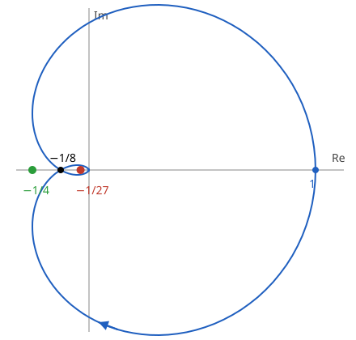

# Nyquist 판정법

# 개요

**Nyquist 판정법(Nyquist stability criterion)** 은 되먹임 고리가 안정한지를, 고리를 끊었을 때의 주파수 응답 곡선이 한 점을 몇 번 감는지로 판정하는 방법이다. 증폭기의 출력을 입력으로 되돌리는 회로에서 이득 $k$ 를 키우면 어느 순간 회로가 저절로 진동하기 시작하는데, 그 순간의 $k$ 를 알려면 닫힌 고리의 특성방정식의 근을 $k$ 마다 구해야 한다.

Nyquist 판정법은 근을 구하는 대신 고리를 끊은 장치의 주파수 응답 곡선 하나를 그리고, 그 곡선이 점 $-1/k$ 를 감는 횟수로 모든 $k$ 의 안정성을 한 번에 읽는다.

# 직관

장치의 전달 함수가 $G(s)=1/(s+1)^3$ 이고 출력에 $k$ 를 곱해 입력에서 빼는 고리를 만든다. 닫힌 고리의 극은 $1+kG(s)=0$, 곧 다음 방정식의 근이다.

$$
(s+1)^3+k=0
$$

근의 실부가 모두 음수이면 안정하다. $k=8$ 이면 좌변이 다음처럼 인수분해되어 근 $\pm i\sqrt3$ 이 허수축 위에 있다.

$$
s^3+3s^2+3s+9=(s+3)(s^2+3)
$$

$k=27$ 이면 $s+1=3e^{\pm i\pi/3}$ 인 근의 실부가 $0.5$ 라 불안정하다. 이렇게는 $k$ 마다 [삼차방정식](cubic-equation.md)을 풀어야 한다.

$1+kG(s)$ 의 영점 가운데 오른쪽 반평면에 있는 것의 개수는 [Rouché 정리](rouche-theorem.md) 문서의 편각 원리로 셀 수 있다. $s$ 가 허수축을 따라 $-i\infty$ 에서 $i\infty$ 로 가고 큰 반원으로 돌아오는 동안 $1+kG(s)$ 가 원점을 감는 횟수가 그 개수다. $1+kG$ 가 원점을 감는 것은 $G$ 가 점 $-1/k$ 를 감는 것과 같다.

그래서 곡선 $G(i\omega)$ 하나만 그리면 된다. 아래 그림은 $\omega$ 가 $-\infty$ 에서 $\infty$ 로 갈 때의 $G(i\omega)$ 이고, 화살표는 $\omega$ 가 커지는 방향이다. 곡선은 $\omega=\sqrt3$ 에서 음의 실수축을 $-1/8$ 에서 지난다.

$k=4$ 이면 점 $-1/4$ 는 곡선 바깥에 있어 감기지 않고, 닫힌 고리가 안정하다. $k=27$ 이면 점 $-1/27$ 은 원점 왼쪽의 작은 고리 안에 있어 두 번 감기고, 불안정한 근이 둘이다. 경계는 $-1/k=-1/8$, 곧 $k=8$ 이다.

# 정의

## 전달 함수와 고리

**전달 함수(transfer function)** 는 선형 시불변 장치에서 출력의 [Laplace 변환](laplace-transform.md)을 입력의 Laplace 변환으로 나눈 유리함수 $G(s)$ 다. 분모의 차수가 분자의 차수 이상이라 $\vert s\vert\to\infty$ 에서 $G$ 가 유계라고 둔다. 직관 절의 $G=1/(s+1)^3$ 이 그 예다.

출력에 이득 $k$ 를 곱해 입력에서 빼면 닫힌 고리의 전달 함수는 $kG/(1+kG)$ 이고, 그 극은 $1+kG(s)$ 의 영점이다. $kG$ 를 **열린 고리 전달 함수(open-loop transfer function)** 라 한다.

## Nyquist 경로와 Nyquist 선도

**Nyquist 경로(Nyquist contour)** 는 허수축을 $-iR$ 에서 $iR$ 로 올라간 뒤 오른쪽 반원 $\vert s\vert=R$ 로 $-iR$ 에 돌아오는 닫힌 경로에서 $R\to\infty$ 로 보낸 것이다. 이 경로는 오른쪽 반평면을 시계 방향으로 한 바퀴 돈다. $G$ 의 극이 허수축 위에 있으면 그 극을 오른쪽으로 작은 반원을 그려 피한다.

Nyquist 경로 위에서 $G(s)$ 가 그리는 곡선을 **Nyquist 선도(Nyquist plot)** 라 한다. $G$ 가 무한대에서 유계이면 큰 반원은 한 점으로 줄어들므로, 선도는 $\omega\in\mathbb R$ 에 대한 $G(i\omega)$ 다. 직관 절의 그림이 그 선도다.

# 성질

## Nyquist 판정법

$P$ 를 $G$ 의 극 가운데 오른쪽 반평면에 있는 것의 개수, $N$ 을 Nyquist 선도가 점 $-1/k$ 를 시계 방향으로 감는 횟수라 하자. 닫힌 고리의 극 가운데 오른쪽 반평면에 있는 것의 개수 $Z$ 는 다음과 같다[^1].

$$
Z=N+P
$$

그래서 닫힌 고리가 안정한 것은 선도가 $-1/k$ 를 반시계 방향으로 정확히 $P$ 번 감는 것과 동치다. 직관 절에서는 $G$ 의 극이 $-1$ 뿐이라 $P=0$ 이고, $k=27$ 에서 $N=2$ 라 $Z=2$ 다.

증명의 요지. $F(s)=1+kG(s)$ 는 $G$ 의 분자와 분모를 $n$, $d$ 라 할 때 $(d+kn)/d$ 다. $F$ 의 영점은 닫힌 고리의 극이고 $F$ 의 극은 $G$ 의 극이다. 편각 원리로 $F$ 가 경로를 따라 원점을 반시계 방향으로 감는 횟수는 경로 안의 영점 수에서 극 수를 뺀 것인데, Nyquist 경로가 시계 방향이므로 부호가 바뀌어 시계 방향 횟수가 $Z-P$ 다. $F$ 가 원점을 감는 횟수는 $kG$ 가 $-1$ 을, 곧 $G$ 가 $-1/k$ 를 감는 횟수다.

## 이득 여유와 위상 여유

열린 고리가 안정하고 선도가 $-1$ 을 감지 않을 때, 선도가 음의 실수축을 지나는 점을 $-a$ 라 하면 $1/a$ 를 **이득 여유(gain margin)** 라 한다. 이득을 $1/a$ 배까지 키워도 안정하다. 직관 절의 $G$ 는 $a=1/8$ 이라 이득 여유가 $8$ 이다.

$\vert kG(i\omega)\vert=1$ 인 $\omega$ 에서 $kG(i\omega)$ 의 편각에 $180^\circ$ 를 더한 값을 **위상 여유(phase margin)** 라 한다. $k=4$ 이면 $(1+\omega^2)^{3/2}=4$ 에서 $\omega\approx 1.233$ 이고 편각이 $-3\arctan\omega\approx-152.9^\circ$ 라 위상 여유는 약 $27.1^\circ$ 다. 고리에 위상을 이만큼 더 늦추는 요소가 들어가면 불안정해진다.

## 유리함수가 아닌 고리

증명은 편각 원리만 쓰므로 $G$ 가 오른쪽 반평면에서 유리형이고 무한대에서 유계이면 그대로 성립한다. 시간 지연 $e^{-s\tau}$ 가 곱해진 고리는 특성방정식이 다항식이 아니라 근이 무한히 많지만, $\vert e^{-i\omega\tau}\vert=1$ 이라 선도를 그리는 일은 같다. 지연이 늘면 선도가 원점 둘레를 더 많이 돌아 $-1/k$ 를 감기 쉬워진다.

# 활용

- 되먹임 설계. 선도를 보고 이득 여유와 위상 여유가 정한 값 이상이 되도록 보상기를 고른다. 장치의 모형이 조금 틀려도 선도가 크게 바뀌지 않으면 여유 안에서 안정성이 유지된다.
- [원 판정법](circle-criterion.md). 상수 이득 $k$ 대신 기울기가 구간 $\lbrack k\_1,k\_2\rbrack$ 에 있는 비선형 되먹임이면, 점 $-1/k$ 대신 실수축 위의 $-1/k\_1$ 과 $-1/k\_2$ 를 지름의 양 끝으로 하는 원판을 피하는 조건이 된다.
- 이산시간 계. 표본화된 고리에서는 허수축 대신 단위원을 경로로 써서 $G(e^{i\theta})$ 의 선도로 같은 판정을 한다.
- 증폭기 설계. Nyquist 는 되먹임 증폭기가 저절로 진동하는 조건을 이 판정법으로 설명했다[^2].

[^1]: K. J. Åström, R. M. Murray, *Feedback Systems: An Introduction for Scientists and Engineers*, Princeton University Press, 2008.
[^2]: H. Nyquist, "Regeneration theory", *Bell System Technical Journal* 11 (1932), 126–147.

# 연관 문서

## 선수지식

- [Rouché 정리](rouche-theorem.md)
- [Laplace 변환](laplace-transform.md)

## 더 알아보기

- [Routh–Hurwitz 판정법](routh-hurwitz-criterion.md)

#complex_analysis #optimization #signal_processing
