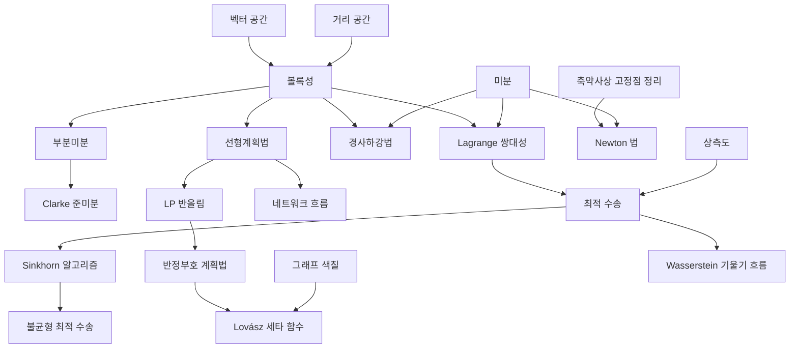

# 최적화 개관

# 개요

최적화(optimization)는 제약 아래에서 목적함수를 최소화하는 문제를 다룬다. 물음은 "국소 최적해가 전역 최적해인가, 그리고 최적해를 몇 번의 반복으로 찾는가" 이고, 답을 가르는 조건이 볼록성이다. 볼록 문제에서는 두 물음이 모두 풀리고, 볼록하지 않으면 둘 다 일반적으로 어렵다.

최적화의 갈래는 볼록성과 쌍대성의 이론, 반복법으로 해를 찾는 알고리즘, 조합 문제를 완화해 푸는 선형·반정부호 계획법, 여러 주체의 목적이 맞서는 게임과 균형, 확률분포 사이의 거리를 최소화하는 최적 수송이다. [근사 알고리즘](approximation-algorithms.md)의 복잡도 쪽은 [PCP 정리](pcp-theorem.md)(probabilistically checkable proof)와 [유일게임 추측](unique-games.md)에 있다.

시작은 [볼록성](convexity.md)이다. 거기서 [Lagrange 쌍대성](lagrange-duality.md)이 이론의 축으로, [경사하강법](gradient-descent.md)이 알고리즘의 축으로, [선형계획법](linear-programming.md)이 조합 최적화의 축으로 갈라진다.

# 지도

# 갈래

처음 읽는 사람은 볼록성과 쌍대성을 순서대로 읽는다. 그 뒤는 네 방향으로 갈린다. 반복 알고리즘은 기울기와 2 차 정보로 해를 찾고, 선형·반정부호 계획법은 조합 문제를 완화해 풀고, 게임과 균형은 여러 주체의 목적이 맞서는 문제를 다루고, 최적 수송은 확률분포 사이의 거리를 최소화한다.

## 볼록성과 쌍대성

먼저 읽을 것: [벡터 공간](vector-spaces.md)(선형대수 개관), [거리 공간](metric-spaces.md)(위상 개관), [미분](derivative.md)(해석 개관). 시작 문서: [볼록성](convexity.md).

- [볼록성](convexity.md): 볼록집합과 볼록함수, 국소 최적해가 전역 최적해가 되는 조건
  - [준볼록 함수](quasiconvex-functions.md): 수준집합만 볼록인 함수, 이분 탐색으로 푸는 최소화
- [Helly 정리](helly-theorem.md): 볼록집합 모임의 공통점을 $d+1$ 개씩의 교집합으로 판정하는 정리, Radon 분할과 Carathéodory 정리
- [다색 Carathéodory 정리](colorful-caratheodory.md): 색마다 원점을 둘러싸는 점 집합에서 하나씩 골라 원점을 둘러싸는 단체, 첫째 선택 보조정리
- [Tverberg 정리](tverberg-theorem.md): 점 $(r-1)(d+1)+1$ 개를 볼록 껍질이 공통점을 갖는 $r$ 부분으로 나누는 분할, 위상적 판본
  - [중심점 정리](centerpoint-theorem.md): 어느 닫힌 반공간이 포함하든 점을 $n/(d+1)$ 개 이상 함께 포함하게 되는 점의 존재, Tukey 깊이
- [부분미분](subdifferential.md): 꺾인 볼록 함수에서 기울기를 대신하는 집합, $0$ 이 들어 있는 것이 최적성 조건
  - [Clarke 준미분](clarke-subdifferential.md): 볼록하지 않은 Lipschitz 함수에서 기울기 극한의 볼록껍질로 세우는 준미분
- [볼록 공액](convex-conjugate.md): 함수를 받침 아핀 함수의 모임으로 바꾸는 변환, Fenchel–Moreau 정리
- [Lagrange 쌍대성](lagrange-duality.md): 제약을 쌍대변수로 옮기는 변환과 최적성 조건
  - [압축 센싱](compressed-sensing.md): 미지수보다 적은 측정에서 희소해를 복원하는 $\ell\_1$ 최소화, 제한 등거리 성질

## 반복 알고리즘

먼저 읽을 갈래: 볼록성과 쌍대성. 먼저 읽을 것: [축약사상 고정점 정리](banach-fixed-point.md)(해석 개관), [확률근사](stochastic-approximation.md)(확률 개관). 시작 문서: [경사하강법](gradient-descent.md).

- [경사하강법](gradient-descent.md): 기울기 방향의 1 차 방법과 그 수렴률
  - [선탐색](line-search.md): 하강방향의 보폭을 정하는 Armijo 와 Wolfe 조건, Zoutendijk 조건과 전역 수렴
  - [Nesterov 가속법](nesterov-acceleration.md): 직전 변위를 더해 조건수 의존을 제곱근으로 낮추는 1 차 방법
- [근접 경사법](proximal-gradient-method.md): 미분 불가능한 볼록 항을 근접 연산자로 처리하는 반복, 연성 문턱과 ISTA(iterative shrinkage-thresholding algorithm)
- [확률적 경사하강법](stochastic-gradient-descent.md): 기울기를 표본으로 추정하는 반복, 잡음 구간과 보폭 일정
  - [적응적 경사 방법](adaptive-gradient-methods.md): 좌표별 기울기 제곱의 누적으로 보폭을 나누는 AdaGrad, RMSProp, Adam
  - [분산 축소 경사법](variance-reduced-gradient-methods.md): 항별 기울기를 기억해 추정량의 분산을 없애는 SVRG(stochastic variance reduced gradient)와 SAGA
  - [Kiefer–Wolfowitz 절차](kiefer-wolfowitz.md): 함숫값만 관측할 때 차분으로 기울기를 추정하는 반복, 동시 섭동과 $t^{-1/3}$ 수렴
- [Newton 법](newton-method.md): 2 차 정보를 쓰는 국소 이차수렴
  - [신뢰영역 방법](trust-region.md): 2 차 모형을 믿을 반경 안에서 최소화하는 반복, 감소 비율로 반경을 갱신하는 전역 수렴
  - [비선형 최소제곱](nonlinear-least-squares.md): 잔차 제곱합의 최소화, Jacobian 으로 Hessian 을 근사하는 Gauss–Newton 과 감쇠를 더한 Levenberg–Marquardt
  - [준Newton 법](quasi-newton-methods.md): secant 조건으로 Hessian 근사를 갱신하는 BFGS(Broyden–Fletcher–Goldfarb–Shanno)와 그 제한 기억 판 L-BFGS, 초선형 수렴

## 선형·반정부호 계획법

먼저 읽을 갈래: 볼록성과 쌍대성. 먼저 읽을 것: [행렬식](determinants.md)(선형대수 개관), [그래프 색칠](graph-coloring.md), [매칭](matchings.md)(그래프 이론 개관). 시작 문서: [선형계획법](linear-programming.md).

- [선형계획법](linear-programming.md): 다면체 위의 선형 목적함수, 꼭짓점 최적성과 쌍대성
  - [단체법](simplex-method.md): 기저 허용해를 따라 이웃 꼭짓점으로 옮기는 피벗, 축소 비용과 비율 검사, Bland 규칙과 Klee–Minty 예
  - [타원체법](ellipsoid-method.md): 분리 초평면으로 자른 반타원체를 최소 타원체로 감싸는 반복, 부피 감소율과 선형계획법의 다항 시간, 분리와 최적화의 동치
  - [내점법](interior-point-method.md): 경계에서 발산하는 장벽을 더해 내부를 지나는 다항시간 해법
- [정수계획법](integer-programming.md): 정수 조건을 더한 선형계획, 분기한정과 절단평면
- [완전 단일모듈 행렬](totally-unimodular-matrices.md): 선형 완화가 정수해를 주는 제약행렬, Hoffman-Kruskal 정리와 Ghouila-Houri 판정
- [전체 쌍대 정수성](total-dual-integrality.md): 모든 정수 목적함수에서 쌍대 문제가 정수해를 갖는 부등식계, Edmonds–Giles 정리와 Hilbert 기저, 매칭 다면체
- [Chvátal 계수](chvatal-rank.md): 절단평면을 몇 번 반복해야 정수 껍질에 닿는지 재는 값
- [반정부호 계획법](semidefinite-programming.md): 반정부호 행렬 위의 완화와 Goemans–Williamson 알고리즘
  - [행렬 완성](matrix-completion.md): 일부만 관측된 저계수 행렬을 핵노름 최소화로 복원하는 문제, coherence 조건과 정확 복원 정리
  - [Lovász 세타 함수](lovasz-theta.md): 독립수와 채색수 사이에 끼는 반정부호 계획값
- [안정집합 다면체](stable-set-polytope.md): 안정집합 지시벡터의 볼록 껍질, 홀수 사이클 부등식과 클릭 부등식, 완벽그래프 판정과 확장 복잡도
- [매칭 다면체](matching-polytope.md): 매칭 지시벡터의 볼록 껍질, 홀수 집합 부등식과 Edmonds 의 정리, 분리 문제와 지수적 확장 복잡도
- [Sherali–Adams 계층](sherali-adams-hierarchy.md): 제약에 변수의 곱을 곱해 선형화하는 완화의 열, 단계 n 에서 정수 껍질, Lovász–Schrijver 연산과 국소 분포
- [Lasserre 계층](lasserre-hierarchy.md): 모멘트 행렬의 반정부호 조건을 더한 완화의 열, 세타 몸체와 제곱합 증명서, 단계의 하한

## 게임과 균형

먼저 읽을 갈래: 볼록성과 쌍대성. 먼저 읽을 것: [Kakutani 고정점 정리](kakutani-fixed-point.md)(위상 개관). 시작 문서: [Nash 균형](nash-equilibrium.md).

- [Nash 균형](nash-equilibrium.md): 전략형 게임의 혼합전략 균형, 고정점 논증과 minimax 값, 계산의 복잡도
  - [가격 무정부](price-of-anarchy.md): 가장 나쁜 균형의 사회적 비용과 최적 비용의 비, 아핀 지연에서 $4/3$ 유계와 Braess 역설
- [상관균형](correlated-equilibrium.md): 공통 신호를 보고 행동을 고르는 균형, 선형계획 표현과 후회 최소화의 수렴
  - [곱셈 가중치 절차](multiplicative-weights.md): 누적 손실의 지수로 가중치를 두는 온라인 절차, $O(\sqrt{T\log n})$ 후회 상한과 선형계획 근사해

## 최적 수송

먼저 읽을 갈래: 볼록성과 쌍대성. 먼저 읽을 것: [약수렴](weak-convergence.md)(확률 개관), [KL divergence](kl-divergence.md)(정보이론 개관), [Itô 적분](ito-calculus.md)(확률 개관). 시작 문서: [최적 수송](optimal-transport.md).

- [최적 수송](optimal-transport.md): 분포를 옮기는 최소 비용과 Kantorovich 쌍대성
- [Sinkhorn 알고리즘](sinkhorn.md): 엔트로피 항을 더해 행렬 스케일링으로 푼다
  - [불균형 최적 수송](unbalanced-optimal-transport.md): 질량이 보존되지 않는 경우로의 확장
- [Wasserstein 기울기 흐름](wasserstein-gradient-flow.md): 확률분포 공간 위의 기울기 흐름과 [Fokker–Planck 방정식](fokker-planck.md)

# 연관 문서

## 선수지식

- [집합](sets.md)

## 더 알아보기

- [볼록성](convexity.md)
- [Newton 법](newton-method.md)

#optimization #analysis #algorithms #overview
