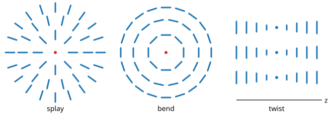

# Oseen–Frank 에너지

# 개요

**Oseen–Frank 에너지(Oseen–Frank energy)** 는 막대 모양 분자가 한 방향으로 늘어선 액정(liquid crystal)에서, 분자의 방향이 곳곳에서 달라질 때 드는 탄성 에너지다. 액정 화면의 얇은 층에서 위아래 유리판의 분자 방향을 서로 직각으로 맞추면, 그 사이의 분자들은 어떤 모양으로 방향을 바꾸며 늘어서는지가 물음이 된다. Oseen–Frank 에너지는 방향의 변화를 펼침, 비틀림, 굽힘 세 가지로 나눠 각각에 상수를 곱해 더하고, 이 에너지가 가장 작은 방향장을 평형 상태로 계산한다.

# 직관

액정의 상태를 점 $x$ 마다 분자의 방향을 나타내는 단위벡터 $n(x)$ 로 적는다. 분자는 앞뒤가 없어서 $n$ 과 $-n$ 은 같은 상태다. 모든 곳에서 $n$ 이 같으면 에너지가 $0$ 이고, $n$ 이 바뀌는 방식은 아래 그림의 세 가지로 나뉜다.

왼쪽은 펼침(splay)이다. 평면에서 $n=x/\vert x\vert$ 이면 막대가 한 점에서 퍼져 나가고, $\mathrm{div}\thinspace n=1/\vert x\vert$ 가 $0$ 이 아니다. 가운데는 굽힘(bend)이다. $n=(-x\_2,x\_1,0)/r$ 이면 막대가 원을 따라 휘고, $\mathrm{div}\thinspace n=0$ 이지만 $n\times\mathrm{curl}\thinspace n$ 의 크기가 $1/r$ 이다.

오른쪽은 비틀림(twist)이다. $n=(\cos qz,\sin qz,0)$ 이면 $z$ 축을 따라 막대가 축에 수직인 평면에서 돈다. 계산하면 $\mathrm{div}\thinspace n=0$ 이고 $\mathrm{curl}\thinspace n=-qn$ 이라 $n\cdot\mathrm{curl}\thinspace n=-q$ 다. 세 양 $\mathrm{div}\thinspace n$, $n\cdot\mathrm{curl}\thinspace n$, $n\times\mathrm{curl}\thinspace n$ 이 세 가지 변형을 하나씩 잰다.

# 정의

열린집합 $\Omega\subset\mathbb R^3$ 에서 $S^2$ 로 가는 방향장 $n$ 의 Oseen–Frank 에너지는 다음이다.

$$
F(n)=\frac12\int\_\Omega\Bigl(K\_1(\mathrm{div}\thinspace n)^2+K\_2(n\cdot\mathrm{curl}\thinspace n)^2+K\_3\vert n\times\mathrm{curl}\thinspace n\vert^2\Bigr)dx
$$

양의 상수 $K\_1$, $K\_2$, $K\_3$ 을 **Frank 탄성 상수(Frank elastic constants)** 라 하고, 차례로 펼침, 비틀림, 굽힘의 상수다. 직관 절의 비틀림 예에서 피적분 함수는 $K\_2q^2$ 이고, 굽힘 예에서는 $K\_3/r^2$ 이다.

이 에너지는 $n$ 을 $-n$ 으로 바꾸어도, 공간과 $n$ 을 함께 돌려도 변하지 않는다. F. C. Frank 는 이 두 조건을 만족하고 $\nabla n$ 에 대해 2 차인 에너지가 경계 항을 빼면 이 꼴뿐임을 보였다[^1].

# 성질

## 한 상수 근사

$K\_1=K\_2=K\_3=K$ 이면 단위벡터 $n$ 에 대해 다음 항등식이 성립한다.

$$
\vert\nabla n\vert^2=(\mathrm{div}\thinspace n)^2+(n\cdot\mathrm{curl}\thinspace n)^2+\vert n\times\mathrm{curl}\thinspace n\vert^2+\mathrm{div}\bigl((n\cdot\nabla)n-(\mathrm{div}\thinspace n)n\bigr)
$$

마지막 항은 발산이라 적분하면 경계값만으로 정해진다. 그러므로 경계값을 고정하면 $F(n)$ 의 최소화는 Dirichlet 에너지 $\int\_\Omega\vert\nabla n\vert^2dx$ 의 최소화와 같고, 최소점은 $S^2$ 로 가는 조화사상이다. [Schoen–Uhlenbeck 정칙성 정리](schoen-uhlenbeck-theorem.md)가 이 경우의 최소점의 특이점이 고립된 점임을 준다.

## 점 결함

평면의 원판 $\varepsilon\lt\vert x\vert\lt R$ 에서 펼침 예 $n=x/\vert x\vert$ 는 $\vert\nabla n\vert^2=1/\vert x\vert^2$ 이므로 에너지가 $2\pi\log(R/\varepsilon)$ 이고, $\varepsilon\to 0$ 에서 무한대로 간다. 평면에서 방향이 평면 안에만 있으면 점 결함은 유한한 에너지로 생기지 않는다.

공간의 공 $\vert x\vert\lt R$ 에서 $n=x/\vert x\vert$ 는 $\vert\nabla n\vert^2=2/\vert x\vert^2$ 이고 에너지가 $8\pi R$ 로 유한하다. 3 차원에서는 점 결함이 평형 상태에 나타날 수 있다. 원기둥 안의 방향장이 축에서 결함을 만드는 대신 축 방향으로 일어서는 현상도 평면에서 생기는 무한한 에너지를 피하는 것이다.

## 존재와 부분 정칙성

$K\_1$, $K\_2$, $K\_3$ 이 양수이면 경계값을 고정한 $H^1(\Omega,S^2)$ 에서 $F$ 의 최소점이 [변분법의 직접법](direct-method.md)으로 존재한다. R. Hardt, D. Kinderlehrer, F.-H. Lin 은 상수가 서로 달라도 최소점이 닫힌 집합 밖에서 해석적이고, 그 집합의 1 차원 Hausdorff 측도가 $0$ 임을 증명했다[^2].

# 활용

- 비틀린 네마틱 화면. 두 유리판 사이 두께 $d$ 의 층에서 위아래 방향을 직각으로 맞추면, 비틀림 예에서 $q=\pi/(2d)$ 인 방향장이 평형이고 에너지 밀도는 $K\_2q^2/2$ 다. 전압을 걸면 이 비틀림이 풀리며 빛의 투과가 바뀐다.
- Fréedericksz 전이(Fréedericksz transition). 판에 나란히 놓인 분자 층에 수직으로 전기장을 걸면, 전기장이 문턱을 넘을 때 비로소 분자가 기운다. 펼침 배치에서 문턱은 $\pi/d$ 에 $K\_1$ 의 제곱근을 곱한 크기에 비례하고, 이 측정으로 Frank 상수를 구한다.
- 결함의 분류. 3 차원 점 결함은 경계값 둘레의 [Brouwer 차수](brouwer-degree.md)로 분류되고, 한 상수 근사에서 차수 $\pm 1$ 의 최소 결함은 $\pm x/\vert x\vert$ 를 돌린 것이다.

[^1]: F. C. Frank, "On the theory of liquid crystals", *Discussions of the Faraday Society* 25 (1958), 19–28.
[^2]: R. Hardt, D. Kinderlehrer, F.-H. Lin, "Existence and partial regularity of static liquid crystal configurations", *Communications in Mathematical Physics* 105 (1986), 547–570.

# 연관 문서

## 선수지식

- [Schoen–Uhlenbeck 정칙성 정리](schoen-uhlenbeck-theorem.md)

## 더 알아보기

아직 연결한 문서가 없다.

#analysis #differential_geometry
