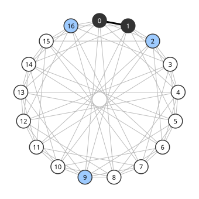

# Paley 그래프

# 개요

**Paley 그래프(Paley graph)** 는 유한체의 원소를 정점으로 두고 차가 제곱수인 두 원소를 이은 [그래프](graphs.md)다. 정점 $17$ 개의 그래프에서 서로 모두 이웃한 네 정점도, 서로 모두 이웃하지 않은 네 정점도 없게 하려면 간선을 어떻게 골라야 하는지 묻는 문제가 있다. $17$ 로 나눈 나머지에서 차가 제곱수인 쌍을 이으면 그런 그래프가 되고, 그래프의 대칭이 커서 간선 하나만 확인하면 된다.

# 직관

[Ramsey 이론](ramsey-theory.md)의 $R(4,4)=18$ 은 정점 $18$ 개의 그래프에는 서로 모두 이웃한 네 정점이나 서로 모두 이웃하지 않은 네 정점이 반드시 있다는 것이고, 정점 $17$ 개에서는 둘 다 없는 그래프가 있다는 것이다. 그런 그래프를 하나 만든다. $0$ 이 아닌 수의 제곱을 $17$ 로 나눈 나머지는 $1,2,4,8,9,13,15,16$ 의 여덟 개다. 정점 $0,1,\dots,16$ 에서 차가 이 여덟 수 가운데 하나인 두 정점을 잇는다. $-1=16$ 이 제곱수라 $a-b$ 와 $b-a$ 가 함께 제곱수이거나 함께 아니므로 이 관계는 대칭이다.

네 정점짜리 부분집합은 $2380$ 개라 하나씩 확인하기 어렵다. 대신 제곱수 $s$ 와 임의의 $t$ 에 대해 $x\mapsto sx+t$ 는 차에 제곱수를 곱할 뿐이므로 이웃 관계를 보존한다.

이웃한 $y,z$ 에 대해 $s=z-y$, $t=y$ 로 두면 $0,1$ 이 $y,z$ 로 가므로, 서로 이웃한 네 정점이 있으면 $0$ 과 $1$ 을 포함하는 것도 있다. 그림에서 $0$ 과 $1$ 의 공통 이웃은 $x$ 와 $x-1$ 이 둘 다 제곱수인 $x$, 곧 $2,9,16$ 이다. 이 셋의 차 $7,14,7$ 은 제곱수가 아니므로 셋 가운데 이웃한 쌍이 없고, 서로 이웃한 네 정점은 없다.

$3$ 은 제곱수가 아니다. $x\mapsto 3x$ 는 차가 제곱수인 쌍을 차가 제곱수가 아닌 쌍으로 보내므로, 이 그래프를 이웃 관계를 뒤집은 그래프로 옮긴다. 따라서 서로 이웃하지 않은 네 정점도 없다.

# 정의

$q$ 가 $4$ 로 나눈 나머지가 $1$ 인 [소수](primes.md)의 거듭제곱이고 $\mathbb F_q$ 가 위수 $q$ 의 [유한체](finite-fields.md)라 하자. $\mathbb F_q$ 의 원소를 정점으로 두고 $x-y$ 가 $0$ 이 아닌 제곱수인 $x\ne y$ 를 이은 그래프를 **Paley 그래프** 라 하고 $P_q$ 로 적는다[^1]. $q\equiv 1\pmod 4$ 이면 $-1$ 이 제곱수이므로 이웃 관계가 대칭이다. 직관 절의 그래프는 $P\_{17}$ 이다.

- $P_5$ 는 $1,4$ 가 제곱수이므로 차가 $\pm 1$ 인 쌍을 이은 오각형이다.
- $P_9$ 는 $\mathbb F_9=\mathbb F_3\lbrack i\rbrack$ ($i^2=-1$) 에서 $0$ 이 아닌 제곱수가 $\pm 1,\pm i$ 이므로, $a+bi$ 를 $3\times 3$ 격자의 칸 $(a,b)$ 로 놓으면 같은 행이나 같은 열의 두 칸을 이은 그래프다.

그래프와 그 여그래프(complement)가 동형이면 자기 여그래프(self-complementary)라 한다. 직관 절의 $x\mapsto 3x$ 처럼 제곱수가 아닌 $n$ 을 곱하는 사상이 $P_q$ 에서 여그래프로 가는 동형사상이므로 $P_q$ 는 자기 여그래프다.

# 성질

## 강정칙성과 고윳값

$P_q$ 는 매개변수 $(q,(q-1)/2,(q-5)/4,(q-1)/4)$ 의 [강정칙 그래프](strongly-regular-graphs.md)이고 회의 그래프다[^1]. 정점마다 이웃이 제곱수 $(q-1)/2$ 개다. $x\mapsto sx+t$ 가 이웃한 쌍을 이웃한 쌍으로 옮기고 어느 이웃한 쌍이든 $0,1$ 에서 옮겨 오므로, 이웃한 쌍의 공통 이웃 수 $\lambda$ 가 하나로 정해진다. $x\mapsto nx$ 가 이웃한 쌍과 이웃하지 않은 쌍을 맞바꾸므로 이웃하지 않은 쌍의 공통 이웃 수 $\mu$ 도 하나로 정해진다.

강정칙 그래프의 매개변수 관계 $k(k-\lambda-1)=(v-k-1)\mu$ 에서 $v-k-1=k$ 이므로 $\lambda+\mu=k-1$ 이고, 자기 여그래프이므로 여그래프의 $\lambda$ 인 $v-2k+\mu-2=\mu-1$ 이 $\lambda$ 와 같다. 두 식에서 $\lambda=(q-5)/4$, $\mu=(q-1)/4$ 다.

$P\_{17}$ 에서는 $\lambda=3$ 이고 직관 절의 $2,9,16$ 이 그 셋이다.

인접행렬의 [고윳값](eigenvalues.md)은 $(q-1)/2$ 와 $(-1\pm\sqrt q)/2$ 다. 덧셈 지표 $\psi$ 를 성분으로 하는 벡터 $(\psi(x))\_x$ 가 고유벡터이고, $\psi\ne 1$ 이면 고윳값은 $\sum\_{s\text{ 제곱수}}\psi(s)=(G(\psi)-1)/2$ 다. $G(\psi)=\sum_x\psi(x^2)$ 는 [Gauss 합](gauss-sums.md)이고 $q\equiv 1\pmod 4$ 에서 $G(\psi)=\pm\sqrt q$ 다.

## 클릭 수의 상한

$P_q$ 의 서로 모두 이웃한 정점 집합의 최대 크기, 곧 클릭 수(clique number) $\omega$ 는

$$
\omega(P_q)\le\sqrt q
$$

를 만족한다. 정점 추이적인 그래프, 곧 어느 정점이든 어느 정점으로 옮기는 동형사상이 있는 그래프에서는 클릭 $K$ 와 독립집합 $I$ 에 대해 $\lvert K\rvert\thinspace\lvert I\rvert\le q$ 다. 자기 여그래프이므로 독립집합의 최대 크기도 $\omega$ 이고, $\omega^2\le q$ 다. $q=p^2$ 이면 $\mathbb F_p$ 의 원소는 모두 $\mathbb F\_{p^2}$ 의 제곱수이므로 $\mathbb F_p$ 가 크기 $p=\sqrt q$ 의 클릭이고 등호가 성립한다. $q$ 가 소수이면 $\omega(P_q)\le(\sqrt{2q-1}+1)/2$ 다[^2].

## 간선의 고른 분포

정점 집합 $X,Y$ 에 대해 $x\in X$, $y\in Y$ 가 이웃한 순서쌍 $(x,y)$ 의 수 $e(X,Y)$ 는

$$
\left\lvert e(X,Y)-\frac{q-1}{2q}\lvert X\rvert\thinspace\lvert Y\rvert\right\rvert\le\frac{1+\sqrt q}{2}\sqrt{\lvert X\rvert\thinspace\lvert Y\rvert}
$$

를 만족한다. $X$ 와 $Y$ 의 지시벡터를 고유벡터로 전개하고 $(q-1)/2$ 가 아닌 고윳값의 절댓값이 $(1+\sqrt q)/2$ 이하인 것을 쓴다. 이 부등식은 [Expander 그래프](expander-graphs.md) 문서의 혼합 보조정리(expander mixing lemma)의 경우다. 크기가 $\sqrt q$ 보다 충분히 큰 집합들 사이에서는 간선이 무작위 그래프처럼 절반쯤 있다.

# 활용

- Ramsey 수의 하한. $P\_{17}$ 에서 $R(4,4)\ge 18$ 이고, $P_5$ 에서 $R(3,3)\ge 6$ 이다. 일반적인 $P_q$ 는 클릭 수의 상한에서 $t\gt\sqrt q$ 일 때 $R(t,t)\gt q$ 를 준다. 이 하한은 $t$ 의 이차식이어서 무작위 그래프가 주는 하한 $2^{t/2}$ 보다 작다.
- 회의 행렬과 [Hadamard 행렬](hadamard-matrices.md). 이웃이면 $1$, 이웃이 아니면 $-1$ 인 [행렬](matrices.md)에 둘레를 붙인 것이 [회의 행렬](conference-matrices.md) 문서의 Paley 구성이다.
- 준무작위 그래프(quasirandom graph). 간선의 고른 분포 절의 부등식 때문에 Paley 그래프는 무작위 그래프가 거의 확실하게 갖는 성질들을 결정적으로 갖는 그래프의 표준 예로 쓰인다.

[^1]: C. Godsil, G. Royle, *Algebraic Graph Theory*, Graduate Texts in Mathematics 207, Springer, 2001. 10.3 절.
[^2]: B. Hanson, G. Petridis, "Refined estimates concerning sumsets contained in the roots of unity", *Proceedings of the London Mathematical Society* 122 (2021), 353–358.

# 연관 문서

## 선수지식

- [강정칙 그래프](strongly-regular-graphs.md)
- [Ramsey 이론](ramsey-theory.md)

## 더 알아보기

아직 연결한 문서가 없다.

#graph_theory #number_theory #combinatorics
