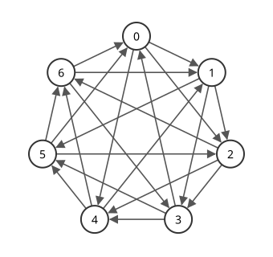

# Paley 토너먼트

# 개요

**Paley 토너먼트(Paley tournament)** 는 유한체의 원소를 선수로 두고, 차가 제곱수인 방향으로 승패를 정한 [토너먼트](tournaments.md)다. 일곱 팀이 서로 한 번씩 경기한 리그에서 어느 두 팀을 골라도 그 둘을 모두 이긴 셋째 팀이 있게 결과를 정할 수 있는지 묻는다. 일곱 팀을 $0,\dots,6$ 으로 두고 $j-i$ 를 $7$ 로 나눈 나머지가 $1,2,4$ 이면 $i$ 가 $j$ 를 이긴다고 정하면 그런 리그가 되고, 이 규칙을 일반 유한체로 넓힌 것이 Paley 토너먼트다.

# 직관

일곱 팀 $0,1,\dots,6$ 의 리그에서 $j-i$ 를 $7$ 로 나눈 나머지가 $1,2,4$ 가운데 하나이면 $i$ 가 $j$ 를 이긴다고 정한다. $i-j$ 의 나머지는 $7$ 에서 그 수를 뺀 $6,5,3$ 이므로, 두 팀 가운데 정확히 한 팀이 이긴다. 아래 그림에서 화살표는 이긴 팀에서 진 팀으로 간다.

두 팀 $0$ 과 $1$ 을 모두 이긴 팀을 찾는다. 팀 $6$ 은 $0-6$ 의 나머지가 $1$, $1-6$ 의 나머지가 $2$ 이므로 둘을 모두 이긴다. 그림에서 $6$ 에서 $0$ 과 $1$ 로 화살표가 나간다.

다른 두 팀은 $0,1$ 을 옮겨서 얻는다. $i$ 가 $j$ 를 이기고 $s=j-i$ 라 하면 $x\mapsto sx+i$ 는 $0,1$ 을 $i,j$ 로 보낸다. $s$ 는 $1,2,4$ 가운데 하나이고 $1,2,4$ 끼리 곱한 나머지도 $1,2,4$ 가운데 하나이므로, 이 사상은 승패를 보존한다. 그래서 $6s+i$ 가 $i$ 와 $j$ 를 모두 이긴다.

$1,2,4$ 는 $7$ 로 나눈 나머지에서 $0$ 아닌 제곱수 $1^2,3^2,2^2$ 이다. 차가 제곱수인 두 원소를 고르는 규칙은 [Paley 그래프](paley-graphs.md)와 같고, $7$ 에서는 $-1$ 이 제곱수가 아니라서 방향이 정해진다.

# 정의

$q$ 는 $4$ 로 나눈 나머지가 $3$ 인 소수의 거듭제곱이고 $\mathbb F\_q$ 는 원소가 $q$ 개인 [유한체](finite-fields.md)다. $\mathbb F\_q$ 의 $0$ 아닌 원소 가운데 절반 $(q-1)/2$ 개가 제곱수다.

$\mathbb F\_q$ 의 원소를 정점으로 두고, $y-x$ 가 $0$ 아닌 제곱수일 때 $x\to y$ 로 둔 방향 그래프를 Paley 토너먼트 $T_q$ 라 한다[^1]. $q\equiv 3\pmod 4$ 이면 $-1$ 이 제곱수가 아니므로 $y-x$ 와 $x-y$ 가운데 정확히 하나가 제곱수이고, $T_q$ 는 토너먼트다.

- $T_3$ 은 제곱수가 $1$ 뿐이므로 $0\to 1\to 2\to 0$ 의 세 정점 순환이다.
- $T_7$ 은 직관 절의 리그다.

$\chi(a)$ 를 $a$ 가 $0$ 아닌 제곱수이면 $1$, 제곱수가 아니면 $-1$, $a=0$ 이면 $0$ 으로 정하면 $x\to y$ 는 $\chi(y-x)=1$ 과 같다. $\chi$ 를 이차 지표(quadratic character)라 한다.

# 성질

## 대칭

$a$ 가 $0$ 아닌 제곱수이면 $x\mapsto ax+b$ 는 $T_q$ 의 자기동형이다. 제곱수끼리의 곱이 제곱수이기 때문이다. 직관 절처럼 이 사상들은 화살표 $0\to 1$ 을 어느 화살표 $x\to y$ 로도 보내므로, $T_q$ 의 모든 화살표는 서로 옮겨진다.

## 정칙성과 이중 정칙성

$T_q$ 의 정점은 모두 $(q-1)/2$ 팀을 이기고 $(q-1)/2$ 팀에 진다. 모든 정점의 점수가 같은 토너먼트를 정칙 토너먼트(regular tournament)라 한다.

서로 다른 두 정점이 함께 이기는 정점의 수가 두 정점에 상관없이 일정한 토너먼트를 **이중 정칙 토너먼트(doubly regular tournament)** 라 한다. $T_q$ 는 이중 정칙이고 그 수는 $(q-3)/4$ 다[^1]. 대칭 절로 그 수는 일정하고, 정점 $w$ 마다 $w$ 를 이긴 $(q-1)/2$ 팀에서 두 팀을 고르는 쌍을 세면 다음이 나온다.

$$
\frac{q\binom{(q-1)/2}{2}}{\binom q2}=\frac{q-3}{4}
$$

같은 셈을 $w$ 가 이긴 팀에 하면, 두 정점을 함께 이기는 정점의 수도 $(q-3)/4$ 다. $T_7$ 에서는 $1$ 이고, $0$ 과 $1$ 을 함께 이기는 팀은 $6$ 뿐이며 $0$ 과 $1$ 이 함께 이기는 팀은 $2$ 뿐이다.

## 모든 k 팀을 이기는 팀

어느 $k$ 팀을 골라도 그들을 모두 이긴 팀이 있는 토너먼트를 성질 $S_k$ 를 갖는다고 한다. Schütte 가 $S_k$ 를 갖는 토너먼트가 있는지 물었고, Erdős 가 정점이 충분히 많은 무작위 토너먼트에서 $S_k$ 가 성립할 확률이 $1$ 에 가까움을 보였다[^2]. $T_7$ 은 $S_2$ 를 갖고, 정점이 $7$ 개보다 적은 토너먼트에는 $S_2$ 가 없다[^3].

**정리(Graham–Spencer).** $q\gt k^24^k$ 이면 $T_q$ 는 $S_k$ 를 갖는다[^4].

*증명의 요지.* $a_1,\dots,a_k$ 를 모두 이기는 $x$ 의 개수는 $x\ne a_i$ 에서 다음 합이다.

$$
N=\sum_x\prod_{i=1}^k\frac{1+\chi(a_i-x)}{2}
$$

곱을 전개하면 첫 항이 $q/2^k$ 정도이고, 나머지 항은 $\chi$ 를 서로 다른 일차식의 곱에 넣은 합이다. 그 합은 [Weil 지표합 한계](weil-character-sum-bound.md)로 $(k-1)\sqrt q$ 이하이므로, $q\gt k^24^k$ 에서 $N\gt 0$ 이다.

## 반대칭 Hadamard 행렬

$T_q$ 의 화살표 $x\to y$ 에 $1$, $y\to x$ 에 $-1$ 을 놓은 행렬 $Q$ 는 성분이 $\chi(y-x)$ 인 반대칭행렬이다. 여기에 행과 열을 하나씩 붙인 행렬이 [Hadamard 행렬](hadamard-matrices.md)의 Paley 구성이고, $I$ 를 더하면 차수 $q+1$ 의 반대칭 Hadamard 행렬(skew Hadamard matrix)이 된다.

정점 $4t-1$ 개의 이중 정칙 토너먼트와 차수 $4t$ 의 반대칭 Hadamard 행렬은 이렇게 서로 대응한다[^5]. Paley 토너먼트는 $4t-1$ 이 소수 거듭제곱일 때의 이중 정칙 토너먼트를 준다.

# 활용

- [준무작위 그래프](quasirandom-graphs.md)의 토너먼트판. 어느 정점 집합에서나 화살표가 거의 고르게 나뉘는 토너먼트를 준무작위 토너먼트라 하고, Paley 토너먼트가 그 명시적인 예다[^6].
- [Rosenfeld 추측](rosenfeld-conjecture.md). 정점 $n$ 개의 토너먼트가 방향을 정한 정점 $n$ 개의 경로를 모두 포함한다는 정리의 예외 셋 가운데 하나가 $T_7$ 이다.
- [Hadamard 행렬](hadamard-matrices.md). $q\equiv 3\pmod 4$ 인 소수 거듭제곱 $q$ 마다 Paley 토너먼트가 차수 $q+1$ 의 반대칭 Hadamard 행렬을 준다.

[^1]: J. W. Moon, *Topics on Tournaments*, Holt, Rinehart and Winston, 1968.
[^2]: P. Erdős, "On a problem in graph theory", *The Mathematical Gazette* 47 (1963), 220–223.
[^3]: E. Szekeres, G. Szekeres, "On a problem of Schütte and Erdős", *The Mathematical Gazette* 49 (1965), 290–293.
[^4]: R. L. Graham, J. H. Spencer, "A constructive solution to a tournament problem", *Canadian Mathematical Bulletin* 14 (1971), 45–48.
[^5]: K. B. Reid, E. Brown, "Doubly regular tournaments are equivalent to skew Hadamard matrices", *Journal of Combinatorial Theory, Series A* 12 (1972), 332–338.
[^6]: F. R. K. Chung, R. L. Graham, "Quasi-random tournaments", *Journal of Graph Theory* 15 (1991), 173–198.

# 연관 문서

## 선수지식

- [토너먼트](tournaments.md)
- [Paley 그래프](paley-graphs.md)

## 더 알아보기

아직 연결한 문서가 없다.

#graph_theory #combinatorics #number_theory
