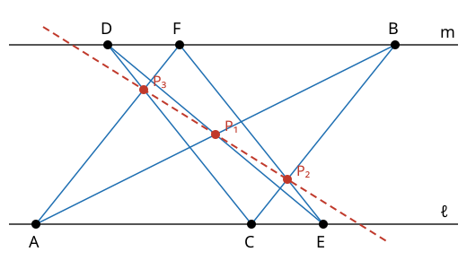

# Pappus 정리

# 개요

**Pappus 정리(Pappus's hexagon theorem)** 는 두 직선 위에 점을 세 개씩 찍고 엇갈려 이은 직선들이 만나는 세 점이 한 직선 위에 있다는 정리다. 공책의 두 줄 위에 점을 세 개씩 찍고 자로 위아래 점을 엇갈려 이으면 교점이 세 개 생기는데, 점을 어디에 찍어도 이 세 교점은 일직선에 놓인다. 이 진술에는 자로 긋는 직선만 나오므로 점과 직선만으로 정의된 평면에서도 참인지 물을 수 있고, 그 답으로 그 평면의 좌표에서 곱셈의 순서를 바꿔도 되는지 판정한다.

# 직관

직선 $\ell$ 을 $y=0$, 직선 $m$ 을 $y=2$ 로 둔다. $\ell$ 위에 $A=(0,0)$, $C=(3,0)$, $E=(4,0)$ 을, $m$ 위에 $B=(5,2)$, $D=(1,2)$, $F=(2,2)$ 를 찍는다. 점을 $A,B,C,D,E,F$ 순서로 이으면 두 직선을 오가는 변 여섯 개가 생긴다.

마주 보는 변은 $AB$ 와 $DE$, $BC$ 와 $EF$, $CD$ 와 $FA$ 다. 각 쌍의 직선과 교점은 다음과 같다.

| 변의 쌍    | 두 직선                          | 교점          |
| ---------- | -------------------------------- | ------------- |
| $AB$, $DE$ | $5y=2x$, $3y=8-2x$               | $(2.5,\thinspace 1)$   |
| $BC$, $EF$ | $y=x-3$, $y=4-x$                 | $(3.5,\thinspace 0.5)$ |
| $CD$, $FA$ | $y=3-x$, $y=x$                   | $(1.5,\thinspace 1.5)$ |

세 교점은 모두 직선 $2x+4y=9$ 위에 있다. 아래 그림에서 검은 점이 처음 찍은 여섯 점이고, 빨간 점 세 개가 교점이며, 빨간 점선이 세 교점을 지나는 직선이다.

[Pascal 정리](pascal-theorem.md)는 원뿔곡선 위의 여섯 점에 대해 같은 결론을 준다. 원뿔곡선 자리에 두 직선 $\ell$, $m$ 을 놓은 것이 이 그림이다.

# 정의

## Pappus 배치

직관 절의 그림에는 점 아홉 개 $A,B,C,D,E,F,P\_1,P\_2,P\_3$ 과 직선 아홉 개가 있다. 직선은 $\ell$, $m$, 변 여섯 개, 그리고 세 교점을 지나는 점선이다. 직선마다 아홉 점 가운데 세 개가 있고, 점마다 아홉 직선 가운데 세 개가 지난다. $\ell$ 위에는 $A,C,E$ 가, $AB$ 위에는 $A,B,P\_1$ 이 있고, $A$ 를 지나는 직선은 $\ell$, $AB$, $FA$ 다.

이렇게 점 아홉 개와 직선 아홉 개가 서로 셋씩 걸린 결합 구조를 **Pappus 배치(Pappus configuration)** 라 한다. Pappus 정리는 이 배치의 직선 여덟 개가 그려지면 아홉째 직선, 곧 세 교점을 지나는 직선도 있다는 진술이다.

## 나눗셈환 위의 사영평면

**나눗셈환(division ring)** 은 $0$ 이 아닌 원소마다 곱셈 역원이 있는 환이다. 곱셈의 교환법칙은 요구하지 않는다. [사원수](quaternion-algebras.md) $\mathbb H$ 가 그 예이고 $ij=k$, $ji=-k$ 다.

나눗셈환 $D$ 에 대해 $D^3$ 의 1차원 부분공간을 점, 2차원 부분공간을 직선으로 삼은 결합 구조를 $\mathrm{PG}(2,D)$ 라 한다. [유한 사영평면](finite-projective-planes.md)의 $\mathrm{PG}(2,q)$ 는 $D$ 가 유한체 $\mathbb F\_q$ 인 경우다. $\mathrm{PG}(2,D)$ 는 사영평면의 세 공리를 만족한다.

사영평면에서 Pappus 배치의 직선 여덟 개가 그려질 때마다 아홉째 직선이 있으면 그 평면을 **Pappus 평면(Pappian plane)** 이라 한다.

# 성질

## Pappus 정리

정리. 실수나 복소수 위의 사영평면에서 서로 다른 두 직선 $\ell$, $m$ 위에 교점 $\ell\cap m$ 이 아닌 점 $A,C,E\in\ell$ 와 $B,D,F\in m$ 이 있으면 $P\_1=AB\cap DE$, $P\_2=BC\cap EF$, $P\_3=CD\cap FA$ 는 한 직선 위에 있다[^1].

증명의 요지. 원뿔곡선을 $Q=\ell\cdot m$ 으로 둔 Pascal 정리의 논법이다. 삼차곡선 $AB\cdot CD\cdot EF$ 와 $BC\cdot DE\cdot FA$ 는 여섯 점과 $P\_1,P\_2,P\_3$ 에서 만난다. $P\_1$ 과 $P\_2$ 를 지나는 직선 $L$ 에 대해 삼차곡선 $\ell\cdot m\cdot L$ 은 아홉 점 가운데 여덟 점을 지나므로, [Cayley–Bacharach 정리](cayley-bacharach-theorem.md)로 $P\_3$ 도 지난다.

$P\_3$ 이 $\ell$ 위에 있으면 직선 $CD$ 와 $\ell$ 의 교점은 $C$, 직선 $FA$ 와 $\ell$ 의 교점은 $A$ 이므로 $C=A$ 가 되어 어긋난다. 같은 이유로 $P\_3$ 은 $m$ 위에도 없으므로 $L$ 위에 있다.

## 곱셈의 교환법칙과의 동치

정리. $\mathrm{PG}(2,D)$ 가 Pappus 평면인 것과 $D$ 의 곱셈이 교환법칙을 만족하는 것은 동치다[^2].

증명의 요지. 사영변환으로 직선 $P\_1P\_2$ 를 무한원직선으로, $\ell$ 과 $m$ 을 두 좌표축으로 보낸다. 그러면 결론은 "$AB\parallel DE$ 이고 $BC\parallel EF$ 이면 $CD\parallel FA$" 가 된다. 직선을 $y=xs+t$ 꼴로 쓰면, $x$ 축의 점 $(u,0)$ 과 $y$ 축의 점 $(0,v)$ 를 이은 직선에 평행하고 $(u',0)$ 을 지나는 직선은 $y$ 축과 $(0,\thinspace u'u^{-1}v)$ 에서 만난다.

$A=(a,0)$, $C=(c,0)$, $E=(e,0)$, $B=(0,b)$ 로 두면 두 평행 조건에서 $D=(0,\thinspace ea^{-1}b)$, $F=(0,\thinspace ec^{-1}b)$ 가 정해진다. 결론 $CD\parallel FA$ 는 $ec^{-1}b=ac^{-1}ea^{-1}b$ 와 같다.

$D$ 가 가환이면 양변이 같다. $c=b=1$ 로 두면 조건은 $e=aea^{-1}$, 곧 $ea=ae$ 다. 사원수에서 $a=i$, $e=j$ 를 잡으면 $ea=-k\ne k=ae$ 이므로 $\mathrm{PG}(2,\mathbb H)$ 에서는 Pappus 배치의 아홉째 직선이 없다.

## Hessenberg 정리

정리. Pappus 평면에서는 Desargues 정리(Desargues's theorem)가 성립한다. 이것을 Hessenberg 정리(Hessenberg's theorem)라 한다[^3].

유한 사영평면 문서의 좌표화 정리에 따라 Desargues 정리가 성립하는 평면은 어떤 나눗셈환 $D$ 의 $\mathrm{PG}(2,D)$ 다. 위의 동치와 합치면 Pappus 평면은 체 $F$ 위의 $\mathrm{PG}(2,F)$ 와 동형인 평면이다.

유한 나눗셈환은 체이므로(Wedderburn 정리, Wedderburn's little theorem), 유한 사영평면에서는 Desargues 정리와 Pappus 정리가 동치다. 무한 평면에서는 $\mathrm{PG}(2,\mathbb H)$ 가 Desargues 정리는 만족하고 Pappus 정리는 만족하지 않는다.

## 쌍대

Pappus 배치에서 점과 직선을 맞바꾸면 점 아홉 개와 직선 아홉 개가 셋씩 걸린 구조가 다시 나오고, 이것도 Pappus 배치다[^1]. 그래서 Pappus 평면의 쌍대 평면도 Pappus 평면이다.

# 활용

- 사영평면의 좌표화. 점과 직선의 결합 공리에 Pappus 정리를 공리로 더하면 그 평면은 체 위의 $\mathrm{PG}(2,F)$ 가 된다. Hilbert 는 선분의 곱을 작도로 정의하고 그 곱의 교환법칙을 Pappus 정리로 증명했다[^2].
- [유한 사영평면](finite-projective-planes.md). 차수 $9$ 인 비데자르그 평면 셋은 Hessenberg 정리에 따라 Pappus 평면도 아니다. 체 위의 평면 $\mathrm{PG}(2,q)$ 는 Pappus 평면이다.

[^1]: H. S. M. Coxeter, *Projective Geometry*, 2판, Springer, 1987.
[^2]: D. Hilbert, *Grundlagen der Geometrie*, Teubner, 1899, 6 장.
[^3]: G. Hessenberg, "Beweis des Desarguesschen Satzes aus dem Pascalschen", *Mathematische Annalen* 61 (1905), 161–172.

# 연관 문서

## 선수지식

- [유한 사영평면](finite-projective-planes.md)
- [Pascal 정리](pascal-theorem.md)

## 더 알아보기

아직 연결한 문서가 없다.

#algebra #combinatorics #field_theory
