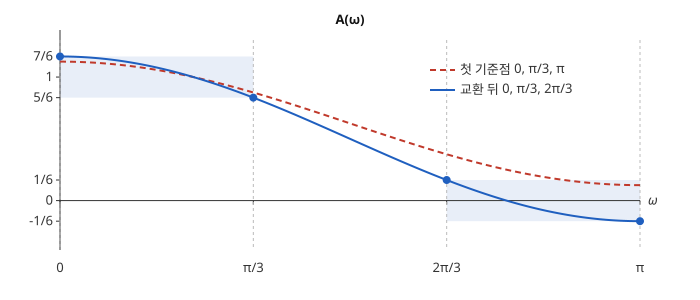

# Parks–McClellan 알고리즘

# 개요

**Parks–McClellan 알고리즘(Parks–McClellan algorithm)** 은 통과시킬 주파수와 지울 주파수에서 원하는 응답과의 최대 오차가 가장 작은 대칭 [FIR 필터](fir-filters.md)(finite impulse response filter)의 계수를 찾는 반복법이다. 계수 3 개로 주파수 $0$ 부터 $\pi/3$ 까지는 그대로 두고 $2\pi/3$ 부터 $\pi$ 까지는 지우려 하면, 오차를 어느 주파수에서도 $1/6$ 이하로 할 수 있고 그보다 작게는 할 수 없다. 이 알고리즘은 오차가 같은 크기로 부호를 바꾸는 주파수들을 골라 연립방정식을 풀고, 더 큰 오차가 나온 주파수로 고른 점을 바꾸기를 되풀이한다.

# 직관

대칭 계수 $(b_0,b_1,b_0)$ 의 FIR 필터는 지연 한 칸을 빼면 주파수 응답이

$$
A(\omega)=b_1+2b_0\cos\omega
$$

다. $A$ 가 $\lbrack 0,\pi/3\rbrack$ 에서 $1$ 에, $\lbrack 2\pi/3,\pi\rbrack$ 에서 $0$ 에 가깝기를 바란다. 사이의 $(\pi/3,2\pi/3)$ 에는 요구가 없다. 미지수는 $b_0,b_1$ 둘이다.

주파수 세 개를 골라 그 자리에서 오차가 같은 크기 $\delta$ 로 부호를 바꾸게 한다. 처음에 $0,\pi/3,\pi$ 를 고르면

$$
A(0)-1=\delta,\qquad A(\pi/3)-1=-\delta,\qquad A(\pi)-0=\delta
$$

이다. $A(0)=b_1+2b_0$, $A(\pi/3)=b_1+b_0$, $A(\pi)=b_1-2b_0$ 을 넣어 풀면 $\delta=1/8$, $A(\omega)=\frac58+\frac12\cos\omega$ 다. 그런데 고르지 않은 $2\pi/3$ 에서 $A=\frac58-\frac14=\frac38$ 이라 오차가 $3/8$ 로 $\delta$ 보다 크다.

오차가 가장 큰 $2\pi/3$ 를 넣고 그와 부호가 같은 $\pi$ 를 뺀다. $0,\pi/3,2\pi/3$ 에서 같은 연립방정식을 풀면 $\delta=1/6$, $A(\omega)=\frac12+\frac23\cos\omega$ 다. $A$ 는 $\omega$ 가 커질수록 줄어드므로 통과 쪽에서 $\frac76$ 부터 $\frac56$ 까지, 지우는 쪽에서 $\frac16$ 부터 $-\frac16$ 까지 움직이고 오차는 어디서나 $1/6$ 이하다. 계수는 $b_1=\frac12$, $b_0=\frac13$ 이다.

아래 그림에서 붉은 점선이 첫 시도, 푸른 실선이 바꾼 뒤다. 푸른 실선은 옅은 두 띠 안에 머물고, 네 점 $0,\pi/3,2\pi/3,\pi$ 에서 띠의 위아래 끝에 번갈아 닿는다.



# 정의

## 가중 최소최대 문제

$L\ge 0$ 이고 길이 $2L+1$ 의 대칭 FIR 필터의 응답을

$$
A(\omega)=\sum_{k=0}^{L}a_k\cos k\omega
$$

로 쓴다. 닫힌 구간 몇 개의 합집합 $F\subset\lbrack 0,\pi\rbrack$ 위에 원하는 응답 $D$ 와 양의 가중치 $V$ 를 주고, 가중 오차를 $E(\omega)=V(\omega)\bigl(A(\omega)-D(\omega)\bigr)$ 로 둔다. $\max_{\omega\in F}\lvert E(\omega)\rvert$ 를 가장 작게 하는 $a_0,\dots,a_L$ 을 찾는 문제를 가중 최소최대 문제(weighted minimax problem)라 한다.

직관 절은 $L=1$, $F=\lbrack 0,\pi/3\rbrack\cup\lbrack 2\pi/3,\pi\rbrack$, 첫 구간에서 $D=1$, 둘째 구간에서 $D=0$, $V=1$ 이다. $F$ 에 들지 않는 $(\pi/3,2\pi/3)$ 을 전이대역(transition band)이라 한다.

## 기준점과 교환

$F$ 안의 $L+2$ 개의 점 $\omega_0\lt\omega_1\lt\dots\lt\omega_{L+1}$ 을 **기준점(reference set)** 이라 한다. 기준점에서

$$
E(\omega_j)=(-1)^j\delta,\qquad j=0,\dots,L+1
$$

을 만족하는 $a_0,\dots,a_L,\delta$ 를 구하는 것을 기준점 위의 풀이라 한다. 미지수와 식이 모두 $L+2$ 개다. 다음 반복을 **Remez 교환 알고리즘(Remez exchange algorithm)** 이라 하고, 이것을 FIR 필터 설계에 쓴 것이 Parks–McClellan 알고리즘이다[^1].

1. 기준점을 고른다.
2. 기준점 위에서 풀어 $A$ 와 $\delta$ 를 얻는다.
3. $F$ 전체에서 $\lvert E\rvert$ 의 극값을 찾는다. 최댓값이 $\lvert\delta\rvert$ 와 같으면 멈춘다.
4. $\lvert E\rvert$ 가 $\lvert\delta\rvert$ 보다 큰 극값점을, 부호가 번갈아 바뀌는 성질을 지키며 기준점과 바꾸고 2 로 간다.

직관 절의 첫 기준점은 $0,\pi/3,\pi$ 이고, 교환 한 번으로 $0,\pi/3,2\pi/3$ 이 되어 멈춘다.

```javascript
function remez(F, D, V, L, ref) {
  while (true) {
    const { a, delta } = solveOnReference(ref, D, V, L); // L+2 개의 일차방정식
    const E = (w) => V(w) * (cosSum(a, w) - D(w));
    const peaks = localExtrema(E, F); // F 위 |E| 의 극값점, 띠의 끝점 포함
    if (Math.max(...peaks.map((w) => Math.abs(E(w)))) <= Math.abs(delta) * (1 + 1e-9))
      return a;
    ref = alternatingSubset(peaks, E, L + 2); // 부호가 번갈아 바뀌는 L+2 개, |E| 가 큰 것 우선
  }
}
```

# 성질

## 교대 정리

교대 정리(alternation theorem). $A$ 가 가중 최소최대 문제의 해인 것은 $F$ 안에 $L+2$ 개의 점 $\omega_0\lt\dots\lt\omega_{L+1}$ 이 있어 $E(\omega_j)=\pm(-1)^j\max_F\lvert E\rvert$ 인 것과 동치다. 해는 하나뿐이다.

증명의 요지. $\cos k\omega$ 의 일차결합은 $\cos\omega$ 의 $L$ 차 다항식이고 $\cos$ 가 $\lbrack 0,\pi\rbrack$ 에서 단조이므로, $0$ 이 아니면 $\lbrack 0,\pi\rbrack$ 에서 근이 $L$ 개 이하다. 교대점이 $L+2$ 개인데 더 작은 오차의 $A'$ 이 있으면 $A-A'$ 이 그 점들에서 부호를 번갈아 바꾸어 근이 $L+1$ 개가 되므로 모순이다. 교대점이 $L+1$ 개 이하이면 부호가 바뀌는 자리 $L$ 개 이하에 근을 둔 다항식 $p$ 로 $A-\varepsilon p$ 를 만들어 최대 오차를 줄일 수 있다. 이 논법은 [Chebyshev 다항식](chebyshev-polynomials.md)의 최소 편차 성질의 증명과 같다.

직관 절의 해는 $0,\pi/3,2\pi/3,\pi$ 에서 오차가 $+\frac16,-\frac16,+\frac16,-\frac16$ 이다. $L+2=3$ 개보다 하나 많은 교대점이 있다.

## 기준점 위의 풀이의 유일성

서로 다른 $L+2$ 개의 기준점 위의 연립방정식은 해가 하나뿐이다. 동차 방정식의 해 $(a,\delta)$ 에서 $\delta\ne 0$ 이면 $A$ 가 $L+2$ 개의 점에서 부호를 번갈아 바꾸어 근이 $L+1$ 개가 되고, $\delta=0$ 이면 $A$ 가 근을 $L+2$ 개 가진다. 둘 다 위의 근의 개수와 어긋나므로 $a=0$, $\delta=0$ 이다.

## 오차의 하한과 상한

기준점 위의 풀이가 준 $\delta$ 와 그 $A$ 의 최대 오차 $\lVert E\rVert$ 사이에 최적 오차 $E^\ast$ 가 있다.

$$
\lvert\delta\rvert\le E^\ast\le\lVert E\rVert
$$

de la Vallée Poussin 정리(de la Vallée Poussin theorem)의 내용이 왼쪽 부등식이고, 증명은 교대 정리의 첫 논법과 같다. 직관 절의 첫 시도에서 $\frac18\le E^\ast\le\frac38$ 이고 실제 값은 $\frac16$ 이다. 교환할 때마다 $\lvert\delta\rvert$ 가 커지며 $E^\ast$ 로 수렴한다[^2].

## 띠의 폭과 오차

전이대역을 넓히면 같은 $L$ 에서 $E^\ast$ 가 줄고, 좁히면 커진다. 직관 절에서 지우는 띠를 $\lbrack\omega_s,\pi\rbrack$, $2\pi/3\le\omega_s\le\pi$ 로 바꾸면 기준점 $0,\pi/3,\omega_s$ 위의 풀이가 교대 정리를 만족하고

$$
E^\ast=\frac{1}{4(1-\cos\omega_s)}
$$

이다. $\omega_s=\pi$ 이면 $1/8$, $\omega_s=2\pi/3$ 이면 $1/6$ 이다. 띠를 고정하고 길이를 늘리면 $E^\ast$ 는 $L$ 에 대해 지수적으로 줄어든다.

# 활용

- [FIR 필터](fir-filters.md)의 최적 설계. 통과대역과 저지대역의 오차 비를 가중치 $V$ 로 정해 계수를 얻는다. 창 방법이 띠의 경계 근처에 큰 오차를 남기는 것과 달리 오차가 띠 전체에 고르게 퍼진다.
- [Dolph–Chebyshev 창](dolph-chebyshev-window.md)은 지우는 띠 하나만 두고 $A(0)$ 을 고정한 최소최대 문제의 해다. 이때 교대점은 Chebyshev 다항식의 극값점에서 온다.
- [다중률 신호처리](multirate-signal-processing.md)의 [반대역 필터](half-band-filter.md) 설계. 통과대역과 저지대역을 $\pi/2$ 에 대해 대칭으로 두면 해의 짝수 번째 계수가 가운데를 빼고 $0$ 이 된다.

[^1]: T. W. Parks, J. H. McClellan, "Chebyshev approximation for nonrecursive digital filters with linear phase", *IEEE Transactions on Circuit Theory* 19 (1972), 189–194.
[^2]: E. W. Cheney, *Introduction to Approximation Theory*, McGraw-Hill, 1966, 3 장.

# 연관 문서

## 선수지식

- [FIR 필터](fir-filters.md)
- [Chebyshev 다항식](chebyshev-polynomials.md)

## 더 알아보기

아직 연결한 문서가 없다.

#signal_processing #analysis #optimization #algorithms
