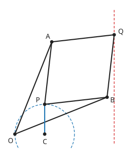

# Peaucellier–Lipkin 연결 장치

# 개요

**Peaucellier–Lipkin 연결 장치(Peaucellier–Lipkin linkage)** 는 막대와 회전 관절만으로 한 점이 정확한 직선을 그리게 하는 장치다. 막대 하나의 끝을 고정하고 돌리면 다른 끝은 원을 그리고, 막대를 몇 개 이어도 관절이 그리는 곡선은 보통 원이나 원을 섞은 곡선이다. 막대 여섯 개를 마름모와 두 팔로 엮으면 두 점이 서로의 [원 반전](circle-inversion.md)이 되고, 원점을 지나는 원 위를 도는 점의 반전이 직선 위를 움직인다.

# 직관

고정점 $O=(0,0)$ 에서 길이 $5$ 인 막대 두 개를 뻗어 끝을 $A=(4,3)$, $B=(4,-3)$ 에 둔다. 길이 $\sqrt{10}$ 인 막대 네 개로 마름모 $APBQ$ 를 만들면 $P=(3,0)$, $Q=(5,0)$ 이다. $\vert AP\vert^2=1+9=10$ 이고 $\vert AQ\vert^2=1+9=10$ 이다.

$P$ 와 $Q$ 는 $O$ 에서 본 같은 반직선 위에 있고 $OP\cdot OQ=3\cdot 5=15$ 다. 장치를 움직여도 이 곱은 그대로다. $A$ 에서 $PQ$ 에 내린 수선의 발 $M$ 은 $PQ$ 의 중점이고, 두 직각삼각형 $OAM$ 과 $PAM$ 에서 다음이 나온다.

$$
OP\cdot OQ=(OM-PM)(OM+PM)=OM^2-PM^2=OA^2-PA^2=25-10
$$

$P$ 를 중심 $C=(3/2,0)$, 반지름 $3/2$ 인 원 위에서 움직이도록 막대 $CP$ 를 하나 더 단다. 이 원은 $O$ 를 지나므로 반전으로 직선이 되고, $Q$ 는 직선 $x=15/3=5$ 위를 움직인다. $P=(3/2,3/2)$ 이면 $OP=3/\sqrt2$, $OQ=5\sqrt2$ 이고 $Q=(5,5)$ 다.

그림은 $P=(3/2,3/2)$ 인 자리다. 파란 점선 원 위를 $P$ 가 돌면 $Q$ 는 빨간 점선 직선 위를 오르내린다.

# 정의

## 반전기

고정점 $O$ 에 길이 $b$ 인 막대 둘을 잇고, 그 끝 $A$, $B$ 를 길이 $a\lt b$ 인 막대 넷의 마름모 $APBQ$ 의 마주 보는 두 꼭짓점으로 삼은 장치를 **Peaucellier 반전기(Peaucellier inversor)** 라 한다. 직관 절의 장치는 $a=\sqrt{10}$, $b=5$ 다.

## Peaucellier–Lipkin 연결 장치

반전기의 $P$ 를 고정점 $C$ 에 길이 $\vert CO\vert$ 인 막대로 이은 장치를 Peaucellier–Lipkin 연결 장치라 한다. 막대는 일곱 개이고, 고정점은 $O$ 와 $C$ 둘이다. 직관 절에서 $C=(3/2,0)$ 이고 막대 $CP$ 의 길이는 $3/2$ 다.

# 성질

## 반전기의 곱

반전기에서 $O$, $P$, $Q$ 는 한 직선 위에 있고 $OP\cdot OQ=b^2-a^2$ 이다.

$OA=OB$ 이고 $PA=PB$, $QA=QB$ 이므로 $O$, $P$, $Q$ 는 모두 선분 $AB$ 의 수직이등분선 위에 있다. 곱은 직관 절의 식에서 $25$ 와 $10$ 을 $b^2$ 과 $a^2$ 으로 바꾼 것이다. 그러므로 $Q$ 는 $P$ 의 중심 $O$, 반지름 $\sqrt{b^2-a^2}$ 인 원에 대한 반전이다.

## 직선 운동

$C$ 를 중심으로 하고 $O$ 를 지나는 원 위를 $P$ 가 움직이면 $Q$ 는 직선 $OC$ 에 수직인 직선 위를 움직인다. 원 반전 문서에서 원점을 지나는 원은 원점을 지나지 않는 직선으로 옮겨지기 때문이다. $OC=c$ 이면 그 직선은 $O$ 에서 거리 $(b^2-a^2)/(2c)$ 에 있다. 직관 절에서는 $15/3=5$ 다.

막대 $CP$ 의 길이를 $\vert CO\vert$ 와 다르게 하면 $P$ 의 원이 $O$ 를 지나지 않으므로 $Q$ 는 원을 그린다.

## 움직이는 범위

$P$ 는 $O$ 에 닿을 수 없다. $OP$ 의 범위는 $b-a$ 부터 $b+a$ 까지이고, 그에 따라 $OQ$ 의 범위도 $b-a$ 부터 $b+a$ 까지다. 그래서 $Q$ 가 그리는 것은 직선 전체가 아니라 그 가운데 한 선분이다.

# 활용

- 정확한 직선 운동. 증기기관의 피스톤처럼 직선으로 움직이는 부품을 회전하는 부품에 잇는 장치다. Watt 의 연결 장치는 직선에 가까운 곡선만 그리고, 이 장치는 미끄러지는 홈 없이 정확한 직선을 그린 첫 평면 연결 장치다.
- [Kempe 보편성 정리](kempe-universality-theorem.md). 평면 대수곡선의 유계인 조각은 모두 어느 연결 장치의 한 관절이 그린다. 이 장치가 직선 하나를 막대로 그린 것을 모든 대수곡선으로 넓힌 정리다.
- [원 반전](circle-inversion.md)의 작도. 반전기의 $P$ 로 곡선을 따라가면 $Q$ 가 그 곡선의 반전을 그린다.

# 연관 문서

## 선수지식

- [원 반전](circle-inversion.md)

## 더 알아보기

- [Kempe 보편성 정리](kempe-universality-theorem.md)

#complex_analysis #algebra
