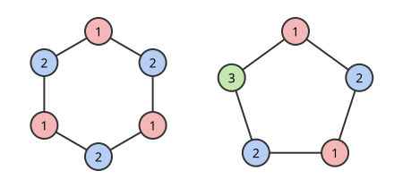

# 완벽그래프와 강한 완벽그래프 정리

# 개요

**완벽그래프(perfect graph)** 는 모든 유도 부분그래프에서 채색수와 최대 클릭의 크기가 같은 [그래프](graphs.md)다. 서로 모두 이어진 정점이 $k$ 개 있으면 색이 적어도 $k$ 개 필요하지만, 일반 그래프에서는 이 수로 모자라고 얼마나 더 필요한지 계산하기 어렵다. 완벽그래프에서는 이 수가 언제나 정확한 답이고, 이 성질로 채색수와 가장 큰 독립집합을 다항시간에 구한다.

# 직관

정점 다섯 개의 순환 $C_5$ 에는 삼각형이 없으므로 서로 모두 이어진 정점은 많아야 둘이다. 그런데 순환을 따라 두 색을 번갈아 칠하면 다섯째 정점에서 첫 정점과 색이 겹쳐 색이 셋 필요하다. 아래 그림의 왼쪽은 정점 여섯 개의 순환 $C_6$ 으로 두 색이면 충분해 두 값이 $2$ 로 같고, 오른쪽 $C_5$ 는 셋째 색이 필요하다.

$C_5$ 옆에 서로 모두 이어진 정점 셋을 따로 붙이면 그래프 전체에서는 두 값이 모두 $3$ 이 되어 같다. 그러나 $C_5$ 부분만 떼어 보면 여전히 어긋난다. 그래서 정점을 몇 개 지우고 남은 그래프마다 두 값이 같기를 요구하고, 그러면 $C_5$ 처럼 어긋나는 조각을 포함하지 않는 그래프로 특징지어진다.

# 정의

## 클릭, 채색수, 유도 부분그래프

그래프 $G$ 의 정점 집합 가운데 어느 두 정점도 인접한 것을 **클릭(clique)** 이라 하고, 가장 큰 클릭의 크기를 $\omega(G)$ 로 쓴다. 인접한 정점이 다른 색을 받도록 칠하는 데 필요한 색의 최소 개수가 **채색수(chromatic number)** $\chi(G)$ 이고, 서로 인접하지 않은 정점 집합의 최대 크기가 독립수(independence number) $\alpha(G)$ 다. 정점 부분집합 $U$ 와 양 끝이 $U$ 에 든 간선 전부로 된 그래프를 $U$ 가 만드는 **유도 부분그래프(induced subgraph)** 라 한다. $G$ 의 간선과 비간선을 맞바꾼 그래프가 **보그래프(complement)** $\bar G$ 다.

직관 절의 $C_5$ 는 $\omega=2$, $\chi=3$, $\alpha=2$ 이고, $C_6$ 은 $\omega=\chi=2$, $\alpha=3$ 이다.

## 완벽그래프

$G$ 의 모든 유도 부분그래프 $H$ 에 대해 $\omega(H)=\chi(H)$ 이면 $G$ 를 완벽그래프라 한다.

$C_6$ 의 유도 부분그래프는 $C_6$ 자신과 경로들의 서로소 합이고, 간선이 있으면 두 색으로 칠해져 $\omega=\chi=2$, 간선이 없으면 $\omega=\chi=1$ 이다. 그래서 $C_6$ 은 완벽그래프다. $C_5$ 는 자기 자신에서 $\omega\ne\chi$ 이므로 완벽그래프가 아니고, $C_5$ 를 유도 부분그래프로 갖는 그래프도 완벽그래프가 아니다.

## 구멍과 반구멍

길이 $4$ 이상인 순환이 유도 부분그래프로 나타나면 그것을 **구멍(hole)** 이라 하고, 길이가 홀수면 **홀수 구멍(odd hole)** 이다. 홀수 구멍의 보그래프를 **홀수 반구멍(odd antihole)** 이라 한다.

$C_5$ 는 보그래프가 다시 $C_5$ 이므로 홀수 구멍이자 홀수 반구멍이다. $C_7$ 의 보그래프는 각 정점이 순환에서 두 칸 이상 떨어진 네 정점과 인접한 그래프이고, $C_7$ 과 동형이 아니다.

## Berge 그래프

홀수 구멍도 홀수 반구멍도 유도 부분그래프로 갖지 않는 그래프를 **Berge 그래프(Berge graph)** 라 한다. $C_6$ 은 유도 부분그래프인 순환이 $C_6$ 하나뿐이고 보그래프 쪽에도 홀수 반구멍이 없어 Berge 그래프이고, $C_5$ 는 Berge 그래프가 아니다.

# 성질

## 작은 그래프

홀수 구멍과 홀수 반구멍 가운데 가장 작은 것이 $C_5$ 이므로 정점이 $4$ 개 이하인 그래프는 모두 완벽하다. 정점에 이름을 붙인 정점 $5$ 개의 그래프 $2^{10}=1024$ 개 가운데 완벽하지 않은 것은 $C_5$ 에 이름을 붙이는 $4!/2=12$ 가지뿐이다.

## 완벽한 그래프족

- 이분그래프(bipartite graph)는 유도 부분그래프도 이분그래프라 $\omega\le 2$ 이고 $\chi\le 2$ 다.
- 현 그래프(chordal graph)는 길이 $4$ 이상의 구멍이 없는 그래프다. 완벽 소거 순서(perfect elimination ordering)의 역순으로 탐욕 채색하면 색 수가 $\omega$ 다.
- 구간 그래프(interval graph)는 수직선의 구간들을 정점으로, 겹치는 두 구간을 간선으로 둔 그래프이고 현 그래프다.
- 비교가능성 그래프(comparability graph)는 [부분순서](partial-orders.md)에서 비교 가능한 두 원소를 이은 그래프다. 클릭이 사슬, 독립집합이 반사슬이고 Mirsky 정리(Mirsky's theorem)가 $\omega=\chi$ 를 준다.

## 약한 완벽그래프 정리

약한 완벽그래프 정리(weak perfect graph theorem)는 $G$ 가 완벽하면 $\bar G$ 도 완벽하다는 정리다. Lovász 가 1972 년에 증명했다[^1].

Lovász 는 같은 해에 $G$ 가 완벽할 필요충분조건이 모든 유도 부분그래프 $H$ 에서 $\alpha(H)\thinspace\omega(H)\ge\lvert V(H)\rvert$ 인 것임을 보였다[^2]. $\bar G$ 에서는 $\alpha$ 와 $\omega$ 가 맞바뀌므로 이 조건은 $G$ 와 $\bar G$ 에서 같고, 약한 완벽그래프 정리가 따라 나온다. $C_5$ 에서는 $\alpha\omega=4\lt 5$ 로 조건이 깨진다.

## 강한 완벽그래프 정리

**강한 완벽그래프 정리(strong perfect graph theorem)** 는 $G$ 가 완벽할 필요충분조건이 $G$ 가 Berge 그래프라는 정리다. C. Berge 가 1961 년에 추측으로 내놓았고, M. Chudnovsky, N. Robertson, P. Seymour, R. Thomas 가 증명해 2006 년에 출판했다[^3].

완벽하면 Berge 그래프인 방향은 계산으로 나온다. 홀수 구멍 $C_{2k+1}$ 은 $\omega=2$, $\chi=3$ 이고 홀수 반구멍 $\bar C_{2k+1}$ 은 $\omega=k$, $\chi=k+1$ 이라 둘 다 완벽하지 않다.

반대 방향의 증명은 구조 분해다. 모든 Berge 그래프가 다섯 가지 기본 부류 가운데 하나에 속하거나, 네 가지 분해 가운데 하나로 더 작은 Berge 그래프들로 나뉜다는 것을 보인다. 기본 부류는 완벽하고 분해가 완벽성을 보존하므로 귀납법으로 증명된다.

## 인식 문제

Berge 그래프인지 판정하는 $O(n^9)$ 시간 알고리즘이 2005 년에 나왔다[^4]. 이 알고리즘은 강한 완벽그래프 정리를 쓰지 않고 홀수 구멍과 홀수 반구멍을 직접 찾는다. 홀수 구멍이 있는지만 판정하는 문제도 다항시간에 풀린다는 것이 2020 년에 증명되었다[^5].

## 알고리즘

완벽그래프에서 $\alpha,\omega,\chi$ 와 클릭 덮개수를 모두 다항시간에 계산할 수 있다. Grötschel, Lovász, Schrijver 는 [Lovász 세타 함수](lovasz-theta.md) $\vartheta$ 를 [반정부호 계획법](semidefinite-programming.md)으로 계산해 이 결과를 얻었다. 완벽그래프에서는 $\alpha(G)=\vartheta(G)=\chi(\bar G)$ 이다. 조합적 방법으로 완벽그래프를 다항시간에 채색하는 알고리즘은 클릭 크기가 상수로 묶인 경우에 알려져 있다[^6].

# 활용

## 스케줄링과 자원 배정

구간 그래프의 채색이 구간 스케줄링이다. 겹치는 작업에 서로 다른 자원을 배정하는 문제이고, 완벽성으로 필요한 자원의 최소 개수가 동시에 겹치는 작업의 최대 개수와 같다.

레지스터 할당(register allocation)에서 프로그램의 간섭 그래프(interference graph)가 현 그래프이면 같은 성질을 쓴다. 정적 단일 배정(static single assignment, SSA) 형식의 프로그램이 그런 경우이고, 일반 그래프에서 NP(nondeterministic polynomial time)-난해인 채색이 현 그래프에서는 선형시간에 풀린다.

## 순서 이론의 정리들

[Dilworth 정리](dilworth-theorem.md)는 유한 부분순서에서 최대 반사슬의 크기가 사슬 덮개의 최소 개수와 같다는 정리다. 비교가능성 그래프로 옮기면 $\alpha=\chi(\bar G)$ 이고, 비교가능성 그래프의 보그래프가 완벽하다는 진술과 같다. Mirsky 정리는 비교가능성 그래프 자신이 완벽하다는 진술이고, 약한 완벽그래프 정리로 두 정리 가운데 하나에서 다른 하나가 유도된다.

## 최소최대 정리와 다면체

이분그래프의 König 정리(Kőnig's theorem)는 최대 매칭의 크기가 최소 정점 덮개의 크기와 같다는 정리이고, 이분그래프의 선 그래프(line graph)의 보그래프가 완벽하다는 진술과 동치다.

완벽그래프는 [안정집합 다면체](stable-set-polytope.md)가 음이 아닌 조건과 클릭 부등식만으로 기술되는 그래프와 일치한다. 그래서 완벽그래프에서는 최대 독립집합 문제의 이 선형 완화가 정수 꼭짓점만 갖는다.

[^1]: L. Lovász, "Normal hypergraphs and the perfect graph conjecture", Discrete Mathematics 2 (1972), 253–267.
[^2]: L. Lovász, "A characterization of perfect graphs", Journal of Combinatorial Theory Series B 13 (1972), 95–98.
[^3]: M. Chudnovsky, N. Robertson, P. Seymour, R. Thomas, "The strong perfect graph theorem", Annals of Mathematics 164 (2006), 51–229.
[^4]: M. Chudnovsky, G. Cornuéjols, X. Liu, P. Seymour, K. Vušković, "Recognizing Berge graphs", Combinatorica 25 (2005), 143–186.
[^5]: M. Chudnovsky, A. Scott, P. Seymour, S. Spirkl, "Detecting an odd hole", Journal of the ACM 67 (2020), Article 5.
[^6]: M. Chudnovsky, A. Lagoutte, P. Seymour, S. Spirkl, "Colouring perfect graphs with bounded clique number", Journal of Combinatorial Theory Series B 122 (2017), 757–775.

# 연관 문서

## 선수지식

- [Lovász 세타 함수](lovasz-theta.md)
- [그래프 이론 개관](graph-theory-overview.md)

## 더 알아보기

- [안정집합 다면체](stable-set-polytope.md)

#graph_theory #combinatorics #theorem
