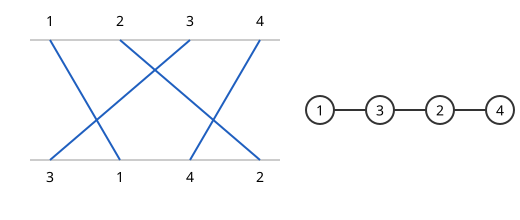

# 순열 그래프

# 개요

**순열 그래프(permutation graph)** 는 순열에서 순서가 뒤바뀐 두 수를 간선으로 이은 그래프다. 위아래 두 줄에 같은 수들을 다른 순서로 적고 같은 수끼리 선분으로 이으면, 서로 엇갈리는 선분의 쌍이 이 그래프의 간선이다. 엇갈리지 않게 고를 수 있는 선분의 최대 개수는 그래프의 가장 큰 독립집합이고, 이것은 순열의 가장 긴 증가 부분수열로 $O(n\log n)$ 시간에 계산된다.

# 직관

수 $1,2,3,4$ 를 위 줄에는 크기 순서로, 아래 줄에는 $3,1,4,2$ 의 순서로 적고 같은 수끼리 선분으로 잇는다. 아래 그림의 왼쪽이다.

두 선분이 엇갈리는 것은 위 줄에서의 순서와 아래 줄에서의 순서가 반대인 것이다. $3$ 은 아래 줄에서 $1$ 과 $2$ 보다 앞에 있고, $4$ 는 $2$ 보다 앞에 있다. 엇갈리는 쌍은 $\lbrace 1,3\rbrace,\lbrace 2,3\rbrace,\lbrace 2,4\rbrace$ 이고, 이 쌍을 이은 그래프는 그림 오른쪽의 경로 $1\text{–}3\text{–}2\text{–}4$ 다.

서로 엇갈리지 않는 선분들은 아래 줄에서도 크기 순서로 놓인 수들, 곧 $3,1,4,2$ 의 증가 부분수열이다. 가장 긴 것은 $3,4$ 나 $1,4$ 나 $1,2$ 이고 길이가 $2$ 다.

# 정의

$\lbrace 1,\dots,n\rbrace$ 의 순열 $\pi$ 에 대해, $i\lt j$ 이고 $\pi^{-1}(i)\gt\pi^{-1}(j)$ 인 쌍, 곧 $\pi$ 를 한 줄로 적었을 때 큰 수가 작은 수보다 앞에 오는 쌍을 간선으로 둔 그래프 $G\_\pi$ 를 $\pi$ 의 **순열 그래프** 라 한다. 이런 꼴의 그래프와 동형인 그래프도 순열 그래프라 한다. 직관 절의 경로는 $\pi=3142$ 의 순열 그래프다.

# 성질

## 클릭과 독립집합

$G\_\pi$ 의 클릭은 $\pi$ 의 감소 부분수열이고, 독립집합은 증가 부분수열이다. 그래서 가장 큰 독립집합의 크기는 [가장 긴 증가 부분수열](longest-increasing-subsequence.md)의 길이이고 $O(n\log n)$ 시간에 계산된다.

## 비교 가능성 그래프와의 관계

$G\_\pi$ 는 [비교 가능성 그래프](comparability-graphs.md)다. 간선 $\lbrace i,j\rbrace$ ($i\lt j$) 에 $i\to j$ 로 방향을 주면, $i\lt j\lt k$ 이고 $i,j$ 와 $j,k$ 가 뒤바뀌었을 때 $i,k$ 도 뒤바뀌므로 추이적이다. 여그래프는 뒤바뀌지 않은 쌍의 그래프이고 같은 방법으로 비교 가능성 그래프다.

정리. 그래프가 순열 그래프인 것은 그 그래프와 여그래프가 모두 비교 가능성 그래프인 것과 동치다[^1]. 두 추이적 방향 주기가 정하는 두 순서를 합치면 위 줄의 순서가 되고, 하나를 뒤집어 합치면 아래 줄의 순서가 된다.

## 완벽성과 단조 부분수열

순열 그래프는 [완벽그래프](perfect-graphs.md)이므로 정점 수는 가장 큰 클릭의 크기와 가장 큰 독립집합의 크기의 곱 이하다. 길이 $n$ 의 수열에서 가장 긴 증가 부분수열과 가장 긴 감소 부분수열의 길이의 곱이 $n$ 이상이라는 Erdős–Szekeres 정리(Erdős–Szekeres theorem)가 이 부등식이다.

# 활용

- 엇갈리지 않는 연결의 선택. 두 줄의 단자를 잇는 선 가운데 서로 엇갈리지 않는 것을 가장 많이 고르는 문제가 가장 큰 독립집합이고, 가장 긴 증가 부분수열로 푼다.
- 정렬의 측정. 순열 그래프의 간선 수는 순열의 뒤바뀜 수이고, 인접한 두 수를 맞바꾸어 정렬할 때 필요한 맞바꿈의 횟수다.
- 그래프 알고리즘. 순열 그래프에서는 가장 큰 클릭, 가장 큰 독립집합, 색칠 수가 다항 시간에 계산되고, 순열 그래프인지는 선형 시간에 판정된다[^2].

[^1]: S. Even, A. Pnueli, A. Lempel, "Permutation graphs and transitive graphs", *Journal of the ACM* **19** (1972), 400–410.
[^2]: R. M. McConnell, J. P. Spinrad, "Modular decomposition and transitive orientation", *Discrete Mathematics* **201** (1999), 189–241.

# 연관 문서

## 선수지식

- [비교 가능성 그래프](comparability-graphs.md)

## 더 알아보기

아직 연결한 문서가 없다.

#graph_theory #order_theory #combinatorics
