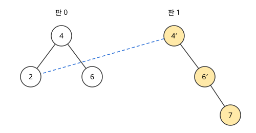

# 영속 자료구조

# 개요

**영속 자료구조(persistent data structure)** 는 갱신한 뒤에도 갱신하기 전의 모습을 그대로 남겨 두어 언제든 다시 질의할 수 있는 자료구조다. 정렬된 집합 $\lbrace 2,4,6\rbrace$ 에 $7$ 을 넣은 뒤에도 넣기 전의 집합에서 "$5$ 보다 큰 가장 작은 원소" 를 묻고 싶을 때, 갱신마다 자료구조 전체를 복사하면 원소 $n$ 개의 집합을 $n$ 번 갱신하는 데 $n^2$ 에 비례하는 공간이 든다. 영속 자료구조는 갱신으로 바뀌는 부분만 새로 만들고 나머지는 옛 모습과 함께 쓴다.

# 직관

집합 $\lbrace 2,4,6\rbrace$ 를 뿌리 $4$, 왼쪽 자식 $2$, 오른쪽 자식 $6$ 인 이진 탐색 트리로 둔다. $7$ 을 넣으면 $6$ 의 오른쪽 자식 자리가 바뀌고, $6$ 을 가리키는 $4$ 의 오른쪽 포인터도 새 $6$ 을 가리켜야 한다. 그러나 $2$ 와 그 아래는 그대로다.

그래서 뿌리에서 $7$ 이 매달릴 자리까지의 경로 위에 있는 마디 $4$ 와 $6$ 만 복사해 $4'$ 과 $6'$ 을 만든다. $6'$ 의 오른쪽 자식은 $7$ 이고, $4'$ 의 왼쪽 포인터는 옛 마디 $2$ 를 그대로 가리킨다. 옛 뿌리 $4$ 에서 내려가면 $\lbrace 2,4,6\rbrace$ 가, 새 뿌리 $4'$ 에서 내려가면 $\lbrace 2,4,6,7\rbrace$ 가 나온다.

아래 그림의 왼쪽이 넣기 전의 트리이고, 칠한 마디가 넣으면서 새로 만든 마디, 점선이 두 트리가 함께 쓰는 마디 $2$ 로 가는 포인터다.



# 정의

## 판과 영속성

자료구조에 갱신을 한 번 할 때마다 생기는 상태를 **판(version)** 이라 한다. 갱신이 직전 판을 지우는 보통의 자료구조를 **일시적(ephemeral)** 이라 한다.

- **부분 영속(partially persistent)** 자료구조는 모든 판에 질의할 수 있고 가장 최근 판만 갱신할 수 있다. 판들은 한 줄로 늘어선다.
- **완전 영속(fully persistent)** 자료구조는 모든 판에 질의하고 갱신할 수 있다. 옛 판을 갱신하면 거기서 갈라진 새 판이 생겨 판들이 트리를 이룬다.
- **합류 영속(confluently persistent)** 자료구조는 두 판을 합쳐 새 판을 만드는 갱신도 허용한다.

이 구분은 Driscoll, Sarnak, Sleator, Tarjan 이 1989 년에 정했다[^1].

예. 직관 절의 트리에서 판 0 은 뿌리 $4$, 판 1 은 뿌리 $4'$ 으로 질의한다. 판 1 에만 다음 원소를 넣으면 부분 영속이고, 판 0 에 $5$ 를 넣어 판 1 과 다른 판 2 를 만들 수 있으면 완전 영속이다.

## 경로 복사

**경로 복사(path copying)** 는 갱신으로 바뀌는 마디와 그 마디에 이르는 뿌리부터의 경로 위의 마디를 모두 복사하고, 복사본의 나머지 포인터는 옛 마디를 가리키게 하는 방법이다. 판마다 뿌리 하나를 기록해 둔다.

```typescript
interface PNode {
  readonly key: number;
  readonly left: PNode | null;
  readonly right: PNode | null;
}

// 옛 트리 t 는 바꾸지 않고, k 를 넣은 새 판의 뿌리를 돌려준다.
function insert(t: PNode | null, k: number): PNode {
  if (t === null) return { key: k, left: null, right: null };
  if (k < t.key) return { key: t.key, left: insert(t.left, k), right: t.right };
  return { key: t.key, left: t.left, right: insert(t.right, k) };
}
```

예. 판 0 의 뿌리에 `insert(root0, 7)` 을 부르면 $4$ 와 $6$ 에서 새 마디를 만들고 $7$ 을 새로 만들어, 마디 세 개로 판 1 의 뿌리 $4'$ 을 얻는다.

## 뚱뚱한 마디

**뚱뚱한 마디(fat node)** 방법은 마디를 복사하지 않고, 마디의 각 필드에 지금까지 쓰인 값을 판 번호와 함께 모두 기록하는 방법이다. 판 $i$ 에서 필드를 읽을 때는 판 번호가 $i$ 이하인 기록 가운데 가장 최근 것을 찾는다.

예. 직관 절에서 마디 $6$ 의 오른쪽 필드에 (판 0, 없음), (판 1, $7$) 을 기록하면 $4$ 와 $6$ 을 복사하지 않아도 된다. 판 0 에서 읽으면 없음, 판 1 에서 읽으면 $7$ 이다.

# 성질

## 경로 복사의 비용

경로 복사로 갱신 한 번에 드는 시간과 새 공간은 바뀌는 마디의 깊이에 비례한다. [균형 이진 탐색 트리](balanced-binary-search-trees.md)에서는 높이가 $O(\log n)$ 이므로 판마다 $O(\log n)$ 공간이 늘고, $m$ 번 갱신한 뒤의 전체 공간은 $O(n+m\log n)$ 이다. red-black 트리의 삽입은 회전을 상수 번 하지만 색을 바꾸는 마디가 경로 위에 있으므로 같은 상한이 성립한다.

## 뚱뚱한 마디의 비용

뚱뚱한 마디에서 필드 값 하나를 바꾸는 갱신은 공간 $O(1)$ 만 더한다. 대신 필드를 읽을 때마다 판 번호를 [이진 탐색](binary-search.md)하므로, $m$ 개 판이 있으면 읽기 한 번이 $O(\log m)$ 배 느려진다.

## 마디 복사 정리

마디마다 그 마디를 가리키는 포인터 수가 상수 이하인 포인터 자료구조는, 필드 값을 하나 바꿀 때마다 [분할상환](amortized-analysis.md) $O(1)$ 공간과 시간만 더해 부분 영속으로 만들 수 있다. 질의는 상수배만 느려진다[^1].

*증명의 요지.* 마디마다 수정 기록 칸을 상수 개 더 두고, 갱신은 빈 칸에 (판 번호, 필드, 값) 을 적는다. 칸이 다 찼으면 마디의 최신 값만 담은 복사본을 만들고, 이 마디를 가리키던 마디들에 새 주소를 적는 갱신을 되풀이한다. 퍼텐셜을 살아 있는 마디의 찬 칸 수로 두면, 복사 한 번이 퍼텐셜을 칸 수만큼 줄이므로 연쇄된 복사의 비용이 그 감소로 상쇄된다.

같은 논문은 판 트리의 판 번호에 전순서를 주는 방법을 더해 완전 영속도 분할상환 $O(1)$ 의 공간과 시간 증가로 얻는다[^1].

## 불변 자료구조

필드를 만든 뒤 바꾸지 않는 자료구조는 갱신이 늘 새 마디를 만들므로 자동으로 영속적이다. 앞 절의 `insert` 가 그 예다. 순수 함수형 언어의 목록과 트리가 이렇게 만들어진다[^3].

# 활용

- 평면 점 위치(planar point location). 평면을 선분으로 나눈 지도에서 질의점이 든 칸을 찾는다. 세로줄을 왼쪽에서 오른쪽으로 옮기며 그 줄과 만나는 선분을 위아래 순서로 담은 탐색 트리를 영속적으로 갱신하면, 질의는 $x$ 좌표로 판을 찾고 그 판에서 $y$ 좌표로 찾는다. 선분 $n$ 개에 공간 $O(n)$, 질의 $O(\log n)$ 이다[^2].
- 과거 시점 질의. 데이터베이스와 버전 관리 체계에서 각 시점의 상태를 판으로 남겨 두고 옛 시점의 범위 질의에 답한다.
- 되돌리기와 백트래킹. 탐색 알고리즘이 분기마다 판을 기억해 두면 되돌아갈 때 상태를 복구하는 비용이 없다.

[^1]: J. R. Driscoll, N. Sarnak, D. D. Sleator, R. E. Tarjan, "Making data structures persistent", Journal of Computer and System Sciences 38 (1989), 86–124.
[^2]: N. Sarnak, R. E. Tarjan, "Planar point location using persistent search trees", Communications of the ACM 29 (1986), 669–679.
[^3]: C. Okasaki, *Purely Functional Data Structures*, Cambridge University Press, 1998.

# 연관 문서

## 선수지식

- [균형 이진 탐색 트리](balanced-binary-search-trees.md)
- [분할상환 분석](amortized-analysis.md)

## 더 알아보기

아직 연결한 문서가 없다.

#data_structures #algorithms #computation
