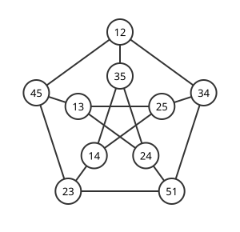

# Petersen 그래프

# 개요

**Petersen 그래프(Petersen graph)** 는 원소 다섯 개에서 고른 두 원소짜리 부분집합 열 개를 정점으로 두고, 겹치지 않는 두 부분집합을 간선으로 이은 그래프다. 모든 정점에 간선이 셋씩 붙은 그래프의 간선을 세 가지 색으로, 한 정점에서 만나는 간선끼리는 다른 색이 되게 칠할 수 있는지 묻는다. 작은 예를 몇 개 칠해 보면 늘 되는 것처럼 보이지만 Petersen 그래프에서는 되지 않아서, 그래프에 대한 추측을 시험하는 첫 반례로 쓰인다.

# 직관

정점마다 간선이 셋씩 붙은 [그래프](graphs.md)의 간선을 색 세 가지로 칠한다. 한 정점에서 만나는 세 간선은 서로 다른 색이어야 한다. 정점 넷이 모두 이웃한 완전 그래프 $K_4$ 는 마주 보는 간선 쌍 셋에 색을 하나씩 주면 된다. 정육면체의 꼭짓점과 모서리로 된 그래프도 평행한 모서리 네 개씩을 한 색으로 칠하면 된다.

아래 그림은 Petersen 그래프다. 바깥 오각형, 안쪽 별 모양 오각형, 둘을 잇는 간선 다섯 개로 되어 있고, 정점 이름 $12$ 는 부분집합 $\lbrace 1,2\rbrace$ 이다. 바깥 오각형에서 이웃한 두 정점, 예를 들어 $12$ 와 $34$ 는 겹치지 않는다.

이 그래프를 세 색으로 칠할 수 있다면, 한 색의 간선은 모든 정점을 한 번씩 짝짓는다. 나머지 두 색의 간선은 정점마다 둘씩 붙어 순환들을 이루고, 두 색이 번갈아 나오므로 순환의 길이가 모두 짝수다.

그런데 Petersen 그래프에서 한 짝짓기의 간선을 지우면 언제나 길이 $5$ 인 순환 둘이 남는다. 그림에서 바깥과 안쪽을 잇는 다섯 간선을 지우면 바깥 오각형과 안쪽 별이 남는 것이 그 예다. 그래서 세 색으로는 칠할 수 없다.

# 정의

## 두 원소 부분집합의 그래프

$\lbrace 1,2,3,4,5\rbrace$ 의 두 원소 부분집합 전체를 정점 집합으로 두고, 두 정점이 서로소일 때 간선으로 이은 그래프를 Petersen 그래프라 한다. 정점은 $\binom52=10$ 개다. 정점 $\lbrace 1,2\rbrace$ 와 서로소인 두 원소 부분집합은 $\lbrace 3,4,5\rbrace$ 에서 고른 $3$ 개이므로 모든 정점의 차수가 $3$ 이고 간선은 $15$ 개다. [Kneser 그래프](kneser-graphs.md)의 기호로는 $K(5,2)$ 다.

# 성질

## 짧은 순환과 공통 이웃

서로 이웃한 두 정점은 공통 이웃이 없고, 이웃하지 않은 두 정점은 공통 이웃이 꼭 하나 있다. 이웃한 $A,B$ 는 합집합이 원소 넷이라 둘 다와 서로소인 두 원소 부분집합이 없다. 이웃하지 않은 $A,B$ 는 원소 하나를 공유해 합집합이 원소 셋이고, 나머지 두 원소가 공통 이웃이다.

그래서 길이 $3$ 인 순환과 길이 $4$ 인 순환이 없고 가장 짧은 순환의 길이는 $5$ 다. 어느 두 정점 사이의 거리도 $2$ 이하다. 이 성질은 Petersen 그래프가 매개변수 $(10,3,0,1)$ 인 [강정칙 그래프](strongly-regular-graphs.md)라는 것과 같다.

## Moore 한계

차수 $3$, 지름 $2$ 인 그래프의 정점은 $1+3+3\cdot 2=10$ 개 이하다. 한 정점, 그 이웃 셋, 이웃마다 새로 닿는 정점 둘씩을 세면 이 수가 나온다. Petersen 그래프는 이 한계에 닿는다. 이런 그래프를 Moore 그래프(Moore graph)라 한다.

## 간선 색칠과 완전 매칭

Petersen 그래프에는 완전 매칭이 여섯 개 있고, 어느 것을 지워도 길이 $5$ 인 순환 둘이 남는다[^1]. 그래서 직관 절의 논증대로 간선을 세 색으로 칠할 수 없고, 간선 채색수는 $4$ 다. 다리가 없는 3-정규 그래프이므로 [Tutte 정리](tutte-theorem.md)의 귀결인 Petersen 정리가 완전 매칭의 존재를 보장한다.

## Hamilton 순환

Petersen 그래프에는 모든 정점을 한 번씩 지나는 [Hamilton 순환](hamiltonian-cycles.md)이 없다. 있다면 그 순환의 간선 열 개를 번갈아 두 색으로 칠하고 나머지 다섯 간선에 셋째 색을 주어 세 색 칠하기가 나오므로 앞 절과 모순이다. 반면 어느 정점 하나를 지워도 남은 아홉 정점에는 Hamilton 순환이 있다.

## 그 밖의 불변량

- 채색수는 $3$ 이고 독립수는 $4$ 다. 원소 하나를 공유하는 두 원소 부분집합 넷이 최대 독립집합이다.
- 평면 그래프가 아니다. 바깥과 안쪽을 잇는 다섯 간선을 축약하면 $K_5$ 가 나온다.
- 인접 행렬의 고윳값은 $3$, $1$, $-2$ 이고 중복도는 $1$, $5$, $4$ 다.
- 자기동형군은 $\lbrace 1,\dots,5\rbrace$ 의 치환이 부분집합에 작용하는 대칭군 $S_5$ 이고 위수는 $120$ 이다.

# 활용

- 반례. 다리가 없는 3-정규 그래프 가운데 간선을 세 색으로 칠할 수 없는 가장 작은 것이고, 그런 그래프 전체를 [snark](snarks.md) 라 한다. [그래프 강인성](graph-toughness.md)과 Hamilton 순환의 충분조건에 대한 추측도 이 그래프로 먼저 시험한다.
- Kneser 그래프. $K(n,k)$ 의 채색수가 $n-2k+2$ 라는 Lovász 정리의 가장 작은 경우가 $K(5,2)$ 의 채색수 $3$ 이다.
- 강정칙 그래프와 [Hoffman 비율 한계](hoffman-ratio-bound.md). 고윳값 $3$ 과 $-2$ 로 독립수의 상한 $10\cdot 2/(3+2)=4$ 가 나오고 실제 독립수와 같다.
- [그래프 마이너](graph-minors.md). $K_5$ 를 마이너로 가지므로 평면 그래프가 아니라는 판정의 예이고, 마이너 이론의 여러 추측에서 극단적인 예로 나온다.

[^1]: D. A. Holton, J. Sheehan, *The Petersen Graph*, Cambridge University Press (1993).

# 연관 문서

## 선수지식

- [그래프](graphs.md)

## 더 알아보기

아직 연결한 문서가 없다.

#graph_theory #combinatorics
