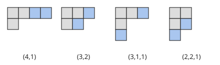

# Pieri 규칙

# 개요

**Pieri 규칙(Pieri rule)** 은 Schur 다항식에 완전 동차 대칭다항식 $h_k$ 를 곱한 것을 다시 Schur 다항식의 합으로 펼치는 규칙이다. 두 변수에서 $x+y$ 와 $x^2+xy+y^2$ 을 곱해 전개한 다항식이 어느 Schur 다항식들의 합인지는 전개만 보아서는 알 수 없다. Pieri 규칙은 Young 도형 $(1)$ 에 칸 두 개를 같은 열에 두 개가 오지 않게 붙이는 방법을 세어, 답이 $s\_{(3)}+s\_{(2,1)}$ 임을 계산 없이 준다.

# 직관

두 변수에서 $s\_{(1)}=x+y$ 와 $h_2=x^2+xy+y^2$ 의 곱은 다음과 같다.

$$
s\_{(1)}h_2=x^3+2x^2y+2xy^2+y^3
$$

[Schur 다항식](schur-polynomials.md) 문서의 정의에서 두 변수의 $s\_{(3)}$ 과 $s\_{(2,1)}$ 은 다음과 같고, 둘을 더하면 위의 전개가 된다.

$$
s\_{(3)}=x^3+x^2y+xy^2+y^3,\qquad s\_{(2,1)}=x^2y+xy^2
$$

도형 $(1)$ 에 칸 두 개를 붙여 만들 수 있는 도형은 $(3)$, $(2,1)$, $(1,1,1)$ 인데, $(1,1,1)$ 은 붙인 두 칸이 첫 열에 함께 들어가므로 빠진다. 남은 두 도형이 답의 두 항이다.

같은 셈을 도형 $(2,1)$ 과 $h_2$ 에 하면 붙일 수 있는 방법이 아래 그림의 넷이다. 회색이 원래 도형이고 파란 칸이 붙인 두 칸이며, 어느 그림에서도 파란 두 칸은 다른 열에 있다.

그래서 다음이 성립한다.

$$
s\_{(2,1)}h_2=s\_{(4,1)}+s\_{(3,2)}+s\_{(3,1,1)}+s\_{(2,2,1)}
$$

세 변수에서 양변에 $x=y=z=1$ 을 넣으면 좌변은 $8\cdot 6=48$ 이고, 우변의 네 항은 $24$, $15$, $6$, $3$ 이어서 합이 $48$ 이다.

# 정의

## 가로 띠와 세로 띠

두 분할 $\lambda\subseteq\mu$ 의 Young 도형의 차 $\mu/\lambda$ 의 어느 두 칸도 같은 열에 있지 않으면 $\mu/\lambda$ 를 **가로 띠(horizontal strip)** 라 하고, 어느 두 칸도 같은 행에 있지 않으면 **세로 띠(vertical strip)** 라 한다. 칸의 수를 띠의 크기라 한다. 직관 절의 그림 넷은 $(2,1)$ 위의 크기 $2$ 인 가로 띠 전부다. $(1,1,1)/(1)$ 은 세로 띠이지만 가로 띠는 아니다.

## 완전 동차와 기본 대칭다항식

$h_k$ 는 차수 $k$ 인 단항식 전부의 합이고, $e_k$ 는 서로 다른 변수 $k$ 개를 곱한 단항식 전부의 합이다. $h_k=s\_{(k)}$ 이고 $e_k=s\_{(1^k)}$ 이다. 두 변수에서 $h_2=x^2+xy+y^2$ 이고 $e_2=xy$ 다.

# 성질

## Pieri 규칙

**정리.** 모든 분할 $\lambda$ 와 $k\ge 0$ 에 대해 다음이 성립한다[^1].

$$
s_\lambda h_k=\sum_{\mu/\lambda\ \text{가로 띠},\ \vert\mu/\lambda\vert=k}s_\mu,\qquad s_\lambda e_k=\sum_{\mu/\lambda\ \text{세로 띠},\ \vert\mu/\lambda\vert=k}s_\mu
$$

계수는 모두 $0$ 이나 $1$ 이다. 둘째 식은 첫째 식에 대칭함수의 대합 $\omega$ 를 씌운 것이다. $\omega$ 는 $h_k$ 와 $e_k$ 를 맞바꾸고 $s_\lambda$ 를 켤레 분할의 $s\_{\lambda'}$ 로 보내며, 켤레를 취하면 가로 띠가 세로 띠가 된다.

## 증명의 요지

$s_\lambda$ 는 모양 $\lambda$ 의 준표준 대각표 $T$ 의 단항식 합이고, $h_k$ 는 길이 $k$ 인 줄지 않는 수열 $w$ 의 단항식 합이다. $w$ 의 수를 왼쪽부터 차례로 $T$ 에 [Robinson–Schensted–Knuth 대응](robinson-schensted-knuth.md)의 행 삽입으로 넣는다. 줄지 않는 수열을 차례로 넣으면 새로 생긴 칸들이 왼쪽에서 오른쪽으로 놓이고 두 칸이 같은 열에 오지 않으므로, 결과의 모양 $\mu$ 에서 $\mu/\lambda$ 는 가로 띠다[^1].

거꾸로 모양 $\mu$ 의 대각표와 가로 띠 $\mu/\lambda$ 가 주어지면 띠의 칸을 오른쪽부터 차례로 빼내는 역삽입으로 $T$ 와 $w$ 가 하나씩 정해진다. 삽입은 단항식을 보존하므로 이 전단사가 첫 식을 준다.

## Kostka 수

$h_\mu=h\_{\mu_1}h\_{\mu_2}\cdots$ 에 Pieri 규칙을 되풀이하면 $s_\lambda$ 의 계수는 빈 도형에서 크기 $\mu_1,\mu_2,\dots$ 인 가로 띠를 차례로 붙여 $\lambda$ 에 이르는 방법의 수다. $i$ 번째 띠의 칸에 $i$ 를 적으면 이 방법은 모양 $\lambda$, 내용 $\mu$ 인 준표준 대각표와 일대일로 대응한다. 그래서 다음이 성립한다.

$$
h_\mu=\sum_\lambda K\_{\lambda\mu}\thinspace s_\lambda
$$

$K\_{\lambda\mu}$ 는 Schur 다항식 문서의 Kostka 수다. $\mu=(1,1,\dots,1)$ 이면 띠가 모두 한 칸이고, $K\_{\lambda,(1^n)}$ 은 표준 대각표의 수 $f^\lambda$ 다. $h_1^2=s\_{(2)}+s\_{(1,1)}$ 에서 두 계수가 $f^{(2)}=f^{(1,1)}=1$ 이다.

## 분기 규칙

변수 하나를 떼어 $s_\lambda(x_1,\dots,x_n)$ 을 $x_n$ 의 거듭제곱으로 펼치면 다음이 된다.

$$
s_\lambda(x_1,\dots,x_n)=\sum_{\lambda/\mu\ \text{가로 띠}}s_\mu(x_1,\dots,x\_{n-1})\thinspace x_n^{\vert\lambda\vert-\vert\mu\vert}
$$

대각표에서 수 $n$ 이 든 칸을 지우면 남은 것이 모양 $\mu$ 의 대각표이고, 지운 칸이 가로 띠를 이룬다. 이 식을 되풀이하면 대각표는 서로 끼어드는 분할의 사슬과 같고, 이것이 Gelfand–Tsetlin 패턴(Gelfand–Tsetlin pattern)이다.

## Littlewood–Richardson 규칙과의 관계

$h_k=s\_{(k)}$ 이므로 Pieri 규칙은 [Littlewood–Richardson 규칙](littlewood-richardson.md)에서 한쪽 분할이 한 행인 경우다. 한 행 $(k)$ 의 Littlewood–Richardson 대각표는 모든 칸이 $1$ 이고, 같은 열에 $1$ 이 둘 올 수 없으므로 가로 띠와 같다.

# 활용

- 표현의 텐서곱. $\mathrm{GL}\_n(\mathbb C)$ 의 기약표현 $V_\lambda$ 와 대칭 거듭제곱 $\mathrm{Sym}^k\mathbb C^n$ 의 텐서곱은 $\mu/\lambda$ 가 크기 $k$ 인 가로 띠인 $V_\mu$ 들의 직합이다. 직관 절의 $48$ 과 네 항 $24,15,6,3$ 이 $n=3$ 에서의 차원이다.
- Schubert 계산. [Schubert 계산](schubert-calculus.md)의 특수 Schubert 류와의 곱셈 규칙이 Pieri 규칙과 같은 꼴이고, [Grassmann 다양체](grassmannian.md)의 코호몰로지환에서 교차수를 이 규칙으로 계산한다.
- 대칭군의 표현. Young 부분군에서 유도한 순열 가군을 [Specht 가군](specht-modules.md)으로 분해할 때 $S^\lambda$ 의 중복도가 Kostka 수 $K\_{\lambda\mu}$ 이고, 이것을 Young 규칙(Young's rule)이라 한다.
- 지표의 극한. [Thoma 정리](thoma-theorem.md)의 증명에서 $k=1$ 인 Pieri 규칙이 [Young 격자](youngs-lattice.md) 위의 조화함수 조건을 준다.

[^1]: W. Fulton, *Young Tableaux*, London Mathematical Society Student Texts 35, Cambridge University Press, 1997, 2.2 절과 6.1 절.

# 연관 문서

## 선수지식

- [Schur 다항식](schur-polynomials.md)

## 더 알아보기

아직 연결한 문서가 없다.

#combinatorics #algebra
