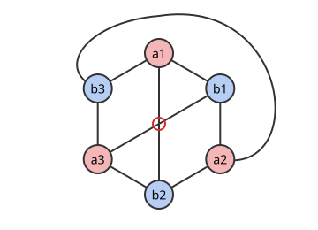

# 평면 그래프

# 개요

**평면 그래프(planar graph)** 는 평면 위에 간선이 서로 교차하지 않게 그릴 수 있는 [그래프](graphs.md)다. 집 세 채를 수도, 가스, 전기 공급소 세 곳에 모두 관으로 잇되 관끼리 겹치지 않게 놓을 수 있는지, 회로 기판의 부품을 잇는 선을 한 층에 겹치지 않게 깔 수 있는지가 평면성의 문제다. 정점의 수, 간선의 수, 그림이 평면을 나눈 조각의 수 사이에 성립하는 식 하나로 이런 배치가 불가능함을 보이고, 어떤 그래프가 평면 그래프인지 판정한다.

# 직관

집 세 채 $a_1,a_2,a_3$ 과 공급소 세 곳 $b_1,b_2,b_3$ 을 모두 이은 그래프가 $K_{3,3}$ 이다. 아래 그림은 교차를 한 곳으로 줄인 그리기다. 정점을 옮기고 곡선을 돌려 그려도 교차가 하나는 남는데, 그리는 방법을 모두 시험해서는 교차를 없앨 수 없다는 것을 보일 수 없다.

교차 없이 그렸다고 가정하고 그림이 나눈 평면의 조각을 센다. 나무는 조각이 바깥 하나뿐이고 간선이 정점보다 하나 적다. 나무에 간선을 하나 더할 때마다 순환이 하나 생겨 조각이 하나 는다. 그래서 연결된 그림에서는 정점 수 $V$, 간선 수 $E$, 조각 수 $F$ 가 언제나 $V-E+F=2$ 를 만족한다.

$K_{3,3}$ 은 집끼리나 공급소끼리 이어지지 않으므로 삼각형이 없고, 각 조각의 경계는 간선 $4$ 개 이상이다. 각 간선은 조각 두 개의 경계에 놓이므로 $4F\le 2E$ 다. $V=6$, $E=9$ 를 넣으면 $F=2-6+9=5$ 이고 $4\cdot 5=20\gt 18$ 이 되어 모순이다. 그래서 교차를 없앨 수 없다.

# 정의

## 평면 그래프와 평면 그리기

그래프 $G$ 의 **평면 그리기(plane embedding)** 는 각 정점을 평면의 서로 다른 점에, 각 간선을 끝점을 잇는 단순 곡선에 대응시키되, 두 곡선이 공통 끝점 외에는 만나지 않게 하는 것이다. 평면 그리기가 존재하는 그래프를 평면 그래프라 한다. 평면 그리기가 하나 지정된 그래프를 **plane graph** 라 한다.

네 정점이 모두 서로 이어진 $K_4$ 는 정점 $a,b,d$ 로 삼각형을 그리고 $c$ 를 삼각형 안에 두어 $a,b,d$ 와 이으면 평면 그리기가 되므로 평면 그래프다. 직관 절의 그림은 교차가 있어 $K_{3,3}$ 의 평면 그리기가 아니다.

## 면

plane graph $G$ 에서 평면에서 그림(정점과 간선의 합집합)을 제거하고 남은 집합의 연결 성분을 **면(face)** 이라 한다. 유계가 아닌 면이 정확히 하나 있고 이를 **외부면(outer face)** 이라 한다. 면의 개수를 $F$ 로 쓴다. 면 $f$ 의 **차수(degree)** $\deg(f)$ 는 $f$ 의 경계를 한 바퀴 돌 때 지나는 간선의 수이고, 다리(bridge)인 간선은 두 번 센다.

위 $K_4$ 의 그리기에서 면은 안쪽 삼각형 $abc$, $bcd$, $acd$ 와 외부면 $abd$ 의 넷이고 차수가 모두 $3$ 이다.

## 세분과 마이너

- **세분(subdivision)** 은 간선을 새 정점으로 쪼개 두 간선으로 바꾸는 연산을 반복해 얻은 그래프다. 정점 다섯 개의 순환 $C_5$ 는 삼각형 $C_3$ 의 세분이다.
- **마이너(minor)** 는 간선 삭제, 정점 삭제, 간선 축약(edge contraction)만으로 얻을 수 있는 그래프다. $C_5$ 의 간선 둘을 축약하면 $C_3$ 이므로 $C_3$ 은 $C_5$ 의 마이너다([그래프 마이너](graph-minors.md)).

## 쌍대 그래프

plane graph $G$ 의 **쌍대 그래프(dual graph)** $G^\ast$ 는 $G$ 의 각 면에 정점 하나를 두고, $G$ 의 각 간선 $e$ 에 대해 $e$ 를 사이에 둔 두 면의 정점을 잇는 간선을 둔 그래프다. 같은 면이 양쪽이면 고리(loop)가 된다.

위 $K_4$ 의 그리기에서 면이 넷이고 어느 두 면도 간선 하나를 사이에 두고 맞닿으므로 쌍대 그래프도 $K_4$ 다.

# 성질

## Euler 공식

Euler 공식(Euler's formula, 1758)은 연결된 plane graph $G$ 에 대한 등식

$$
V - E + F = 2
$$

이다. 연결 성분이 $k$ 개면 $V-E+F=1+k$ 다.

증명은 간선 수에 대한 귀납법이다. 순환이 없으면 $G$ 는 트리이고 $E=V-1$ , $F=1$ 이므로 성립한다. 순환이 있으면 순환 위의 간선 $e$ 를 하나 고른다. $e$ 는 서로 다른 두 면의 경계에 있으므로 $G-e$ 에서는 그 두 면이 하나로 합쳐진다. 따라서 $E$ 와 $F$ 가 각각 1씩 줄고 $V-E+F$ 는 보존된다. $G-e$ 는 여전히 연결이므로 귀납 가정을 적용한다. ∎

$F$ 는 그리기와 무관하게 $E-V+2$ 로 정해진다. $K_4$ 에서 $4-6+4=2$ 다. $V-E+F$ 는 구면의 [Euler 지표](euler-characteristic.md)이고, 종수 $g$ 의 곡면에 면이 모두 원판이 되게 그린 그래프는 $V-E+F=2-2g$ 를 만족한다.

## 간선 수 상한

$V \ge 3$ 인 단순 평면 그래프는

$$
E \le 3V - 6
$$

를 만족한다. 삼각형이 없으면 더 강하게

$$
E \le 2V - 4
$$

가 성립한다.

증명의 요지. 각 면의 차수는 3 이상이고(삼각형이 없으면 4 이상), 차수의 합은 $2E$ 다. 따라서 $3F \le 2E$ , 즉 $F \le 2E/3$ 이다. Euler 공식에 대입하면 $2 = V - E + F \le V - E + 2E/3 = V - E/3$ 이므로 $E \le 3V - 6$ 이다. 삼각형 없는 경우는 $4F \le 2E$ 로 같은 계산을 반복한다. ∎

단순 평면 그래프의 평균 차수는 $2E/V \le 6 - 12/V \lt 6$ 이므로, 차수가 5 이하인 정점이 반드시 존재한다. 평균 논법은 [비둘기집 원리](pigeonhole-principle.md)의 한 형태이고, 부분그래프도 평면이므로 평면 그래프의 [그래프 퇴화도](graph-degeneracy.md)는 5 이하다.

## K5 와 K3,3

$K_5$ 는 $V = 5, E = 10$ 이고 $3 \cdot 5 - 6 = 9 \lt 10$ 이므로 비평면이다. $K_{3,3}$ 은 이분 그래프라 삼각형이 없고 $V = 6, E = 9$ 인데 $2 \cdot 6 - 4 = 8 \lt 9$ 이므로 비평면이다.

세분해도 평면성은 변하지 않으므로, $K_5$ 나 $K_{3,3}$ 의 세분을 부분그래프로 포함하는 그래프는 모두 비평면이다. 평면 그리기에서 간선을 축약해도 평면 그리기가 남으므로 $K_5$ 나 $K_{3,3}$ 을 마이너로 갖는 그래프도 비평면이다.

## Kuratowski 정리와 Wagner 정리

Kuratowski 정리(Kuratowski's theorem, 1930)는 그래프 $G$ 가 평면일 필요충분조건이 $G$ 가 $K_5$ 의 세분도 $K_{3,3}$ 의 세분도 부분그래프로 포함하지 않는 것이라는 정리다.

Wagner 정리(Wagner's theorem, 1937)는 그래프 $G$ 가 평면일 필요충분조건이 $G$ 가 $K_5$ 도 $K_{3,3}$ 도 마이너로 갖지 않는 것이라는 정리다.

최대차수가 3 이하인 $K_{3,3}$ 은 마이너인 것과 세분이 부분그래프인 것이 같고, $K_5$ 마이너가 있는데 $K_5$ 세분이 없으면 $K_{3,3}$ 세분이 있음을 보여 두 정리가 동치가 된다. 충분성의 표준 증명은 최소 반례를 3-연결 그래프로 환원한 뒤, 3-연결 그래프가 볼록 그리기를 갖는다는 Tutte 의 스프링 정리(Tutte's spring theorem)를 쓴다.

Wagner 정리는 금지 마이너로 그래프 성질을 특징짓는 첫 예다. Robertson–Seymour 정리(Robertson–Seymour theorem)로 마이너에 대해 닫힌 모든 그래프 성질이 유한 개의 금지 마이너로 특징지어지고[^1], 평면성은 그 목록이 $\lbrace K_5,K_{3,3}\rbrace$ 인 경우다.

평면성 판정은 Hopcroft–Tarjan 알고리즘(Hopcroft–Tarjan algorithm)이 $O(V)$ 시간에 처리해 평면 그리기를 찾거나 Kuratowski 부분그래프를 출력한다. [그래프 동형](graph-isomorphism.md) 문제도 평면 그래프로 제한하면 선형 시간에 풀린다.

## 5색 정리

5색 정리(five color theorem)는 모든 평면 그래프가 5-색칠 가능하다는 정리다.

증명은 정점 수에 대한 귀납법이다. 평면 그래프에는 차수 5 이하인 정점 $v$ 가 있다. $G-v$ 는 귀납 가정으로 5-색칠된다. $v$ 의 차수가 4 이하이거나 이웃들이 5색을 다 쓰지 않으면 남은 색을 주면 끝난다.

문제는 $v$ 의 이웃이 정확히 5개이고 색이 모두 다른 경우다. 평면 그리기에서 $v$ 주위를 시계 방향으로 돈 이웃을 $v_1,\dots,v_5$ , 색을 $1,\dots,5$ 라 하자. 색 1과 3만 쓰인 정점들이 이루는 부분그래프에서 $v_1$ 을 포함하는 연결 성분을 Kempe 사슬(Kempe chain)이라 한다. 만약 $v_3$ 이 이 성분에 속하지 않으면, 성분 안의 색 1과 3을 통째로 맞바꿔도 색칠은 여전히 적절하고 $v_1$ 의 색이 3이 되므로 색 1이 $v$ 에 남는다. 만약 $v_3$ 이 같은 성분에 속한다면 $v_1$ 에서 $v_3$ 으로 가는 1-3 경로가 존재하고, 이 경로와 $v$ 가 만드는 닫힌 곡선이 $v_2$ 와 $v_4$ 를 갈라놓는다. 평면성 때문에 $v_2$ 에서 $v_4$ 로 가는 2-4 경로는 이 곡선을 넘을 수 없으므로 존재하지 않는다. 그러면 $v_2$ 쪽 2-4 사슬을 뒤집어 색 2를 비운다. ∎

Kempe 는 1879 년 같은 논법으로 4 색 정리를 증명했다고 발표했으나 차수 5 정점에서 두 사슬을 동시에 뒤집는 단계에 오류가 있었고(Heawood, 1890), 논증의 남은 부분이 5 색 정리다. [그래프 색칠](graph-coloring.md)의 4 색 정리(four color theorem)는 불가피 집합(unavoidable set)과 축약 가능 배치(reducible configuration)를 컴퓨터로 검사하는 방식으로 1976 년에 증명되었다[^2].

## 그리기의 유일성과 쌍대

같은 평면 그래프가 면의 경계가 다른 그리기를 여럿 가질 수 있다. 3-연결 평면 그래프는 Whitney 정리(Whitney's theorem)로 면의 경계 순환들이 그리기와 무관하게 정해진다.

쌍대 그래프 $G^\ast$ 도 평면이고 $\lvert V(G^\ast)\rvert = F(G)$, $\lvert E(G^\ast)\rvert = E(G)$, $F(G^\ast) = V(G)$ 다. 연결 plane graph 에서 $(G^\ast)^\ast \cong G$ 다. 쌍대는 그리기에 따라 달라지므로 추상 그래프의 불변량이 아니다.

$G$ 의 순환은 $G^\ast$ 의 극소 절단에 대응하고, 그 역도 성립한다. 그래서 $G$ 의 그래프 [matroid](matroids.md) 의 쌍대 matroid 가 $G^\ast$ 의 그래프 matroid 이고, 평면 그래프의 최소 절단을 쌍대 그래프의 최단 순환으로 구하는 알고리즘이 나온다([네트워크 흐름](network-flow.md)).

## 그 밖의 구조

- 삼각형 없는 평면 그래프는 3-색칠 가능하다(Grötzsch 정리, Grötzsch's theorem).
- Lipton–Tarjan 의 평면 분리자 정리(planar separator theorem)로 $O(\sqrt{V})$ 개의 정점을 지워 각 조각의 정점 수가 $2V/3$ 이하가 되게 나눌 수 있다. 평면 그래프의 분할 정복 알고리즘이 이 정리를 쓴다.
- 평면 삼각분할의 개수는 Tutte 가 [생성함수](generating-functions.md)로 계산했다.

# 활용

## 정다면체 분류

볼록 다면체의 꼭짓점과 모서리로 된 그래프는 3-연결 평면 그래프이고, Steinitz 정리(Steinitz's theorem)로 그 역도 성립한다. 그래서 Euler 공식이 볼록 다면체에 적용된다.

정다면체는 모든 면이 같은 정 $p$ 각형이고 모든 꼭짓점에 같은 수 $q$ 개의 면이 모이는 다면체다. 면과 모서리, 꼭짓점과 모서리의 접촉을 두 방식으로 세면

$$
pF = 2E, \qquad qV = 2E
$$

이므로 $F=2E/p$ , $V=2E/q$ 다. Euler 공식에 넣으면

$$
\frac{2E}{q} - E + \frac{2E}{p} = 2
$$

이고 양변을 $2E$ 로 나누면

$$
\frac{1}{p} + \frac{1}{q} - \frac{1}{2} = \frac{1}{E} \gt 0
$$

를 얻는다. $p \ge 3$ , $q \ge 3$ 인 정수해는

$$
(p, q) \in \lbrace(3,3), (3,4), (4,3), (3,5), (5,3)\rbrace
$$

다섯 개뿐이고 각각 정사면체, 정팔면체, 정육면체, 정이십면체, 정십이면체에 대응한다. $(p,q)$ 와 $(q,p)$ 의 교환이 쌍대 그래프에 대응한다.

$1/p+1/q-1/2=0$ 인 해 $(3,6)$, $(4,4)$, $(6,3)$ 은 정삼각형, 정사각형, 정육각형의 평면 타일링이고, 음수인 해는 쌍곡 평면의 타일링이다.

## 위상수학, 알고리즘, 조합 최적화

- 위상수학. Euler 공식은 Euler 지표의 특수한 경우이고, 구면에 그린 그래프의 셀 분할에 대한 [단체 호몰로지](homology.md) 계산이 같은 값을 준다. [다양체](manifolds.md)인 곡면의 분류에 이 계산을 쓴다.
- 알고리즘. 평면 그래프에서는 최대유량, 최단 경로, 그래프 동형이 일반 그래프보다 빠르게 풀리고, 분리자 정리로 나눈 조각에서 동적 계획법을 쓴다. 회로 배선(very large scale integration, VLSI), 지도 렌더링, 지리 정보 시스템이 응용이다.
- 조합 최적화. 평면 그래프의 최대 절단은 쌍대 그래프의 $T$ 조인($T$-join) 문제로 바뀌어 다항 시간에 풀린다. 일반 그래프의 최대 절단은 NP(nondeterministic polynomial time)-난해다.
- 색칠. 4 색 정리로 평면 그래프의 채색수는 4 이하다.
- 스펙트럼. 평면 그래프의 [그래프 Laplacian](graph-laplacian.md) 고윳값으로 분리자의 크기를 어림하고, Tutte 의 스프링 그리기는 바깥 면을 고정한 뒤 Laplacian 에 대한 [조화함수](harmonic-functions.md)로 안쪽 정점의 위치를 정해 볼록 그리기를 만든다.

[^1]: N. Robertson, P. Seymour, "Graph Minors. XX. Wagner's conjecture", Journal of Combinatorial Theory Series B 92 (2004), https://doi.org/10.1016/j.jctb.2004.08.001
[^2]: K. Appel, W. Haken, "Every planar map is four colorable", Bulletin of the American Mathematical Society 82 (1976), https://www.ams.org/journals/bull/1976-82-05/S0002-9904-1976-14122-5/

# 연관 문서

## 선수지식

- [그래프](graphs.md)
- [Euler 지표](euler-characteristic.md)

## 더 알아보기

- [그래프 마이너](graph-minors.md)
- [교차수 부등식](crossing-number-inequality.md)
- [Kasteleyn 정리](kasteleyn-theorem.md)

#graph_theory #topology
