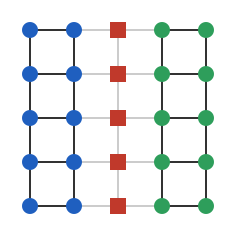

# 평면 분리자 정리

# 개요

**평면 분리자 정리(planar separator theorem)** 는 정점이 $n$ 개인 [평면 그래프](planar-graphs.md)에서 정점을 $O(\sqrt n)$ 개만 지우면, 남은 그래프가 정점이 각각 $2n/3$ 개 이하인 조각들로 나뉜다는 정리다. 도로망 같은 평면 그래프에서 계산을 두 반쪽으로 나누어 따로 하고 싶으면, 두 반쪽을 잇는 정점을 적게 골라내야 한다. 이 정리는 그런 정점 집합이 언제나 $\sqrt n$ 정도의 크기로 존재하고 선형 시간에 찾아진다는 것을 보여, 평면 그래프 문제를 분할 정복으로 푸는 근거가 된다.

# 직관

아래 그림은 정점 $25$ 개의 $5\times5$ 격자 그래프다. 가운데 세로줄의 정점 $5$ 개(빨간 사각형)를 지우면 왼쪽 $10$ 개와 오른쪽 $10$ 개가 남고, 둘 사이에는 간선이 없다. 각 조각은 $2\cdot25/3\approx16.7$ 개보다 적다.

$k\times k$ 격자에서는 가운데 줄 $k=\sqrt n$ 개로 같은 일을 한다. 격자가 아닌 평면 그래프에는 곧은 가운데 줄이 없다. 대신 한 정점에서 [그래프 탐색](graph-search.md)의 너비 우선 탐색을 하면 출발점에서의 걸음 수가 같은 정점들이 한 층을 이루고, 한 층을 지우면 그 앞의 층들과 뒤의 층들 사이에 간선이 없다. 층이 가운데 줄의 역할을 한다.

층 하나가 너무 클 수 있다. 그때는 작은 층 두 개로 자른 사이의 두꺼운 부분을 다시 나누는데, 거기서 평면성이 쓰인다.

# 정의

그래프 $G=(V,E)$ 의 정점 집합 $S$ 를 지운 $G-S$ 의 모든 연결 성분이 정점 $\alpha\lvert V\rvert$ 개 이하를 가지면 $S$ 를 $G$ 의 **$\alpha$-분리자($\alpha$-separator)** 라 한다. $\alpha=2/3$ 인 경우를 그냥 **분리자(separator)** 라 한다. 직관 절의 가운데 세로줄은 $5\times5$ 격자의 분리자다.

# 성질

## Lipton–Tarjan 정리

정리. 정점이 $n$ 개인 평면 그래프는 크기가 $2\sqrt2\thinspace\sqrt n$ 이하인 분리자를 가지고, 그런 분리자를 $O(n)$ 시간에 찾을 수 있다[^1].

증명의 요지. 연결 그래프로 두고 한 정점에서 너비 우선 탐색을 해 층 $L\_0,L\_1,\dots$ 를 얻는다. 앞쪽 층들의 정점 수 합이 처음으로 $n/2$ 이상이 되는 층을 $L\_{i}$ 라 한다. $i$ 이하에서 크기가 $\sqrt n$ 이하인 층 $L\_{a}$ 와 $i$ 이상에서 그런 층 $L\_{b}$ 를 $b-a$ 가 $O(\sqrt n)$ 이 되게 고를 수 있다. 층의 크기 합이 $n$ 이므로 $\sqrt n$ 개가 넘는 연속한 층이 모두 $\sqrt n$ 보다 클 수는 없다.

$L\_a$ 와 $L\_b$ 를 지우면 $L\_a$ 앞과 $L\_b$ 뒤의 부분은 각각 $n/2$ 개 이하다. 사이 부분은 너비 우선 탐색 나무의 깊이가 $O(\sqrt n)$ 이다. 이 부분을 삼각분할하면 신장 나무의 깊이가 $d$ 일 때 나무 간선과 나무 밖 간선 하나로 된 순환 가운데 정점 $2d+1$ 개 이하인 것이 그래프를 $2/3$ 비율로 나눈다. 이 순환과 두 층을 합친 것이 분리자다.

## 크기의 최적성

$k\times k$ 격자는 크기가 $ck$ 보다 작은 분리자를 갖지 않는 상수 $c\gt 0$ 이 있다. 그래서 $\sqrt n$ 의 차수는 줄일 수 없다. 상수 $2\sqrt2$ 는 이후 $\sqrt{4.5}\thinspace\sqrt n$ 등으로 개선되었다[^2].

## 반복 분할

분리자를 지운 조각에 다시 정리를 적용하면, 평면 그래프는 각 단계에서 $O(\sqrt m)$ 개 정점을 지워 정점 $m$ 개의 조각을 둘로 나누는 재귀 분할을 가진다. 깊이는 $O(\log n)$ 이고 모든 단계에서 지운 정점은 합쳐 $O(\sqrt n)$ 개다. 단계마다 조각의 크기가 $2/3$ 배 이하로 줄어 지운 정점 수의 합이 첫 단계의 $\sqrt n$ 에 상수를 곱한 값으로 묶인다.

# 활용

- 중첩 분할(nested dissection). 평면 격자에서 나온 희소 연립방정식을 [Gauss 소거법](gaussian-elimination.md)으로 풀 때, 분리자 정점을 맨 뒤에 소거하는 순서를 재귀로 정하면 새로 생기는 0 아닌 성분이 $O(n\log n)$ 개이고 연산이 $O(n^{3/2})$ 번이다[^3].
- 평면 그래프의 [근사 알고리즘](approximation-algorithms.md). 최대 독립 집합처럼 일반 그래프에서 근사가 어려운 문제를, 분리자로 조각을 작게 나눈 뒤 조각마다 정확히 풀어 평면 그래프에서 임의의 정확도로 근사한다[^4].
- 평면 그래프의 최단 경로와 최대 흐름. 분리자 정점들 사이의 거리만 저장하는 재귀 구조로 계산 시간을 줄인다.
- 나무폭. 평면 그래프의 [나무폭](treewidth.md)이 $O(\sqrt n)$ 이라는 것이 반복 분할에서 나온다.

[^1]: R. J. Lipton, R. E. Tarjan, "A separator theorem for planar graphs", *SIAM Journal on Applied Mathematics* **36** (1979), 177–189.
[^2]: N. Alon, P. Seymour, R. Thomas, "Planar separators", *SIAM Journal on Discrete Mathematics* **7** (1994), 184–193.
[^3]: R. J. Lipton, D. J. Rose, R. E. Tarjan, "Generalized nested dissection", *SIAM Journal on Numerical Analysis* **16** (1979), 346–358.
[^4]: R. J. Lipton, R. E. Tarjan, "Applications of a planar separator theorem", *SIAM Journal on Computing* **9** (1980), 615–627.

# 연관 문서

## 선수지식

- [평면 그래프](planar-graphs.md)
- [그래프 탐색](graph-search.md)

## 더 알아보기

- [중첩 분할](nested-dissection.md)

#graph_theory #algorithms #combinatorics
