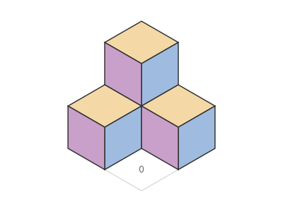

# 평면 분할

# 개요

**평면 분할(plane partition)** 은 방의 구석에 쌓은 정육면체 더미를, 바닥 칸마다 쌓은 개수를 적은 수의 표로 나타낸 것이다. 구석에서 멀어질수록 더미가 낮아지도록 쌓는다는 규칙 아래에서, 정육면체 $n$ 개를 쌓는 방법이 몇 가지인지, 크기가 정해진 상자 안에 쌓는 방법이 몇 가지인지를 묻는다.

정육면체 $2$ 개는 가로로 둘, 세로로 둘, 위로 둘의 $3$ 가지로 쌓는다. 이 개수들은 [분할수](partitions.md)처럼 무한곱의 계수로 나오고, 상자 안에 쌓는 방법의 수는 경로 수를 늘어놓은 행렬식 하나로 계산된다.

# 직관

정육면체 $4$ 개를 구석에 쌓은 아래 그림을 바닥에서 보면, 구석 칸에 $2$ 개, 그 오른쪽과 왼쪽 칸에 $1$ 개씩이 있다. 칸마다 쌓은 개수를 적으면 다음 표가 된다.

$$
\begin{matrix}2&1\cr 1&0\end{matrix}
$$

더미가 공중에 뜨지 않고 구석에 기대려면, 표의 수가 오른쪽으로 가도 아래로 가도 커지지 않아야 한다. 거꾸로 이런 표가 주어지면 칸마다 그 수만큼 쌓아 더미 하나가 정해진다. 그래서 더미를 세는 문제는 표를 세는 문제다.

표에 쓴 수의 합이 $1$, $2$, $3$ 인 표는 각각 $1$, $3$, $6$ 개다. 합이 $3$ 이면 한 칸에 $3$ 을 쓴 것, $1$ 셋을 가로나 세로로 쓴 것, $2$ 와 $1$ 을 가로나 세로로 쓴 것, $1$ 셋을 ㄱ 자로 쓴 것을 더해 모두 $6$ 개다.

# 정의

## 평면 분할

음이 아닌 정수 $\pi\_{ij}$ $(i,j\ge 1)$ 의 배열이 유한 개만 $0$ 이 아니고 다음을 만족하면 평면 분할이라 한다.

$$
\pi\_{ij}\ge\pi\_{i+1,j},\qquad\pi\_{ij}\ge\pi\_{i,j+1}
$$

수의 합 $\vert\pi\vert=\sum\_{i,j}\pi\_{ij}$ 를 $\pi$ 의 크기라 한다. 직관 절의 표는 크기 $4$ 인 평면 분할이다. 첫 행만 $0$ 이 아니면 보통의 분할이다.

## 상자에 들어가는 평면 분할

$\pi\_{ij}\ne 0$ 인 칸이 $i\le a$, $j\le b$ 이고 모든 수가 $c$ 이하이면, $\pi$ 는 $a\times b\times c$ 상자에 들어간다고 한다. 정육면체 더미가 가로 $a$, 세로 $b$, 높이 $c$ 인 상자 안에 있다는 뜻이다. 직관 절의 표는 $2\times 2\times 2$ 상자에 들어간다.

# 성질

## MacMahon 생성함수

크기 $n$ 인 평면 분할의 수를 $\mathrm{pp}(n)$ 이라 하면 다음이 성립한다[^1].

$$
\sum\_{n\ge 0}\mathrm{pp}(n)q^n=\prod\_{k\ge 1}\frac{1}{(1-q^k)^k}
$$

우변을 전개하면 다음이 나온다.

$$
1+q+3q^2+6q^3+13q^4+\cdots
$$

$q^2$ 의 계수 $3$ 은 첫 인수에서 $q^2$ 을 한 번, 둘째 인수 $(1-q^2)^{-2}$ 에서 $q^2$ 을 두 가지로 고른 것이다.

분할수의 생성함수 $\prod\_k(1-q^k)^{-1}$ 과 견주면 인수 $(1-q^k)^{-1}$ 이 $k$ 번 곱해져 있다. 증명은 평면 분할을 대각선마다 자른 분할들의 열로 보고, 이웃한 두 분할이 서로 끼어 있다는 조건을 [Schur 다항식](schur-polynomials.md)의 Cauchy 항등식으로 세는 것이다.

## 상자 공식

$a\times b\times c$ 상자에 들어가는 평면 분할의 수는 다음과 같다[^1].

$$
\prod\_{i=1}^{a}\prod\_{j=1}^{b}\frac{i+j+c-1}{i+j-1}
$$

$1\times 1\times 1$ 에서는 $2$ 로, 빈 상자와 정육면체 하나다. $2\times 2\times 2$ 에서는 $3\cdot 2\cdot 2\cdot\frac53=20$ 이다.

## 마름모 쪽매와의 대응

정육면체 더미를 대각선 방향 $(1,1,1)$ 에서 내려다보면, 보이는 면이 모두 정삼각형 두 개로 된 마름모이고 그 마름모들이 변의 길이가 $a,b,c,a,b,c$ 인 육각형을 빈틈없이 덮는다. 직관 절의 그림에서 세 색이 마름모의 세 방향이다. 이렇게 $a\times b\times c$ 상자의 평면 분할과 그 육각형의 마름모 쪽매(lozenge tiling)가 일대일로 대응한다.

## 경로와 행렬식

마름모 쪽매에서 한 방향의 마름모를 지우고 나머지 두 방향의 마름모 가운데선을 이으면, 육각형의 한 변에서 맞은편 변으로 가는 겹치지 않는 격자 경로 $c$ 개가 된다. [Lindström–Gessel–Viennot 보조정리](lindstrom-gessel-viennot-lemma.md)를 쓰면 상자 공식의 값은 다음 행렬식이다.

$$
\det\left\lbrack\binom{a+b}{a-i+j}\right\rbrack\_{1\le i,j\le c}
$$

$a=b=c=2$ 이면 다음과 같이 상자 공식과 같은 값이 나온다.

$$
\det\begin{pmatrix}6&4\cr 4&6\end{pmatrix}=36-16=20
$$

이 행렬식을 계산해 곱의 꼴로 바꾸면 상자 공식이 증명된다.

# 활용

- 무작위 쪽매의 극한 모양. 큰 육각형의 마름모 쪽매를 고르게 무작위로 고르면, 꼭짓점 근처는 한 방향의 마름모로 얼어붙고 가운데 원 안에서만 세 방향이 섞인다. 경로들의 위치가 [결정점과정](determinantal-point-process.md)이어서 이 경계의 요동을 계산한다.
- 대칭류의 열거. 대각선에 대해 대칭인 평면 분할, 회전에 대해 불변인 평면 분할처럼 대칭을 준 열 가지 부류를 Stanley 가 정리했다[^2]. 그 가운데 완전 대칭이고 자기 보완인 평면 분할의 수는 [교대 부호 행렬](alternating-sign-matrices.md)의 수와 같다.
- 결정 녹는 모형. 구석에 쌓인 결정이 꼭짓점부터 녹는 모형에서 각 상태가 평면 분할이고, 크기 $n$ 마다 가중치 $q^n$ 을 준 분포에서 $q\to 1$ 일 때의 극한 모양을 Okounkov 와 Reshetikhin 이 계산했다.

[^1]: P. A. MacMahon, Combinatory Analysis, Vol. 2, Cambridge University Press, 1916.
[^2]: R. P. Stanley, "Symmetries of plane partitions", Journal of Combinatorial Theory, Series A 43 (1986), 103–113.

# 연관 문서

## 선수지식

- [분할수](partitions.md)
- [Lindström–Gessel–Viennot 보조정리](lindstrom-gessel-viennot-lemma.md)

## 더 알아보기

아직 연결한 문서가 없다.

#combinatorics #algebra #probability
