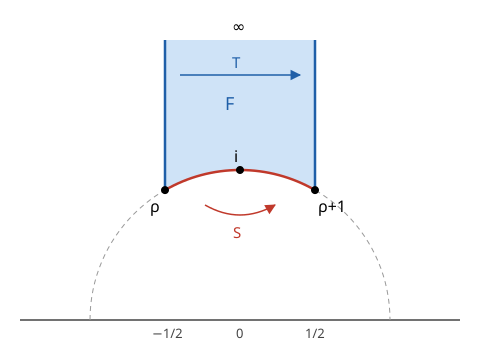

# Poincaré 다각형 정리

# 개요

**Poincaré 다각형 정리(Poincaré's polygon theorem)** 는 쌍곡평면의 다각형 하나와 그 변을 둘씩 짝지어 붙이는 등거리변환들이 주어졌을 때, 꼭짓점에 모이는 각만 확인하면 그 변환들이 생성하는 군이 [Fuchs 군](fuchsian-groups.md)이고 다각형이 기본 영역이라는 정리다. 내각이 $\pi/4$ 인 정팔각형의 마주 보는 변을 붙이는 변환 넷은 무한히 많은 원소를 생성하므로, 팔각형의 복사본들이 겹치지 않는지를 원소마다 확인할 수는 없다.

정리는 이 물음을 꼭짓점 여덟에 모이는 각의 합 $8\cdot\pi/4=2\pi$ 하나로 바꾼다. 합이 $2\pi$ 를 정수로 나눈 값이면 복사본들이 평면을 빈틈과 겹침 없이 덮는다.

# 직관

[모듈러 군](modular-group.md)의 기본 영역 $F$ 는 $\lvert\mathrm{Re}\thinspace\tau\rvert\le\frac12$, $\lvert\tau\rvert\ge1$ 인 영역이다. 아래 그림에서 $F$ 의 두 세로 변은 $T(\tau)=\tau+1$ 로 붙고, 아래쪽 원호의 두 반쪽은 $S(\tau)=-1/\tau$ 로 $i$ 를 중심으로 접혀 붙는다. 꼭짓점은 $\rho=e^{2\pi i/3}$, $i$, $\rho+1$ 과 위쪽 끝 $\infty$ 다.

$F$ 의 복사본을 붙여 가며 꼭짓점 $\rho$ 의 둘레를 채운다. $F$ 는 $\rho$ 에서 각 $\pi/3$ 을 차지한다. $T^{-1}F$ 는 $F$ 의 왼쪽 세로 변을 공유하며 붙고, $F$ 의 꼭짓점 $\rho+1$ 이 $\rho$ 로 옮겨지므로 $\rho$ 에서 다시 $\pi/3$ 을 차지한다. 두 각의 합은 $2\pi/3$ 이다.

$\rho$ 를 한 바퀴 돌려면 $2\pi$ 가 필요하고, $2\pi$ 는 $2\pi/3$ 의 정확히 세 배다. 변환 $ST(\tau)=-1/(\tau+1)$ 은 $ST(\rho)=-1/(\rho+1)=\rho$ 를 만족하고 $\rho$ 를 중심으로 $2\pi/3$ 만큼 돈다. 그래서 $F$, $T^{-1}F$ 의 쌍을 $ST$ 로 두 번 더 돌리면 복사본 여섯이 $\rho$ 둘레를 겹침 없이 채운다. 이것이 관계 $(ST)^3=1$ 이다.

꼭짓점 $i$ 에서는 $F$ 가 각 $\pi$ 를 차지하고 $SF$ 가 나머지 $\pi$ 를 채운다. $S$ 를 두 번 하면 원래 자리이므로 관계 $S^2=1$ 이 나온다. 꼭짓점 $\infty$ 에서는 $F$ 의 각이 $0$ 이고, $T$ 의 거듭제곱으로 옮긴 복사본들이 끝없이 옆으로 늘어선다.

각의 합이 $2\pi$ 를 정수로 나눈 값이 아니면 이 일이 일어나지 않는다. 합이 $2\pi/2.5$ 이면 순환을 세 번 쓴 각이 $3\cdot 2\pi/2.5=2.4\pi$ 로 $2\pi$ 를 넘으므로, 세 번째로 붙인 복사본이 처음 놓은 것과 겹친다.

# 정의

## 쌍곡 다각형

**쌍곡 다각형(hyperbolic polygon)** 은 쌍곡평면 $\mathbb H$ 에서 유한 개의 측지선 조각으로 둘러싸인 볼록한 닫힌 영역이다. 측지선 조각을 **변(side)**, 두 변이 만나는 점을 **꼭짓점(vertex)** 이라 한다. 두 변이 실수축 위나 $\infty$ 에서 만나면 그 점을 **이상 꼭짓점(ideal vertex)** 이라 하고, 그 자리의 내각은 $0$ 이다.

직관 절의 $F$ 는 꼭짓점 $\rho$, $i$, $\rho+1$ 과 이상 꼭짓점 $\infty$ 를 가진 사각형이다. 원호를 $i$ 에서 두 변으로 나누었으므로 $i$ 의 내각은 $\pi$ 다.

## 변 짝짓기

다각형 $P$ 의 **변 짝짓기(side pairing)** 는 변마다 짝 변 $s'$ 과 방향 보존 등거리변환 $g\_s$ 를 정한 것으로, 다음을 만족한다.

1. $g\_s$ 는 $s'$ 을 $s$ 로 보내고, $g\_s(P)$ 와 $P$ 는 $s$ 에서만 만난다.
2. $s$ 의 짝 변은 $s'$ 이고 $g\_{s'}=g\_s^{-1}$ 이다.

$F$ 에서는 오른쪽 세로 변을 왼쪽 세로 변으로 보내는 $T^{-1}$ 과 그 역 $T$, 그리고 원호의 두 반쪽을 서로 보내는 $S$ 가 변 짝짓기다. $S=S^{-1}$ 이므로 조건 2 를 만족한다.

## 꼭짓점 순환

꼭짓점 $v\_1$ 에서 출발해 $v\_1$ 을 끝점으로 갖는 변 $s\_1$ 을 고르고, 짝짓기 변환으로 $v\_1$ 을 옮긴 점을 $v\_2$ 라 한다. $v\_2$ 를 끝점으로 갖는 다른 변으로 같은 일을 되풀이하면 유한 번 뒤에 $v\_1$ 로 돌아온다. 이렇게 얻은 꼭짓점의 열 $v\_1,\dots,v\_k$ 를 **꼭짓점 순환(vertex cycle)** 이라 하고, 그동안 쓴 변환을 차례로 합성한 $h$ 를 **순환 변환(cycle transformation)** 이라 한다. $h$ 는 $v\_1$ 을 고정한다.

$F$ 의 꼭짓점 순환은 $\lbrace\rho,\rho+1\rbrace$, $\lbrace i\rbrace$, $\lbrace\infty\rbrace$ 셋이다. 내각의 합은 각각 $2\pi/3$, $\pi$, $0$ 이고 순환 변환은 각각 $ST$ 의 거듭제곱 하나, $S$, $T$ 다.

# 성질

## 정리

$P$ 를 쌍곡 다각형, $\lbrace g\_s\rbrace$ 를 변 짝짓기라 한다. 다음 두 조건이 성립한다고 한다[^1].

1. 이상 꼭짓점이 아닌 꼭짓점 순환마다 내각의 합이 $2\pi/m$ 이다. $m$ 은 순환마다 정해지는 양의 정수다.
2. 이상 꼭짓점의 순환마다 순환 변환이 포물형이다.

그러면 $\Gamma=\langle g\_s\rangle$ 은 Fuchs 군이고 $P$ 는 $\Gamma$ 의 기본 영역이다. $\Gamma$ 는 다음 관계들로 표시된다.

$$
g\_sg\_{s'}=1,\qquad h^{m}=1
$$

둘째 관계는 이상 꼭짓점이 아닌 꼭짓점 순환마다 하나씩 있고, $h$ 는 그 순환의 순환 변환, $m$ 은 조건 1 의 정수다.

증명의 요지. $\Gamma$ 의 원소와 $P$ 의 점을 짝으로 한 집합을 짝짓기 변환이 정하는 대로 붙여 곡면 $\widetilde X$ 를 만든다. 사상 $(g,x)\mapsto gx$ 는 $\widetilde X\to\mathbb H$ 이다.

조건 1 은 꼭짓점 둘레에서 이 사상이 국소적으로 단사이고 전사임을 보장한다. 조건 2 는 $\widetilde X$ 가 이상 꼭짓점 근처에서 완비임을 보장한다. 그러면 이 사상은 [덮개공간](covering-spaces.md)의 덮개사상이고, $\mathbb H$ 가 단순연결이므로 동형이다. 복사본 $gP$ 들이 겹치지 않고 $\mathbb H$ 를 덮는다는 것이 이 동형에서 나온다.

## 모듈러 군의 표시

$F$ 와 $T$, $S$ 에 정리를 쓰면 조건 1 은 $2\pi/3=2\pi/3$, $\pi=2\pi/2$ 이고 조건 2 는 $T$ 가 포물형이라는 것이다. 그래서 모듈러 군은 다음 표시를 갖는다.

$$
\mathrm{PSL}\_2(\mathbb Z)=\langle S,T\mid S^2=1,\thinspace (ST)^3=1\rangle
$$

[모듈러 군](modular-group.md) 문서의 직접 계산은 $S$, $T$ 가 군을 생성하고 이 두 관계를 만족함을 보인다. 정리는 다른 관계가 이 둘에서 유도된다는 것까지 준다.

## 넓이

내각이 $\alpha\_1,\dots,\alpha\_n$ 인 쌍곡 $n$ 각형의 넓이는 [Gauss–Bonnet 정리](gauss-bonnet.md)에서 다음과 같다.

$$
\mathrm{Area}(P)=(n-2)\pi-\sum\_{j=1}^n\alpha\_j
$$

$F$ 는 $n=4$ 이고 내각이 $\pi/3,\pi,\pi/3,0$ 이므로 넓이가 $2\pi-5\pi/3=\pi/3$ 이다. 내각 $\pi/4$ 인 정팔각형은 $6\pi-2\pi=4\pi$ 이고, 이는 종수 $2$ 인 닫힌 곡면의 넓이 $4\pi(g-1)$ 과 같다.

## 정팔각형과 종수 2 곡면

내각 $\pi/4$ 인 정팔각형에서 마주 보는 변을 짝짓는 변환 넷을 잡는다. 꼭짓점 여덟은 하나의 순환을 이루고 내각의 합이 $2\pi$ 이므로 조건 1 이 $m=1$ 로 성립한다. 이상 꼭짓점은 없다.

정리에서 네 변환이 생성하는 군은 Fuchs 군이고, 관계는 짝짓기 관계와 순환 변환이 항등이라는 관계 하나다. 유일한 순환에서 $m=1$ 이므로 타원형 원소가 없어 이 군은 꼬임이 없고, 몫은 팔각형의 변을 붙인 종수 $2$ 곡면이다.

## 각 조건을 만족하지 않는 팔각형

정팔각형의 크기를 키우면 내각이 줄어든다. 내각이 $\pi/5$ 이면 합이 $8\pi/5$ 이고 $2\pi$ 를 정수로 나눈 값이 아니다.

순환 변환은 꼭짓점을 중심으로 $8\pi/5$ 만큼 도는 회전이다. 꼭짓점 둘레에 복사본을 하나씩 붙이면 각 $\pi/5$ 씩 쌓이고, 열한째 복사본이 $2\pi$ 를 넘어 첫 복사본과 겹친다. 그래서 팔각형은 생성된 군의 기본 영역이 아니다.

## 반사군

변 짝짓기 대신 각 변에 대한 반사를 쓰는 판본이 있다. 내각이 모두 $\pi/m$ 꼴인 쌍곡 다각형에서 변에 대한 반사들이 생성하는 군은 이산이고 그 다각형이 기본 영역이며, 관계는 반사의 제곱과 이웃한 두 반사의 곱의 $m$ 제곱이다. [삼각군](triangle-groups.md)의 반사군이 내각 $\pi/p,\pi/q,\pi/r$ 인 삼각형에 이 판본을 쓴 것이고, 그 표시가 [Coxeter 군](coxeter-groups.md)의 표시다.

## 역방향

모든 Fuchs 군은 볼록한 기본 다각형을 갖는다. 점 $z\_0$ 을 고정하고 $z\_0$ 이 다른 어느 $gz\_0$ 보다 가까운 점들을 모은 [Dirichlet 영역](dirichlet-domains.md)이 그 다각형이고, 그 변 짝짓기가 군을 생성한다[^1]. 공부피가 유한하면 이 다각형의 변은 유한 개다.

# 활용

- [모듈러 군](modular-group.md)의 표시 $\langle S,T\mid S^2,(ST)^3\rangle$ 과 자유곱 분해 $\mathbb Z/2\ast\mathbb Z/3$ 이 기본 영역 $F$ 에 이 정리를 쓴 결과다.
- [합동 부분군](congruence-subgroups.md)의 기본 영역. $F$, $SF$, $STF$ 를 이어 붙인 $\Gamma_0(2)$ 의 기본 영역에 변 짝짓기를 찾으면 정리가 $\Gamma_0(2)$ 의 생성원과 관계를 준다.
- [Fuchs 군](fuchsian-groups.md)의 넓이 공식에서 종수, 타원형 고정점, 첨점은 기본 다각형의 꼭짓점 순환과 이상 꼭짓점에서 읽힌다.
- [Teichmüller 공간](teichmuller-space.md)의 점을 구체적으로 만들 때, 내각의 합이 $2\pi$ 인 $4g$ 각형과 그 변 짝짓기를 주면 종수 $g$ 곡면의 쌍곡 구조가 하나 정해진다.
- [Klein 사차곡선](klein-quartic.md)은 $\Delta(2,3,7)$ 삼각형 336 개를 붙인 14 각형에 변 짝짓기를 주어 얻는다.
- 3 차원 쌍곡공간의 다면체에도 같은 꼴의 Poincaré 다면체 정리(Poincaré polyhedron theorem)가 있고, Bianchi 군의 표시를 계산하는 데 쓰인다.

[^1]: S. Katok, *Fuchsian Groups*, University of Chicago Press, 1992, Ch. 3 과 Ch. 4. B. Maskit, "On Poincaré's theorem for fundamental polygons", *Advances in Mathematics* 7 (1971), 219–230.

# 연관 문서

## 선수지식

- [Fuchs 군](fuchsian-groups.md)

## 더 알아보기

- [Dirichlet 영역](dirichlet-domains.md)

#differential_geometry #group_theory #complex_analysis
