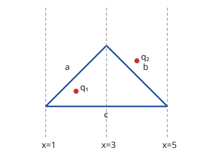

# 점 위치 찾기

# 개요

**점 위치 찾기(point location)** 는 평면을 선분들로 나눈 지도가 주어졌을 때, 질의점이 어느 칸에 드는지 빠르게 답하는 자료구조를 만드는 문제다. 지도에서 손가락으로 짚은 곳이 어느 행정구역인지 물을 때, 구역 경계의 선분이 $n$ 개면 선분을 하나씩 확인하는 데 $n$ 에 비례하는 시간이 든다.

점 위치 찾기는 지도를 미리 가공해 질의마다 $O(\log n)$ 시간에 답한다. 가공한 자료의 크기를 $O(n)$ 으로 줄이는 것이 이 문제의 중심이다.

# 직관

꼭짓점 $(1,1)$, $(3,3)$, $(5,1)$ 인 삼각형이 평면을 안과 밖으로 나눈다. 왼쪽 위 변을 $a$, 오른쪽 위 변을 $b$, 밑변을 $c$ 라 한다. 꼭짓점들의 $x$ 좌표 $1,3,5$ 에 세로선을 그어 평면을 띠 넷으로 자른다.

그림에서 한 띠 안에서는 선분들이 서로 만나지 않고 아래에서 위로 줄을 선다. $1\lt x\lt 3$ 인 띠에서는 $c$ 가 아래, $a$ 가 위이고, $3\lt x\lt 5$ 인 띠에서는 $c$ 가 아래, $b$ 가 위다.

질의점 $q_1=(2,1.5)$ 은 $x$ 좌표로 둘째 띠에 든다. 그 띠에서 $c$ 의 높이는 $1$, $a$ 의 높이는 $x=2$ 에서 $2$ 이므로 $q_1$ 은 $c$ 와 $a$ 사이, 곧 삼각형 안이다. $q_2=(4,2.5)$ 는 셋째 띠에서 $b$ 의 높이 $2$ 보다 위에 있어 삼각형 밖이다.

두 번의 이진 탐색으로 답이 나온다. 띠를 찾는 탐색과, 띠 안의 선분 줄에서 찾는 탐색이다. 그런데 띠마다 선분 줄을 따로 저장하면 띠가 $O(n)$ 개, 줄의 길이가 $O(n)$ 이어서 저장량이 $O(n^2)$ 까지 커진다.

# 정의

## 평면 분할

평면을 서로 안쪽에서 만나지 않는 선분 $n$ 개로 나눈 것을 **평면 분할(planar subdivision)** 이라 하고, 선분들로 둘러싸인 각 영역을 칸이라 한다. 직관 절의 삼각형은 선분 셋과 칸 둘로 된 평면 분할이다.

## 점 위치 찾기 문제

평면 분할을 미리 처리해 자료구조를 만들고, 질의점 $q$ 마다 $q$ 가 든 칸을 답하는 문제다. 비용은 처리 시간, 저장량, 질의 시간의 셋으로 잰다.

## 띠 방법

꼭짓점들의 $x$ 좌표로 평면을 세로 띠로 자르고, 띠마다 그 띠를 가로지르는 선분을 아래에서 위로 정렬해 두는 방법을 **띠 방법(slab method)** 이라 한다. D. Dobkin 과 R. J. Lipton 이 썼다[^1]. 질의 시간은 $O(\log n)$, 저장량은 $O(n^2)$ 이다.

# 성질

## 영속 탐색 트리

이웃한 두 띠의 선분 줄은 조금만 다르다. 직관 절에서 둘째 띠의 줄 $(c,a)$ 와 셋째 띠의 줄 $(c,b)$ 는 $a$ 를 빼고 $b$ 를 넣은 것이다. 꼭짓점 하나를 지날 때마다 그 꼭짓점에서 끝나는 선분을 빼고 시작하는 선분을 넣으므로, 모든 띠를 지나는 동안 넣고 빼는 횟수는 합해서 $2n$ 이다.

N. Sarnak 과 R. E. Tarjan 은 띠의 줄을 [영속 자료구조](persistent-data-structures.md)인 균형 탐색 트리의 판들로 저장했다[^2]. 왼쪽에서 오른쪽으로 쓸며 넣고 빼면 갱신마다 $O(1)$ 의 새 공간만 쓰고, 띠마다 그때의 판을 가리킨다. 저장량이 $O(n)$, 질의 시간이 $O(\log n)$ 이 된다.

## Kirkpatrick 계층

D. Kirkpatrick 은 평면 분할을 삼각형들로 나눈 뒤, 차수가 작은 꼭짓점들 가운데 서로 이웃하지 않는 것들을 지우고 생긴 구멍을 다시 삼각형으로 메우는 일을 되풀이했다[^3]. [평면 그래프](planar-graphs.md)는 변이 $3n-6$ 개 이하라 평균 차수가 $6$ 미만이므로, 차수가 상수 이하이고 서로 이웃하지 않는 꼭짓점이 매번 상수 비율만큼 있다.

그래서 꼭짓점 수가 매번 상수배로 줄어 단계가 $O(\log n)$ 개다. 질의는 마지막 단계의 큰 삼각형에서 시작해, 한 단계 내려갈 때마다 지금 삼각형과 겹치는 상수 개의 삼각형만 확인한다. 저장량 $O(n)$, 질의 시간 $O(\log n)$ 이다.

## 하한

비교로 답을 정하는 자료구조에서는 칸이 $n$ 개면 질의에 $\Omega(\log n)$ 번의 비교가 필요하다. 비교 $k$ 번의 결과는 $2^k$ 가지이고, 칸 $n$ 개를 구별하려면 $2^k\ge n$ 이어야 한다. 위의 두 방법은 상수배 안에서 최적이다.

# 활용

- 가장 가까운 점 질의. [Voronoi 도형](voronoi-diagrams.md)을 평면 분할로 두고 점 위치 찾기를 하면, 질의점과 가장 가까운 사이트가 $O(\log n)$ 시간에 나온다.
- 지리 정보 체계. 좌표로 행정구역, 토지 구획, 우편번호 구역을 찾는 질의가 이 문제다.
- 기하 알고리즘의 부분 단계. 무작위 점진 알고리즘으로 [사다리꼴 분할](trapezoidal-maps.md)을 만들면서 그 분할 위의 점 위치 찾기 구조를 함께 만드는 방법이 기대 저장량 $O(n)$, 기대 질의 시간 $O(\log n)$ 을 준다.

[^1]: D. Dobkin, R. J. Lipton, "Multidimensional searching problems", SIAM Journal on Computing 5 (1976), 181–186.
[^2]: N. Sarnak, R. E. Tarjan, "Planar point location using persistent search trees", Communications of the ACM 29 (1986), 669–679.
[^3]: D. Kirkpatrick, "Optimal search in planar subdivisions", SIAM Journal on Computing 12 (1983), 28–35.

# 연관 문서

## 선수지식

- [영속 자료구조](persistent-data-structures.md)
- [평면 그래프](planar-graphs.md)

## 더 알아보기

- [사다리꼴 분할](trapezoidal-maps.md)

#data_structures #algorithms #computation
