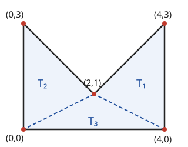

# 다각형 삼각분할

# 개요

**다각형 삼각분할(polygon triangulation)** 은 변이 서로 엇갈리지 않는 다각형을, 꼭짓점끼리 잇는 안쪽 선분으로 잘라 삼각형들로 나누는 것이다. 오목한 곳이 있는 다각형의 넓이를 재거나 화면에 칠하려면, 넓이와 칠하기가 쉬운 삼각형으로 먼저 나누어야 한다. 볼록 다각형은 한 꼭짓점에서 다른 꼭짓점으로 선분을 그으면 되지만, 오목한 다각형에서는 그 선분이 다각형 밖으로 나갈 수 있다.

다각형 삼각분할은 다각형 안에 있는 선분만 골라 긋는 방법을 정하고, 꼭짓점이 $n$ 개이면 언제나 삼각형 $n-2$ 개로 나뉜다는 것을 보장한다.

# 직관

꼭짓점이 $(0,0)$, $(4,0)$, $(4,3)$, $(2,1)$, $(0,3)$ 인 오각형을 본다. 위쪽 가운데가 $(2,1)$ 까지 파여 있다. $(0,0)$ 에서 $(4,3)$ 으로 선분을 그으면 $x=2$ 에서 높이가 $1.5$ 이고, 파인 곳의 바닥 $(2,1)$ 보다 높아 다각형 밖을 지난다.

$(4,3)$ 에서는 사정이 다르다. 양옆의 꼭짓점 $(4,0)$ 과 $(2,1)$ 을 잇는 선분은 다각형 안에 있고, 세 점이 이루는 삼각형 안에 다른 꼭짓점이 없다. 그 삼각형 $T\_1$ 을 잘라 내면 꼭짓점 넷의 다각형이 남는다.

남은 다각형에서 $(0,3)$ 의 양옆 $(2,1)$ 과 $(0,0)$ 을 잇고 삼각형 $T\_2$ 를 잘라 내면, 마지막 삼각형 $T\_3$ 이 남는다. 꼭짓점 $5$ 개가 삼각형 $3$ 개로 나뉘었고, 그은 선분은 $2$ 개다.

# 정의

## 단순 다각형과 대각선

꼭짓점 $v\_1,\dots,v\_n$ 을 차례로 잇고 $v\_n$ 에서 $v\_1$ 로 돌아오는 닫힌 꺾은선이 자기 자신과 만나지 않으면 **단순 다각형(simple polygon)** 이라 한다. [Jordan 곡선 정리](jordan-curve-theorem.md)로 이 꺾은선은 평면을 안과 밖으로 나눈다. 두 꼭짓점을 잇는 선분이 끝점 말고는 다각형의 안쪽에만 있으면 그 선분을 **대각선(diagonal)** 이라 한다.

직관 절에서 $(4,0)$ 과 $(2,1)$ 을 잇는 선분은 대각선이고, $(0,0)$ 과 $(4,3)$ 을 잇는 선분은 밖을 지나므로 대각선이 아니다.

## 삼각분할과 귀

서로 엇갈리지 않는 대각선들로 다각형을 삼각형들로 나눈 것을 **삼각분할(triangulation)** 이라 한다. 연속한 세 꼭짓점 $v\_{i-1},v\_i,v\_{i+1}$ 에서 $v\_{i-1}v\_{i+1}$ 이 대각선이면, 삼각형 $v\_{i-1}v\_iv\_{i+1}$ 을 $v\_i$ 의 **귀(ear)** 라 한다. 직관 절의 오각형은 $(4,3)$ 과 $(0,3)$ 에 귀가 있고, 나머지 세 꼭짓점에는 없다.

# 성질

## 삼각형의 수

꼭짓점이 $n\ge 3$ 개인 단순 다각형은 삼각분할이 존재하고, 어느 삼각분할이든 삼각형이 $n-2$ 개, 대각선이 $n-3$ 개다.

증명의 요지. $n\ge 4$ 이면 대각선이 하나 있다. 가장 왼쪽 꼭짓점 $v$ 와 그 양옆 $u,w$ 를 잡는다. 선분 $uw$ 가 다각형 안에 있으면 그것이 대각선이다. 아니면 삼각형 $uvw$ 안에 다른 꼭짓점이 있고, 그 가운데 직선 $uw$ 에서 가장 먼 꼭짓점과 $v$ 를 잇는 선분이 대각선이다.

대각선 하나는 다각형을 꼭짓점 $n\_1$, $n\_2$ 개의 두 다각형으로 나누고 $n\_1+n\_2=n+2$ 다. 귀납법으로 삼각형이 $(n\_1-2)+(n\_2-2)=n-2$ 개다. 삼각형의 내각을 모두 더하면 다각형의 내각의 합 $(n-2)\pi$ 가 나온다.

## 두 귀 정리

꼭짓점이 $n\ge 4$ 개인 단순 다각형에는 서로 겹치지 않는 귀가 둘 이상 있다(Meisters).[^1]

증명의 요지. 삼각분할의 삼각형을 꼭짓점으로 두고 대각선을 공유하는 두 삼각형을 이은 그래프를 만든다. 이 그래프는 트리(tree)이고 꼭짓점이 둘 이상이므로 잎이 둘 이상이다. 잎인 삼각형은 두 변이 다각형의 변이므로 귀다.

귀를 찾아 잘라 내기를 되풀이하는 **귀 자르기(ear clipping)** 는 귀 하나를 찾는 데 $O(n)$ 이 들어 $O(n^2)$ 시간에 삼각분할을 만든다.

## 단조 다각형으로 나누기

어느 수평선과도 한 구간에서만 만나는 다각형을 $y$ 단조(y-monotone) 다각형이라 한다. $y$ 단조 다각형은 꼭짓점을 위에서 아래로 훑으며 스택에 쌓인 꼭짓점과 대각선을 긋는 방법으로 $O(n)$ 시간에 삼각분할된다.

단순 다각형은 위에서 아래로 쓸며 단조성을 깨는 꼭짓점마다 대각선을 하나 그어 $O(n\log n)$ 시간에 단조 다각형들로 나뉜다(Garey, Johnson, Preparata, Tarjan).[^2] 쓸기 선과 만나는 변들을 탐색 트리에 두는 것은 [Bentley–Ottmann 알고리즘](bentley-ottmann.md)과 같다. 두 단계를 합쳐 $O(n\log n)$ 시간이다.

## 더 빠른 알고리즘

R. Seidel 은 [사다리꼴 분할](trapezoidal-maps.md)을 무작위 점진 방법으로 만들어 기대 $O(n\log^\ast n)$ 시간에 삼각분할했다. B. Chazelle 은 결정적 $O(n)$ 시간 알고리즘을 주었다.[^3]

# 활용

- 미술관 정리(art gallery theorem). 꼭짓점이 $n$ 개인 미술관을 지키는 데 경비원 $\lfloor n/3\rfloor$ 명이면 충분하고, 그만큼 필요한 미술관이 있다(Chvátal). S. Fisk 의 증명은 삼각분할의 꼭짓점을 세 색으로 칠하고 가장 적게 쓰인 색의 꼭짓점에 경비원을 둔다. 색마다 모든 삼각형에 한 꼭짓점씩 있으므로 그 색의 꼭짓점들이 다각형 전체를 본다.[^4]
- 그래픽스. 그래픽 처리 장치는 삼각형만 그리므로, 글자의 윤곽이나 지도의 구역 같은 다각형을 칠하기 전에 삼각분할한다.
- 넓이와 무게중심. 삼각형마다 넓이와 무게중심을 구해 더하면 다각형의 넓이와 무게중심이 나온다.

[^1]: G. H. Meisters, "Polygons have ears", *American Mathematical Monthly* **82** (1975), 648–651.
[^2]: M. R. Garey, D. S. Johnson, F. P. Preparata, R. E. Tarjan, "Triangulating a simple polygon", *Information Processing Letters* **7** (1978), 175–179.
[^3]: R. Seidel, "A simple and fast incremental randomized algorithm for computing trapezoidal decompositions and for triangulating polygons", *Computational Geometry: Theory and Applications* **1** (1991), 51–64. B. Chazelle, "Triangulating a simple polygon in linear time", *Discrete & Computational Geometry* **6** (1991), 485–524.
[^4]: V. Chvátal, "A combinatorial theorem in plane geometry", *Journal of Combinatorial Theory, Series B* **18** (1975), 39–41. S. Fisk, "A short proof of Chvátal's watchman theorem", *Journal of Combinatorial Theory, Series B* **24** (1978), 374.

# 연관 문서

## 선수지식

- [Bentley–Ottmann 알고리즘](bentley-ottmann.md)

## 더 알아보기

아직 연결한 문서가 없다.

#algorithms #computation #combinatorics
