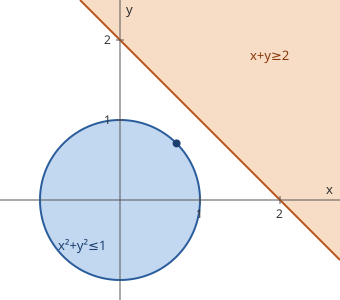

# Positivstellensatz

# 개요

**Positivstellensatz(Krivine–Stengle Positivstellensatz)** 는 실수 다항식 부등식계에 해가 없는 것과, 부등식들과 제곱식을 더해 $-1$ 을 만드는 항등식이 있는 것이 같다는 정리다. 원판 $x^2+y^2\le 1$ 안에 $x+y\ge 2$ 인 점이 있는지 묻는 문제가 이런 부등식계다. 이 정리는 해가 없을 때 전개만으로 확인되는 항등식을 증거로 내놓게 해, 최댓값을 구하지 않고도 해가 없음을 보인다.

# 직관

원판 $x^2+y^2\le 1$ 과 반평면 $x+y\ge 2$ 가 만나는지 본다. 그림에서 원판은 파란 영역이고, 반평면은 주황 직선의 오른쪽 위다. 원판에서 $x+y$ 가 가장 큰 점은 그림의 점 $(1/\sqrt2,1/\sqrt2)$ 이고 그 값은 $\sqrt2$ 이므로 둘은 만나지 않는다.

이 논증은 원판 위에서 $x+y$ 의 최댓값을 구해야 한다. 변수가 많거나 영역이 복잡하면 최댓값을 구하는 것이 처음 문제만큼 어렵다.

[Hilbert 영점 정리](hilbert-nullstellensatz.md)에서는 방정식들에 다항식을 곱해 더해 $1$ 을 만들면 해가 없다는 증거가 되었다. 부등식에서도 같은 방법을 쓴다. 두 조건을 $g=1-x^2-y^2\ge 0$ 과 $f=x+y-2\ge 0$ 으로 적으면 다음 항등식이 성립한다.

$$
(x-1)^2+(y-1)^2+g+2f=-1
$$

좌변을 전개하면 $x^2$, $y^2$, $x$, $y$ 의 항이 모두 지워지고 상수 $1+1+1-4=-1$ 이 남는다. 원판 안에서 $x+y\ge 2$ 인 점이 있으면 그 점에서 좌변의 네 항이 모두 $0$ 이상이라 좌변이 $0$ 이상인데, 우변은 $-1$ 이다. 그래서 이 항등식 하나가 해가 없다는 증거다.

영점 정리가 실수에서 실패한 $x^2+1=0$ 도 이 꼴의 증거가 있다. 등식을 두 부등식 $x^2+1\ge 0$ 과 $-(x^2+1)\ge 0$ 으로 적으면 $x^2+(-(x^2+1))=-1$ 이다. 해가 없으면 언제나 이런 항등식이 있다는 것이 Positivstellensatz 이고, 그러려면 조건끼리 곱한 항 $fg$ 까지 더하는 것을 허용해야 한다.

# 정의

$\mathbb R\lbrack x\rbrack=\mathbb R\lbrack x_1,\dots,x_n\rbrack$ 은 실계수 [다항식환](polynomial-rings.md)이다.

## 제곱합

**제곱합(sum of squares)** 은 $q_1,\dots,q_r\in\mathbb R\lbrack x\rbrack$ 에 대해 $q_1^2+\cdots+q_r^2$ 꼴로 쓰이는 다항식이다. 제곱합 전체의 집합을 $\Sigma$ 로 쓴다. 직관 절의 $(x-1)^2+(y-1)^2$ 은 제곱합이고, 양의 상수 $2=(\sqrt2)^2$ 도 제곱합이다. 제곱합은 모든 점에서 $0$ 이상이다.

## 기본 반대수 집합

$g_1,\dots,g_m\in\mathbb R\lbrack x\rbrack$ 에 대해 다음 집합을 **기본 반대수 집합(basic semialgebraic set)** 이라 한다.

$$
K(g)=\lbrace a\in\mathbb R^n:g_1(a)\ge 0,\dots,g_m(a)\ge 0\rbrace
$$

직관 절의 원판과 반평면의 교집합은 $g_1=1-x^2-y^2$, $g_2=x+y-2$ 로 정한 $K(g)$ 이고 빈 집합이다. 등식 $h=0$ 은 두 부등식 $h\ge 0$, $-h\ge 0$ 으로 적는다.

## Preordering 과 quadratic module

$e=(e_1,\dots,e_m)\in\lbrace 0,1\rbrace^m$ 에 대해 $g^e=g_1^{e_1}\cdots g_m^{e_m}$ 으로 쓴다. $g$ 가 생성하는 **preordering** 은 다음 집합이다.

$$
T(g)=\Bigl\lbrace\sum_{e\in\lbrace 0,1\rbrace^m}\sigma_eg^e:\sigma_e\in\Sigma\Bigr\rbrace
$$

조건끼리의 곱을 빼고 다음 꼴만 모은 집합을 $g$ 가 생성하는 **quadratic module** 이라 하고 $M(g)$ 로 쓴다.

$$
M(g)=\lbrace\sigma_0+\sigma_1g_1+\cdots+\sigma_mg_m:\sigma_i\in\Sigma\rbrace
$$

$M(g)\subseteq T(g)$ 이고, $T(g)$ 와 $M(g)$ 의 원소는 모두 $K(g)$ 위에서 $0$ 이상이다.

직관 절의 항등식은 $\sigma_0=(x-1)^2+(y-1)^2$, $\sigma_1=1$, $\sigma_2=2$ 로 $-1=\sigma_0+\sigma_1g_1+\sigma_2g_2$ 를 준다. 그래서 $-1\in M(g)$ 이다.

# 성질

## Krivine–Stengle Positivstellensatz

**정리.** $g_1,\dots,g_m,f\in\mathbb R\lbrack x\rbrack$ 이고 $K=K(g)$, $T=T(g)$ 라 하면 다음이 성립한다[^1][^2].

1. $K=\varnothing$ 인 것과 $-1\in T$ 인 것은 동치다.
2. $K$ 위에서 $f\gt 0$ 인 것과 $pf=1+q$ 를 만족하는 $p,q\in T$ 가 있는 것은 동치다.
3. $K$ 위에서 $f\ge 0$ 인 것과 $pf=f^{2k}+q$ 를 만족하는 $p,q\in T$ 와 $k\ge 0$ 이 있는 것은 동치다.
4. $K$ 위에서 $f=0$ 인 것과 $-f^{2k}\in T$ 인 $k\ge 0$ 이 있는 것은 동치다.

*증명의 요지.* 1 의 한쪽은 직관 절처럼 $K$ 의 점을 대입하면 나온다. 반대쪽은 $-1\notin T$ 일 때 [선택 공리](axiom-of-choice.md) 문서의 Zorn 보조정리(Zorn's lemma)로 $T$ 를 극대인 것으로 넓혀 $\mathbb R\lbrack x\rbrack$ 의 어떤 소 아이디얼에 의한 몫의 분수체에 순서를 만든다. 그 [실폐체](real-closed-fields.md)인 실폐포에서는 변수 $x_i$ 의 상이 모든 $g_j\ge 0$ 을 만족하므로, 실폐체 문서의 Tarski–Seidenberg 정리로 $\mathbb R^n$ 에도 그런 점이 있다.

2 는 1 을 $g_1,\dots,g_m,-f$ 에 적용한다. $K$ 위에서 $f\gt 0$ 이면 $K(g,-f)=\varnothing$ 이므로 $-1=s_0+s_1\cdot(-f)$ 인 $s_0,s_1\in T$ 가 있고, $s_1f=1+s_0$ 이다. 3 과 4 는 같은 방법에 [Hilbert 영점 정리](hilbert-nullstellensatz.md)의 Rabinowitsch 기법처럼 변수를 하나 더한다.

## 실영점 정리

아이디얼 $J\subseteq\mathbb R\lbrack x\rbrack$ 의 **실근기(real radical)** 는 어떤 $k\ge 1$ 과 $\sigma\in\Sigma$ 에 대해 $g^{2k}+\sigma\in J$ 인 $g$ 전체이고, $\sqrt[\mathbb R]{J}$ 로 쓴다.

**정리(실영점 정리, real Nullstellensatz).** $V\_{\mathbb R}(J)$ 를 $J$ 의 실수 해집합이라 하면 $I(V\_{\mathbb R}(J))=\sqrt[\mathbb R]{J}$ 다[^2].

$J$ 의 생성원 $h$ 마다 $h\ge 0$ 과 $-h\ge 0$ 을 두고 위 정리의 4 를 적용하면 나온다. $J=(x^2+y^2)$ 이면 실수 해는 원점 하나이고 $x$ 는 거기서 $0$ 이다. $x^2+y^2\in J$ 이므로 $k=1$, $\sigma=y^2$ 으로 $x\in\sqrt[\mathbb R]{J}$ 다. 복소수에서는 $x^2+y^2=(x+iy)(x-iy)$ 의 해집합이 두 직선이고 $x$ 는 거기서 $0$ 이 아니므로, 보통의 근기에는 $x$ 가 들어 있지 않다.

## Hilbert 17번 문제

$m=0$ 이면 $K=\mathbb R^n$ 이고 $T=\Sigma$ 다. 모든 점에서 $f\ge 0$ 이면 정리의 3 으로 $pf=f^{2k}+q$ 인 제곱합 $p,q$ 가 있다. $f\ne 0$ 이면 $p\ne 0$ 이고 다음이 나온다.

$$
f=\frac{pf}{p}=\frac{(f^{2k}+q)\thinspace p}{p^2}
$$

분자는 제곱합끼리의 곱이라 제곱합이고 분모는 제곱이므로, $f$ 는 유리함수의 제곱합이다. 실폐체 문서의 Hilbert 17번 문제에 대한 Artin 의 답이 이렇게 다시 나온다.

## 분모가 필요한 다항식

음이 아닌 다항식이 다항식의 제곱합이 되지 않는 예가 있어서 3 의 $p$ 는 뺄 수 없다. **Motzkin 다항식(Motzkin polynomial)** 은 다음 다항식이다.

$$
M(x,y)=x^4y^2+x^2y^4-3x^2y^2+1
$$

세 수 $x^4y^2$, $x^2y^4$, $1$ 의 산술평균은 기하평균 $x^2y^2$ 이상이므로 [산술-기하 평균 부등식](am-gm-inequality.md)으로 $M\ge 0$ 이다. $M$ 이 다항식의 제곱합 $\sum_iq_i^2$ 이면 지수 벡터의 볼록 껍질을 비교해 각 $q_i$ 에 들어갈 수 있는 단항식이 $1$, $xy$, $x^2y$, $xy^2$ 으로 좁혀진다. 그러면 $x^2y^2$ 의 계수가 $(xy)^2$ 항에서만 나와 $0$ 이상이 되어 $-3$ 과 모순이다[^3].

$n$ 변수 차수 $2d$ 의 음이 아닌 다항식이 모두 다항식의 제곱합인 것은 $n=1$ 이거나 $2d=2$ 이거나 $(n,2d)=(2,4)$ 일 때뿐이다(Hilbert, 1888)[^4]. Motzkin 다항식은 $(n,2d)=(2,6)$ 의 반례다.

## Schmüdgen 정리와 Putinar 정리

$K$ 가 콤팩트이면 분모 없이 쓸 수 있다.

**정리(Schmüdgen 정리, Schmüdgen's theorem).** $K(g)$ 가 콤팩트이고 $K(g)$ 위에서 $f\gt 0$ 이면 $f\in T(g)$ 다[^5].

어떤 $N$ 에 대해 $N-x_1^2-\cdots-x_n^2\in M(g)$ 이면 $M(g)$ 가 **Archimedes 조건(Archimedean condition)** 을 만족한다고 한다. 이 조건이 있으면 $K(g)$ 는 공 안에 들어가므로 콤팩트다.

**정리(Putinar 정리, Putinar's Positivstellensatz).** $M(g)$ 가 Archimedes 조건을 만족하고 $K(g)$ 위에서 $f\gt 0$ 이면 $f\in M(g)$ 다[^6].

원판 $g=1-x^2-y^2$ 하나로 된 $M(g)$ 는 $N=1$ 로 Archimedes 조건을 만족한다. 원판 위에서 $x+y\ge-\sqrt2$ 이므로 $f=x+y+3/2$ 는 원판 위에서 양수이고, Putinar 정리가 보장하는 표현은 다음과 같다.

$$
x+y+\frac32=\frac12\bigl((x+1)^2+(y+1)^2\bigr)+\frac12\bigl(1-x^2-y^2\bigr)
$$

## 제곱합 판정과 반정부호 계획법

차수 $2d$ 의 다항식 $p$ 가 제곱합인 것은 차수 $d$ 이하의 단항식을 늘어놓은 벡터 $z$ 와 반정부호 대칭행렬 $Q$ 로 $p=z^TQz$ 라 쓸 수 있는 것과 동치다. $Q=\sum_i c_ic_i^T$ 로 분해하면 $p=\sum_i(c_i^Tz)^2$ 이기 때문이다. $p$ 의 계수를 맞추는 조건은 $Q$ 의 성분에 대한 일차식이므로, 이 판정은 [반정부호 계획법](semidefinite-programming.md)의 실행 가능성 문제다[^7].

$p=x^2-2x+2$, $z=(1,x)$ 이면 다음 $Q$ 가 맞는다.

$$
Q=\begin{pmatrix}2&-1\cr -1&1\end{pmatrix}
$$

$Q$ 는 대각합 $3$, 행렬식 $1$ 이라 반정부호이고, $Q$ 를 분해하면 $p=(x-1)^2+1$ 이다. preordering 이나 quadratic module 의 원소를 찾는 것도 $\sigma_e$ 의 차수를 정하면 같은 꼴의 문제가 된다.

# 활용

- [Lasserre 계층](lasserre-hierarchy.md). 차수를 제한한 Putinar 표현을 반정부호 계획법으로 찾고, 차수를 올려 가며 다항식 최솟값의 하한을 만든다. 그 쌍대가 모멘트 행렬의 반정부호 조건이다.
- [Hausdorff 모멘트 문제](hausdorff-moment-problem.md). Schmüdgen 의 원 논문은 콤팩트 $K(g)$ 위의 모멘트 문제를 다룬다. 다항식 위의 선형 범함수가 $K(g)$ 위 측도의 적분인 것과 $T(g)$ 위에서 $0$ 이상인 것이 동치다[^5]. $K=\lbrack 0,1\rbrack$ 이 Hausdorff 의 경우다.
- [Lyapunov 안정성](lyapunov-stability.md). 다항식 벡터장에서 Lyapunov 함수와 그 도함수의 부호 조건을 제곱합 조건으로 바꿔 반정부호 계획법으로 찾는다.
- 증명 복잡도. 해가 없다는 증거 $-1\in T(g)$ 의 차수를 증명의 크기로 보는 Positivstellensatz 증명 체계(Positivstellensatz proof system)가 정의된다[^8].
- [실폐체](real-closed-fields.md). Stengle 의 정리는 $\mathbb R$ 대신 임의의 실폐체 위에서 성립하고, 증명이 Tarski–Seidenberg 정리를 쓰는 자리가 그 이유다[^2].

[^1]: J.-L. Krivine, "Anneaux préordonnés", *Journal d'Analyse Mathématique* 12 (1964), 307–326.
[^2]: G. Stengle, "A nullstellensatz and a positivstellensatz in semialgebraic geometry", *Mathematische Annalen* 207 (1974), 87–97. 교재 서술은 J. Bochnak, M. Coste, M.-F. Roy, *Real Algebraic Geometry*, Springer, 1998, 4장.
[^3]: T. S. Motzkin, "The arithmetic-geometric inequality", O. Shisha 편, *Inequalities*, Academic Press, 1967, 205–224.
[^4]: D. Hilbert, "Über die Darstellung definiter Formen als Summe von Formenquadraten", *Mathematische Annalen* 32 (1888), 342–350.
[^5]: K. Schmüdgen, "The K-moment problem for compact semi-algebraic sets", *Mathematische Annalen* 289 (1991), 203–206.
[^6]: M. Putinar, "Positive polynomials on compact semi-algebraic sets", *Indiana University Mathematics Journal* 42 (1993), 969–984.
[^7]: P. A. Parrilo, "Semidefinite programming relaxations for semialgebraic problems", *Mathematical Programming* 96 (2003), 293–320.
[^8]: D. Grigoriev, N. Vorobjov, "Complexity of Null- and Positivstellensatz proofs", *Annals of Pure and Applied Logic* 113 (2001), 153–160.

# 연관 문서

## 선수지식

- [Hilbert 영점 정리](hilbert-nullstellensatz.md)
- [실폐체](real-closed-fields.md)

## 더 알아보기

- [Lasserre 계층](lasserre-hierarchy.md)

#ring_theory #algebra #optimization #field_theory
