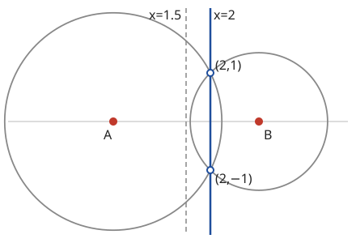

# 멱 도형

# 개요

**멱 도형(power diagram)** 은 점마다 원을 하나씩 두고, 평면의 각 점을 거리의 제곱에서 반지름의 제곱을 뺀 값이 가장 작은 원에 배정해 평면을 나눈 그림이다. 큰 마트와 작은 마트가 있으면 손님은 큰 마트까지 조금 더 걸어가더라도 그쪽을 고른다. 두 마트에서 같은 거리인 수직이등분선으로 구역을 나누는 [Voronoi 도형](voronoi-diagrams.md)으로는 이 차이를 나타낼 수 없다.

멱 도형은 마트마다 반지름을 주어 큰 마트의 구역을 넓힌다. 구역의 경계는 여전히 직선이어서 Voronoi 도형과 같은 방법으로 계산된다.

# 직관

마트 $A$ 는 $(0,0)$ 에, $B$ 는 $(3,0)$ 에 있다. $A$ 를 중심으로 반지름 $\sqrt5$ 인 원을, $B$ 를 중심으로 반지름 $\sqrt2$ 인 원을 그린다. 큰 원이 큰 마트다.

점 $x=(x_1,x_2)$ 에서 $A$ 까지 거리의 제곱에서 $5$ 를 빼고, $B$ 까지 거리의 제곱에서 $2$ 를 뺀다. 두 값이 같은 점은 다음 식을 만족한다.

$$
x_1^2+x_2^2-5=(x_1-3)^2+x_2^2-2
$$

$x_2^2$ 과 $x_1^2$ 이 양쪽에서 지워져 $6x_1=12$, 곧 $x_1=2$ 가 남는다. 경계는 직선 $x_1=2$ 이고, 수직이등분선 $x_1=1.5$ 보다 작은 마트 $B$ 쪽으로 $0.5$ 만큼 옮겨 갔다.

그림에서 두 원은 $(2,1)$ 과 $(2,-1)$ 에서 만나고, 경계 $x_1=2$ 가 그 두 점을 지난다. 두 원의 교점에서는 두 값이 모두 $0$ 이기 때문이다.

# 정의

## 멱

평면의 점 $p$ 와 실수 $w$ 의 짝을 **가중 사이트(weighted site)** 라 한다. $w\ge 0$ 이면 중심 $p$, 반지름 $\sqrt w$ 인 원으로 생각한다. 점 $x$ 의 가중 사이트 $(p,w)$ 에 대한 **멱(power)** 은 다음이다.

$$
\mathrm{pow}(x,p)=\lvert x-p\rvert^2-w
$$

직관 절에서 원점의 멱은 $A$ 에 대해 $-5$, $B$ 에 대해 $7$ 이다. 멱이 음수인 것과 $x$ 가 원 안에 있는 것은 동치다.

## 멱 영역과 멱 도형

가중 사이트 $(p_1,w_1),\dots,(p_n,w_n)$ 에서 $p_i$ 의 **멱 영역(power cell)** 은 다음이다.

$$
P_i=\lbrace x\in\mathbb R^2:\ \mathrm{pow}(x,p_i)\le\mathrm{pow}(x,p_j)\quad\forall j\rbrace
$$

멱 영역들로 평면을 나눈 것을 **멱 도형(power diagram)** 이라 한다. Laguerre 도형(Laguerre diagram)이라고도 한다. 가중치가 모두 같으면 Voronoi 도형이다.

# 성질

## 직선 경계

두 사이트의 경계 $\mathrm{pow}(x,p_i)=\mathrm{pow}(x,p_j)$ 를 펼치면 $\lvert x\rvert^2$ 이 지워져 다음 직선이 된다.

$$
2(p_j-p_i)\cdot x=\lvert p_j\rvert^2-\lvert p_i\rvert^2-w_j+w_i
$$

이 직선은 $p_ip_j$ 에 수직이고, 두 원이 만나면 두 교점을 지난다. 이 직선을 두 원의 **근축(radical axis)** 이라 한다. 멱 영역은 반평면들의 교집합이므로 볼록 다각형이다. 모든 가중치에 같은 수를 더해도 멱 도형은 바뀌지 않는다.

## 빈 영역

Voronoi 도형과 달리 사이트가 자기 멱 영역 밖에 있을 수 있고, 멱 영역이 비어 있을 수도 있다. 직관 절에 가중치 $0$ 인 사이트 $C=(1,0)$ 을 더한다. $C$ 의 멱이 $A$ 의 멱보다 작으려면 $x_1\gt 3$ 이어야 하고, $B$ 의 멱보다 작으려면 $x_1\lt 1.5$ 이어야 한다. 두 조건을 함께 만족하는 점이 없으므로 $C$ 의 멱 영역은 비어 있다.

## 포물면으로 올리기

$\mathrm{pow}(x,p)=\lvert x\rvert^2-h_p(x)$ 로 쓰면 $h_p$ 는 다음 일차함수다.

$$
h_p(x)=2p\cdot x-\lvert p\rvert^2+w
$$

$\lvert x\rvert^2$ 은 모든 사이트에 공통이므로, 멱이 가장 작은 사이트는 $h_p(x)$ 가 가장 큰 사이트다. 그러므로 평면 $z=h_{p_i}(x)$ 들의 위쪽 포락면을 평면에 내린 것이 멱 도형이다.

쌍대로, 사이트 $(p,w)$ 를 점 $(p,\lvert p\rvert^2-w)$ 로 올려 3 차원 볼록 껍질의 아래쪽 면을 내리면 **정규 삼각분할(regular triangulation)** 이 나온다. 가중치가 모두 $0$ 이면 [Delaunay 삼각분할](delaunay-triangulation.md) 문서의 포물면 올리기다. 멱 영역이 빈 사이트는 아래쪽 껍질의 꼭짓점이 아니다. 앞 절의 $C$ 는 $(1,0,1)$ 로 올라가고, $A$ 와 $B$ 를 올린 $(0,0,-5)$ 와 $(3,0,7)$ 을 잇는 선분은 $x_1=1$ 에서 높이 $-1$ 이므로 $C$ 가 그 위에 있다.

이 대응으로 3 차원 [볼록 껍질 알고리즘](convex-hull-algorithms.md)이 멱 도형을 $O(n\log n)$ 시간에 계산한다. 볼록 다각형으로 평면을 나눈 분할 가운데 3 차원 볼록 다면체 곡면을 내린 것과 멱 도형은 일치한다(Aurenhammer).[^1]

## 영역의 넓이를 정하는 가중치

평면 영역 $\Omega$ 위의 확률밀도 $\rho$, 서로 다른 점 $p_1,\dots,p_n$, 합이 $1$ 인 양수 $\lambda_1,\dots,\lambda_n$ 이 주어진다. 그러면 각 멱 영역의 질량이 다음과 같아지는 가중치 $w$ 가 존재하고, 모든 가중치에 같은 수를 더하는 것을 빼면 하나뿐이다.[^2]

$$
\int_{P_i\cap\Omega}\rho(x)\thinspace dx=\lambda_i\qquad(i=1,\dots,n)
$$

증명의 요지. 다음 함수 $\Phi$ 는 $w$ 에 대해 오목하다.

$$
\Phi(w)=\sum_{i=1}^n\lambda_iw_i+\sum_{i=1}^n\int_{P_i\cap\Omega}\bigl(\lvert x-p_i\rvert^2-w_i\bigr)\rho(x)\thinspace dx
$$

$\Phi$ 를 $w_i$ 로 미분하면 $\lambda_i-\rho(P_i\cap\Omega)$ 이므로 $\Phi$ 의 최댓값에서 질량 조건이 성립한다. 경사 상승이나 [Newton 법](newton-method.md)으로 $\Phi$ 를 최대화해 가중치를 계산한다.

이때 $P_i\cap\Omega$ 의 점을 모두 $p_i$ 로 보내는 사상은 비용 $\lvert x-y\rvert^2$ 의 [최적 수송](optimal-transport.md)이다. 가중치 $w_i$ 는 Kantorovich 쌍대 문제의 해다.

# 활용

- 반이산 최적 수송. 연속 분포를 유한 개의 점으로 옮기는 최적 수송이 앞 절의 가중치 계산으로 풀린다. 영상의 색 분포 옮기기와 우주론의 초기 밀도 복원이 이 계산을 쓴다.[^3]
- 공의 합집합. 원자를 반지름이 다른 공으로 나타낸 분자 모형에서, 각 공을 그 공의 멱 영역으로 잘라 붙이면 겹침 없이 합집합이 나뉜다. 분자의 부피와 겉넓이를 이 조각들로 계산한다.[^1]
- 미세 조직 모형. 크기가 다른 결정립이나 거품 방울로 된 재료 단면을 멱 도형으로 근사한다. 결정립마다 가중치를 주어 큰 결정립의 영역을 넓힌다.
- 용량 제한 배정. 시설마다 받을 수 있는 수요가 정해져 있을 때, 앞 절의 정리로 수요 밀도를 정해진 비율로 나누는 직선 경계의 구역을 얻는다.

[^1]: F. Aurenhammer, "Power diagrams: properties, algorithms and applications", *SIAM Journal on Computing* **16** (1987), 78–96.
[^2]: F. Aurenhammer, F. Hoffmann, B. Aronov, "Minkowski-type theorems and least-squares clustering", *Algorithmica* **20** (1998), 61–76.
[^3]: Q. Mérigot, "A multiscale approach to optimal transport", *Computer Graphics Forum* **30** (2011), 1583–1592. B. Lévy, R. Mohayaee, S. von Hausegger, "A fast semidiscrete optimal transport algorithm for a unique reconstruction of the early Universe", *Monthly Notices of the Royal Astronomical Society* **506** (2021), 1165–1185.

# 연관 문서

## 선수지식

- [Voronoi 도형](voronoi-diagrams.md)

## 더 알아보기

아직 연결한 문서가 없다.

#algorithms #computation #optimization
