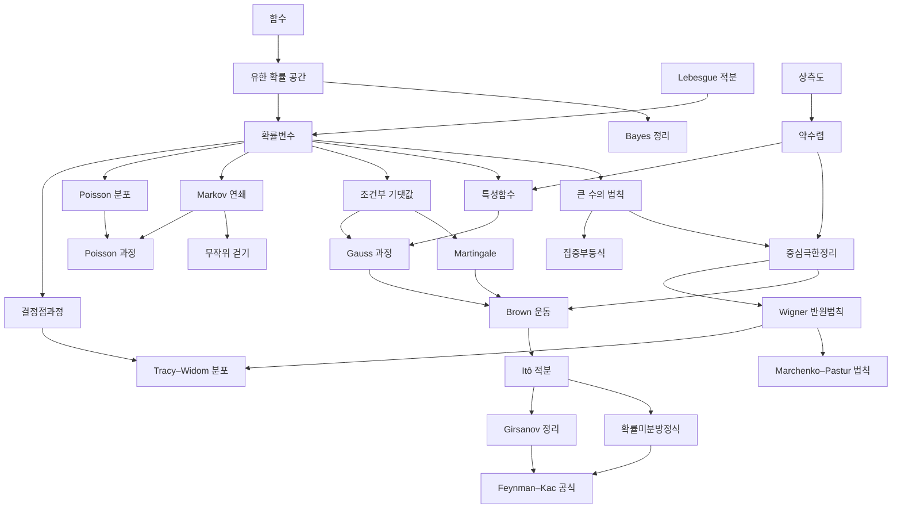

# 확률론 개관

# 개요

확률론(probability theory)은 우연에 맡긴 결과가 따르는 규칙을 다루는 분야다. 동전을 $10$ 번 던지면 앞면이 $3$ 번 나올 수도 $8$ 번 나올 수도 있지만, $10000$ 번 던지면 앞면의 비율은 약 95% 의 확률로 $0.49$ 와 $0.51$ 사이에 있다. 각 결과에 확률을 주는 모형을 세우고, 많은 시행을 모았을 때 합과 평균이 어디로 모이고 얼마나 흩어지는지를 그 모형에서 계산한다.

처음 읽는 사람은 [유한 확률 공간](probability.md)에서 시작한다. 측도론적 기반은 [측도론 개관](measure-theory-overview.md)에, 추론 쪽은 [통계 개관](statistics-overview.md)에 있다.

# 지도

# 갈래

처음 읽는 사람은 확률 공간과 확률변수, 극한정리의 순서로 읽는다. 그 뒤는 네 방향으로 갈린다. 편차와 Gauss 구조는 유한 표본에서 벗어날 확률을 재고, 조건부 구조와 이산시간 확률과정은 정보가 늘어나는 열을 다루고, 연속시간 확률과정은 Brown 운동 위의 미적분을 세우고, 무작위 행렬과 점과정은 고윳값의 극한 분포를 다룬다.

## 확률 공간과 확률변수

먼저 읽을 것: [함수](functions.md)(기초 개관), [Cauchy–Schwarz 부등식](cauchy-schwarz.md)(선형대수 개관). 시작 문서: [유한 확률 공간](probability.md).

- [유한 확률 공간](probability.md): 표본공간, 사건, 확률측도
  - [Bayes 정리](bayes.md): 조건부확률의 역전
  - [생일 문제](birthday-problem.md): 무작위로 뽑은 값이 처음 겹치는 시점, 약 √N 번에서 충돌 확률이 절반을 넘는 계산과 해시 충돌
  - [투표 정리](ballot-theorem.md): 개표 내내 앞설 확률 (a − b)/(a + b), 반사 원리와 무작위 걷기의 도달 시간 정리
  - [Radically elementary 확률론](radically-elementary-probability.md): 초유한 크기의 유한 확률공간 위에서 측도 없이 세운 Brown 운동과 확률적분
- [확률변수](random-variables.md): 가측함수로서의 확률변수와 적분으로서의 기댓값
  - [Jensen 부등식](jensen-inequality.md): 평균을 먼저 낼 때와 나중에 낼 때의 대소, 지지선 증명과 등호 조건
  - [적률생성함수](moment-generating-function.md): 지수함수의 기댓값으로 적률을 모은 함수, 독립 합의 곱 분해, 유일성과 연속성, 누적생성함수의 볼록성
- [이항분포](binomial-distribution.md): 독립 시행의 성공 횟수, 최빈값과 Chernoff 꼬리, Poisson 과 정규분포로의 두 극한
  - [기하분포](geometric-distribution.md): 첫 성공까지의 시행 횟수, 무기억성과 지수분포로의 극한, 음이항분포
    - [쿠폰 수집가 문제](coupon-collector.md): n 종류를 모두 모으는 데 걸리는 평균 n Hₙ 번의 뽑기, 꼬리 확률과 Gumbel 극한
  - [다항분포](multinomial-distribution.md): 결과가 여러 가지인 독립 시행의 결과별 횟수, 음의 공분산과 Poisson 표현, Pearson 카이제곱 통계량의 극한
  - [초기하분포](hypergeometric-distribution.md): 되돌려 넣지 않고 뽑을 때 표시된 것의 개수, 유한 모집단 수정과 이항분포 근사
- [Poisson 분포](poisson-distribution.md): 희귀 사건의 개수 분포, 이항분포의 극한과 Le Cam 오차 한계
- [확률밀도](probability-density.md): 분포를 기준측도로 적분해 쓴 함수와 밀도가 없는 분포
  - [균등분포](uniform-distribution.md): 범위 안의 값이 똑같이 나오기 쉬운 분포, 역변환 표본추출과 확률 적분 변환, 순서통계량
  - [Cauchy 분포](cauchy-distribution.md): 평균이 없는 두꺼운 꼬리의 분포, 표본평균이 같은 분포를 따르는 성질과 정규분포의 비
- [지수분포](exponential-distribution.md): 지난 시간이 앞으로의 확률을 바꾸지 않는 대기시간, 최솟값과 합의 분포
  - [감마분포](gamma-distribution.md): 지수 대기시간 여러 개의 합, 합의 가법성과 비의 베타분포
    - [베타분포](beta-distribution.md): 모르는 확률에 대한 분포, 이항 관측의 켤레 사전분포와 균등분포의 순서통계량
- [순서통계량](order-statistics.md): 표본을 늘어놓은 k 번째 값의 분포, 역변환에 의한 환원, 지수 간격, 표본 분위수의 정규 극한과 최댓값의 Gumbel 극한
  - [극값 분포](extreme-value-distributions.md): 최댓값의 극한으로 나오는 Gumbel, Fréchet, Weibull 세 꼴, 최대 안정성과 Poisson 근사, 끌림 영역
- [공분산](covariance.md): 두 확률변수가 함께 벗어나는 정도, 상관계수와 Cauchy–Schwarz, 공분산행렬, 최적 선형 예측
  - [정규분포](normal-distribution.md): 평균과 분산으로 정해지는 종 모양 분포, 다변량 정규분포의 선형변환과 조건부분포, 꼬리와 최대 엔트로피
    - [로그정규분포](lognormal-distribution.md): 로그가 정규분포를 따르는 양수의 분포, 곱의 극한과 적률로 정해지지 않는 예
- [조건부 기댓값](conditional-expectation.md): 부분 $\sigma$ 대수 위로의 사영
- [Kolmogorov 확장정리](kolmogorov-extension.md): 정합적 유한차원 분포족에서 확률과정을 세우는 정리

## 극한정리

먼저 읽을 갈래: 확률 공간과 확률변수. 먼저 읽을 것: [Fourier 변환](fourier-transform.md)(해석 개관), [Dynkin 계](dynkin-system.md)(측도론 개관), [Weierstrass 인수분해 정리](weierstrass-factorization.md)(복소해석 개관). 시작 문서: [약수렴](weak-convergence.md).

- [약수렴](weak-convergence.md): 분포의 수렴과 tightness
  - [전변동거리](total-variation-distance.md): 사건 확률의 최대 차, 결합 표현과 Pinsker 부등식
  - [결합](coupling.md): 두 분포를 주변분포로 갖는 쌍, 불일치 확률의 최솟값이 전변동거리
  - [Skorokhod 표현정리](skorokhod-representation.md): 분포 수렴을 거의 확실한 수렴으로 실현하는 결합
- [특성함수](characteristic-functions.md): Fourier 변환으로 분포 수렴을 판정
  - [Cramér 분해 정리](cramer-decomposition.md): 정규분포를 독립 합으로 나누면 각 조각이 정규분포라는 정리, Hadamard 인수분해와 Raikov 정리
- [Borel–Cantelli 보조정리](borel-cantelli.md): 사건열의 상극한을 확률의 합으로 판정하는 두 보조정리
- [Kolmogorov 0-1 법칙](kolmogorov-zero-one-law.md): 독립열의 꼬리사건의 확률이 0 이나 1 이라는 정리, 꼬리 가측 확률변수, Hewitt–Savage 0-1 법칙
- [확률변수의 수렴](convergence-of-random-variables.md): 거의 확실한 수렴, 확률수렴, Lᵖ 수렴, 분포수렴의 함의와 반례, 부분열 정리, Slutsky 정리
  - [Kolmogorov 세 급수 정리](kolmogorov-three-series.md): 독립 확률변수 급수가 거의 확실히 수렴하는 조건, Kolmogorov 최대 부등식
- [큰 수의 법칙](law-of-large-numbers.md): 표본평균이 기댓값으로
- [중심극한정리](central-limit-theorem.md): 요동의 정규분포 근사
  - [Stein 방법](stein-method.md): 정규분포의 특징 항등식을 얼마나 어기는지로 분포 거리를 누르는 방법, 독립이 없는 합의 수렴 속도

## 편차와 Gauss 구조

먼저 읽을 갈래: 극한정리. 먼저 읽을 것: [KL divergence](kl-divergence.md)(정보이론 개관), [볼록 공액](convex-conjugate.md)(최적화 개관). 시작 문서: [집중부등식](concentration-inequalities.md).

- [집중부등식](concentration-inequalities.md): 유한 표본에서 평균을 벗어날 확률의 지수적 상한
  - [Khintchine 부등식](khintchine-inequality.md): 무작위 부호 합의 $L^p$ 노름이 계수의 $\ell^2$ 노름과 동등, 최적 상수와 Gauss 비교
- [대편차 원리](large-deviations.md): 벗어날 확률의 지수를 결정하는 rate function, Cramér 정리와 Sanov 정리
  - [Gärtner–Ellis 정리](gartner-ellis.md): 독립 없이 쓰는 대편차 원리, 적률생성함수 극한의 미분가능성과 Markov 연쇄의 시간평균
- [Gauss 과정](gaussian-processes.md): 평균함수와 공분산핵으로 결정되는 과정, 조건부분포의 닫힌 형태

## 조건부 구조와 이산시간 확률과정

먼저 읽을 갈래: 확률 공간과 확률변수. 시작 문서: [Martingale](martingales.md).

- [de Finetti 정리](de-finetti-theorem.md): 교환가능 무한열이 독립 동일분포열의 혼합으로 유일하게 적힌다
- [Martingale](martingales.md): 공정한 도박의 형식화, 선택적 정지와 수렴정리
  - [Doob 분해](doob-decomposition.md): martingale 과 예측 가능 과정의 합으로의 유일한 분해, 예측 가능 2차 변동
  - [확률근사](stochastic-approximation.md): 잡음 섞인 관측으로 $f(\theta)=0$ 을 푸는 반복법, Robbins–Monro 보폭 조건
- [Markov 연쇄](markov-chains.md): 전이행렬, 정상분포, 수렴정리
  - [무작위 걷기](random-walks.md): 재귀성을 유효저항으로 읽는 대응
  - [Poisson 과정](poisson-process.md): 독립·정상 증분을 가진 계수과정, 지수 대기시간
  - [Markov 연쇄의 혼합시간](mixing-time.md): 전변동거리로 재는 수렴 속도, 결합 상한과 스펙트럼 간격
  - [경로 결합](path-coupling.md): 이웃한 두 상태의 한 걸음 결합만으로 얻는 혼합시간 상한, 그래프 색칠 연쇄의 $O(n\log n)$ 혼합
- [Markov 연쇄 Monte Carlo](markov-chain-monte-carlo.md): 목표분포를 불변분포로 갖는 연쇄의 구성, 세부균형과 수락확률
  - [Hamiltonian Monte Carlo](hamiltonian-monte-carlo.md): 보조 운동량을 더한 확장 분포와 Hamilton 흐름 제안, leapfrog 적분기
- [은닉 Markov 모형](hidden-markov-model.md): 관측 뒤에 숨은 상태열, 전향 후향 재귀와 Viterbi 복호
  - [확률 그래프 모형](graphical-models.md): 결합분포를 인수의 곱으로 적고 그 구조를 그래프로 둔 모형, 믿음 전파와 나무폭에 지수인 추론 비용
- [Markov 결정 과정](markov-decision-process.md): 행동으로 전이를 고르는 연쇄, Bellman 방정식과 값 반복
  - [부분관측 Markov 결정 과정](partially-observable-mdp.md): 상태 위의 사후분포를 상태로 삼아 다시 Markov 결정 과정이 되는 구조, 조각마다 선형이고 볼록한 값함수
- [최적 정지](optimal-stopping.md): Snell 포락과 문턱 규칙, 비서 문제
  - [Gittins 지표](gittins-index.md): 팔마다 따로 계산한 수의 최댓값이 할인 밴딧의 최적 정책이다
- [분지과정](branching-processes.md): 자손 생성함수의 합성으로 세대를 잇는 과정, 소멸 확률이 생성함수의 고정점
- [침투](percolation.md): 변을 확률 $p$ 로 열어 무한 클러스터가 생기는 임계값, 나무에서는 분지과정과 같은 판정
  - [Ising 모형](ising-model.md): 정점마다 부호를 배정하고 같은 부호의 이웃을 선호하는 분포, 2 차원 이상에서 낮은 온도의 자발 자화
  - [최초 통과 침투](first-passage-percolation.md): 변마다 무작위 통과 시간을 준 격자의 최소 통과 시간, 시간 상수의 존재와 Cox–Durrett 모양 정리

## 연속시간 확률과정

먼저 읽을 갈래: 조건부 구조와 이산시간 확률과정. 시작 문서: [Brown 운동](brownian-motion.md).

- [Brown 운동](brownian-motion.md): 연속시간 Gauss 과정과 경로의 성질
  - [Donsker 불변원리](donsker-invariance-principle.md): 부분합의 꺾은선이 $C\lbrack 0,1\rbrack$ 에서 Brown 운동으로 약수렴
  - [Brown 다리](brownian-bridge.md): 양 끝값을 0 으로 묶은 Gauss 과정, Brown 운동의 조건부 분포와 최댓값의 Kolmogorov 분포
  - [반복로그 법칙](law-of-iterated-logarithm.md): 부분합과 Brown 운동의 상극한이 $\sqrt{2t\log\log t}$ 규모라는 정리, Strassen 의 함수형 판본
  - [Lévy 연속률](levy-modulus.md): 길이 h 인 구간의 가장 큰 증분이 $\sqrt{2h\log(1/h)}$ 규모라는 정리. Hölder 지수 1/2 의 경계와 빠른 점
  - [Skorokhod 매장](skorokhod-embedding.md): 평균 0 인 분포를 Brown 운동의 정지시간에서의 값으로 실현하는 구성. 무작위 걷기 전체를 한 경로 위에 놓아 Brown 운동의 정리를 부분합에 옮긴다
- [Itô 적분](ito-calculus.md): 유계변동이 없는 경로 위의 적분과 Itô 공식
- [확률미분방정식](stochastic-differential-equations.md): 잡음 항이 들어간 미분방정식의 해와 그 밀도
  - [Fokker–Planck 방정식](fokker-planck.md): 해의 밀도가 만족하는 편미분방정식, 확률흐름과 정상분포, 세부균형
  - [Langevin 동역학](langevin-dynamics.md): 기울기 흐름에 열잡음을 더한 과정, Gibbs 측도 표본추출과 이산화 편향
  - [Freidlin–Wentzell 이론](freidlin-wentzell.md): 작은 잡음 확률미분방정식의 대편차, 작용범함수와 탈출 시간
- [Girsanov 정리](girsanov.md): 측도변환으로 표류항을 바꾼다
- [Feynman–Kac 공식](feynman-kac.md): 편미분방정식의 해를 경로 적분의 기댓값으로
- [Black–Scholes 방정식](black-scholes-equation.md): 복제로 얻는 가격 방정식, 추세를 지우고 변수를 바꾸어 열전도 꼴의 편미분방정식으로 옮기는 풀이
  - [미국형 옵션](american-options.md): 행사 시각을 함께 고르는 가격 문제, 변분 부등식과 행사 경계

## 무작위 행렬과 점과정

먼저 읽을 갈래: 극한정리. 먼저 읽을 것: [고윳값](eigenvalues.md)(선형대수 개관). 시작 문서: [Wigner 반원법칙](wigner-semicircle.md).

- [Wigner 반원법칙](wigner-semicircle.md): 고윳값 분포의 극한
  - [Marchenko–Pastur 법칙](marchenko-pastur.md): 표본공분산행렬의 스펙트럼
  - [자유확률](free-probability.md): 교환하지 않는 변수의 자유독립, R 변환과 자유 합성곱
- [결정점과정](determinantal-point-process.md): 상관함수가 행렬식으로 주어지는 점과정
- [Tracy–Widom 분포](tracy-widom.md): 최대 고윳값의 요동
  - [KPZ 보편성류](kpz-universality.md): 높이 요동이 시간의 1/3 제곱 규모인 무작위 성장 모형의 부류, 마지막 통과 침투와 배제 과정

# 연관 문서

## 선수지식

- [집합](sets.md)

## 더 알아보기

- [유한 확률 공간](probability.md)
- [약수렴](weak-convergence.md)

#probability #measure_theory #statistics #overview
