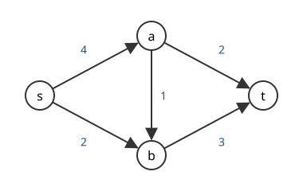
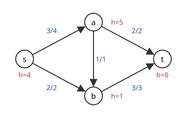

# push–relabel 알고리즘

# 개요

**push–relabel 알고리즘(push–relabel algorithm)** 은 정점에 들어온 양이 나간 양보다 많은 상태를 허용하고, 남는 양을 이웃으로 조금씩 보내며 최대 흐름을 찾는 알고리즘이다. 공급지 $s$ 에서 수요지 $t$ 로 물건을 보낼 때, 증가 경로를 찾는 방법은 $s$ 에서 $t$ 까지 길 하나를 통째로 찾은 뒤에야 양을 보낸다. push–relabel 알고리즘은 정점마다 높이를 두고 남는 양을 높이가 하나 낮은 이웃에만 보내므로, 각 단계가 정점 하나와 그 이웃만 보고 끝난다.

# 직관

아래 그림의 네트워크에서 $s$ 에서 $t$ 로 최대한 많이 보낸다. 간선 옆의 수가 용량이다.



먼저 $s$ 에서 나가는 간선을 모두 용량만큼 채운다. $a$ 에 $4$, $b$ 에 $2$ 가 들어오고 둘 다 아직 아무것도 내보내지 않았다. 정점마다 높이를 두고, 남는 양은 높이가 정확히 하나 낮은 이웃으로만 보낸다. 처음 높이는 $s$ 가 정점 수 $4$ 이고 나머지가 $0$ 이다.

$a$ 의 이웃 $b$, $t$ 는 높이가 $0$ 이어서 보낼 곳이 없으므로 $a$ 의 높이를 $1$ 로 올린다. 그러면 $t$ 로 $2$, $b$ 로 $1$ 을 보내고 $a$ 에 $1$ 이 남는다.

이제 $a$ 에서 $t$, $b$ 로 가는 간선은 가득 찼고, 더 보낼 수 있는 곳은 이미 받은 양을 $s$ 쪽으로 보내는 길뿐이다. $s$ 의 높이가 $4$ 이므로 $a$ 의 높이를 $5$ 로 올리고 남은 $1$ 을 $s$ 로 보낸다.

$b$ 에는 $2+1=3$ 이 남아 있다. 높이를 $1$ 로 올리고 $t$ 로 $3$ 을 보낸다. 남는 양이 있는 정점이 없으므로 끝나고, $t$ 에 $5$ 가 도착했다.

아래 그림이 마지막 상태다. 간선의 수는 흐른 양과 용량이고, 정점 옆의 $h$ 는 높이다.



$a$ 에서 나가는 두 간선과 $s\to b$ 의 용량 합이 $2+1+2=5$ 이므로 $5$ 보다 많이 보낼 수는 없다. 이렇게 남는 양을 높이가 낮은 쪽으로 보내고(push), 보낼 곳이 없으면 높이를 올리는(relabel) 계산을 push–relabel 알고리즘이라 한다.

# 정의

[네트워크 흐름](network-flow.md) 문서의 네트워크 $G=(V,E)$, 용량 $c$, 공급지 $s$, 수요지 $t$, 잔여 용량 $c_f$ 와 잔여 그래프 $G_f$ 를 쓴다. $n=\vert V\vert$, $m=\vert E\vert$ 다.

## 선흐름

**선흐름(preflow)** 은 용량 조건 $0\le f(u,v)\le c(u,v)$ 를 만족하고, $s$ 가 아닌 모든 정점 $v$ 에서 다음 **초과량(excess)** 이 $0$ 이상인 함수 $f$ 다.

$$e(v)=\sum_{u}f(u,v)-\sum_{w}f(v,w)$$

$s$, $t$ 가 아니고 $e(v)\gt 0$ 인 정점을 **활성 정점(active vertex)** 이라 한다. 활성 정점이 없는 선흐름은 흐름이다. 직관 절에서 $s$ 의 간선을 채운 직후 $e(a)=4$, $e(b)=2$ 이고 둘 다 활성이다.

## 높이 함수

**높이 함수(height function)** 는 $h(s)=n$, $h(t)=0$ 이고 잔여 그래프의 모든 간선 $(u,v)$ 에서 $h(u)\le h(v)+1$ 인 함수 $h:V\to\mathbb Z_{\ge 0}$ 다. 잔여 간선 $(u,v)$ 가 $h(u)=h(v)+1$ 이면 **허용 간선(admissible edge)** 이라 한다.

## 두 연산

활성 정점 $u$ 에서 다음 둘 가운데 하나를 한다.

- **push**. 허용 간선 $(u,v)$ 가 있으면 $\delta=\min(e(u), c_f(u,v))$ 만큼 $u$ 에서 $v$ 로 보낸다. $\delta=c_f(u,v)$ 이면 포화 push, 아니면 비포화 push 라 한다.
- **relabel**. 허용 간선이 없으면 $h(u)$ 를 $1+\min\lbrace h(v):(u,v)\in G_f\rbrace$ 로 올린다.

**push–relabel 알고리즘** 은 $s$ 의 간선을 모두 채우고 $h(s)=n$, 나머지 높이를 $0$ 으로 둔 뒤, 활성 정점이 없을 때까지 두 연산을 되풀이한다[^1]. 직관 절에서 relabel 은 세 번($a$ 를 $1$ 로, $a$ 를 $5$ 로, $b$ 를 $1$ 로), push 는 네 번 일어났다.

```javascript
function pushRelabel(G, s, t) {
  const n = G.vertices.length;
  h.fill(0); h[s] = n;
  for (const v of G.out(s)) send(s, v, G.cap(s, v));      // s 의 간선을 채운다
  while (hasActive()) {
    const u = pickActive();
    const v = G.residualOut(u).find(w => h[u] === h[w] + 1);
    if (v !== undefined) send(u, v, Math.min(excess[u], residualCap(u, v)));  // push
    else h[u] = 1 + Math.min(...G.residualOut(u).map(w => h[w]));             // relabel
  }
  return excess[t];
}
```

# 성질

## 높이 함수와 증가 경로

높이 함수가 있으면 $G_f$ 에 $s$ 에서 $t$ 로 가는 경로가 없다.

경로가 있으면 같은 정점을 지나지 않는 경로로 줄일 수 있고 그 간선 수는 $n-1$ 이하다. 간선 하나를 지날 때 높이는 많아야 $1$ 줄므로 $h(t)\ge h(s)-(n-1)=1$ 이 되어 $h(t)=0$ 과 어긋난다.

## 두 연산이 지키는 것

push 와 relabel 은 선흐름과 높이 함수의 조건을 지키고, relabel 은 높이를 $1$ 이상 올린다. push 로 새로 생기는 잔여 간선은 $(v,u)$ 이고 $h(v)=h(u)-1$ 이므로 조건을 만족한다. relabel 은 허용 간선이 없을 때만 하므로 모든 잔여 간선 $(u,v)$ 에서 $h(u)\lt h(v)+1$ 이었고, 새 높이는 그 최솟값에 $1$ 을 더한 것이다.

## 높이의 상한

활성 정점 $v$ 에서는 $G_f$ 에서 $s$ 로 가는 경로가 있다. $v$ 의 초과량은 $s$ 에서 흘러온 것이고, 흘러온 길을 거꾸로 따라가는 간선은 모두 잔여 간선이기 때문이다. 앞 절과 같은 계산으로 $h(v)\le h(s)+n-1=2n-1$ 이다. 직관 절에서 $a$ 의 높이 $5$ 는 상한 $7$ 이하다.

## 정확성과 연산 횟수

알고리즘이 끝나면 활성 정점이 없으므로 $f$ 는 흐름이고, 높이 함수가 있으므로 증가 경로가 없다. 최대유량 최소절단 정리(max-flow min-cut theorem)에 따라 $f$ 는 최대 흐름이다[^1].

높이의 상한에서 relabel 은 정점마다 $2n-1$ 번 이하, 모두 $2n^2$ 번 이하다. 포화 push 는 $O(nm)$ 번, 비포화 push 는 $O(n^2m)$ 번 이하로 증명되고, 활성 정점을 아무렇게나 골라도 전체 시간이 $O(n^2m)$ 이다[^1].

## 활성 정점을 고르는 규칙

먼저 활성이 된 정점부터 처리하면 $O(n^3)$ 시간이다[^1]. 높이가 가장 높은 활성 정점부터 처리하면 비포화 push 가 $O(n^2\sqrt m)$ 번 이하다[^2]. Goldberg 와 Tarjan 은 동적 나무(dynamic tree)로 여러 push 를 한꺼번에 처리해 $O(nm\log(n^2/m))$ 시간을 얻었다[^1].

## 최소 절단

끝났을 때 $G_f$ 에서 $s$ 로부터 갈 수 있는 정점의 집합 $S$ 를 잡으면 $(S, V\setminus S)$ 가 최소 절단이다. 직관 절에서 $s\to a$ 에 잔여 용량 $1$ 이 남아 $S=\lbrace s,a\rbrace$ 이고, 절단의 용량이 $5$ 다.

# 활용

- 최대 흐름 계산. 높이를 주기적으로 $t$ 까지의 잔여 거리로 다시 계산하는 전역 relabel 과, 어떤 높이에 정점이 하나도 없으면 그보다 높은 정점을 한꺼번에 올리는 틈 규칙을 더한 구현이 실제 문제에서 증가 경로 방법보다 빠르다고 보고되었다[^3].
- [최소 비용 흐름](min-cost-flow.md). Goldberg 와 Tarjan 의 [비용 척도 조정 알고리즘](cost-scaling-algorithm.md)은 비용 조건을 오차 $\varepsilon$ 까지 허용한 흐름을 push 와 relabel 로 고치고 $\varepsilon$ 을 반씩 줄인다.
- 이분 [매칭](matchings.md). 용량이 모두 $1$ 인 네트워크에서 push–relabel 로 최대 매칭을 구한다.
- 병렬 계산. 두 연산이 정점 하나와 그 이웃만 보므로, 서로 떨어진 활성 정점을 동시에 처리할 수 있다.

[^1]: A. V. Goldberg, R. E. Tarjan, "A new approach to the maximum-flow problem", *Journal of the ACM* 35 (1988), 921–940.
[^2]: J. Cheriyan, S. N. Maheshwari, "Analysis of preflow push algorithms for maximum network flow", *SIAM Journal on Computing* 18 (1989), 1057–1086.
[^3]: B. V. Cherkassky, A. V. Goldberg, "On implementing the push-relabel method for the maximum flow problem", *Algorithmica* 19 (1997), 390–410.

# 연관 문서

## 선수지식

- [네트워크 흐름](network-flow.md)

## 더 알아보기

- [비용 척도 조정 알고리즘](cost-scaling-algorithm.md)

#graph_theory #algorithms #optimization
