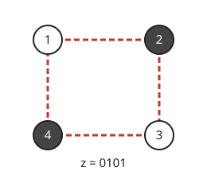

# 양자 근사 최적화 알고리즘

# 개요

**양자 근사 최적화 알고리즘(quantum approximate optimization algorithm, QAOA)** 은 비용에 따라 위상을 주는 단계와 비트를 섞는 단계를 번갈아 $p$ 번 적용한 회로로 상태를 만들고, 그 상태를 측정해 비용이 큰 비트열을 얻는 방법이다. 정사각형의 네 꼭짓점을 두 묶음으로 나눠 서로 다른 묶음을 잇는 변을 많이 만드는 문제에서, 꼭짓점마다 동전을 던져 나누면 변 $4$ 개 가운데 평균 $2$ 개가 두 묶음을 잇는다. 이 알고리즘은 $p=1$ 에서 각도 두 개를 골라 평균을 $3$ 으로 올리고, 각도는 고전 컴퓨터가 측정 결과를 보며 고친다.

# 직관

정사각형의 꼭짓점 $1,2,3,4$ 에 비트 $z\_1,z\_2,z\_3,z\_4$ 를 준다. 변 $\lbrace 1,2\rbrace,\lbrace 2,3\rbrace,\lbrace 3,4\rbrace,\lbrace 4,1\rbrace$ 가운데 양 끝의 비트가 다른 변의 개수를 $C(z)$ 라 한다. 아래 그림은 $z=0101$ 이고 네 변이 모두 양 끝의 비트가 달라 $C=4$ 다.

큐비트 넷을 $\vert +\rangle^{\otimes 4}$ 로 두고 측정하면 $16$ 개의 비트열이 같은 확률로 나오고 $C$ 의 평균은 $2$ 다. 여기에 $e^{-i\gamma C}$ 를 적용하면 비트열마다 $e^{-i\gamma C(z)}$ 가 곱해진다. 위상만 바뀌었으므로 측정 결과의 확률은 그대로다.

다음으로 큐비트마다 $e^{-i\beta X}$ 를 적용한다. 이 회전은 비트 하나가 다른 비트열끼리 진폭을 섞으므로, 앞 단계의 위상이 섞인 진폭끼리 더해지고 지워진다. 변 하나 $\lbrace u,v\rbrace$ 의 양 끝 비트가 다를 확률을 계산하면 다음이 나온다.

$$
\Pr(z_u\ne z_v)=\frac12+\frac14\sin 4\beta\thinspace\sin 2\gamma
$$

$\gamma=\pi/4$, $\beta=\pi/8$ 에서 이 확률이 $3/4$ 이고, 변 넷을 더하면 $C$ 의 평균은 $3$ 이다. 이 단계를 $p$ 번 되풀이하고 각도 $2p$ 개를 고르면 평균을 더 올릴 수 있다.

# 정의

## 비용 해밀토니언과 섞는 해밀토니언

비트열 $z\in\lbrace 0,1\rbrace^n$ 의 비용 함수 $C$ 에 대해 대각 행렬 $\sum\_zC(z)\vert z\rangle\langle z\vert$ 를 같은 이름 $C$ 로 쓰고 **비용 해밀토니언(cost Hamiltonian)** 이라 한다. 그래프의 변 집합 $E$ 에서 최대 절단 문제(maximum cut problem)의 비용 해밀토니언은 다음과 같다.

$$
C=\sum_{\lbrace u,v\rbrace\in E}\frac{1-Z_uZ_v}2
$$

$B=\sum\_{j=1}^nX\_j$ 를 **섞는 해밀토니언(mixing Hamiltonian)** 이라 한다. 직관 절은 $n=4$, $E$ 가 정사각형의 변 넷인 경우다.

## 회로와 기댓값

깊이 $p$ 와 각도 $\boldsymbol\gamma=(\gamma\_1,\dots,\gamma\_p)$, $\boldsymbol\beta=(\beta\_1,\dots,\beta\_p)$ 에 대해 다음 상태를 만든다.

$$
\vert\boldsymbol\gamma,\boldsymbol\beta\rangle=e^{-i\beta_pB}e^{-i\gamma_pC}\cdots e^{-i\beta_1B}e^{-i\gamma_1C}\vert +\rangle^{\otimes n}
$$

$F\_p(\boldsymbol\gamma,\boldsymbol\beta)=\langle\boldsymbol\gamma,\boldsymbol\beta\vert C\vert\boldsymbol\gamma,\boldsymbol\beta\rangle$ 로 두고 $M\_p=\max F\_p$ 라 한다. 각도를 고전 최적화로 고치며 $F\_p$ 를 측정으로 어림하고, 마지막 각도의 상태를 여러 번 측정해 비용이 가장 큰 비트열을 내는 절차를 **양자 근사 최적화 알고리즘** 이라 한다[^1]. 직관 절에서 $F\_1(\pi/4,\pi/8)=3$ 이다.

이 절차는 [변분 양자 고유값 풀이](variational-quantum-eigensolver.md)에서 매개변수 회로를 위의 꼴로 고정하고 $-C$ 의 가장 작은 고윳값을 찾는 경우다.

# 성질

## 깊이에 대한 단조성

깊이 $p+1$ 의 마지막 각도를 $\gamma\_{p+1}=\beta\_{p+1}=0$ 으로 두면 깊이 $p$ 의 회로가 되므로 $M\_{p+1}\ge M\_p$ 이다.

## 단열 극한

정리. $\lim\_{p\to\infty}M\_p=\max\_zC(z)$ 이다[^1].

증명의 요지. $\vert +\rangle^{\otimes n}$ 은 $-B$ 의 바닥 상태이고, 최대 비용의 비트열은 $-C$ 의 바닥 상태다. [단열 양자 계산](adiabatic-quantum-computation.md)의 경로 $-(1-s)B-sC$ 를 $p$ 토막으로 잘라 토막마다 두 발전을 번갈아 적용하면 깊이 $p$ 의 회로가 되고, 이 회로는 $p\to\infty$ 에서 단열 발전에 수렴한다. 이 각도에서의 $F\_p$ 가 최댓값에 가까워지므로 $M\_p$ 도 그렇다.

## 국소성

깊이 $p$ 에서 변 $\lbrace u,v\rbrace$ 의 항의 기댓값은 $u$ 나 $v$ 에서 거리 $p$ 안의 꼭짓점과 변으로 된 부분그래프에만 의존한다. $e^{-i\gamma C}$ 와 $e^{-i\beta B}$ 의 각 인수는 한두 큐비트에만 작용하므로, $Z\_uZ\_v$ 를 한 단계 앞으로 옮기면 의존하는 큐비트가 이웃까지만 늘어난다. 직관 절의 공식은 $p=1$ 에서 이 부분그래프가 길이 $3$ 인 경로인 경우다.

## 근사 비율

3-정규 그래프의 최대 절단에서 $p=1$ 은 모든 그래프에서 $M\_1\ge 0.6924\cdot\max\_zC(z)$ 를 준다[^1]. 반정부호 계획법(semidefinite programming)을 쓰는 Goemans–Williamson 알고리즘의 비율 $0.878$ 이 이보다 크다.

국소성 때문에 깊이가 얕으면 그래프 전체를 보지 못한다. $d$-정규 이분 그래프의 어떤 족에서 깊이 $p\lt c\log n$ 인 회로의 근사 비율은 $5/6+O(1/\sqrt d)$ 이하다[^2]. 무작위 $d$-정규 그래프의 최대 독립 집합에서도, 깊이가 $\varepsilon\log n$ 미만이면 $d$ 가 클 때 찾는 독립 집합의 크기가 최댓값의 $0.854$ 배를 넘지 못한다[^3].

## 표본추출의 고전적 어려움

$p=1$ 회로의 출력 분포에서 표본을 뽑는 일을 고전 컴퓨터가 곱셈 오차 안에서 다항식 시간에 하면 다항식 계층이 무너진다[^4]. 최적화의 이득과는 별개로 얕은 회로가 고전적으로 따라 하기 어렵다는 근거로 쓰인다.

# 활용

- 제약 충족 문제. 절마다 만족 여부를 비용으로 더한 해밀토니언에 같은 회로를 쓴다. 변수 셋의 배타적 논리합 등식들(Max-E3LIN2)에서 변수마다 등장 횟수가 $D$ 이하이면 $p=1$ 이 만족 비율 $1/2+\Omega(D^{-3/4})$ 를 준다[^5].
- 섞는 단계의 변형. 해의 제약(예: 꼭짓점을 정확히 $k$ 개 고르기)을 지키는 섞는 해밀토니언으로 $B$ 를 바꾸어 실현 가능한 비트열 안에서만 움직이게 한다.
- 하드웨어 시험. 회로가 얕고 [양자 오류정정부호](quantum-error-correction.md) 없이 돌릴 수 있어 오류정정 이전 단계의 장치에서 쓰인다.

[^1]: E. Farhi, J. Goldstone, S. Gutmann, A quantum approximate optimization algorithm, arXiv:1411.4028 (2014).
[^2]: S. Bravyi, A. Kliesch, R. Koenig, E. Tang, Obstacles to variational quantum optimization from symmetry protection, *Physical Review Letters* 125 (2020), 260505.
[^3]: E. Farhi, D. Gamarnik, S. Gutmann, The quantum approximate optimization algorithm needs to see the whole graph: a typical case, arXiv:2004.09002 (2020).
[^4]: E. Farhi, A. W. Harrow, Quantum supremacy through the quantum approximate optimization algorithm, arXiv:1602.07674 (2016).
[^5]: E. Farhi, J. Goldstone, S. Gutmann, A quantum approximate optimization algorithm applied to a bounded occurrence constraint problem, arXiv:1412.6062 (2014).

# 연관 문서

## 선수지식

- [단열 양자 계산](adiabatic-quantum-computation.md)
- [변분 양자 고유값 풀이](variational-quantum-eigensolver.md)

## 더 알아보기

아직 연결한 문서가 없다.

#computation #optimization #graph_theory
