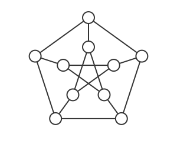

# Ramanujan 그래프의 명시적 구성

# 개요

**Ramanujan 그래프(Ramanujan graph)** 는 정점마다 이웃 수가 같은 그래프 가운데 고윳값으로 잰 섞임이 가능한 한 가장 좋은 그래프다. 정점마다 연결선이 $d$ 개인 통신망을 크게 만들수록, 망 위를 무작위로 걷는 신호가 고르게 퍼지는 빠르기에는 넘을 수 없는 한계가 있다. 그 한계에 닿는 망을 정점 수를 얼마든지 키우며 만드는 것이 문제이고, [행렬](matrices.md)군의 Cayley 그래프로 만들어 그 고윳값을 정수론의 부등식으로 누른다.

# 직관

정점마다 연결선이 $3$ 개인 통신망에서 신호가 한 정점에서 출발해 매 단계 이웃 셋 가운데 하나로 무작위로 옮겨 간다. 아래 정의 절의 그림인 Petersen 그래프에서 이렇게 걸으면, 각 정점에 있을 확률이 모든 정점에서 $1/10$ 인 고른 상태와의 차이가 한 단계마다 $2/3$ 배 이하로 줄어든다. $2/3$ 의 $2$ 는 인접행렬의 고윳값 가운데 $3$ 을 뺀 것의 절댓값 최대이고, 이 값 $\lambda$ 가 작을수록 신호가 빨리 퍼진다.

망을 크게 만들면 $\lambda$ 를 마음대로 줄일 수 없다. 연결선이 $d$ 개인 망에서는 정점 수가 커질수록 $\lambda$ 의 가장 작은 값이 $2\sqrt{d-1}$ 에 가까워지고, $d=3$ 이면 $2\sqrt2\approx 2.83$ 이다. Petersen 그래프처럼 작은 그래프에서 $\lambda\le 2\sqrt{d-1}$ 을 맞추기는 쉽지만, 정점 수를 한없이 키우면서 이 부등식을 지키는 그래프를 만드는 것이 이 문서의 문제다.

# 정의

## Ramanujan 그래프

연결된 $d$ 정규 그래프 $G$ 의 인접행렬 고윳값을 $d=\mu_1\ge\mu_2\ge\cdots\ge\mu_n$ 이라 하고

$$
\lambda(G)=\max\lbrace|\mu_i|:\ |\mu_i|\ne d\rbrace
$$

라 하자. $\lambda(G)\le2\sqrt{d-1}$ 이면 $G$ 가 **Ramanujan 그래프** 다. 이분 그래프(bipartite graph)에서는 $\mu_n=-d$ 가 늘 고윳값이므로 $\lambda$ 의 계산에서 뺀다.

그림의 Petersen 그래프(Petersen graph)는 $3$ 정규이고 고윳값이 $3$ 하나, $1$ 다섯, $-2$ 넷이다. $\lambda=2\le 2\sqrt2$ 이므로 Ramanujan 그래프다. 완전이분그래프 $K_{3,3}$ 은 고윳값이 $3,0,0,0,0,-3$ 이고 $\pm 3$ 을 빼면 $\lambda=0$ 이므로 Ramanujan 그래프다.

## LPS 구성

LPS(Lubotzky–Phillips–Sarnak) 구성은 다음 Cayley 그래프(Cayley graph)다. $p,q$ 를 $4$ 로 나눈 나머지가 1 인 서로 다른 소수라 하자. $p$ 가 $\mathbb F_q$ 에서 제곱잉여인지에 따라 $\mathrm{PSL}\_2(\mathbb F_q)$ 또는 $\mathrm{PGL}\_2(\mathbb F_q)$ 를 택하고, $x_0^2+x_1^2+x_2^2+x_3^2=p$ 의 해에서 만든 $p+1$ 개의 원소를 생성집합으로 하는 Cayley 그래프가 $X^{p,q}$ 다. 이 그래프는 $(p+1)$ 정규이고 Ramanujan 이다.

# 성질

## Alon–Boppana 정리

Alon–Boppana 정리(Alon–Boppana bound)는 $d$ 를 고정하고 정점 수를 키울 때 $d$ 정규 그래프의 $\lambda$ 가 다음을 만족한다는 정리다[^1].

$$
\lambda\ \ge\ 2\sqrt{d-1}-o(1)
$$

$d$ 정규 무한 나무의 인접작용소는 스펙트럼 반지름이 $2\sqrt{d-1}$ 이고, 정점 수가 큰 $d$ 정규 그래프는 한 정점 근처에서 이 나무와 같은 모양이어서 이 경계가 나온다. 그래서 Ramanujan 그래프는 정점 수가 큰 [Expander 그래프](expander-graphs.md) 가운데 스펙트럼 간극(spectral gap) $d-\lambda$ 가 최대인 것이다.

## LPS 증명의 요지

소수 $p$ 를 [네 제곱수의 합](four-squares-theorem.md)으로 쓰는 방법의 개수가 $8(p+1)$ 이라는 Jacobi 정리가 [사원수 대수](quaternion-algebras.md)에서 $p+1$ 개의 생성원을 준다. 이 Cayley 그래프의 고윳값은 [군의 표현](group-representations.md)으로 계산되고, 사원수 대수 위 자기동형 형식(automorphic form)의 Hecke 고윳값이다. [Jacquet–Langlands 대응](jacquet-langlands.md)으로 이를 무게 2 첨점형식의 계수 $a_p$ 로 옮기면 Deligne 이 증명한 Ramanujan 추측의 경계가 적용되고, 차수가 $d=p+1$ 이므로 그래프 쪽 부등식이 나온다.

$$
\vert a_p\vert\le 2\sqrt p,\qquad d=p+1\ \Rightarrow\ \lambda\le 2\sqrt{d-1}
$$

그래프의 이름은 이 경계에서 왔다. Margulis 도 1988 년에 같은 그래프를 독립적으로 구성했다.

## 차수의 제약

LPS 구성은 $d=p+1$, 곧 소수에 1 을 더한 차수에서만 쓰인다. Morgenstern 은 소수 거듭제곱 $q$ 에 대해 $d=q+1$ 인 구성을 주었다.

## Marcus–Spielman–Srivastava

Marcus, Spielman, Srivastava 는 2015 년에 모든 $d\ge3$ 에 대해 $d$ 정규 이분 Ramanujan 그래프의 무한 족이 존재함을 증명했다.

증명은 주어진 그래프의 2 겹 덮개를 잘 고르면 $\lambda$ 가 늘지 않음을 보인다. 가능한 덮개들의 [특성다항식](eigenvalues.md)을 평균하면 원래 그래프의 매칭 다항식(matching polynomial)이 되고, 그 근은 Heilmann–Lieb 정리로 $2\sqrt{d-1}$ 이하다. 이 다항식들이 교대 족(interlacing family)을 이루므로, 어느 한 덮개의 특성다항식의 가장 큰 근이 평균 다항식의 가장 큰 근 이하다. 교대 족의 논법은 Kadison–Singer 문제의 해결에도 쓰였다.

이 증명은 존재만 보인다. M. B. Cohen 은 이 그래프들을 정점 수의 다항 시간에 구성하는 알고리즘을 주었다[^2].

## 무작위 정규 그래프

Friedman 정리(Friedman's theorem)로 무작위 $d$ 정규 그래프는 높은 확률로 $\lambda\le2\sqrt{d-1}+\varepsilon$ 을 만족한다. $\varepsilon$ 이 붙으므로 이 정리는 Ramanujan 그래프의 존재를 주지 않는다.

# 활용

## 오류정정부호와 통신망

$\lambda$ 가 작은 그래프는 지름이 작고, 간선을 적게 지워서는 큰 조각으로 끊기지 않는다. expander 부호(expander code)의 복호 오류 한계, 결함에 강한 통신망의 지름과 연결도가 $\lambda$ 로 어림되고, 같은 차수에서 Ramanujan 그래프가 이 어림을 가장 좋게 만든다.

## 무작위성 추출과 복잡도

Expander 그래프 위의 [무작위 걷기](random-walks.md)는 짧은 시간에 [균등분포](uniform-distribution.md)에 가까워지고, 무작위성을 아끼는 알고리즘이 이 성질을 쓴다. Expander 걷기 보조정리(expander walk lemma)와 결정론적 증폭(deterministic amplification)이 $\lambda/d$ 를 경계에 쓰므로, Ramanujan 그래프를 쓰면 같은 차수에서 상수가 가장 작아진다.

## 암호 해시

초특이 동종사상 그래프(supersingular isogeny graph)도 Ramanujan 이다. 그 그래프의 인접행렬이 Brandt 행렬이고 고윳값이 Hecke 고윳값이므로 Deligne 경계가 적용된다. Charles–Goren–Lauter 해시 함수는 이 그래프 위의 걷기로 입력을 출력 정점에 대응시키고, 빠른 섞임으로 출력이 고르게 퍼진다. 충돌 저항성은 두 정점 사이의 경로를 찾기 어렵다는 가정에 기댄다.

[^1]: A. Lubotzky, R. Phillips, P. Sarnak, *Ramanujan graphs*, Combinatorica **8** (1988), 261–277. 독립 구성은 G. Margulis (1988). Alon–Boppana 경계는 N. Alon, *Eigenvalues and expanders*, Combinatorica **6** (1986). 교과서는 A. Lubotzky, *Discrete Groups, Expanding Graphs and Invariant Measures* (1994), 그리고 G. Davidoff, P. Sarnak, A. Valette, *Elementary Number Theory, Group Theory and Ramanujan Graphs* (2003). 이분 판본은 A. Marcus, D. Spielman, N. Srivastava, *Interlacing families I*, Ann. of Math. **182** (2015). 무작위 그래프 쪽은 J. Friedman, *A proof of Alon's second eigenvalue conjecture*, Mem. Amer. Math. Soc. (2008).
[^2]: M. B. Cohen, "Ramanujan graphs in polynomial time", 57th IEEE Symposium on Foundations of Computer Science (2016), 276–281.

# 연관 문서

## 선수지식

- [Expander 그래프](expander-graphs.md)

## 더 알아보기

- [초특이 동종사상 그래프](supersingular-isogeny-graphs.md)

#graph_theory #number_theory #construction
