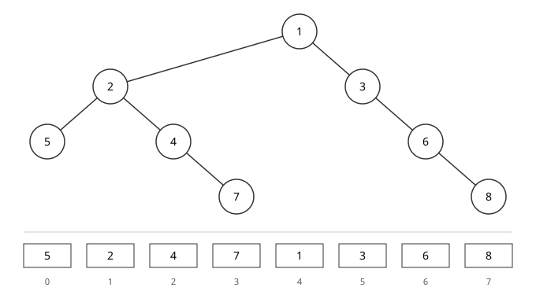

# 구간 최솟값 질의

# 개요

**구간 최솟값 질의(range minimum query, RMQ)** 는 바뀌지 않는 배열에서 주어진 구간의 가장 작은 값이 있는 자리를 묻는 질의다. 한 해의 일별 최저기온 기록에서 "3월 2일부터 5월 7일까지 가장 추운 날" 을 수천 번 물으면, 질의마다 구간을 훑는 데 구간 길이만큼의 비교가 든다. 배열이 바뀌지 않으므로 미리 표를 만들어 두면 질의 하나에 비교를 한두 번만 한다.

# 직관

배열 $A=(5,2,4,7,1,3,6,8)$ 의 자리를 $0$ 부터 $7$ 까지 센다. 구간 $\lbrack 1,6\rbrack$ 의 값은 $2,4,7,1,3,6$ 이고 최솟값 $1$ 은 자리 $4$ 에 있다. 구간마다 답을 미리 적어 두면 질의는 표 읽기 한 번이지만, 구간이 $n(n+1)/2$ 개라 $n$ 이 백만이면 표가 너무 크다.

길이가 $1,2,4,8,\dots$ 인 구간의 답만 적어 두면 표의 칸 수는 $n\log\_2 n$ 정도다. 구간 $\lbrack 1,6\rbrack$ 은 길이가 $6$ 이라 표에 없지만, 길이 $4$ 인 두 구간 $\lbrack 1,4\rbrack$ 과 $\lbrack 3,6\rbrack$ 이 이 구간을 덮는다. 두 구간이 $\lbrack 3,4\rbrack$ 에서 겹쳐도 최솟값은 같은 값을 두 번 보아도 바뀌지 않으므로, 두 구간의 답 가운데 작은 쪽이 답이다. $\lbrack 1,4\rbrack$ 의 답도 $\lbrack 3,6\rbrack$ 의 답도 자리 $4$ 이므로 답은 자리 $4$ 다.

# 정의

## 구간 최솟값 질의

전순서 집합의 원소로 된 배열 $A\lbrack 0..n-1\rbrack$ 과 $0\le l\le r\lt n$ 에 대해 $\mathrm{RMQ}\_A(l,r)$ 은 $A\lbrack l\rbrack,\dots,A\lbrack r\rbrack$ 가운데 가장 작은 값이 있는 자리다. 같은 값이 여럿이면 가장 왼쪽 자리로 정한다. 배열을 받아 미리 계산하는 단계를 **전처리(preprocessing)** 라 하고, 전처리 시간과 질의 시간의 쌍으로 방법의 비용을 적는다.

예. 직관 절의 $A$ 에서 $\mathrm{RMQ}\_A(1,6)=4$, $\mathrm{RMQ}\_A(0,2)=1$, $\mathrm{RMQ}\_A(5,7)=5$ 다.

## 희소 표

**희소 표(sparse table)** 는 모든 자리 $i$ 와 $2^j\le n-i$ 인 모든 $j$ 에 대해 다음 값을 적은 표다.

$$
M\lbrack j\rbrack\lbrack i\rbrack=\mathrm{RMQ}\_A(i,\thinspace i+2^j-1)
$$

$j=0$ 줄은 $M\lbrack 0\rbrack\lbrack i\rbrack=i$ 이고, 길이 $2^j$ 인 구간은 길이 $2^{j-1}$ 인 두 구간으로 나뉘므로 $M\lbrack j\rbrack\lbrack i\rbrack$ 는 $M\lbrack j-1\rbrack\lbrack i\rbrack$ 와 $M\lbrack j-1\rbrack\lbrack i+2^{j-1}\rbrack$ 가운데 값이 작은 쪽이다. 질의 $(l,r)$ 은 $j=\lfloor\log\_2(r-l+1)\rfloor$ 로 두고 $M\lbrack j\rbrack\lbrack l\rbrack$ 과 $M\lbrack j\rbrack\lbrack r-2^j+1\rbrack$ 가운데 값이 작은 쪽을 답한다.

```typescript
function buildSparseTable(A: number[]): number[][] {
  const n = A.length;
  const M: number[][] = [A.map((x, i) => i)];
  for (let j = 1; 1 << j <= n; j++) {
    const prev = M[j - 1];
    const row: number[] = [];
    for (let i = 0; i + (1 << j) <= n; i++) {
      const a = prev[i];
      const b = prev[i + (1 << (j - 1))];
      row.push(A[b] < A[a] ? b : a);
    }
    M.push(row);
  }
  return M;
}

function query(A: number[], M: number[][], l: number, r: number): number {
  const j = Math.floor(Math.log2(r - l + 1));
  const a = M[j][l];
  const b = M[j][r - (1 << j) + 1];
  return A[b] < A[a] ? b : a;
}
```

예. 직관 절의 $A$ 에서 $M\lbrack 2\rbrack\lbrack 1\rbrack=4$, $M\lbrack 2\rbrack\lbrack 3\rbrack=4$ 이므로 질의 $(1,6)$ 의 답은 $4$ 다.

## Cartesian 트리

값이 서로 다른 배열 $A$ 의 **Cartesian 트리(Cartesian tree)** 는 최솟값의 자리 $m$ 을 뿌리로 하고, $A\lbrack 0..m-1\rbrack$ 의 Cartesian 트리를 왼쪽 부분 트리로, $A\lbrack m+1..n-1\rbrack$ 의 Cartesian 트리를 오른쪽 부분 트리로 하는 이진 트리다. Vuillemin 이 1980 년에 정의했다[^1]. 자리를 키로, 값을 우선순위로 보면 Cartesian 트리는 [트립](treaps.md)과 같은 조건을 만족하는 트리다.

예. 직관 절의 $A$ 의 Cartesian 트리는 아래 그림과 같다. 뿌리는 값 $1$ 이 있는 자리 $4$ 이고, 그 왼쪽은 $(5,2,4,7)$ 의 트리, 오른쪽은 $(3,6,8)$ 의 트리다. 그림 아래 줄은 배열이고 그 밑의 수가 자리다.



# 성질

## 희소 표의 비용

희소 표의 칸은 $O(n\log n)$ 개이고 칸마다 비교 한 번으로 채우므로 전처리가 $O(n\log n)$ 시간과 공간이다. 질의는 표 읽기 두 번과 비교 한 번이라 $O(1)$ 이다.

$\min(x,x)=x$ 이므로 겹치는 두 구간을 쓸 수 있다. 같은 방법은 최댓값과 최대공약수에도 쓰이지만 합에는 쓰이지 않는다. 합에는 [세그먼트 트리](segment-trees.md)를 쓴다.

## 선형 시간 구성

Cartesian 트리는 배열을 왼쪽부터 읽으며 $O(n)$ 시간에 만든다. 지금까지 만든 트리에서 뿌리부터 오른쪽 자식만 따라간 경로를 스택에 두고, 새 값보다 큰 마디를 스택에서 꺼낸 뒤 새 마디를 경로 끝에 붙이고 마지막으로 꺼낸 마디를 그 왼쪽 자식으로 삼는다.

```typescript
// parent[i] 는 자리 i 의 부모 자리, 뿌리는 -1.
function cartesianTree(A: number[]): number[] {
  const parent = new Array(A.length).fill(-1);
  const stack: number[] = [];
  for (let i = 0; i < A.length; i++) {
    let last = -1;
    while (stack.length > 0 && A[stack[stack.length - 1]] > A[i]) {
      last = stack.pop()!;
    }
    if (last !== -1) parent[last] = i;
    if (stack.length > 0) parent[i] = stack[stack.length - 1];
    stack.push(i);
  }
  return parent;
}
```

각 자리는 스택에 한 번 들어가고 많아야 한 번 나오므로 전체가 $O(n)$ 이다.

## 최소 공통 조상과의 동치

뿌리 있는 트리에서 두 마디 $u,v$ 의 **최소 공통 조상(lowest common ancestor, LCA)** 은 $u$ 와 $v$ 의 공통 조상 가운데 가장 깊은 마디다. 마디는 자기 자신의 조상으로 센다. Cartesian 트리에서 다음이 성립한다[^2].

$$
\mathrm{RMQ}\_A(l,r)=\mathrm{LCA}(l,r)
$$

*증명의 요지.* $m=\mathrm{RMQ}\_A(l,r)$ 이라 하자. $m$ 의 조상의 값은 모두 $A\lbrack m\rbrack$ 보다 작으므로 $\lbrack l,r\rbrack$ 밖에 있고, 그래서 $\lbrack l,r\rbrack$ 은 $m$ 의 부분 트리에 통째로 들어 있다. $m$ 이 $l$ 이나 $r$ 이 아니면 $l$ 은 $m$ 의 왼쪽, $r$ 은 오른쪽 부분 트리에 있어 $m$ 아래에서 갈라진다.

예. $\mathrm{RMQ}\_A(0,2)=1$ 이고, 그림에서 자리 $0$ 과 $2$ 는 자리 $1$ 의 두 자식이다.

거꾸로, 마디 $n$ 개인 트리의 LCA 질의는 트리를 깊이 우선으로 돌며 들르는 마디의 깊이를 적은 길이 $2n-1$ 의 배열에서 구간 최솟값 질의로 바뀐다. 이 배열은 이웃한 두 값의 차가 $\pm 1$ 이다.

## 선형 전처리와 상수 질의

구간 최솟값 질의는 $O(n)$ 전처리와 $O(1)$ 질의로 풀린다[^3]. 이웃한 값의 차가 $\pm 1$ 인 배열을 길이 $\frac12\log\_2 n$ 인 블록으로 나눈다. 블록 최솟값들의 배열에 희소 표를 만들면 칸이 $O(n)$ 개다. 블록 안의 질의는 블록의 차의 부호 열로 정해지고 그런 열은 $2^{\frac12\log\_2 n}=\sqrt n$ 가지뿐이므로, 그 모든 열의 모든 질의의 답을 $O(\sqrt n\log^2 n)$ 칸에 미리 적는다. 일반 배열은 Cartesian 트리와 LCA 를 거쳐 이 경우로 바뀐다.

# 활용

- 최장 공통 접두사. [접미사 배열](suffix-arrays.md)의 LCP(longest common prefix) 배열에서 구간 최솟값을 구하면 임의의 두 접미사의 최장 공통 접두사 길이가 $O(1)$ 에 나온다.
- 트리의 LCA. 계통수에서 두 종의 가장 가까운 공통 조상, 파일 체계에서 두 경로의 공통 상위 폴더를 깊이 배열의 구간 최솟값으로 찾는다.
- 문자열 검색의 문서 목록. 패턴이 나오는 문서들을 겹치지 않게 내놓는 질의에서, 같은 문서의 앞선 출현 자리를 적은 배열의 구간 최솟값을 되풀이해 쓴다.

[^1]: J. Vuillemin, "A unifying look at data structures", Communications of the ACM 23 (1980), 229–239.
[^2]: H. N. Gabow, J. L. Bentley, R. E. Tarjan, "Scaling and related techniques for geometry problems", Proceedings of the 16th ACM Symposium on Theory of Computing (1984), 135–143.
[^3]: M. A. Bender, M. Farach-Colton, "The LCA problem revisited", LATIN 2000, Lecture Notes in Computer Science 1776 (2000), 88–94.

# 연관 문서

## 선수지식

- [세그먼트 트리](segment-trees.md)
- [트립](treaps.md)

## 더 알아보기

아직 연결한 문서가 없다.

#data_structures #algorithms #computation
