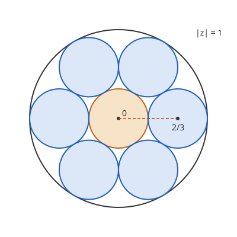

# Rodin–Sullivan 정리

# 개요

**Rodin–Sullivan 정리(Rodin–Sullivan theorem)** 는 영역을 작은 동전으로 육각형 격자 모양으로 채우고 같은 맞닿음 관계로 원판 안을 다시 채우면, 동전 중심끼리의 대응이 동전이 작아질수록 영역을 원판으로 보내는 등각사상에 수렴한다는 정리다. 정사각형을 원판으로 보내는 등각사상이 있다는 것은 [Riemann 사상정리](riemann-mapping-theorem.md)가 보장하지만, 그 증명은 사상의 값을 계산하는 방법을 주지 않는다.

이 정리는 동전의 반지름을 맞추는 반복 계산만으로 그 사상의 근삿값을 얻을 수 있게 한다.

# 직관

영역 $\Omega$ 와 그 안의 점 $z\_0$ 이 있다. Riemann 사상정리는 $\Omega$ 를 단위 원판으로 보내고 $z\_0$ 을 $0$ 으로 보내는 등각사상 $f$ 가 있다고 말한다. 증명은 그런 함수들 가운데 $z\_0$ 에서 도함수의 절댓값이 가장 큰 것을 고르는 것이어서, $f$ 의 값을 계산하는 절차가 들어 있지 않다.

반지름 $\varepsilon$ 인 동전을 평면에 육각형 격자로 깔고 $\Omega$ 안에 완전히 들어가는 동전만 남긴다. 예를 들어 $\Omega$ 가 $z\_0$ 을 중심으로 하는 반지름 $3\varepsilon$ 인 원판이면 $z\_0$ 에 놓인 동전 하나와 그 둘레의 동전 여섯 개가 남는다. 둘레 동전의 중심은 $z\_0$ 에서 $2\varepsilon$ 떨어져 있다.

이 일곱 동전과 맞닿음 관계가 같은 동전 일곱 개를 단위 원판 안에 놓되, 둘레의 여섯 동전은 단위원에 안쪽에서 닿게 한다. 대칭이므로 가운데 동전의 반지름을 $r\_0$, 둘레 동전의 반지름을 $r\_1$ 로 둔다.

둘레 동전이 단위원에 닿으므로 $r\_0+2r\_1=1$ 이다. 이웃한 둘레 동전의 중심은 원점에서 $r\_0+r\_1$ 떨어져 있고 $60^\circ$ 를 사이에 두므로 두 중심의 거리는 $r\_0+r\_1$ 이다. 두 동전이 맞닿으려면 이 거리가 $2r\_1$ 이어야 하므로 $r\_0=r\_1=1/3$ 이다.

그림에서 둘레 동전의 중심은 원점에서 $2/3$ 떨어져 있다. 처음 동전의 중심을 새 동전의 중심으로 보내고 중심 셋이 이루는 삼각형 안은 일차식으로 이으면, $z\_0$ 에서 $2\varepsilon$ 떨어진 점이 $2/3$ 로 가므로 이 사상은 $(z-z\_0)/(3\varepsilon)$ 이다. 이것은 반지름 $3\varepsilon$ 인 원판을 단위 원판으로 보내는 등각사상과 같다.

$\Omega$ 가 정사각형이면 남는 동전이 많고 원판 안의 동전은 반지름이 제각각이 되어, 꼭짓점 근처의 동전은 작아지고 변의 가운데 근처의 동전은 커진다. Rodin–Sullivan 정리는 $\varepsilon\to 0$ 일 때 이렇게 만든 사상이 $f$ 에 수렴한다는 것이다.

# 정의

## 최대 원 채움

$K$ 가 닫힌 원판과 위상동형인 삼각분할이라 하자. 접촉 그래프가 $K$ 이고 경계 정점의 원이 모두 단위원에 안쪽에서 접하는 단위 원판 안의 [원 채움](circle-packing-theorem.md)을 $K$ 의 **최대 원 채움(maximal circle packing)** 이라 한다. 최대 원 채움은 존재하고, 단위 원판의 Möbius 자기동형을 빼면 하나뿐이다[^2]. 직관 절에서 반지름 $1/3$ 인 일곱 동전이 정점 일곱 개짜리 삼각분할의 최대 원 채움이다.

## 이산 Riemann 사상

$\Omega$ 가 유계인 단순연결 영역이고 $z\_0\in\Omega$ 라 하자. 반지름 $\varepsilon$ 인 육각형 격자 원 채움에서 $\Omega$ 안에 완전히 들어가는 원들 가운데 $z\_0$ 에 가장 가까운 원과 맞닿음으로 이어지는 원 전체를 $H\_\varepsilon$ 이라 한다. $H\_\varepsilon$ 의 접촉 그래프 $K\_\varepsilon$ 의 최대 원 채움을 잡되, $z\_0$ 에 가장 가까운 원의 상은 중심이 $0$ 이고 정해진 이웃 원의 상은 중심이 양의 실수축 위에 있게 한다.

원의 중심을 상의 중심으로 보내고 $K\_\varepsilon$ 의 각 삼각형 위에서 일차식으로 이은 사상 $f\_\varepsilon$ 을 **이산 Riemann 사상(discrete Riemann mapping)** 이라 한다. 직관 절의 반지름 $3\varepsilon$ 인 원판에서 $f\_\varepsilon(z)=(z-z\_0)/(3\varepsilon)$ 이다.

# 성질

## Rodin–Sullivan 정리

**정리(Rodin–Sullivan, 1987).** $f$ 가 $\Omega$ 를 단위 원판으로 보내고 $f(z\_0)=0$, $f'(z\_0)\gt 0$ 인 등각사상이면, $\varepsilon\to 0$ 일 때 $f\_\varepsilon$ 은 $\Omega$ 의 콤팩트 부분집합에서 $f$ 로 고르게 수렴한다[^1].

Thurston 이 1985 년에 이 수렴을 추측했고 Rodin 과 Sullivan 이 증명했다. 증명은 다음 두 절의 고리 보조정리와 육각 채움의 강성을 쓴다.

## 고리 보조정리

**고리 보조정리(ring lemma).** 정수 $n\ge 3$ 마다 상수 $c(n)\gt 0$ 이 있어서, 반지름 $1$ 인 원을 $n$ 개의 원이 차례로 맞닿으며 둘러싸고 각각 가운데 원에 닿으면 둘레 원의 반지름은 모두 $c(n)$ 이상이다[^1].

증명의 요지. 둘레 원 하나가 아주 작으면 그 양옆의 둘레 원은 가운데 원과 맞닿은 점 근처에서 서로 거의 닿아야 하고, 그러면 그 양옆도 작아야 한다. 이것이 사슬을 따라 이어져 $n$ 개로는 가운데 원을 둘러쌀 수 없게 된다.

$f\_\varepsilon$ 의 상에서 맞닿은 원 세 개의 중심이 이루는 삼각형은 고리 보조정리에 따라 세 반지름의 비가 유계이고, 그 각은 $0$ 에서 떨어져 있다. 일차 사상이 정삼각형을 각이 $0$ 에서 떨어진 삼각형으로 보내면 그 사상의 팽창률이 유계이므로, $\Omega$ 의 콤팩트 부분집합마다 $\varepsilon$ 과 무관한 $K$ 가 있어 $f\_\varepsilon$ 들이 그 위에서 $K$ [준등각 사상](quasiconformal-maps.md)이다. $K$ 준등각 사상의 정규족 성질에 따라 $f\_\varepsilon$ 의 부분수열이 수렴한다.

## 육각 채움의 강성

평면 전체의 육각형 격자 접촉 그래프를 갖는 원 채움은 육각형 격자 원 채움을 닮음변환한 것뿐이다[^1].

$\Omega$ 의 콤팩트 부분집합 안의 원 하나는 $\varepsilon\to 0$ 일 때 둘레에 육각형 격자 모양의 원이 점점 많은 겹으로 놓인다. 강성과 고리 보조정리를 합치면 그 원의 상에서 이웃한 원끼리의 반지름의 비가 $1$ 로 가고, 상의 삼각형이 정삼각형에 가까워진다. 그래서 극한 사상의 팽창률은 $1$ 이고, $1$ 준등각 사상은 등각사상이다. 정규화가 $f$ 와 같으므로 Riemann 사상의 유일성에 따라 극한은 $f$ 이고, 부분수열을 잡을 필요 없이 $f\_\varepsilon\to f$ 다.

## 도함수의 수렴

원의 상의 반지름을 $\varepsilon$ 으로 나눈 값은 $f$ 의 도함수의 절댓값 $\vert f'\vert$ 로 수렴한다. He 와 Schramm 은 육각형 격자에서 이 수렴과 더 높은 도함수의 수렴이 콤팩트 부분집합에서 고르게 성립한다는 것을 보였다[^3]. 직관 절의 원판에서는 모든 상의 반지름이 $1/3$ 이고, 이것을 $\varepsilon$ 으로 나눈 $1/(3\varepsilon)$ 이 $f'$ 과 같다.

육각형이 아닌 삼각분할에서도 원의 최대 반지름이 $0$ 으로 가면 이산 Riemann 사상이 Riemann 사상으로 수렴한다[^4].

# 활용

- 수치 등각 사상. 원 채움 정리 문서의 각 합 반복으로 최대 원 채움의 반지름을 구하면 등각사상의 근삿값과 $\vert f'\vert$ 의 근삿값이 함께 나온다. 다각형이 아닌 영역에도 쓰여, 다각형 영역에 맞춘 [Schwarz–Christoffel 공식](schwarz-christoffel-formula.md)과 쓰임새가 다르다.
- 이산 해석함수. 같은 접촉 그래프를 갖는 두 원 채움 사이의 대응을 해석함수의 이산판으로 보고, [Schwarz–Pick 보조정리](schwarz-pick-lemma.md)의 이산판처럼 연속 이론의 정리를 원 채움으로 옮긴다[^2].
- 곡면 평탄화. 뇌 피질처럼 삼각분할로 주어진 곡면을 같은 접촉 그래프의 원 채움으로 평면이나 원판에 펴서, 각을 크게 왜곡하지 않는 지도를 만든다[^5].

[^1]: B. Rodin, D. Sullivan, "The convergence of circle packings to the Riemann mapping", *Journal of Differential Geometry* 26 (1987), 349–360.
[^2]: K. Stephenson, *Introduction to Circle Packing: The Theory of Discrete Analytic Functions*, Cambridge University Press, 2005.
[^3]: Z.-X. He, O. Schramm, "The C∞-convergence of hexagonal disk packings", *Transactions of the American Mathematical Society* 350 (1998), 2719–2754.
[^4]: Z.-X. He, O. Schramm, "On the convergence of circle packings to the Riemann map", *Inventiones Mathematicae* 125 (1996), 285–305.
[^5]: M. K. Hurdal, K. Stephenson, "Cortical cartography using the discrete conformal approach of circle packings", *NeuroImage* 23 (2004), S119–S128.

# 연관 문서

## 선수지식

- [원 채움 정리](circle-packing-theorem.md)
- [준등각 사상](quasiconformal-maps.md)

## 더 알아보기

아직 연결한 문서가 없다.

#complex_analysis #graph_theory #combinatorics
