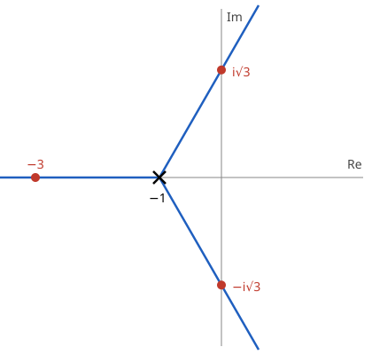

# 근궤적

# 개요

**근궤적(root locus)** 은 되먹임 고리의 이득 $k$ 를 $0$ 부터 키울 때 닫힌 고리의 극이 복소평면에서 움직이는 자취다. 이득을 키우면 응답이 빨라지다가 어느 순간 진동하고 불안정해지는데, 극이 어느 길로 움직이는지 알면 진동이 언제 시작되고 어느 이득에서 허수축을 넘는지 함께 보인다.

근궤적은 극을 이득마다 계산하지 않고, 열린 고리 전달 함수의 극과 영점의 위치에서 정해지는 몇 가지 규칙으로 자취의 모양을 그린다.

# 직관

[Nyquist 판정법](nyquist-criterion.md) 문서의 고리 $G(s)=1/(s+1)^3$ 에서 닫힌 고리의 극은 $(s+1)^3=-k$ 의 근이다. $-k$ 의 세제곱근을 쓰면 극은 다음과 같다.

$$
s=-1+k^{1/3}e^{i\pi(2l+1)/3}\qquad(l=0,1,2)
$$

$k=0$ 이면 세 극이 모두 $-1$ 에 있다. $k$ 가 커지면 세 극이 $-1$ 에서 각각 $60^\circ$, $180^\circ$, $-60^\circ$ 방향의 반직선을 따라 거리 $k^{1/3}$ 만큼 멀어진다.

아래 그림이 그 세 반직선이고, ×는 $k=0$ 의 극, 빨간 점은 $k=8$ 의 극이다. $k=8$ 이면 $k^{1/3}=2$ 라 극이 $i\sqrt3$, $-i\sqrt3$, $-3$ 에 있고, 위아래 두 반직선이 허수축을 지난다.

$k\lt 8$ 이면 세 극이 왼쪽 반평면에 있어 안정하고, $k\gt 8$ 이면 두 극이 오른쪽 반평면으로 넘어가 불안정하다. 허수축 위의 극 $\pm i\sqrt3$ 은 각진동수 $\sqrt3$ 의 진동이다.

# 정의

열린 고리 전달 함수를 $G(s)=n(s)/d(s)$ 로 쓴다. $d$ 는 차수 $N$ 의 최고차항 계수가 $1$ 인 다항식이고 근이 $p\_1,\dots,p\_N$ 이며, $n$ 은 차수 $M\le N$ 이고 근이 $z\_1,\dots,z\_M$ 이다. $p\_j$ 를 열린 고리의 극, $z\_i$ 를 영점이라 한다.

$k\ge 0$ 에 대해 다음 방정식의 근 전체가 이루는 복소평면의 집합을 **근궤적** 이라 한다[^1].

$$
d(s)+k\thinspace n(s)=0
$$

직관 절은 $N=3$, $M=0$, $p\_1=p\_2=p\_3=-1$ 인 경우다.

# 성질

## 편각 조건과 크기 조건

$n(s)\ne 0$ 인 점 $s$ 가 근궤적 위에 있는 것과 $G(s)$ 가 음의 실수인 것은 동치다. 편각으로 쓰면 다음과 같다.

$$
\sum\_{i=1}^M\arg(s-z\_i)-\sum\_{j=1}^N\arg(s-p\_j)=\pi\pmod{2\pi}
$$

그 점에 해당하는 이득은 $k=1/\vert G(s)\vert$ 다. 직관 절에서 $s=i\sqrt3$ 이면 $\arg(i\sqrt3+1)=60^\circ$ 를 세 번 빼서 $-180^\circ$ 가 되고, $k=\vert 1+i\sqrt3\vert^3=8$ 이다.

## 그리기 규칙

편각 조건에서 다음이 나온다[^2].

- 가지는 $N$ 개다. $k=0$ 에서 극 $p\_j$ 에서 출발하고, $k\to\infty$ 에서 $M$ 개는 영점 $z\_i$ 로 가고 $N-M$ 개는 무한대로 간다.
- 무한대로 가는 가지는 중심 $\sigma=(\sum p\_j-\sum z\_i)/(N-M)$ 에서 각 $(2l+1)\pi/(N-M)$ 로 뻗는 점근선에 다가간다. 직관 절은 $\sigma=-1$ 이고 각이 $60^\circ$, $180^\circ$, $300^\circ$ 라 가지가 점근선 자체다.
- 실수축 위의 점은 그 점보다 오른쪽에 있는 실수 극과 실수 영점의 개수의 합이 홀수일 때 근궤적 위에 있다. 켤레 복소수 쌍의 편각은 서로 지워지고 오른쪽의 실수 극이나 영점은 하나마다 $\pi$ 를 보태므로, 그 합이 홀수일 때 편각 조건이 성립한다.
- 가지가 허수축을 지나는 이득은 $d+kn$ 에 [Routh–Hurwitz 판정법](routh-hurwitz-criterion.md)을 써서 첫째 칸이 $0$ 이 되는 $k$ 로 구한다.

## 영점이 있는 예

$G(s)=(s+2)/(s(s+1))$ 이면 특성방정식은 다음과 같다.

$$
s^2+(1+k)s+2k=0
$$

실수축 규칙으로 구간 $\lbrack -1,0\rbrack$ 과 $(-\infty,-2\rbrack$ 가 근궤적이다. 두 극 $0$, $-1$ 에서 출발한 가지는 $k=3-2\sqrt2$ 에서 $-2+\sqrt2\approx-0.59$ 에 만나 실수축을 떠나고, $k=3+2\sqrt2$ 에서 $-2-\sqrt2\approx-3.41$ 에 다시 실수축으로 들어온다. 그 사이의 복소 근은 $\vert s+2\vert^2=2$ 를 만족해, 영점 $-2$ 를 중심으로 하는 반지름 $\sqrt2$ 의 원 위에 있다.

# 활용

- 이득 선택. 원하는 감쇠비나 응답 속도를 복소평면의 영역으로 적고, 근궤적이 그 영역을 지나는 이득을 고른다.
- 보상기 설계. 열린 고리에 영점을 더하면 가지가 그 영점 쪽으로 끌려 왼쪽으로 휘고, 극을 더하면 오른쪽으로 밀린다. $G=1/(s(s+1))$ 의 두 가지는 $-1/2$ 에서 위아래로 곧게 뻗어 $k$ 가 커질수록 진동이 빨라지지만, 영점이 있는 예에서는 영점 $-2$ 가 가지를 원으로 휘어 큰 $k$ 에서 두 극이 실수축으로 돌아오고 진동이 사라진다.
- 매개변수에 따른 고윳값. 행렬 $A-kbc^{\mathsf T}$ 의 특성다항식은 $d(s)=\det(sI-A)$ 와 $n(s)=c^{\mathsf T}\mathrm{adj}(sI-A)b$ 로 $d+kn$ 이 되므로, 고윳값이 $k$ 에 따라 움직이는 자취를 같은 규칙으로 그린다.

[^1]: W. R. Evans, "Graphical analysis of control systems", *Transactions of the American Institute of Electrical Engineers* 67 (1948), 547–551.
[^2]: K. J. Åström, R. M. Murray, *Feedback Systems: An Introduction for Scientists and Engineers*, Princeton University Press, 2008.

# 연관 문서

## 선수지식

- [Nyquist 판정법](nyquist-criterion.md)

## 더 알아보기

아직 연결한 문서가 없다.

#complex_analysis #optimization
