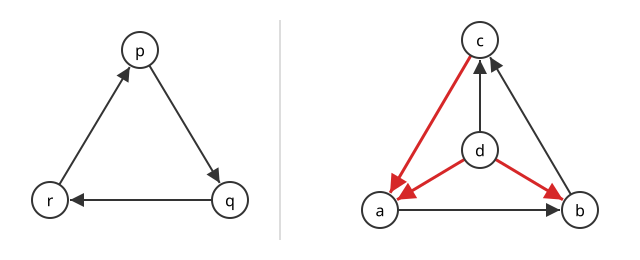

# Rosenfeld 추측

# 개요

**Rosenfeld 추측(Rosenfeld's conjecture)** 은 [토너먼트](tournaments.md)의 정점을 한 줄로 세울 때, 이웃한 두 정점 사이 화살표의 방향을 자리마다 아무렇게나 미리 정해도 그대로 세울 수 있다는 진술이다. 네 팀이 서로 한 번씩 경기한 리그에서 "앞 팀이 이김, 짐, 이김" 의 꼴로 네 팀을 줄 세울 수 있는지, 세 팀 리그에서 "이김, 짐" 의 꼴이 되는지를 묻는 것이 그 예다. F. Havet 와 S. Thomassé 가 세 개의 작은 토너먼트를 빼면 이 진술이 참임을 증명했고, 예외 셋은 방향이 번갈아 바뀌는 꼴만 막는다.

# 직관

아래 그림의 왼쪽은 세 팀 $p,q,r$ 의 리그이고 $p$ 가 $q$ 를, $q$ 가 $r$ 을, $r$ 이 $p$ 를 이겼다. 화살표는 이긴 팀에서 진 팀으로 간다. 세 팀을 "앞 팀이 이김, 짐" 으로 세우려면 가운데 팀이 양옆의 두 팀에게 모두 져야 한다. 세 팀 모두 한 번만 졌으므로 이렇게 세울 수 없다.

오른쪽은 네 팀 리그다. $a,b,c$ 가 왼쪽처럼 서로 한 번씩 이겼고 $d$ 가 세 팀을 모두 이겼다. "이김, 짐, 이김" 으로 세우려면 둘째 팀이 첫째와 셋째에게 모두 져야 하고, 셋째 팀이 넷째를 이겨야 한다.

둘째 자리에 $a$ 를 두면 $a$ 를 이긴 $c$ 와 $d$ 가 첫째와 셋째다. 셋째에 $d$ 를 두면 넷째 $b$ 를 $d$ 가 이기므로 $c,a,d,b$ 가 된다. 붉은 화살표 $c\to a$, $d\to a$, $d\to b$ 가 이 줄이다.

# 정의

## 방향 경로

정점 $u\_1,\dots,u\_n$ 과, 이웃한 두 정점 $u\_i$, $u\_{i+1}$ 사이마다 어느 한 방향의 화살표 하나로 된 방향 그래프를 정점 $n$ 개의 **방향 경로(oriented path)** 라 한다. 화살표가 모두 $u\_i\to u\_{i+1}$ 이면 **유향 경로(directed path)** 이고, 방향이 번갈아 바뀌면 **반대 방향 경로(antidirected path)** 다. 정점 $n$ 개의 방향 경로는 화살표 방향의 열로 정해지므로 $2^{n-1}$ 가지다.

직관 절의 "이김, 짐, 이김" 은 $u\_1\to u\_2\leftarrow u\_3\to u\_4$ 인 반대 방향 경로이고, "이김, 짐" 은 $u\_1\to u\_2\leftarrow u\_3$ 이다.

## 토너먼트가 경로를 포함함

정점 $n$ 개의 토너먼트 $T$ 가 정점 $n$ 개의 방향 경로 $P$ 를 **포함한다(contains)** 는 것은, $T$ 의 정점을 $v\_1,\dots,v\_n$ 으로 늘어놓아 $P$ 에서 $u\_i\to u\_{i+1}$ 이면 $T$ 에서 $v\_i\to v\_{i+1}$ 이고, $P$ 에서 $u\_i\leftarrow u\_{i+1}$ 이면 $T$ 에서 $v\_i\leftarrow v\_{i+1}$ 인 것이다. 이런 줄을 $P$ 꼴의 **방향 Hamilton 경로(oriented Hamiltonian path)** 라 한다. 직관 절의 네 팀 리그는 $c,a,d,b$ 로 $u\_1\to u\_2\leftarrow u\_3\to u\_4$ 를 포함하고, 세 팀 리그는 $u\_1\to u\_2\leftarrow u\_3$ 을 포함하지 않는다.

# 성질

## 유향 경로

모든 토너먼트는 유향 Hamilton 경로를 포함한다. 이것이 토너먼트 문서의 Rédei 정리다.

[Seymour 두 번째 이웃 추측](seymour-second-neighborhood-conjecture.md) 문서의 중앙 순서(median order), 곧 앞으로 가는 화살표가 가장 많은 순서 $v\_1,\dots,v\_n$ 이 그런 경로다. 어떤 $i$ 에서 $v\_{i+1}\to v\_i$ 이면 두 정점만 맞바꾼 순서에서 앞으로 가는 화살표가 하나 늘어나므로 중앙 순서라는 데 어긋난다.

## 다섯 정점의 예외

정점 $0,1,2,3,4$ 에서 $i\to i+1$, $i\to i+2$ ($5$ 로 나눈 나머지) 로 둔 토너먼트를 $R\_5$ 라 한다. 정점마다 두 팀을 이기고 두 팀에게 진다. $R\_5$ 는 반대 방향 경로 $u\_1\to u\_2\leftarrow u\_3\to u\_4\leftarrow u\_5$ 를 포함하지 않는다.

증명의 요지. 셋째 자리의 정점은 둘째와 넷째를 이기는데 이긴 팀이 둘뿐이므로, 셋째를 $0$ 으로 두면 둘째와 넷째는 $\lbrace 1,2\rbrace$ 다. 회전 $i\mapsto i+1$ 이 $R\_5$ 를 보존하므로 셋째를 $0$ 으로 두어도 된다. 정점 $2$ 는 둘째나 넷째 자리에 놓이고, 그 자리는 첫째나 다섯째 정점, 곧 $3$ 이나 $4$ 에게도 져야 한다. $2$ 를 이긴 정점은 $0$ 과 $1$ 뿐이므로 모순이다.

방향을 모두 뒤집은 꼴 $u\_1\leftarrow u\_2\to u\_3\leftarrow u\_4\to u\_5$ 도 포함하지 않는다. $i\mapsto -i$ 는 $R\_5$ 의 화살표를 모두 뒤집으므로 앞의 결론이 이 꼴로 옮겨진다.

## Havet–Thomassé 의 증명

정리. 정점 $n$ 개의 토너먼트는 정점 $n$ 개의 방향 경로를 모두 포함한다. 예외는 직관 절의 세 정점 토너먼트, $R\_5$, 정점 일곱 개의 [Paley 토너먼트](paley-tournaments.md)이고, 셋 다 반대 방향 경로만 포함하지 않는다[^1].

정점 일곱 개의 Paley 토너먼트는 $\mathbb Z\_7$ 에서 $j-i$ 가 $0$ 이 아닌 제곱수 $1,2,4$ 가운데 하나일 때 $i\to j$ 로 둔 토너먼트다. 차가 제곱수인 두 원소를 잇는 규칙은 [Paley 그래프](paley-graphs.md)와 같고, $7$ 을 $4$ 로 나눈 나머지가 $3$ 이라 $j-i$ 와 $i-j$ 가운데 정확히 하나가 제곱수이므로 방향이 하나로 정해진다.

이 정리에 이르기까지의 순서는 다음과 같다.

- B. Grünbaum 은 정점 수가 $3,5,7$ 이 아닌 토너먼트가 반대 방향 Hamilton 경로를 포함함을 증명했다[^2].
- M. Rosenfeld 는 정점이 충분히 많은 토너먼트가 정점 수가 같은 방향 경로를 모두 포함한다고 추측했다.
- A. Thomason 은 $n\ge 2^{128}$ 에서 이 추측을 증명했다[^3].
- Havet 와 Thomassé 가 남은 모든 $n$ 을 처리했다[^1].

# 활용

- 순위 매기기. 둘씩 비교한 결과가 순환하는 대상들을 줄 세울 때, 이웃한 두 대상의 비교 결과가 정해진 꼴을 따르는 순서가 예외 셋을 빼면 언제나 있다. 꼴이 모두 "앞이 이김" 이면 [비교 정렬](comparison-sorting.md)의 삽입 절차로 그 순서를 만든다.
- 토너먼트에 포함되는 방향 나무. [Sumner 보편 토너먼트 추측](sumner-universal-tournament-conjecture.md)은 정점 $n$ 개의 방향 나무가 정점 $2n-2$ 개의 토너먼트에 모두 들어간다는 진술이다. 방향 경로는 잎이 둘인 방향 나무이고, 이 문서의 정리는 경로에 대해 정점 수를 $n$ 까지 줄인다.
[^1]: F. Havet, S. Thomassé, "Oriented Hamiltonian paths in tournaments: a proof of Rosenfeld's conjecture", *Journal of Combinatorial Theory, Series B* 78 (2000), 243–273.
[^2]: B. Grünbaum, "Antidirected Hamiltonian paths in tournaments", *Journal of Combinatorial Theory, Series B* 11 (1971), 249–257.
[^3]: A. Thomason, "Paths and cycles in tournaments", *Transactions of the American Mathematical Society* 296 (1986), 167–180.

# 연관 문서

## 선수지식

- [토너먼트](tournaments.md)

## 더 알아보기

아직 연결한 문서가 없다.

#graph_theory #combinatorics
