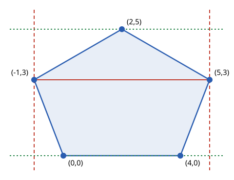

# 회전하는 캘리퍼스

# 개요

**회전하는 캘리퍼스(rotating calipers)** 는 볼록 다각형을 평행한 두 직선 사이에 끼우고 그 두 직선을 다각형 둘레로 한 바퀴 돌리면서, 두 직선에 닿는 꼭짓점 쌍만 확인하는 방법이다. 점 $n$ 개 가운데 가장 멀리 떨어진 두 점을 찾으려면 모든 쌍 $n(n-1)/2$ 개의 거리를 재야 할 것 같다. 회전하는 캘리퍼스는 [볼록 껍질 알고리즘](convex-hull-algorithms.md)으로 껍질을 구한 뒤 맞은편에 놓인 꼭짓점 쌍 $O(n)$ 개만 재어 같은 답을 선형 시간에 얻는다.

# 직관

볼록 껍질 알고리즘 문서의 오각형 $(-1,3)$, $(0,0)$, $(4,0)$, $(5,3)$, $(2,5)$ 에서 가장 먼 두 꼭짓점을 찾는다. 꼭짓점 쌍은 $10$ 개다.

오각형을 세로 직선 두 개 사이에 끼우면 아래 그림의 빨간 점선처럼 $x=-1$ 과 $x=5$ 에서 다각형에 닿고, 닿는 꼭짓점은 $(-1,3)$ 과 $(5,3)$ 이다. 이 두 점의 거리 $6$ 은 두 직선 사이의 거리와 같다. 다른 어느 꼭짓점 쌍도 두 직선 사이에 있으므로 $x$ 방향으로는 이보다 멀 수 없다.



끼우는 방향을 조금씩 돌리면 닿는 꼭짓점 쌍이 바뀐다. 방향을 한 바퀴 돌리는 동안 닿는 쌍은 $\lbrace(-1,3),(5,3)\rbrace$, $\lbrace(0,0),(5,3)\rbrace$, $\lbrace(0,0),(2,5)\rbrace$, $\lbrace(4,0),(2,5)\rbrace$, $\lbrace(4,0),(-1,3)\rbrace$ 다섯 개뿐이다. 거리의 제곱은 차례로 $36,34,29,29,34$ 이고, 가장 먼 두 점은 $(-1,3)$ 과 $(5,3)$ 이다.

# 정의

## 받침 직선과 맞선 쌍

볼록 다각형 $P$ 와 만나고 $P$ 가 그 한쪽에 놓이는 직선을 **받침 직선(supporting line)** 이라 한다. 방향이 같은 받침 직선은 $P$ 의 양쪽에 하나씩 둘이 있다. 두 꼭짓점 $p,q$ 를 각각 지나는 평행한 받침 직선 두 개가 있으면 $\lbrace p,q\rbrace$ 를 **맞선 쌍(antipodal pair)** 이라 한다.

직관 절의 세로 점선은 $(-1,3)$ 과 $(5,3)$ 을 지나는 평행한 받침 직선이므로 이 둘은 맞선 쌍이다. 가로 점선 $y=0$ 과 $y=5$ 는 변 $(0,0)\text{–}(4,0)$ 과 꼭짓점 $(2,5)$ 를 지나므로 $\lbrace(0,0),(2,5)\rbrace$ 와 $\lbrace(4,0),(2,5)\rbrace$ 가 맞선 쌍이다. $\lbrace(0,0),(4,0)\rbrace$ 은 두 점을 지나는 평행한 받침 직선이 없어 맞선 쌍이 아니다.

## 회전하는 캘리퍼스

꼭짓점을 반시계 방향으로 $p\_0,\dots,p\_{n-1}$ 이라 한다. 변 $p\_ip\_{i+1}$ 마다 그 변에서 가장 먼 꼭짓점 $p\_j$ 를 찾고, $i$ 가 늘 때 $j$ 를 앞으로만 옮긴다. 변의 두 끝점과 $p\_j$ 가 이루는 쌍들이 맞선 쌍이다. Shamos 가 지름을 구하려고 1978 년에 썼고, Toussaint 가 여러 문제로 넓혀 이 이름을 붙였다[^1].

```typescript
type Pt = [number, number];

const area2 = (a: Pt, b: Pt, c: Pt): number =>
  Math.abs((b[0] - a[0]) * (c[1] - a[1]) - (b[1] - a[1]) * (c[0] - a[0]));

function antipodalPairs(p: Pt[]): Array<[number, number]> {
  const n = p.length;
  const pairs: Array<[number, number]> = [];
  let j = 1;
  for (let i = 0; i < n; i++) {
    const k = (i + 1) % n;
    while (area2(p[i], p[k], p[(j + 1) % n]) > area2(p[i], p[k], p[j])) j = (j + 1) % n;
    pairs.push([i, j], [k, j]);
  }
  return pairs;
}
```

삼각형 넓이의 두 배 `area2` 는 밑변이 같을 때 높이에 비례하므로, 넓이가 커지는 동안 $j$ 를 옮기면 변에서 가장 먼 꼭짓점에 닿는다.

# 성질

## 지름

정리. 볼록 다각형의 꼭짓점 사이 거리의 최댓값은 어느 맞선 쌍에서 나온다.

증명의 요지. 가장 먼 두 꼭짓점 $p,q$ 에서 선분 $pq$ 에 수직인 두 직선을 긋는다. 다른 꼭짓점 $r$ 이 $p$ 를 지나는 직선 바깥에 있으면 $\lvert rq\rvert\gt\lvert pq\rvert$ 가 되어 모순이다. 그래서 두 직선은 평행한 받침 직선이고 $\lbrace p,q\rbrace$ 는 맞선 쌍이다.

## 맞선 쌍의 수와 시간

정리. 꼭짓점 $n$ 개인 볼록 다각형의 맞선 쌍은 많아야 $3n/2$ 개이고, 위 절차는 $O(n)$ 시간에 이를 모두 내놓는다.

증명의 요지. $i$ 가 한 바퀴 도는 동안 $j$ 도 앞으로만 움직여 많아야 한 바퀴 돈다. 그래서 `while` 의 반복이 모두 합쳐 $O(n)$ 번이다. 점 $n$ 개의 지름은 볼록 껍질에 $O(n\log n)$, 맞선 쌍에 $O(n)$ 이 들어 $O(n\log n)$ 이다.

## 너비

볼록 다각형의 **너비(width)** 는 다각형을 끼우는 평행한 두 받침 직선 사이 거리의 최솟값이다.

정리. 너비를 주는 두 받침 직선 가운데 하나는 다각형의 변을 포함한다. 그래서 너비는 변마다 그 변에서 가장 먼 꼭짓점까지의 거리를 재어 가장 작은 값을 고르면 나오고, 위 절차와 같은 $O(n)$ 시간이 든다.

직관 절의 오각형에서 변 $(0,0)\text{–}(4,0)$ 과 가장 먼 꼭짓점 $(2,5)$ 의 거리 $5$ 가 다섯 변 가운데 가장 작아 너비가 $5$ 다. 그림의 초록 점선이 그 두 받침 직선이다.

## 넓이가 가장 작은 외접 직사각형

정리. 볼록 다각형을 담는 직사각형 가운데 넓이가 가장 작은 것은 한 변이 다각형의 변을 포함한다[^2].

이 정리로 변마다 직사각형을 하나씩 만들면 후보가 $n$ 개다. 캘리퍼스 네 개를 직각으로 두고 함께 돌리면 각 후보의 네 접점이 앞으로만 움직여 전체가 $O(n)$ 시간이다.

# 활용

- 가장 먼 두 점. 점 집합의 지름을 $O(n\log n)$ 에 구한다. 직관 절의 계산이 그 예다.
- 포장과 경계 상자. 물체를 담는 가장 작은 직사각형 상자를 구해 충돌 판정의 경계 상자로 쓴다.
- 두 볼록 다각형 사이의 거리. 두 다각형에 하나씩 받침 직선을 두고 함께 돌리면 가장 가까운 두 점과 가장 먼 두 점을 선형 시간에 찾는다.
- 볼록 다각형의 Minkowski 합. 두 다각형의 변을 기울기 순으로 합쳐 Minkowski 합의 변을 선형 시간에 얻는 것도 같은 회전으로 한다.

[^1]: G. T. Toussaint, "Solving geometric problems with the rotating calipers", Proceedings of the IEEE Mediterranean Electrotechnical Conference (MELECON) 1983, Athens.
[^2]: H. Freeman, R. Shapira, "Determining the minimum-area encasing rectangle for an arbitrary closed curve", Communications of the ACM 18 (1975), 409–413.

# 연관 문서

## 선수지식

- [볼록 껍질 알고리즘](convex-hull-algorithms.md)

## 더 알아보기

아직 연결한 문서가 없다.

#algorithms #computation
