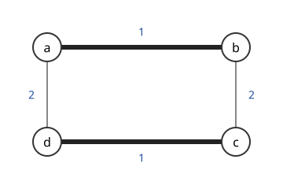
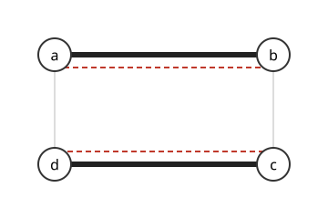

# 시골 우편배달부 문제

# 개요

**시골 우편배달부 문제(rural postman problem)** 는 그래프에서 정해진 변들만 모두 한 번 이상 지나 출발점으로 돌아오는 걸음 가운데 가장 짧은 것을 찾는 문제다. 시골 마을에서는 집이 늘어선 길이 띄엄띄엄 몇 개뿐이고, 배달부는 그 길들을 빠짐없이 걸어야 하지만 집이 없는 길은 이동에만 쓴다. 집이 있는 길이 한 덩어리로 이어져 있으면 [중국인 우편배달부 문제](chinese-postman-problem.md)처럼 길 수가 홀수인 교차로를 짝지어 풀고, 여러 덩어리로 흩어져 있으면 덩어리를 잇는 길을 먼저 고른 뒤 짝짓는다.

# 직관

아래 그림은 교차로 $a,b,c,d$ 와 길 네 개로 된 마을이다. 굵은 선 $ab$ 와 $cd$ 에 집이 있고, 가는 선 $bc$ 와 $da$ 에는 집이 없다. 길 위의 수가 길이(km)다.

중국인 우편배달부 문제의 방법을 집이 있는 길에만 쓴다. 굵은 선만 보면 네 교차로에 선이 하나씩 붙어 있어 모두 홀수다. 네 교차로를 두 쌍으로 짝지어 쌍마다 가장 짧은 길을 한 번 더 걸어야 하고, 가장 짧은 짝짓기는 $a$ 와 $b$, $c$ 와 $d$ 로 더 걷는 거리가 $1+1=2$ 이다.

그 결과가 아래 그림이다. 점선이 한 번 더 걷는 길이다. 모든 교차로의 선 수는 짝수지만, 걸음은 $a,b,a$ 와 $c,d,c$ 두 조각으로 떨어져 있어 한 사람이 이어서 걸을 수 없다.

집이 있는 길이 두 덩어리로 나뉘어 있으므로 덩어리를 잇는 길을 먼저 골라야 한다. 덩어리 $\lbrace a,b\rbrace$ 와 $\lbrace c,d\rbrace$ 사이에서 가장 가까운 길은 길이 $2$ 인 $bc$ 이고, 이것을 더하면 선 수가 홀수인 교차로는 $a$ 와 $d$ 둘이 남는다. $a$ 와 $d$ 사이의 가장 짧은 길 $da$ 를 더하면 $a,b,c,d,a$ 로 걷고 길이는 다음과 같다.

$$
1+2+1+2=6
$$

# 정의

## 시골 우편배달부 문제

$G=(V,E)$ 를 연결 그래프, $w:E\to\lbrack 0,\infty)$ 를 변의 길이, $R\subseteq E$ 를 반드시 지날 변의 집합이라 하자. **시골 우편배달부 문제** 는 $R$ 의 모든 변을 적어도 한 번 지나는 $G$ 의 닫힌 걸음 가운데 길이가 최소인 것을 찾는 문제다. 그 최솟값을 $\mathrm{OPT}$ 로 쓴다. C. S. Orloff 가 1974 년에 이 문제를 세웠다[^1].

직관 절의 마을에서 $R=\lbrace ab,cd\rbrace$ 이고 $\mathrm{OPT}=6$ 이다. $R=E$ 이면 중국인 우편배달부 문제다.

## 필수 변이 만드는 그래프

$R$ 의 변과 그 끝점만 남긴 그래프를 $G_R=(V_R,R)$ 로 쓰고, $G_R$ 에서 차수가 홀수인 정점의 집합을 $T_R$ 로 쓴다. 두 정점 $s,t$ 사이 $G$ 의 [최단경로](shortest-paths.md) 길이를 $d(s,t)$ 로 쓴다.

직관 절에서 $G_R$ 의 연결성분은 $\lbrace a,b\rbrace$ 와 $\lbrace c,d\rbrace$ 둘이고 $T_R=\lbrace a,b,c,d\rbrace$ 다. 또 $d(a,b)=d(c,d)=1$, $d(b,c)=d(a,d)=2$, $d(a,c)=d(b,d)=3$ 이다.

# 성질

## T-join 하한

최적 걸음 $W$ 가 지나는 변 가운데 $R$ 밖의 변과, $R$ 의 변을 두 번째 이후로 지난 것을 다중집합 $F$ 로 모은다. $R$ 에 $F$ 를 더한 그래프에는 Euler 회로가 있으므로 모든 차수가 짝수이고, $F$ 는 $G$ 의 $T_R$-[T-join](t-joins.md) 이다. 따라서 다음이 성립한다.

$$
\mathrm{OPT}\ge w(R)+\min_J w(J)
$$

여기서 $J$ 는 $G$ 의 $T_R$-join 전체를 돈다. 직관 절에서 오른쪽은 $2+2=4$ 로 $\mathrm{OPT}=6$ 보다 작다. 하한을 주는 $J=\lbrace ab,cd\rbrace$ 를 $R$ 에 더한 그래프는 연결이 아니다.

## 연결성분이 하나인 경우

$G_R$ 이 연결이면 하한이 $\mathrm{OPT}$ 와 같다. $d$ 를 가중치로 한 $T_R$ 의 최소 가중치 완전 매칭을 구하고 쌍마다 최단경로의 변을 한 벌씩 $R$ 에 더한다. 경로마다 두 끝점이 $V_R$ 에 있으므로 더한 그래프는 연결이고 모든 차수가 짝수다.

Euler 정리에 따라 이 그래프에 [Euler 회로](eulerian-circuits.md)가 있고, 그 길이는 중국인 우편배달부 문제의 최솟값 공식과 같은 논증으로 하한과 같다. 매칭과 최단경로는 다항 시간에 구하므로 이 경우는 다항 시간에 풀린다.

## NP-어려움

$G_R$ 의 연결성분 수에 제한이 없으면 시골 우편배달부 문제는 NP-어렵다(NP-hard, NP 는 nondeterministic polynomial time)[^2]. [NP-완전](np-completeness.md)인 [Hamilton 순환](hamiltonian-cycles.md) 판정 문제가 이 문제로 환원된다.

정점이 $n\ge 3$ 개인 그래프 $H$ 의 변마다 길이 $1$ 을 준다. 정점 $v$ 마다 새 정점 $v'$ 과 길이 $0$ 인 변 $vv'$ 을 붙이고 $R$ 을 이 변 $n$ 개로 둔다. $R$ 을 모두 지나는 닫힌 걸음은 $H$ 의 모든 정점을 지나므로 $H$ 의 변을 $n$ 번 이상 지나고, 정확히 $n$ 번인 것은 $H$ 의 Hamilton 순환이다. 따라서 $\mathrm{OPT}=n$ 인 것과 $H$ 에 Hamilton 순환이 있는 것이 동치다.

## Frederickson 근사

다음 세 단계는 길이가 $\tfrac32\mathrm{OPT}$ 이하인 걸음을 다항 시간에 만든다. G. N. Frederickson 이 1979 년에 이 비율을 증명했다[^3].

1. $G_R$ 의 연결성분 $C_1,\dots,C_k$ 를 정점으로 하는 완전그래프를 만들고, $C_i$ 와 $C_j$ 사이 변의 무게를 두 성분의 정점 사이 $d$ 의 최솟값으로 둔다. 이 그래프의 [최소 신장트리](minimum-spanning-tree.md)를 구하고, 트리의 변마다 그 무게를 주는 최단경로의 변을 $R$ 에 더한다.
2. 더한 그래프에서 차수가 홀수인 정점의 집합 $T$ 에 대해 $d$ 를 가중치로 한 최소 가중치 완전 매칭을 구하고, 쌍마다 최단경로의 변을 한 벌씩 더한다.
3. 모든 차수가 짝수인 연결 그래프가 되었으므로 Euler 회로를 만든다.

직관 절에서 1 단계는 무게 $2$ 인 $bc$ 를, 2 단계는 $T=\lbrace a,d\rbrace$ 의 쌍 $da$ 를 더해 길이 $6$ 인 걸음을 낸다.

증명의 요지. 최적 걸음의 하한 절의 $F$ 는 모든 연결성분을 이으므로 $w(F)=\mathrm{OPT}-w(R)$ 는 1 단계의 트리 무게 이상이다. 또 최적 걸음은 $T$ 의 정점을 모두 지나므로, 지나는 순서대로 $T$ 의 정점을 이웃끼리 짝지으면 서로 겹치지 않는 완전 매칭 두 개가 나오고 그 $d$ 합을 더한 값은 $\mathrm{OPT}$ 이하다. 따라서 2 단계의 매칭은 $\tfrac12\mathrm{OPT}$ 이하이고 걸음의 길이는 다음 이하다.

$$
w(R)+\bigl(\mathrm{OPT}-w(R)\bigr)+\tfrac12\mathrm{OPT}=\tfrac32\mathrm{OPT}
$$

# 활용

- 호 경로 문제(arc routing problem). 제설, 거리 청소, 쓰레기 수거, 수도 검침처럼 일부 길만 작업하면 되는 경로 계획이 이 문제로 세워진다. 차량마다 실을 수 있는 양의 제한을 더한 용량 제한 호 경로 문제(capacitated arc routing problem)는 B. L. Golden 과 R. T. Wong 이 1981 년에 세웠다[^4].
- 펜 플로터와 레이저 절단기의 이동 경로. 그려야 할 선분을 $R$ 로, 펜을 들고 옮기는 이동을 $R$ 밖의 변으로 두면 이동 거리를 줄이는 문제가 이 꼴이다.
- [외판원 문제](traveling-salesman-problem.md)와의 관계. NP-어려움 절처럼 정점마다 길이 $0$ 인 필수 변을 붙이면, 정해진 정점을 모두 지나는 가장 짧은 닫힌 걸음을 찾는 문제가 시골 우편배달부 문제의 특수한 경우가 된다. Frederickson 근사는 외판원 문제의 Christofides 알고리즘(Christofides algorithm)과 같은 꼴로, 신장트리에 홀수 차수 정점의 매칭을 더한다.

[^1]: C. S. Orloff, "A fundamental problem in vehicle routing", Networks 4 (1974), 35–64.
[^2]: J. K. Lenstra, A. H. G. Rinnooy Kan, "On general routing problems", Networks 6 (1976), 273–280.
[^3]: G. N. Frederickson, "Approximation algorithms for some postman problems", Journal of the ACM 26 (1979), 538–554.
[^4]: B. L. Golden, R. T. Wong, "Capacitated arc routing problems", Networks 11 (1981), 305–315.

# 연관 문서

## 선수지식

- [중국인 우편배달부 문제](chinese-postman-problem.md)

## 더 알아보기

아직 연결한 문서가 없다.

#graph_theory #algorithms #optimization #complexity
