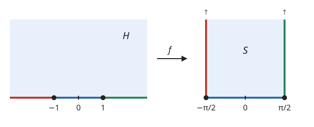

# Schwarz–Christoffel 공식

# 개요

**Schwarz–Christoffel 공식(Schwarz–Christoffel formula)** 은 상반평면을 다각형 안으로 각도를 보존하며 일대일로 옮기는 함수를 적분식으로 쓰는 공식이다. 폭이 $\pi$ 이고 위로 끝없이 뻗은 띠 모양 금속판에서 세 변의 온도가 정해져 있을 때 판 안의 온도를 구하려면, 띠를 상반평면으로 펴는 함수가 있어야 한다. [Riemann 사상정리](riemann-mapping-theorem.md)로는 그런 함수의 존재만 증명되고 식은 나오지 않는다.

이 공식은 꼭짓점마다 그 자리에서 경계가 꺾이는 각도로 지수를 정한 거듭제곱을 곱하고, 그 곱을 적분해 함수를 쓴다.

# 직관

상반평면 $H=\lbrace\mathrm{Im}\thinspace z\gt 0\rbrace$ 에서는 경계값이 주어진 [조화함수](harmonic-functions.md)가 Poisson 적분(Poisson integral)으로 나온다. 그래서 띠 $S=\lbrace -\pi/2\lt\mathrm{Re}\thinspace w\lt\pi/2,\thinspace \mathrm{Im}\thinspace w\gt 0\rbrace$ 의 문제는 $H$ 를 $S$ 로 보내는 전단사 정칙함수 $f$ 를 찾으면 $H$ 의 문제로 옮겨진다.

$f$ 를 경계에서부터 정한다. 실축의 점 $-1$ 과 $1$ 이 띠의 두 모서리 $-\pi/2$ 와 $\pi/2$ 로 가도록 정하면, $x$ 가 실축을 왼쪽에서 오른쪽으로 지날 때 $f(x)$ 는 띠의 왼쪽 변을 내려오고, 바닥을 오른쪽으로 가고, 오른쪽 변을 올라간다.

다음 그림에서 같은 색의 실축 구간과 띠의 변이 서로 대응한다.

$f(x)$ 가 움직이는 방향은 $f'(x)$ 의 편각이다. 그러므로 $f'(x)$ 의 편각은 $x\lt -1$ 에서 $-\pi/2$, $-1\lt x\lt 1$ 에서 $0$, $x\gt 1$ 에서 $\pi/2$ 여야 한다. 편각은 $-1$ 과 $1$ 에서 한 번씩 $\pi/2$ 만큼 늘고, 그 사이에서는 변하지 않는다.

$(z-a)^{\beta}$ 를 상반평면에서 편각이 $0$ 과 $\pi\beta$ 사이에 오는 가지로 잡으면, 실축 위에서 편각은 $x\gt a$ 에서 $0$, $x\lt a$ 에서 $\pi\beta$ 다. $x$ 가 $a$ 를 지나면 편각이 $-\pi\beta$ 만큼 바뀌므로, $\pi/2$ 만큼 늘리려면 $\beta=-1/2$ 이다. 두 모서리에 인수를 하나씩 두고 $x\gt 1$ 에서 편각을 $\pi/2$ 로 맞추는 상수 $i$ 를 곱하면 다음이 나온다.

$$f'(z)=i(z+1)^{-1/2}(z-1)^{-1/2}=\frac{1}{\sqrt{1-z^2}}$$

오른쪽 제곱근은 $(-1,1)$ 에서 양수인 가지다. $f(0)=0$ 으로 적분하면 $f(z)=\arcsin z$ 이고, $f(\pm 1)=\pm\pi/2$ 다.

역방향으로 보면 $w=u+iv$ 일 때 $\sin w=\sin u\cosh v+i\cos u\sinh v$ 이고, $\vert u\vert\lt\pi/2$, $v\gt 0$ 이면 $\cos u\gt 0$, $\sinh v\gt 0$ 이므로 $\sin w$ 의 허수부가 양수다. 띠의 온도는 $H$ 에서 Poisson 적분으로 구한 함수에 $\sin$ 을 합성하면 나온다.

모서리 하나에 인수 하나를 두고 지수를 꺾이는 각도로 정하는 이 방법이 아무 다각형에서나 사상을 준다.

# 정의

Schwarz–Christoffel 공식은 상반평면에서 다각형으로 가는 전단사 [등각사상](conformal-mapping.md)이 꼭짓점마다 인수 하나를 둔 곱의 적분이라는 정리다. 다각형 $P$ 의 꼭짓점을 반시계 방향으로 $w_1,\dots,w_n$ 이라 쓰고, $w_k$ 에서의 내각을 $\pi\alpha_k$ 라 쓴다. 경계를 한 바퀴 돌며 꺾이는 각도를 모두 더하면 $2\pi$ 이므로 $\alpha_k$ 는 다음을 만족한다.

$$\sum_{k=1}^{n}(1-\alpha_k)=2$$

정리의 진술은 다음이다. $f:H\to P$ 가 전단사 등각사상이면 실수 $x_1\lt x_2\lt\cdots\lt x_n$ 과 복소수 $A$, $C$ 가 있어 $f(x_k)=w_k$ 이고

$$f(z)=A+C\int_0^z\prod_{k=1}^{n}(\zeta-x_k)^{\alpha_k-1}\thinspace d\zeta$$

다[^1]. 거듭제곱은 상반평면에서 편각이 $0$ 과 $\pi$ 사이인 가지를 쓴다. $x_k$ 를 꼭짓점 $w_k$ 의 **원상 꼭짓점(prevertex)** 이라 한다. 한 꼭짓점의 원상 꼭짓점을 $\infty$ 에 두면 그 꼭짓점의 인수를 곱에서 뺀다.

직관 절의 띠에서는 꼭짓점이 $-\pi/2$, $\pi/2$, $\infty$ 셋이다. 두 모서리의 내각이 $\pi/2$ 이므로 $\alpha=1/2$ 이고, 두 변이 평행하게 만나는 $\infty$ 에서는 내각이 $0$ 이므로 $\alpha=0$ 이다. $(1-\tfrac12)+(1-\tfrac12)+(1-0)=2$ 로 조건을 만족한다. $\infty$ 의 원상 꼭짓점을 $\infty$ 에 두었으므로 그 인수가 빠지고, 남은 곱 $(\zeta+1)^{-1/2}(\zeta-1)^{-1/2}$ 가 직관 절의 $f'$ 이다.

정삼각형에서는 $\alpha_k=1/3$ 이고, 원상 꼭짓점을 $0$, $1$, $\infty$ 에 두면 다음이 상반평면을 정삼각형으로 보낸다. [Cardy 공식](cardy-formula.md)이 이 사상을 쓴다.

$$F(z)=\int_0^z\zeta^{-2/3}(1-\zeta)^{-2/3}\thinspace d\zeta$$

# 성질

## 공식의 증명

$H$ 는 원판과 등각동치이므로 Riemann 사상정리로 $f$ 가 존재한다. 다각형의 경계는 [Jordan 곡선](jordan-curve-theorem.md)이므로 $f$ 는 $\overline H$ 까지 연속으로 확장되고, 실축의 구간 $(x_k,x_{k+1})$ 은 변 하나로 간다. 변은 선분이므로 [해석적 연속](analytic-continuation.md)의 Schwarz 반사 원리(Schwarz reflection principle)로 $f$ 가 그 구간을 넘어 아래 반평면으로 정칙하게 연장된다. 꼭짓점 근처에서는 $(f-w_k)^{1/\alpha_k}$ 가 곧은 경계를 가지므로 같은 반사가 적용되고, $f(z)=w_k+(z-x_k)^{\alpha_k}h(z)$, $h(x_k)\ne 0$ 꼴이 된다.

서로 다른 구간을 넘어 반사한 두 연장은 평면의 합동변환 $w\mapsto e^{i\theta}w+b$ 만큼 다르다. $f''/f'$ 는 이 변환에 따라 바뀌지 않으므로 $\mathbb C\setminus\lbrace x_1,\dots,x_n\rbrace$ 에서 일가 정칙함수이고, $x_k$ 에서 유수(residue)가 $\alpha_k-1$ 인 단순극(simple pole)을 갖는다. $\infty$ 근처에서 $f''/f'\to 0$ 이므로 [Liouville 정리](liouville-theorem.md)로 다음이 나온다.

$$\frac{f''(z)}{f'(z)}=\sum_{k=1}^{n}\frac{\alpha_k-1}{z-x_k}$$

이것을 두 번 적분하면 공식이다. $\infty$ 근처에서 $f$ 는 $f(\infty)+c/z+\cdots$ 꼴이라 $f''/f'\sim -2/z$ 이고, 위 식의 오른쪽은 $\sum(\alpha_k-1)/z$ 이므로 $\sum(1-\alpha_k)=2$ 와 맞는다.

## 원상 꼭짓점의 결정

$H$ 의 자기동형인 실계수 Möbius 변환(Möbius transformation)은 실축의 세 점을 원하는 세 점으로 보낸다. 그래서 원상 꼭짓점 셋은 마음대로 정할 수 있고, 남은 $n-3$ 개는 변의 길이의 비 $n-3$ 개로 정해진다. 이 연립방정식을 **매개변수 문제(parameter problem)** 라 한다.

삼각형에서는 $n-3=0$ 이므로 매개변수 문제가 없고, 내각이 같은 삼각형은 모두 닮음이다. 원상 꼭짓점을 $0$, $1$, $\infty$ 에 두면 사상은 불완전 베타 적분(incomplete beta integral) $\int_0^z\zeta^{\alpha_1-1}(1-\zeta)^{\alpha_2-1}d\zeta$ 이다.

## 직사각형과 타원적분

네 모서리의 내각이 $\pi/2$ 인 직사각형에서는 원상 꼭짓점을 $\pm 1$, $\pm 1/k$ ($0\lt k\lt 1$) 로 대칭으로 둔다. 다음 사상이 나온다.

$$f(z)=\int_0^z\frac{d\zeta}{\sqrt{(1-\zeta^2)(1-k^2\zeta^2)}}$$

이 적분은 제1종 타원적분(elliptic integral of the first kind)이다. $K(k)=f(1)$ 이고 $k'=\sqrt{1-k^2}$ 일 때 $K'=K(k')$ 라 쓰면, 꼭짓점은 $\pm K$ 와 $\pm K+iK'$ 이다. 역함수는 [Jacobi 타원함수](jacobi-elliptic-functions.md) $\mathrm{sn}$ 이다.

가로세로비 $2K/K'$ 는 $k$ 가 $0$ 에서 $1$ 로 갈 때 $0$ 에서 $\infty$ 로 단조 증가한다. 정사각형은 $k=\sqrt2-1$ 이다.

직사각형 둘을 모서리끼리 대응시키는 등각사상이 있을 필요충분조건은 가로세로비가 같은 것이다. 그런 사상은 $H$ 의 Möbius 변환으로 옮겨져 네 원상 꼭짓점 $-1/k,-1,1,1/k$ 를 순서대로 다른 네 점으로 보내는데, Möbius 변환은 네 점의 비조화비(cross ratio)를 보존하므로 $k$ 가 같아야 한다. 이 비를 직사각형의 **등각 모듈러스(conformal modulus)** 라 한다.

## 원판 판본

단위원판 $\mathbb D$ 를 다각형으로 보내는 사상은 원상 꼭짓점 $z_k$ 를 단위원 위에 두고 다음 꼴이다.

$$f(z)=A+C\int_0^z\prod_{k=1}^{n}\left(1-\frac{\zeta}{z_k}\right)^{\alpha_k-1}d\zeta$$

$H$ 판본에 $\mathbb D$ 를 $H$ 로 보내는 Möbius 변환을 합성하면 나온다. 원판의 자기동형도 원 위의 세 점을 마음대로 정하므로 매개변수 문제의 미지수는 같은 $n-3$ 개다.

## 원상 꼭짓점의 몰림

가늘고 긴 다각형에서는 원상 꼭짓점 몇 개가 지수적으로 가까이 몰린다. 이것을 **몰림(crowding)** 이라 한다[^2]. 위 직사각형의 정규화에서 가로세로비가 $L$ 이면 짧은 변의 두 원상 꼭짓점 $1$ 과 $1/k$ 의 간격은 $L$ 이 클 때 다음과 같다.

$$\frac1k-1\approx 8e^{-\pi L/2}$$

$L=20$ 이면 간격이 $1.8\times 10^{-13}$ 이다. 배정밀도 부동소수점에서는 $L$ 이 $24$ 언저리를 넘으면 두 점을 구별할 수 없다.

# 활용

- 퍼텐셜 흐름과 정전기. 계단 모양 수로의 흐름, 평행한 두 판 끝의 전기장은 영역을 다각형이나 그 극한으로 보고 이 공식으로 상반평면에 옮겨 계산한다. 상반평면에서는 균일한 흐름이나 Poisson 적분으로 답이 나온다.
- [침투](percolation.md)의 교차 확률. Cardy 공식은 영역을 정삼각형으로 보내면 교차 확률이 한 변 위의 길이의 비라는 꼴로 쓰이고, 그 정삼각형 사상이 정의 절의 $F$ 다.
- 직사각형 도체의 저항. 균질한 직사각형 판의 마주 보는 두 변 사이 저항은 가로세로비에 비례한다. 모서리끼리 대응하는 등각사상은 저항을 보존하므로, 네 점을 표시한 단순연결 영역의 저항은 그 영역을 보낸 직사각형의 등각 모듈러스로 계산된다. 이 모듈러스는 [극값 길이](extremal-length.md)와 같다.
- 수치 등각사상. 다각형이 주어지면 매개변수 문제를 [Newton 법](newton-method.md)으로 풀어 원상 꼭짓점을 구하고, 적분은 Gauss–Jacobi 구적법(Gauss–Jacobi quadrature)으로 계산한다. 몰림 때문에 긴 영역에서는 원판이나 상반평면 대신 띠를 정의역으로 쓰는 판본을 쓴다[^2].

[^1]: L. V. Ahlfors, *Complex Analysis*, 3rd ed., McGraw-Hill, 1979, 6장 2절.
[^2]: T. A. Driscoll, L. N. Trefethen, *Schwarz–Christoffel Mapping*, Cambridge University Press, 2002, 2장.

# 연관 문서

## 선수지식

- [Riemann 사상정리](riemann-mapping-theorem.md)

## 더 알아보기

- [Cardy 공식](cardy-formula.md)
- [극값 길이](extremal-length.md)
- [Jacobi 타원함수](jacobi-elliptic-functions.md)

#complex_analysis #analysis
