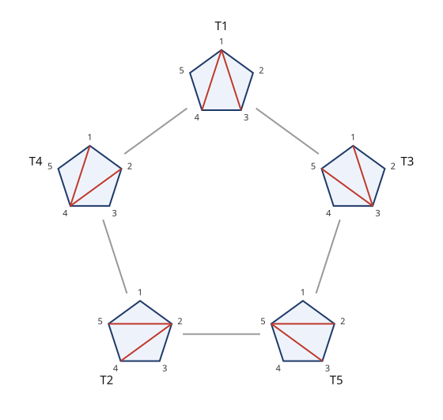

# 2차 다면체

# 개요

**2차 다면체(secondary polytope)** 는 주어진 점들을 삼각형으로 나누는 방법들을 꼭짓점으로 갖는 [볼록 다면체](convex-polytopes.md)다. 볼록 오각형은 대각선 두 개를 그어 삼각형 셋으로 나누는 방법이 다섯 가지이고, 한 분할의 대각선 하나를 다른 대각선으로 바꾸면 이웃한 분할로 옮겨 간다. 다섯 분할을 꼭짓점, 대각선 바꾸기를 변으로 놓으면 오각형이 된다.

2차 다면체는 이 오각형을 실제 좌표를 가진 다면체로 만든다. 점마다 높이를 주고 아래에서 보이는 분할을 찾는 문제는 이 다면체 위에서 일차함수를 최소화하는 문제가 된다.

# 직관

정사각형의 네 꼭짓점 $1=(0,0)$, $2=(1,0)$, $3=(1,1)$, $4=(0,1)$ 을 삼각형으로 나누는 방법은 대각선 $13$ 을 긋는 $T\_1$ 과 대각선 $24$ 를 긋는 $T\_2$ 두 가지다. 꼭짓점마다 높이 $\omega\_i$ 를 주어 공간에 점 $(x,y,\omega\_i)$ 넷을 놓고, 그 볼록 껍질의 아래쪽 면을 내려다보면 두 분할 가운데 하나가 보인다. $\omega=(0,0,1,0)$ 이면 점 $3$ 만 올라가 있어 아래쪽 면은 대각선 $24$ 에서 접히고 $T\_2$ 가 보인다.

어느 분할이 보이는지를 높이의 일차식으로 가를 수 있다. 분할 $T$ 의 삼각형마다 세 꼭짓점의 높이를 평면으로 이어 판을 만들면, 판 아래의 부피는 삼각형마다 넓이에 세 꼭짓점 높이의 평균을 곱해 더한 값이다. 꼭짓점 $v$ 를 가진 삼각형들의 넓이 합을 $\varphi\_T(v)$ 라 하면 이 부피는 $\frac13\sum\_v\omega\_v\varphi\_T(v)$ 다.

$T\_1$ 은 넓이 $1/2$ 인 삼각형 $123$, $134$ 로 되어 있으므로 $\varphi\_{T\_1}=(1,\tfrac12,1,\tfrac12)$ 이고, 같은 계산으로 $\varphi\_{T\_2}=(\tfrac12,1,\tfrac12,1)$ 이다. $\omega=(0,0,1,0)$ 에서 판 아래 부피는 $T\_1$ 이 $1/3$, $T\_2$ 가 $1/6$ 이다.

실제로 보인 $T\_2$ 의 부피가 더 작다. 아래쪽 면이 만드는 판은 꼭짓점 높이를 넘지 않는 볼록한 판 가운데 가장 높은 것이므로 어느 분할의 판보다도 아래에 있다. 그래서 두 점 $\varphi\_{T\_1}$, $\varphi\_{T\_2}$ 를 잇는 선분 위에서 $\omega$ 와의 내적이 가장 작은 끝점이 높이 $\omega$ 가 만드는 분할이다. 이 선분이 정사각형의 2차 다면체다.

# 정의

$A=\lbrace a\_1,\dots,a\_n\rbrace$ 는 $\mathbb R^d$ 를 아핀으로 생성하는 유한 점 배치다. 정사각형이면 $n=4$, $d=2$ 이다.

## 삼각분할

$A$ 의 **삼각분할(triangulation)** $T$ 는 꼭짓점이 $A$ 의 점인 $d$ 차원 단체들의 모임으로, 합집합이 $A$ 의 볼록 껍질이고 두 단체가 공통 면에서만 만나는 것이다. $A$ 의 점을 모두 꼭짓점으로 쓸 필요는 없다.

직선 위의 세 점 $A=\lbrace 0,1,2\rbrace$ 는 선분 $\lbrack 0,2\rbrack$ 하나로 된 $T\_1$ 과 선분 $\lbrack 0,1\rbrack$, $\lbrack 1,2\rbrack$ 로 된 $T\_2$ 두 삼각분할을 갖는다. $T\_1$ 은 점 $1$ 을 쓰지 않는다.

## 정칙 삼각분할

높이 $\omega\in\mathbb R^n$ 을 주고 점 $(a\_i,\omega\_i)\in\mathbb R^{d+1}$ 들의 볼록 껍질을 만든다. 아래쪽 면, 곧 바깥 법선의 마지막 성분이 음수인 면들을 $\mathbb R^d$ 로 내리면 $A$ 의 볼록 껍질의 분할이 나온다. 이 분할이 단체들로 되어 있으면 그것을 $\omega$ 가 정하는 **정칙 삼각분할(regular triangulation)** $T(\omega)$ 라 한다.

직관 절에서 $T\_2=T(0,0,1,0)$ 이다. $A=\lbrace 0,1,2\rbrace$ 에서 $\omega=(0,1,0)$ 이면 가운데 점이 올라가 아래쪽 면이 선분 $\lbrack 0,2\rbrack$ 하나이고 $T(\omega)=T\_1$ 이다.

평면의 점에 높이 $\omega\_i=\vert a\_i\vert^2$ 을 주면 점들이 포물면 위로 올라가고, 네 점이 한 원 위에 있지 않을 때 $T(\omega)$ 는 [Delaunay 삼각분할](delaunay-triangulation.md)이다.

## GKZ 벡터

삼각분할 $T$ 의 **GKZ 벡터(Gelfand–Kapranov–Zelevinsky vector)** $\varphi\_T\in\mathbb R^n$ 은 다음과 같다.

$$
\varphi\_T(i)=\sum\_{\sigma\in T,\thinspace a\_i\in\sigma}\mathrm{vol}(\sigma)
$$

점 $a\_i$ 를 꼭짓점으로 갖는 단체들의 부피 합이고, $a\_i$ 를 쓰지 않으면 $0$ 이다. $A=\lbrace 0,1,2\rbrace$ 에서 $\varphi\_{T\_1}=(2,0,2)$, $\varphi\_{T\_2}=(1,2,1)$ 이다.

## 2차 다면체

$A$ 의 2차 다면체 $\Sigma(A)$ 는 모든 삼각분할의 GKZ 벡터의 볼록 껍질이다[^1].

$$
\Sigma(A)=\mathrm{conv}\lbrace\varphi\_T : T\text{ 는 }A\text{ 의 삼각분할}\rbrace
$$

정사각형과 $\lbrace 0,1,2\rbrace$ 의 2차 다면체는 둘 다 선분이다.

# 성질

## GKZ 정리

**정리(Gelfand–Kapranov–Zelevinsky).** $\Sigma(A)$ 의 차원은 $n-d-1$ 이다. $\Sigma(A)$ 의 꼭짓점은 정칙 삼각분할의 GKZ 벡터 전체이고, 높이 $\omega$ 가 $T(\omega)=T$ 를 정하는 것은 $\Sigma(A)$ 위에서 $\langle\omega,\cdot\rangle$ 이 $\varphi\_T$ 에서만 최소인 것과 동치다[^1].

증명의 요지. 삼각분할 $T$ 위에서 $\omega$ 를 단체마다 일차로 이은 함수를 $g\_{\omega,T}$ 라 하면, 단체 위 일차함수의 적분은 부피에 꼭짓점 값의 평균을 곱한 것이므로 다음이 성립한다.

$$
\langle\omega,\varphi\_T\rangle=(d+1)\int\_{\mathrm{conv}A}g\_{\omega,T}(x)\thinspace dx
$$

아래쪽 면이 정하는 함수 $g\_\omega$ 는 $A$ 의 점에서 $\omega$ 이하인 볼록함수 가운데 가장 큰 것이다. 각 단체에서 $g\_\omega$ 는 꼭짓점 값을 일차로 이은 $g\_{\omega,T}$ 이하이므로 $\int g\_\omega\le\int g\_{\omega,T}$ 이고, 등호는 $T=T(\omega)$ 일 때만 성립한다.

차원은 $\varphi\_T$ 가 모든 $T$ 에서 같은 일차 등식 $d+1$ 개를 만족하는 데서 나온다. 성분의 합은 $(d+1)\mathrm{vol}(\mathrm{conv}A)$ 이고, $\sum\_i\varphi\_T(i)a\_i$ 는 $(d+1)$ 에 볼록 껍질의 부피와 무게중심을 곱한 것이다. 정사각형에서는 $4-2-1=1$ 이다.

## 변과 뒤집기

$A$ 의 부분집합 가운데 아핀 종속이면서 진부분집합은 모두 아핀 독립인 것을 **회로(circuit)** 라 한다. 평면에서는 볼록한 위치의 네 점, 삼각형과 그 안의 한 점, 한 직선 위의 세 점이 회로다. 회로 하나에서 삼각분할의 한쪽을 다른 쪽으로 바꾸는 조작을 **뒤집기(flip)** 라 한다. 볼록한 네 점에서는 대각선을 바꾸는 것이고, 삼각형과 안의 점에서는 그 점을 넣거나 빼는 것이다.

$\Sigma(A)$ 의 변은 뒤집기 하나로 이어지는 두 정칙 삼각분할을 잇는다[^2]. 다면체의 꼭짓점과 변으로 된 그래프는 연결이므로 정칙 삼각분할은 모두 뒤집기로 이어진다. 평면에서는 정칙이 아닌 것까지 모든 삼각분할이 뒤집기로 이어지지만, $\mathbb R^6$ 에는 뒤집기 그래프가 연결되지 않은 점 배치가 있다(Santos, 2000)[^3].

## 볼록 다각형과 결합다면체

볼록 $m$ 각형의 꼭짓점에서는 모든 삼각분할이 정칙이고, 2차 다면체는 차원이 $m-3$ 이고 꼭짓점이 [Catalan 수](catalan-numbers.md) $C\_{m-2}$ 개인 결합다면체(associahedron)다[^1]. 오각형은 $C\_3=5$ 개의 삼각분할로 된 오각형이고, 육각형은 $C\_4=14$ 개의 꼭짓점을 가진 3 차원 다면체다.

아래 그림은 오각형의 다섯 삼각분할을 2차 다면체의 꼭짓점 자리에 놓은 것이다. $T\_k$ 는 꼭짓점 $k$ 에서 대각선 두 개를 그은 분할이고, 이웃한 두 분할은 대각선 하나를 공유한다.

## 정칙이 아닌 삼각분할

평면의 점 여섯 개로 정칙이 아닌 삼각분할을 만들 수 있다[^2]. 무게중심이 원점인 삼각형 $a\_1a\_2a\_3$ 과 $0\lt t\lt 1$ 에 대해 $b\_i=ta\_i$ 로 놓는다. 두 삼각형 사이의 띠는 사다리꼴 $a\_ia\_{i+1}b\_{i+1}b\_i$ 셋이고, 셋 모두에서 대각선 $a\_{i+1}b\_i$ 를 그은 뒤 삼각형 $b\_1b\_2b\_3$ 을 더하면 삼각분할이 된다(첨자는 $3$ 을 법으로 읽는다).

이 삼각분할은 정칙이 아니다. 사다리꼴에서 $b\_{i+1}-b\_i=t(a\_{i+1}-a\_i)$ 이므로 두 대각선은 다음 점에서 만난다.

$$
\frac{ta\_i+b\_{i+1}}{1+t}=\frac{ta\_{i+1}+b\_i}{1+t}
$$

대각선 $a\_{i+1}b\_i$ 가 아래쪽 면에 있으려면 이 점에서 그 대각선의 높이가 더 낮아야 하므로 다음이 필요하다.

$$
t\omega(a\_{i+1})+\omega(b\_i)\lt t\omega(a\_i)+\omega(b\_{i+1})
$$

세 부등식을 $i=1,2,3$ 에 대해 더하면 양변이 같아져 $0\lt 0$ 이 나온다.

## 판별식의 Newton 다면체

$A\subset\mathbb Z^d$ 이면 계수가 미지수 $c\_1,\dots,c\_n$ 인 다항식 $f=\sum\_i c\_ix^{a\_i}$ 의 주 $A$ 행렬식(principal A-determinant) $E\_A$ 가 정의된다. $E\_A$ 는 $f$ 와 그 면들로 제한한 다항식들의 [판별식](discriminant.md)을 곱한 것이고, GKZ 는 $E\_A$ 의 Newton 다면체가 $\Sigma(A)$ 와 같고 $E\_A$ 의 꼭짓점 단항식의 지수가 정칙 삼각분할의 GKZ 벡터임을 증명했다[^1].

$A=\lbrace 0,1,2\rbrace$ 이면 $f=c\_0+c\_1x+c\_2x^2$ 이고 $E\_A=c\_0c\_2(c\_1^2-4c\_0c\_2)$ 이다. 단항식 $c\_0c\_1^2c\_2$ 와 $c\_0^2c\_2^2$ 의 지수 $(1,2,1)$, $(2,0,2)$ 가 정의 절의 $\varphi\_{T\_2}$, $\varphi\_{T\_1}$ 이다.

# 활용

- 정칙성 판정. 평면 삼각분할이 정칙인지는 [Maxwell–Cremona 대응](maxwell-cremona-correspondence.md)으로 안쪽 간선마다 양수인 평형 응력이 있는지와 같고, 일반 차원에서는 위 사다리꼴 부등식과 같은 회로마다의 일차 부등식을 모두 만족하는 $\omega$ 가 있는지를 묻는 선형계획이다.
- 가중 Delaunay 삼각분할. 높이 $\omega\_i=\vert a\_i\vert^2-w\_i$ 가 정하는 정칙 삼각분할이 가중치 $w\_i$ 의 가중 Delaunay 삼각분할이고, 그 쌍대가 power 도형(power diagram)이다.
- 토릭 아이디얼. $A$ 의 [토릭 아이디얼](toric-ideals.md) $I\_A$ 에서 일반적인 가중치 $\omega$ 의 초기 아이디얼 $\mathrm{in}\_\omega(I\_A)$ 의 근기(radical)는 $T(\omega)$ 의 단체에 들지 않는 점 모임마다 그 변수들의 곱으로 생성된 단항식 아이디얼이다. 그래서 $I\_A$ 의 [Gröbner 부채](groebner-fans.md)는 정칙 삼각분할별 뿔로 된 2차 부채(secondary fan)를 세분한다[^4].
- 토릭 다양체의 쌍유리 변환. [Flop](flops.md)의 표준 예인 원뿔 $xy=zw$ 는 정사각형을 밑면으로 하는 [토릭 다양체](toric-varieties.md)이고, 직관 절의 두 삼각분할 $T\_1$, $T\_2$ 가 두 작은 해소 $X^-$, $X^+$ 이며 그 사이의 뒤집기가 flop 이다.
- 삼각분할의 열거. 정칙 삼각분할은 2차 다면체의 변을 따라 뒤집기로 모두 이어지므로, 하나에서 시작해 뒤집기를 되풀이하는 탐색으로 전부 열거한다[^2].

[^1]: I. M. Gelfand, M. M. Kapranov, A. V. Zelevinsky, Discriminants, Resultants, and Multidimensional Determinants, Birkhäuser, 1994, 7 장.
[^2]: J. A. De Loera, J. Rambau, F. Santos, Triangulations: Structures for Algorithms and Applications, Springer, 2010, 5 장과 7 장.
[^3]: F. Santos, A point set whose space of triangulations is disconnected, Journal of the American Mathematical Society 13 (2000), 611–637.
[^4]: B. Sturmfels, Gröbner Bases and Convex Polytopes, American Mathematical Society, 1996, 8 장.

# 연관 문서

## 선수지식

- [볼록 다면체](convex-polytopes.md)
- [Delaunay 삼각분할](delaunay-triangulation.md)

## 더 알아보기

아직 연결한 문서가 없다.

#combinatorics #optimization #algebra #algorithms
