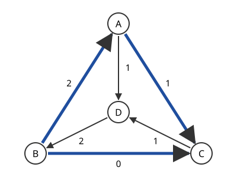

# Seymour 6 흐름 정리

# 개요

**Seymour 6 흐름 정리(Seymour's 6-flow theorem)** 는 다리가 없는 그래프에는 언제나 간선 값의 절댓값이 $1$ 부터 $5$ 사이의 정수인 [nowhere-zero 흐름](nowhere-zero-flows.md)이 있다는 정리다. [Petersen 그래프](petersen-graph.md)는 절댓값 $3$ 이하의 값으로는 흐름을 만들 수 없으므로, 모든 다리 없는 그래프에 통하는 값의 범위가 어디까지 좁혀지는지가 물음이 된다. 이 정리는 간선 값을 짝홀을 맡는 부분과 $3$ 으로 나눈 나머지를 맡는 부분으로 나누고, 순환을 하나씩 더하며 둘째 부분의 값을 고르는 방법으로 범위를 $5$ 까지 좁힌다.

# 직관

순환 하나를 따라 같은 값을 흘리면 모든 정점에서 흐름 보존이 성립하고, 순환 흐름 여러 개를 더한 것도 흐름이다. 그래서 순환을 하나씩 더해 모든 간선의 값을 $0$ 이 아니게 만들려고 한다. 어려운 점은 새 순환이 이미 값이 있는 간선을 지나며 그 값을 $0$ 으로 만들 수 있다는 것이다.

아래 그림은 삼각형 $ABC$ 안에 정점 $D$ 를 두고 세 꼭짓점과 이은 그래프다. 값을 $3$ 으로 나눈 나머지로 계산한다.

먼저 순환 $C\to D\to A\to C$ 에 $1$ 을 흘린다. 다음으로 순환 $A\to D\to B\to A$ 에 값 $\beta$ 를 흘린다. 간선 $AD$ 는 앞의 순환이 $D\to A$ 로 $1$ 을 흘렸으므로 $A\to D$ 방향 값이 $\beta-1$ 이 되고, 간선 $DB$ 는 $\beta$ 가 된다.

$\beta$ 가 $0$ 이면 $DB$ 가, $\beta$ 가 $1$ 이면 $AD$ 가 $0$ 이 된다. 나머지는 $0,1,2$ 셋이므로 $\beta=2$ 가 남고, 두 간선이 모두 $0$ 이 아니다. 새 순환이 처음 지나는 간선이 둘 이하이면 이렇게 늘 값 하나가 남는다. 짝홀만 보는 계산에서는 $0$ 이 아닌 값이 $1$ 하나뿐이라 이런 선택이 없다.

그림의 수가 두 순환을 더한 결과다. 값이 $0$ 인 간선은 $BC$ 하나이고, 그 간선은 굵은 파란 삼각형 $ABC$ 위에 있다. 삼각형에 짝홀 값 $1$ 을 따로 주면 여섯 간선 모두 두 값 가운데 하나는 $0$ 이 아니다.

# 정의

## 3 간선 연결 그래프

그래프가 **$k$ 간선 연결(k-edge-connected)** 이라는 것은 간선을 $k-1$ 개 이하로 지워서는 그래프가 갈라지지 않는다는 것이다. 다리가 없는 연결 그래프는 2 간선 연결이다. 직관 절의 그래프는 간선을 두 개 지워도 갈라지지 않으므로 3 간선 연결이다.

## 2 닫힘

$G$ 의 부분그래프 $H$ 에 대해, $H$ 에 없는 간선이 둘 이하인 순환 $C$ 가 있으면 $H$ 에 $C$ 를 더한다. 이것을 더할 순환이 없을 때까지 되풀이해 얻는 부분그래프를 $H$ 의 **2 닫힘(2-closure)** 이라 한다. 직관 절에서 $H$ 가 삼각형 $ABC$ 이면 순환 $A\to D\to B\to A$ 가 새 간선 $AD$, $DB$ 를 더하고, 순환 $C\to D\to A\to C$ 가 새 간선 $CD$ 를 더해 2 닫힘이 그래프 전체다.

## 정리의 진술

다리가 없는 그래프는 nowhere-zero $6$ 흐름을 가진다. P. D. Seymour 가 증명했다[^1].

# 성질

## 3 정칙 그래프로 줄이기

정리는 3 간선 연결이고 모든 정점의 차수가 $3$ 인 그래프에서 증명하면 충분하다. 간선 두 개로 갈라지는 그래프는 한쪽 조각을 줄인 두 그래프의 흐름을 이어 붙일 수 있고, 차수가 $4$ 이상인 정점은 간선 연결도를 유지하며 쪼갤 수 있다. 그래서 가장 작은 반례가 있다면 3 간선 연결인 3 정칙 그래프다.

## 핵심 보조정리

3 간선 연결인 3 정칙 그래프 $G$ 에는 정점을 공유하지 않는 순환 $C_1,\dots,C_k$ 가 있어, 그 합집합 $H_0$ 의 2 닫힘이 $G$ 전체다[^1]. 직관 절의 그래프에서는 삼각형 $ABC$ 하나가 그런 순환이다.

## 증명의 요지

$H_0$ 의 2 닫힘을 만드는 순환을 더한 순서대로 $D_1,\dots,D_m$ 이라 하자. $\mathbb Z\_3$ 흐름은 $D_m$ 부터 $D_1$ 까지 거꾸로 순환 흐름을 더해 만든다. $D_i$ 에 값을 정할 때 $D_i$ 가 처음 더한 간선들은 $D_1,\dots,D\_{i-1}$ 에 들어 있지 않으므로 그 뒤로 값이 바뀌지 않는다. 그런 간선이 둘 이하이고 간선마다 금지되는 값이 하나이므로, $\mathbb Z\_3$ 의 세 값 가운데 하나가 남는다.

이렇게 얻은 $\mathbb Z\_3$ 흐름 $f_3$ 은 $H_0$ 밖의 모든 간선에서 $0$ 이 아니다. $H_0$ 은 순환의 합집합이라 모든 차수가 짝수이므로, $H_0$ 에서 $1$, 밖에서 $0$ 인 $\mathbb Z\_2$ 흐름 $f_2$ 가 있다. 그러면 $(f_2,f_3)$ 은 nowhere-zero $\mathbb Z\_2\times\mathbb Z\_3$ 흐름이다.

$\mathbb Z\_2\times\mathbb Z\_3$ 은 $\mathbb Z\_6$ 과 같은 군이므로 nowhere-zero $\mathbb Z\_6$ 흐름이 있고, Tutte 의 정리로 nowhere-zero $6$ 흐름이 있다. 직관 절의 그래프에서 $(a,b)\mapsto 3a+4b$ 로 옮기면 그림의 방향으로 $BA$ 가 $5$, $AC$ 가 $1$, $BC$ 가 $3$, $AD$ 가 $4$, $DB$ 가 $2$, $CD$ 가 $4$ 이고, 모든 정점에서 $6$ 으로 나눈 나머지로 흐름 보존이 성립한다.

## Jaeger 8 흐름 정리와의 비교

F. Jaeger 는 다리 없는 그래프의 간선을 모든 차수가 짝수인 부분그래프 셋으로 덮어 nowhere-zero $\mathbb Z\_2^3$ 흐름, 곧 nowhere-zero $8$ 흐름을 얻었다[^2]. Seymour 의 증명은 짝홀 층 둘을 $\mathbb Z\_3$ 층 하나로 바꾼 것이다. $\mathbb Z\_3$ 에서는 $0$ 이 아닌 값이 둘이라 새 간선 둘까지 피할 수 있고, $\mathbb Z\_2$ 에서는 하나뿐이라 피할 수 없다.

## 5 흐름 추측과의 차이

Tutte 의 5 흐름 추측(5-flow conjecture)은 이 정리의 $6$ 을 $5$ 로 바꾼 진술이다. Petersen 그래프의 흐름수가 $5$ 이므로 $5$ 는 더 줄일 수 없다.

# 활용

- 흐름수의 일반 상한. Nowhere-zero 흐름 문서가 정의한 흐름수가 다리 없는 그래프에서 모두 $6$ 이하다. Petersen 그래프처럼 흐름수가 $5$ 인 그래프가 있으므로 상한은 $5$ 와 $6$ 사이에 있다.
- 쌍대인 색칠. 평면 그래프에서 nowhere-zero $k$ 흐름은 면의 $k$ 색칠과 같으므로, 평면에서 이 정리는 6 색 정리의 쌍대 진술이다. 평면이 아닌 곡면에 그린 그래프에서는 면 색칠과 같지 않지만, 흐름의 상한은 그대로 성립한다.

[^1]: P. D. Seymour, "Nowhere-zero 6-flows", *Journal of Combinatorial Theory, Series B* 30 (1981), 130–135.
[^2]: F. Jaeger, "Flows and generalized coloring theorems in graphs", *Journal of Combinatorial Theory, Series B* 26 (1979), 205–216.

# 연관 문서

## 선수지식

- [Nowhere-zero 흐름](nowhere-zero-flows.md)

## 더 알아보기

- [군 연결성](group-connectivity.md)

#graph_theory #combinatorics
