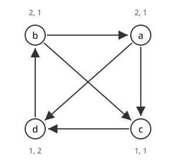

# Seymour 두 번째 이웃 추측

# 개요

**Seymour 두 번째 이웃 추측(Seymour's second neighborhood conjecture)** 은 두 정점 사이에 화살표가 많아야 하나인 방향 그래프에, 화살표 두 개를 따라 새로 닿는 정점이 화살표 하나로 닿는 정점보다 적지 않은 정점이 반드시 있다는 추측이다. 네 팀이 서로 한 번씩 겨룬 리그에서 두 팀을 이긴 팀은, 진 팀들이 다시 이긴 팀 가운데 새로 닿는 팀이 하나뿐일 수 있다. 그래도 리그 안에는 이긴 팀의 이긴 팀 가운데 새로 닿는 팀의 수가 자기가 이긴 팀의 수 이상인 팀이 있다.

모든 두 팀이 겨루는 리그, 곧 [토너먼트](tournaments.md)에서는 이 진술이 증명되었고, 경기 결과와 가장 덜 어긋나는 순위의 마지막 팀이 그런 팀이다.

# 직관

토너먼트 문서의 리그를 다시 쓴다. 네 팀 $a,b,c,d$ 의 경기 결과가 $b\to a$, $a\to c$, $c\to d$, $d\to b$, $a\to d$, $b\to c$ 이고, 화살표는 이긴 팀에서 진 팀으로 간다.

$a$ 는 $c$ 와 $d$ 를 이겼다. $c$ 는 $d$ 를 이겼고 $d$ 는 $b$ 를 이겼으므로, $a$ 에서 화살표 두 개를 따라 새로 닿는 팀은 $b$ 하나다. 이긴 팀이 둘인데 두 다리로 새로 닿는 팀은 하나다.

$b$ 도 같다. $b$ 는 $a$ 와 $c$ 를 이겼고, 두 다리로 새로 닿는 팀은 $d$ 하나다.

$d$ 는 $b$ 하나만 이겼지만 $b$ 가 $a$ 와 $c$ 를 이겼으므로 두 다리로 새로 닿는 팀이 둘이다. $c$ 는 $d$ 를 이기고 $d$ 를 거쳐 $b$ 에 닿아 하나 대 하나다. 아래 그림에서 정점 옆의 두 수가 한 다리로 닿는 팀의 수와 두 다리로 새로 닿는 팀의 수다.

많이 이긴 팀은 이긴 상대들끼리 서로 겹치는 곳으로 화살표가 몰려 두 다리로 새로 닿는 팀이 적다. 조금 이긴 팀에서는 이 수가 처음 수를 따라잡는다. 추측은 이런 팀이 언제나 있다는 것이다.

# 정의

두 정점 사이에 간선이 많아야 하나이고 고리가 없는 [방향 그래프](graphs.md)를 **유향 그래프(oriented graph)** 라 한다. $x\to y$ 와 $y\to x$ 가 함께 있을 수 없다. 토너먼트는 모든 두 정점 사이에 간선이 정확히 하나인 유향 그래프다.

정점 $v$ 에 대해 $v\to x$ 인 정점 $x$ 의 집합을 **첫째 바깥 이웃(first out-neighborhood)** $N^{+}(v)$ 라 한다. $v$ 에서 가는 가장 짧은 방향 경로의 길이가 정확히 $2$ 인 정점의 집합을 **둘째 바깥 이웃(second out-neighborhood)** $N^{++}(v)$ 라 한다. 직관 절의 리그에서 $N^{+}(a)=\lbrace c,d\rbrace$, $N^{++}(a)=\lbrace b\rbrace$ 이고 $N^{+}(d)=\lbrace b\rbrace$, $N^{++}(d)=\lbrace a,c\rbrace$ 다.

다음을 만족하는 정점 $v$ 를 **Seymour 정점(Seymour vertex)** 이라 한다.

$$
\vert N^{++}(v)\vert\ge\vert N^{+}(v)\vert
$$

직관 절의 리그에서 Seymour 정점은 $c$ 와 $d$ 다.

**Seymour 두 번째 이웃 추측** 은 모든 유향 그래프에 Seymour 정점이 있다는 진술이다[^1]. 토너먼트에 한정한 진술은 **Dean 추측(Dean's conjecture)** 이라 한다.

# 성질

## 맞간선이 있는 반례

$x\to y$ 와 $y\to x$ 를 함께 허용하면 진술이 거짓이다. 정점 셋의 모든 순서쌍에 간선을 둔 방향 그래프에서는 모든 정점의 첫째 바깥 이웃이 나머지 두 정점이고 둘째 바깥 이웃은 비어 있다. 유향 그래프로 한정한 것이 이 때문이다.

## Fisher 정리

**Fisher 정리(Fisher's theorem)** 는 모든 토너먼트에 Seymour 정점이 있다는 진술이다[^2]. Fisher 는 정점 위의 확률분포를 [Farkas 보조정리](farkas-lemma.md)로 찾아, 그 분포로 뽑은 정점의 둘째 바깥 이웃의 크기가 평균으로 첫째 바깥 이웃의 크기 이상임을 보였다. 그래서 Dean 추측은 정리다.

## 중앙 순서

토너먼트의 정점을 $v_1,\dots,v_n$ 으로 늘어놓고 $i\lt j$ 이며 $v_i\to v_j$ 인 간선을 앞으로 가는 간선이라 하자. 앞으로 가는 간선의 수가 가장 많은 순서를 **중앙 순서(median order)** 라 한다. 직관 절의 리그에서 $b,a,c,d$ 는 $d\to b$ 하나만 뒤로 가므로 앞으로 가는 간선이 $5$ 개이고, 리그에 3-순환이 있어 $6$ 개는 불가능하므로 중앙 순서다.

중앙 순서에서 $i\lt j$ 이면 $v_i$ 는 $v_{i+1},\dots,v_j$ 의 절반 이상을 이기고, $v_j$ 는 $v_i,\dots,v_{j-1}$ 의 절반 이상에게 진다. $v_i$ 를 $v_j$ 바로 뒤로 옮기면 앞으로 가는 간선의 수가 그 구간에서 $v_i$ 가 진 수에서 이긴 수를 뺀 만큼 늘어나는데, 중앙 순서이므로 늘어날 수 없다. 리그의 $b,a,c,d$ 에서 $d$ 는 앞의 세 팀 가운데 $a$ 와 $c$ 에게 진다.

## Havet–Thomassé 정리

**Havet–Thomassé 정리(Havet–Thomassé theorem)** 는 토너먼트의 중앙 순서에서 마지막 정점이 Seymour 정점이라는 진술이다[^3]. 증명은 위의 구간 성질을 쓴다. 리그의 중앙 순서 $b,a,c,d$ 의 마지막 정점 $d$ 는 직관 절의 Seymour 정점이다. Fisher 정리의 둘째 증명이고, 찾는 정점을 확률분포 대신 순서 하나로 준다.

## 유향 그래프의 부분 결과

일반 유향 그래프에서는 다음이 증명되어 있다.

- Chen, Shen, Yuster 는 모든 유향 그래프에 둘째 바깥 이웃의 크기가 첫째 바깥 이웃의 크기의 $\gamma$ 배 이상인 정점이 있음을 보였다[^4]. $\gamma\approx 0.657$ 은 $2x^3+x^2-1=0$ 의 실근이다.
- Kaneko 와 Locke 는 바깥 차수의 최솟값이 $6$ 이하인 유향 그래프에서 추측이 성립함을 보였다[^5].

# 활용

- 순위 매기기. 중앙 순서는 경기 결과와 어긋나는 쌍이 가장 적은 순위이고, 토너먼트에서 최소 되먹임 호 집합(minimum feedback arc set)을 지운 순서다. [Kemeny 순위](kemeny-ranking.md)는 같은 문제에 간선의 무게를 준 것이다. 토너먼트의 최소 되먹임 호 집합 문제는 NP-어려움(nondeterministic polynomial time hard, NP-hard)이다[^6].
- 사회 연결망. 맞팔로우가 없는 팔로우 관계에서 두 다리로 새 사람에게 닿는 범위가 한 다리 범위 이상인 사람이 있다는 진술이 추측의 내용이다. 토너먼트에서는 중앙 순서를 구하면 그런 사람이 나온다.
- 토너먼트의 부분구조. Havet 와 Thomassé 는 같은 논문에서 중앙 순서를 Sumner 의 보편 토너먼트 추측(Sumner's universal tournament conjecture)의 부분 결과에도 썼다[^3].

[^1]: N. Dean, B. J. Latka, "Squaring the tournament: an open problem", *Congressus Numerantium* 109 (1995), 73–80.
[^2]: D. C. Fisher, "Squaring a tournament: a proof of Dean's conjecture", *Journal of Graph Theory* 23 (1996), 43–48.
[^3]: F. Havet, S. Thomassé, "Median orders of tournaments: a tool for the second neighborhood problem and Sumner's conjecture", *Journal of Graph Theory* 35 (2000), 244–256.
[^4]: G. Chen, J. Shen, R. Yuster, "Second neighborhood via first neighborhood in digraphs", *Annals of Combinatorics* 7 (2003), 15–20.
[^5]: Y. Kaneko, S. C. Locke, "The minimum degree approach for Paul Seymour's distance 2 conjecture", *Congressus Numerantium* 148 (2001), 201–206.
[^6]: N. Alon, "Ranking tournaments", *SIAM Journal on Discrete Mathematics* 20 (2006), 137–142. P. Charbit, S. Thomassé, A. Yeo, "The minimum feedback arc set problem is NP-hard for tournaments", *Combinatorics, Probability and Computing* 16 (2007), 1–4.

# 연관 문서

## 선수지식

- [토너먼트](tournaments.md)

## 더 알아보기

아직 연결한 문서가 없다.

#graph_theory #combinatorics
