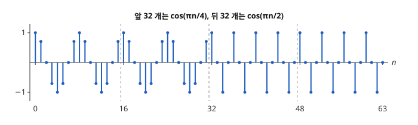
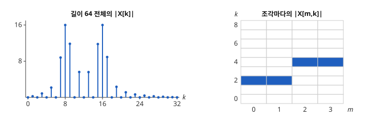

# 단시간 Fourier 변환

# 개요

**단시간 Fourier 변환(short-time Fourier transform, STFT)** 은 신호를 짧은 조각으로 잘라 조각마다 [이산 Fourier 변환](fourier.md)을 계산하는 변환이다. 휘파람 소리를 녹음했는데 앞 절반은 낮은 음, 뒤 절반은 높은 음이었다면, 녹음 전체를 한 번에 변환한 결과에는 두 음이 다 나타나지만 어느 음이 먼저 났는지는 나타나지 않는다. 조각마다 변환하면 각 시각에 어느 주파수가 있었는지가 시각과 주파수의 표로 나온다.

# 직관

수열 $x\lbrack n\rbrack$ $(0\le n\le 63)$ 은 앞 32 개가 $\cos(\pi n/4)$, 뒤 32 개가 $\cos(\pi n/2)$ 다. 앞은 8 칸마다, 뒤는 4 칸마다 같은 값이 되풀이된다. 아래 그림의 점선은 16 칸마다 그은 것이다.

길이 64 의 이산 Fourier 변환 $X\lbrack k\rbrack$ 는 주파수 $2\pi k/64$ 의 성분을 잰다. $\pi/4$ 는 $k=8$, $\pi/2$ 는 $k=16$ 이고, $\lvert X\lbrack 8\rbrack\rvert=\lvert X\lbrack 16\rbrack\rvert=16$ 이다. 앞뒤 절반을 맞바꾼 수열 $y\lbrack n\rbrack=x\lbrack (n+32)\bmod 64\rbrack$ 는 $x$ 를 32 칸 돌린 것이므로 $Y\lbrack k\rbrack=(-1)^kX\lbrack k\rbrack$ 이다. 크기가 모든 $k$ 에서 같으므로, 크기만 보아서는 두 음의 순서를 알 수 없다.

수열을 16 개씩 네 조각으로 자르고 조각마다 길이 16 의 이산 Fourier 변환을 계산한다. 조각 $m$ 의 $t$ 번째 값은 $x\lbrack 16m+t\rbrack$ 이고, $\cos(\pi(16m+t)/4)=\cos(\pi t/4)$, $\cos(\pi(16m+t)/2)=\cos(\pi t/2)$ 이다. 그래서 조각 0, 1 은 $k=2$ 와 $k=14$ 에서만 크기가 $8$ 이고, 조각 2, 3 은 $k=4$ 와 $k=12$ 에서만 크기가 $8$ 이다.

아래 그림의 왼쪽은 길이 64 전체의 $\lvert X\lbrack k\rbrack\rvert$ 이고, 오른쪽은 가로축을 조각 번호 $m$, 세로축을 $k$ 로 놓고 조각마다의 크기를 칠한 표다. 왼쪽에서는 $k=8$ 과 $k=16$ 의 봉우리만 보이고, 오른쪽에서는 앞 두 조각이 $k=2$, 뒤 두 조각이 $k=4$ 에 칠해져 낮은 음이 먼저 났다는 것이 보인다.

# 정의

## 단시간 Fourier 변환

길이 $L$ 인 창함수(window function) $w\lbrack 0\rbrack,\dots,w\lbrack L-1\rbrack$ 과 건너뛰는 칸 수 $R\ge 1$ 을 정한다. 창함수는 [스펙트럼 추정](spectral-estimation.md)에서 주기도에 곱한 것과 같은 수열이다. 수열 $x$ 의 **단시간 Fourier 변환** 은 다음 이중 배열이다[^1].

$$
X\lbrack m,k\rbrack=\sum_{t=0}^{L-1}x\lbrack mR+t\rbrack\thinspace w\lbrack t\rbrack\thinspace e^{-2\pi ikt/L},\qquad k=0,\dots,L-1
$$

$m$ 은 조각 번호이고 $k$ 는 주파수 번호다. 조각 $m$ 은 $x$ 의 $mR$ 번째 값부터 $L$ 개에 창함수를 곱한 것이고, $X\lbrack m,k\rbrack$ 를 $k$ 의 배열로 보면 그 조각의 이산 Fourier 변환이다. 직관 절은 $L=R=16$ 이고 모든 $w\lbrack t\rbrack=1$ 인 경우다.

$\lvert X\lbrack m,k\rbrack\rvert^2$ 을 가로축 $m$, 세로축 $k$ 의 표로 그린 것을 **스펙트로그램(spectrogram)** 이라 한다. 직관 절의 둘째 그림 오른쪽은 제곱하기 전의 크기 $\lvert X\lbrack m,k\rbrack\rvert$ 를 칠한 것이다.

## 주기 Hann 창

**주기 Hann 창(periodic Hann window)** 은 다음 창함수다.

$$
w\lbrack t\rbrack=\tfrac12-\tfrac12\cos(2\pi t/L),\qquad t=0,\dots,L-1
$$

스펙트럼 추정 문서의 Hann 창은 분모가 $L-1$ 이고, 여기서는 분모가 $L$ 이다. $L=4$ 이면 $w=(0,\frac12,1,\frac12)$ 다.

## 연속 판본

$f\in L^2(\mathbb R)$ 와 창 $g\in L^2(\mathbb R)$ 에 대해 다음 함수를 $f$ 의 연속 단시간 Fourier 변환이라 한다[^2].

$$
V\_gf(\tau,\xi)=\int_{\mathbb R}f(t)\thinspace\overline{g(t-\tau)}\thinspace e^{-2\pi i\xi t}\thinspace dt
$$

$\tau$ 는 창의 위치, $\xi$ 는 주파수다. $g$ 가 Gauss 함수 $e^{-\pi t^2}$ 의 상수배이면 이 변환을 **Gabor 변환(Gabor transform)** 이라 한다.

# 성질

## 조각마다의 Parseval 등식

조각마다 다음이 성립한다.

$$
\sum_{k=0}^{L-1}\lvert X\lbrack m,k\rbrack\rvert^2=L\sum_{t=0}^{L-1}\lvert x\lbrack mR+t\rbrack\thinspace w\lbrack t\rbrack\rvert^2
$$

이산 Fourier 변환의 Parseval 등식을 조각 $m$ 에 쓴 것이다. 직관 절의 조각 0 에서 왼쪽은 $8^2+8^2=128$ 이고, 오른쪽은 $16\cdot\sum_{t=0}^{15}\cos^2(\pi t/4)=16\cdot 8=128$ 이다.

## 겹쳐 더하기에 의한 복원

$w$ 를 $\lbrack 0,L-1\rbrack$ 밖에서 $0$ 으로 늘린다. 어떤 정수 범위의 모든 $n$ 에서

$$
\sum_m w\lbrack n-mR\rbrack=1
$$

이면, 그 범위의 $x\lbrack n\rbrack$ 은 다음 식으로 복원된다[^1]. 안쪽 합은 $0\le n-mR\le L-1$ 인 $m$ 에 대해서만 더한다.

$$
x\lbrack n\rbrack=\sum_m\frac1L\sum_{k=0}^{L-1}X\lbrack m,k\rbrack\thinspace e^{2\pi ik(n-mR)/L}
$$

증명의 요지. 안쪽 합은 이산 Fourier 역변환이므로 $x\lbrack n\rbrack\thinspace w\lbrack n-mR\rbrack$ 이다. 이것을 $m$ 에 대해 더하면 $x\lbrack n\rbrack\sum_m w\lbrack n-mR\rbrack=x\lbrack n\rbrack$ 이다.

위 조건을 **COLA 조건(constant overlap-add condition)** 이라 한다. 직관 절의 $w\lbrack t\rbrack=1$, $R=L$ 은 조각이 겹치지 않고 각 $n$ 이 조각 하나에만 들어가므로 조건을 만족한다. 주기 Hann 창과 $R=L/2$ 는 $\theta=2\pi t/L$ 로 두면 $w\lbrack t\rbrack+w\lbrack t+L/2\rbrack=1-\frac12(\cos\theta+\cos(\theta+\pi))=1$ 이므로, 처음과 마지막 $L/2$ 칸을 뺀 모든 $n$ 에서 조건을 만족한다.

## 시간 분해능과 주파수 분해능

조각 하나는 $L$ 칸에 걸치고, 주파수 번호 사이의 간격은 $2\pi/L$ 이다. $L$ 칸 안에서 일어난 두 변화는 같은 조각에 들어가 순서가 나타나지 않고, 간격 $2\pi/L$ 보다 가까운 두 주파수는 같은 번호 근처에 함께 나타난다.

직관 절의 수열로 보면 다음과 같다. $L=64$ 이면 간격은 $2\pi/64$ 로 좁지만 조각이 하나뿐이라 두 음의 순서가 사라진다. $L=16$ 이면 간격은 $\pi/8$ 이고 $\pi/4$ 와 $\pi/2$ 가 서로 다른 번호 2 와 4 에 떨어진다. $L=4$ 이면 간격이 $\pi/2$ 이고, 조각 0 은 $(1,\frac{\sqrt2}2,0,-\frac{\sqrt2}2)$ 이므로 크기가 $k=0,1,2,3$ 에서 $1,\sqrt3,1,\sqrt3$ 으로 모두 $0$ 이 아니어서 주파수를 가를 수 없다.

## 불확정성 원리와 Gauss 창

$\Vert g\Vert\_2=1$ 이라 한다. 연속 판본은 $V\_gf(\tau,\xi)=\int f(t)\thinspace\overline{e^{2\pi i\xi t}g(t-\tau)}\thinspace dt$ 이므로, $f$ 를 함수 $e^{2\pi i\xi t}g(t-\tau)$ 에 대고 잰 값이다. 이 함수의 $\lvert\cdot\rvert^2$ 은 시각 $\tau$ 주위에 분산 $\mathrm{Var}(g)$ 로 퍼지고, [Fourier 변환](fourier-transform.md)의 $\lvert\cdot\rvert^2$ 은 주파수 $\xi$ 주위에 분산 $\mathrm{Var}(\hat g)$ 로 퍼진다. [불확정성 원리](uncertainty-principle.md)의 Heisenberg 부등식(Heisenberg inequality)에서 $\mathrm{Var}(g)\thinspace\mathrm{Var}(\hat g)\ge 1/(16\pi^2)$ 이므로, 창 하나로 시간 폭과 주파수 폭을 함께 임의로 작게 할 수 없다. 등호는 $g$ 가 Gauss 함수일 때만 성립하므로, Gabor 변환의 창이 이 곱을 가장 작게 한다.

# 활용

- 필터 뱅크. $h\_k\lbrack j\rbrack=w\lbrack -j\rbrack\thinspace e^{2\pi ikj/L}$ $(-L+1\le j\le 0)$ 로 두면 $(h\_k\ast x)\lbrack mR\rbrack=X\lbrack m,k\rbrack$ 다. 고정된 $k$ 의 $X\lbrack m,k\rbrack$ 은 주파수 $2\pi k/L$ 근처를 통과시키는 [FIR 필터](fir-filters.md)(finite impulse response)의 출력을 $R$ 칸에 하나씩 남긴 수열이고, 이것은 [다중률 신호처리](multirate-signal-processing.md)의 다운샘플링이다.
- 위상 보코더(phase vocoder). 조각마다의 위상을 고친 뒤 건너뛰는 칸 수를 바꾸어 겹쳐 더하면, 음 높이를 유지한 채 소리의 길이를 바꾼다.
- 음성과 음악의 분석. 스펙트로그램에서 음의 높이는 칠해진 $k$ 로, 음의 시작과 끝은 칠해진 $m$ 의 범위로 나타난다.
- [웨이블릿 변환](wavelet-transform.md). 단시간 Fourier 변환은 모든 주파수에 같은 조각 길이 $L$ 을 쓰고, 웨이블릿 변환은 높은 주파수일수록 짧은 조각을 쓴다.

[^1]: A. V. Oppenheim, R. W. Schafer, *Discrete-Time Signal Processing*, 3rd ed., Pearson (2010), 10.3절.

[^2]: K. Gröchenig, *Foundations of Time-Frequency Analysis*, Birkhäuser (2001), 3장.

# 연관 문서

## 선수지식

- [스펙트럼 추정](spectral-estimation.md)

## 더 알아보기

- [수정 이산 코사인 변환](modified-discrete-cosine-transform.md)

#signal_processing #analysis #algorithms
