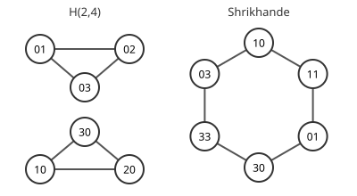

# Shrikhande 그래프

# 개요

**Shrikhande 그래프(Shrikhande graph)** 는 $4\times 4$ 칸을 위아래와 좌우로 이어 붙인 판에서, 가로, 세로, 한쪽 대각선으로 한 칸 떨어진 칸을 이은 그래프다. $4\times 4$ 칸에서 같은 행이나 같은 열의 칸을 이은 [Hamming 그래프](hamming-graphs.md) $H(2,4)$ 와 정점 수, 이웃 수, 공통 이웃 수가 모두 같다. 그래도 두 그래프는 같은 그래프가 아니고, 한 정점의 이웃끼리 어떻게 이어져 있는지를 보면 구별된다.

# 직관

칸을 $ab$ ($a,b\in\lbrace 0,1,2,3\rbrace$) 로 적고, 행과 열 번호는 $4$ 로 나눈 나머지로 계산한다. 칸 $00$ 의 이웃은 차가 $\pm 10$, $\pm 01$, $\pm 11$ 인 칸이므로 $10,30,01,03,11,33$ 의 여섯이다.

이 여섯 칸 사이의 간선을 찾는다. $10$ 과 $11$ 은 차가 $01$, $11$ 과 $01$ 은 차가 $10$, $01$ 과 $30$ 은 차가 $11$ 이므로 이어져 있다. 같은 셈을 이어 가면 아래 그림의 오른쪽처럼 여섯 칸이 6 각형을 이룬다.

$H(2,4)$ 에서 $00$ 의 이웃은 같은 행의 $01,02,03$ 과 같은 열의 $10,20,30$ 이고, 그림의 왼쪽처럼 삼각형 둘로 나뉜다. 두 그림 모두 정점 여섯과 간선 여섯이지만 하나는 이어져 있고 하나는 둘로 나뉘어 있다. 동형사상은 이웃을 이웃으로 보내므로 두 그래프는 동형이 아니다.

# 정의

$\mathbb Z\_4\times\mathbb Z\_4$ 의 원소를 정점으로 두고, 차가 다음 집합에 들어가는 두 원소를 이은 그래프를 Shrikhande 그래프라 한다[^1].

$$
D=\lbrace\pm(1,0),\thinspace\pm(0,1),\thinspace\pm(1,1)\rbrace
$$

$D=-D$ 이므로 이웃 관계가 대칭이다. 직관 절의 $ab$ 는 원소 $(a,b)$ 다. 차의 집합으로 정한 그래프이므로 Cayley 그래프이고, $x\mapsto x+c$ 가 자기동형이라 어느 정점에서 보아도 모양이 같다.

# 성질

## 매개변수

Shrikhande 그래프는 $\mathrm{srg}(16,6,2,2)$ 인 [강정칙 그래프](strongly-regular-graphs.md)다. 이웃한 두 정점 $0$ 과 $(1,0)$ 의 공통 이웃은 $(1,1)$ 과 $(0,3)$ 이고, 이웃하지 않는 $0$ 과 $(2,1)$ 의 공통 이웃은 $(1,0)$ 과 $(1,1)$ 이다. $H(2,4)$ 도 $\mathrm{srg}(16,6,2,2)$ 다.

인접행렬의 고윳값은 $6$, $2$, $-2$ 이고 중복도는 $1$, $6$, $9$ 다. 고윳값의 합 $6+12-18=0$ 이 대각합과 맞는다. 강정칙 그래프의 고윳값은 매개변수로 정해지므로 $H(2,4)$ 도 같은 고윳값과 중복도를 갖고, 두 그래프는 고윳값으로 구별되지 않는다.

## Shrikhande 의 유일성 정리

$n\times n$ 칸에서 같은 행이나 같은 열의 칸을 이은 그래프 $H(2,n)$ 은 $\mathrm{srg}(n^2,2(n-1),n-2,2)$ 다. Shrikhande 는 이 매개변수를 갖는 강정칙 그래프가 $n\ne 4$ 이면 $H(2,n)$ 하나뿐이고, $n=4$ 이면 $H(2,4)$ 와 Shrikhande 그래프 둘뿐임을 증명했다[^2].

## 거리 정칙 그래프로서

지름이 $2$ 인 강정칙 그래프이므로 Shrikhande 그래프는 교차 배열 $\lbrace 6,3;1,2\rbrace$ 의 [거리 정칙 그래프](distance-regular-graphs.md)다. Shrikhande 그래프 $m$ 개와 완전그래프 $K\_4$ 여럿을 데카르트 곱으로 이은 그래프를 Doob 그래프(Doob graph)라 한다. Shrikhande 그래프 $m$ 개와 $K\_4$ 를 $n$ 개 곱한 Doob 그래프는 Hamming 그래프 $H(2m+n,4)$ 와 교차 배열이 같고, $m\ge 1$ 이면 그와 동형이 아니다[^1].

## 원환면 위의 삼각분할

정의의 $D$ 는 가로, 세로, 한쪽 대각선 방향이다. $4\times 4$ 칸의 양 끝을 붙여 원환면을 만들면 Shrikhande 그래프는 그 위에서 간선이 교차하지 않게 그려지고, 면이 모두 삼각형인 분할이 된다. 직관 절의 6 각형은 $00$ 을 둘러싼 삼각형 여섯 개의 바깥 둘레다.

# 활용

- 공스펙트럼 그래프의 예. 강정칙 그래프 문서의 공스펙트럼 절처럼, 고윳값이 같아도 동형이 아닌 강정칙 그래프의 예로 쓰인다.
- [Hamming 그래프](hamming-graphs.md)의 매개변수 특징. Hamming 그래프 $H(d,q)$ 와 교차 배열이 같은 거리 정칙 그래프는 $q=4$ 일 때만 Hamming 그래프가 아닐 수 있고, 그 예외가 Shrikhande 그래프로 만든 Doob 그래프다.

[^1]: A. E. Brouwer, A. M. Cohen, A. Neumaier, *Distance-Regular Graphs*, Springer, 1989, §9.2.
[^2]: S. S. Shrikhande, "The uniqueness of the L₂ association scheme", *Annals of Mathematical Statistics* 30 (1959), 781–798.

# 연관 문서

## 선수지식

- [강정칙 그래프](strongly-regular-graphs.md)
- [Hamming 그래프](hamming-graphs.md)

## 더 알아보기

아직 연결한 문서가 없다.

#graph_theory #combinatorics #linear_algebra
