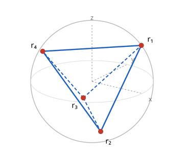

# 대칭 정보 완전 측정

# 개요

**대칭 정보 완전 측정(symmetric informationally complete positive operator-valued measure, SIC-POVM)** 은 결과가 $d^2$ 개인 측정 하나로 $d$ 차원 양자 상태를 정하는 측정이다. 똑같이 준비된 큐비트가 여럿 있고 그 상태를 모를 때, 측정 장치 하나로는 결과가 두 가지라 상태를 정하는 세 수 가운데 하나만 얻는다. 그래서 보통은 장치를 세 기저로 바꿔 가며 측정한다.

대칭 정보 완전 측정은 결과가 넷인 장치 하나를 그대로 두고 되풀이해, 네 결과의 빈도에서 상태를 계산한다.

# 직관

큐비트 상태를 [밀도 행렬](density-matrix.md)의 Bloch 공의 점 $r=(x,y,z)$ 로 적는다. 밀도 행렬은 $\rho=\tfrac12(I+r\cdot\sigma)$ 이고, $r\cdot\sigma$ 는 Pauli [행렬](matrices.md)로 $xX+yY+zZ$ 를 줄여 쓴 것이다. 기저 $\lbrace\vert 0\rangle,\vert 1\rangle\rbrace$ 로 측정하면 $\vert 0\rangle$ 이 확률 $\tfrac12(1+z)$ 로 나오므로, 같은 측정을 되풀이해 얻는 것은 $z$ 하나다. $x$ 와 $y$ 를 얻으려면 장치를 [상호 편향 없는 기저](mutually-unbiased-bases.md)의 $X$ 기저와 $Y$ 기저로 바꿔야 한다.

결과가 둘이면 두 확률의 합이 $1$ 이라 독립인 수가 하나뿐이어서 막혔다. 그러니 결과를 넷으로 늘린다. [양자 상태 구별](quantum-state-discrimination.md)의 POVM 은 양의 준정부호 행렬 몇 개의 합이 $I$ 이기만 하면 측정이 되므로 결과의 수가 차원에 묶이지 않는다. 구면 위의 네 점을 골라, 점 $r_k$ 마다 다음 행렬을 둔다.

$$
E_k=\frac14\bigl(I+r_k\cdot\sigma\bigr)
$$

네 행렬의 합은 다음과 같다.

$$
\sum_{k=1}^4E_k=I+\frac14\bigl(r_1+r_2+r_3+r_4\bigr)\cdot\sigma
$$

그래서 네 점의 합이 $0$ 이면 측정이 된다. 네 점을 다음과 같이 고른다.

$$
\begin{aligned}
r_1&=\tfrac1{\sqrt3}(1,1,1),&r_2&=\tfrac1{\sqrt3}(1,-1,-1),\cr
r_3&=\tfrac1{\sqrt3}(-1,1,-1),&r_4&=\tfrac1{\sqrt3}(-1,-1,1)
\end{aligned}
$$

아래 그림은 Bloch 구면과 네 점을 그린 것이다. 네 점은 구에 내접한 정사면체의 꼭짓점이고, 어느 두 점의 내적도 $-\tfrac13$ 이다.

상태 $r$ 에서 결과 $k$ 의 확률은 $p_k=\mathrm{tr}(E_k\rho)=\tfrac14(1+r\cdot r_k)$ 다. 네 점은 각 좌표의 제곱의 합이 $\tfrac43$ 이고 서로 다른 두 좌표의 곱의 합이 $0$ 이라, $\sum_k(r\cdot r_k)r_k=\tfrac43r$ 다. 그래서 상태는 네 확률에서 다음과 같이 나온다.

$$
r=3\bigl(p_1r_1+p_2r_2+p_3r_3+p_4r_4\bigr)
$$

$\vert 0\rangle$ 이면 $p_1=p_4=\tfrac14(1+\tfrac1{\sqrt3})$, $p_2=p_3=\tfrac14(1-\tfrac1{\sqrt3})$ 이고, 위 식에 넣으면 $r=(0,0,1)$ 이 나온다. 네 점이 어느 쌍이나 같은 각을 이루므로 어느 결과도 다른 결과보다 특별하지 않다. 이 측정이 $d=2$ 의 대칭 정보 완전 측정이다.

# 정의

## 정보 완전성

POVM $\lbrace E\_1,\dots,E\_n\rbrace$ 의 확률 $\mathrm{tr}(E\_k\rho)$ 들이 밀도 행렬 $\rho$ 를 하나로 정하면 그 POVM 을 **정보 완전(informationally complete)** 하다고 한다. 기저 $\lbrace\vert 0\rangle,\vert 1\rangle\rbrace$ 의 측정은 정보 완전하지 않다. $\tfrac12I$ 와 $\vert +\rangle\langle +\vert$ 가 둘 다 확률 $\tfrac12,\tfrac12$ 를 낸다. 직관 절의 네 결과 측정은 정보 완전하다.

## 대칭 정보 완전 측정

$\mathbb C^d$ 의 단위 벡터 $\psi\_1,\dots,\psi\_{d^2}$ 가 서로 다른 $j,k$ 에서 다음을 만족한다.

$$
\vert\langle\psi_j,\psi_k\rangle\vert^2=\frac1{d+1}
$$

이때 $\Pi\_k=\psi\_k\psi\_k^\ast$ 로 두고 $E\_k=\tfrac1d\Pi\_k$ 로 정한 $d^2$ 개의 행렬을 대칭 정보 완전 측정이라 한다. 직관 절에서 $\Pi\_k=\tfrac12(I+r\_k\cdot\sigma)$ 이고, 두 순수 상태의 겹침은 $\tfrac12(1+r\_j\cdot r\_k)=\tfrac12(1-\tfrac13)=\tfrac13$ 이다.

## Weyl–Heisenberg 궤도

$\omega=e^{2\pi i/d}$ 이고 $x\in\mathbb Z/d$ 일 때, $\mathbb C^d$ 의 표준 기저 $\lbrace\vert x\rangle\rbrace$ 위에서 **이동 연산자(shift operator)** $S\vert x\rangle=\vert x+1\rangle$ 와 **시계 연산자(clock operator)** $C\vert x\rangle=\omega^x\vert x\rangle$ 를 정한다. $a,b\in\mathbb Z/d$ 에 대한 $d^2$ 개의 유니터리 $D\_{a,b}=S^aC^b$ 가 위상을 무시하고 이루는 [군](groups.md)을 **Weyl–Heisenberg 군(Weyl–Heisenberg group)** 이라 한다.

단위 벡터 $\psi$ 에 대해 $\lbrace D\_{a,b}\psi\rbrace$ 가 대칭 정보 완전 측정의 벡터이면 $\psi$ 를 **기준 벡터(fiducial vector)** 라 한다. $d=2$ 에서 $S=X$, $C=Z$ 이고 $D\_{1,1}$ 은 위상을 빼면 $Y$ 다. $X$ 로 상태를 옮기면 Bloch 벡터의 $y,z$ 부호가 바뀌고, $Z$ 는 $x,y$ 부호를, $Y$ 는 $x,z$ 부호를 바꾼다. 그래서 $r\_1$ 에서 시작하면 네 연산자가 $r\_1,r\_2,r\_4,r\_3$ 을 내고, $r\_1$ 의 상태가 기준 벡터다.

# 성질

## 직선 수의 상한

정리. $\mathbb C^d$ 의 단위 벡터들이 서로 다른 쌍마다 같은 겹침 $\alpha\lt 1$ 을 가지면 벡터는 $d^2$ 개 이하다.

증명의 요지. $\Pi\_k$ 는 실수 차원이 $d^2$ 인 Hermite 행렬(Hermitian matrix)의 공간에 있다. 내적 $\mathrm{tr}(AB)$ 로 잰 $\Pi\_k$ 들의 Gram 행렬은 대각이 $1$, 나머지가 $\alpha$ 인 행렬 $(1-\alpha)I+\alpha J$ 이고 양의 정부호다. 그래서 $\Pi\_k$ 들은 일차독립이다.

이 상한은 [등각 직선](equiangular-lines.md)의 Gerzon 상한(Gerzon bound)의 복소판이고, 대칭 정보 완전 측정은 상한에 이르는 직선족이다.

## 겹침의 값

정리. 겹침이 모두 같은 단위 벡터 $d^2$ 개의 겹침은 $\tfrac1{d+1}$ 이고, 이때 $\sum\_k\Pi\_k=dI$ 다.

증명의 요지. 앞 정리로 $\Pi\_k$ 들이 Hermite 행렬 공간의 기저이므로 $I=\sum\_kc\_k\Pi\_k$ 로 쓴다. 양변에 $\Pi\_j$ 를 곱해 대각합을 잡으면 $1=(1-\alpha)c\_j+\alpha\sum\_kc\_k$ 라 $c\_j$ 는 $j$ 에 관계없이 같은 값 $c$ 다. 양변의 대각합을 비교하면 $d=d^2c$ 라 $c=\tfrac1d$ 이고, 첫 식에 넣으면 다음이 나온다.

$$
1=\frac1d\bigl(1+(d^2-1)\alpha\bigr)
$$

이 식을 풀면 $\alpha=\tfrac1{d+1}$ 이다. $\sum\_kE\_k=I$ 이므로 정의의 $E\_k$ 는 실제로 측정이다. $N=d^2$ 일 때 [Welch 상한](welch-bound.md)의 우변이 $\tfrac{d^2-d}{d(d^2-1)}=\tfrac1{d+1}$ 이므로, 대칭 정보 완전 측정은 Welch 상한의 등호를 만족하는 등각 단단한 프레임(equiangular tight frame)이다.

## 상태 복원 공식

정리. 대칭 정보 완전 측정의 확률을 $p\_k=\mathrm{tr}(E\_k\rho)$ 라 하면 다음이 성립한다[^1].

$$
\rho=\sum_{k=1}^{d^2}\Bigl((d+1)p_k-\frac1d\Bigr)\Pi_k
$$

증명의 요지. $\rho=\sum\_kc\_k\Pi\_k$ 로 쓰면 대각합에서 $\sum\_kc\_k=1$ 이다. $\Pi\_j$ 와의 대각합을 잡으면 $dp\_j=(1-\alpha)c\_j+\alpha$ 이고, $\alpha=\tfrac1{d+1}$ 을 넣어 $c\_j$ 에 대해 풀면 된다. $d=2$ 이면 계수가 $3p\_k-\tfrac12$ 이고, Bloch 벡터로 옮기면 직관 절의 $r=3\sum\_kp\_kr\_k$ 다.

## 결과 수의 최솟값

확률 $\mathrm{tr}(E\_k\rho)$ 들이 $\rho$ 를 정하려면 $E\_k$ 들이 Hermite 행렬의 공간 전체를 펼쳐야 하므로, 정보 완전한 POVM 은 결과가 $d^2$ 개 이상이다. 대칭 정보 완전 측정은 이 최솟값으로 정보 완전하다. 상호 편향 없는 기저의 완전한 모임은 기저 $d+1$ 개를 따로 측정하므로 결과가 모두 $d(d+1)$ 개다.

## Zauner 추측

**Zauner 추측(Zauner's conjecture)** 은 모든 차원 $d$ 에 Weyl–Heisenberg 군의 기준 벡터가 있다는 진술이다[^2]. Renes, Blume-Kohout, Scott, Caves 는 $d\le 45$ 에서 기준 벡터를 수치로 찾았고[^1], Scott 과 Grassl 은 이를 $d\le 67$ 로 늘렸다[^3]. 모든 $d$ 에서 대칭 정보 완전 측정이 있는지는 알려져 있지 않다[^4].

# 활용

- 양자 상태 단층 촬영(quantum state tomography). 장치 하나의 결과 빈도에서 상태 복원 공식으로 밀도 행렬을 계산한다[^1].
- 신호 설계. $\mathbb C^d$ 에서 벡터 $d^2$ 개로 Welch 상한의 등호를 만족하는 배치이므로, [압축 센싱](compressed-sensing.md)의 측정 행렬과 확산 수열의 후보다.
- 대수적 수론. Appleby, Flammia, McConnell, Yard 는 알려진 기준 벡터의 성분이 실이차체(real quadratic field) $\mathbb Q(\sqrt{(d-3)(d+1)})$ 위의 광선유체(ray class field)에 들어 있음을 관찰했다[^5]. 광선유체는 [유체론](class-field-theory.md)에서 정의된다.

[^1]: J. M. Renes, R. Blume-Kohout, A. J. Scott, C. M. Caves, "Symmetric informationally complete quantum measurements", *Journal of Mathematical Physics* 45 (2004), 2171–2180.
[^2]: G. Zauner, *Quantendesigns: Grundzüge einer nichtkommutativen Designtheorie*, Dissertation, Universität Wien (1999).
[^3]: A. J. Scott, M. Grassl, "Symmetric informationally complete positive-operator-valued measures: A new computer study", *Journal of Mathematical Physics* 51 (2010), 042203.
[^4]: C. A. Fuchs, M. C. Hoang, B. C. Stacey, "The SIC question: history and state of play", *Axioms* 6 (2017), 21.
[^5]: M. Appleby, S. Flammia, G. McConnell, J. Yard, "SICs and algebraic number theory", *Foundations of Physics* 47 (2017), 1042–1059.

# 연관 문서

## 선수지식

- [Welch 상한](welch-bound.md)
- [양자 상태 구별](quantum-state-discrimination.md)
- [상호 편향 없는 기저](mutually-unbiased-bases.md)

## 더 알아보기

아직 연결한 문서가 없다.

#computation #linear_algebra #information_theory #combinatorics
