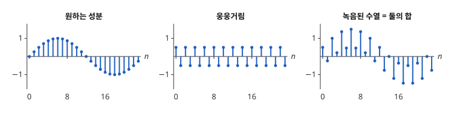
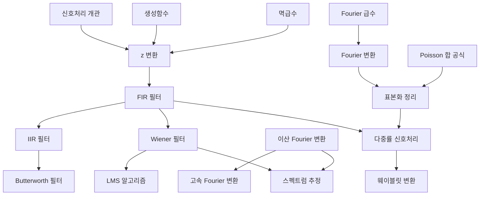

# 신호처리 개관

# 개요

신호처리(signal processing)는 일정한 간격으로 잰 수의 열을 계산으로 바꾸어 원하는 성분만 남기는 방법을 다루는 분야다. 녹음한 소리는 1초에 수만 번 잰 공기 압력의 수열이고, 거기 섞인 일정한 높이의 웅웅거림은 수열 안에서 같은 주기로 되풀이되는 성분이다. 수열을 주기별 성분으로 나누어 보고, 웅웅거림의 주기에서만 출력이 $0$ 이 되는 계산을 설계하면 이 성분이 지워진다. 아래 그림은 천천히 오르내리는 성분, 한 칸마다 부호가 바뀌는 웅웅거림, 그 둘을 더한 수열이다.

처음 읽는 사람은 [z 변환](z-transform.md)에서 시작한다.

# 지도

# 갈래

처음 읽는 사람은 z 변환과 필터, 주파수와 표본화의 순서로 읽는다. 스펙트럼 추정과 다중률 신호처리는 두 갈래를 모두 읽은 뒤에 온다. 필터의 주파수 응답은 둘째 갈래의 Fourier 변환을 수열에 대해 계산한 것이다.

## z 변환과 필터

먼저 읽을 것: [생성함수](generating-functions.md)(조합론 개관), [멱급수](power-series.md)(해석학 개관), [공분산](covariance.md)(확률론 개관), [확률적 경사하강법](stochastic-gradient-descent.md)(최적화 개관), [Laplace 변환](laplace-transform.md)(해석학 개관). 시작 문서: [z 변환](z-transform.md).

- [z 변환](z-transform.md) — 수열을 $z^{-1}$ 의 급수로 바꾸어 선형 시불변 시스템의 합성곱을 곱으로 만든다
- [FIR 필터](fir-filters.md) — 최근 입력 유한 개의 가중합. 항상 안정이고 대칭 계수이면 선형 위상이다
- [IIR 필터](iir-filters.md) — 앞선 출력을 되먹이는 점화식. 전달함수가 유리함수이고 극이 단위원 안에 있어야 안정이다
  - [Butterworth 필터](butterworth-filter.md) — 통과대역에서 크기 응답이 가장 평탄한 저역통과 원형. 쌍일차 변환으로 IIR 필터가 된다
  - [Kalman 필터](kalman-filter.md) — 측정 잡음이 있는 상태를 차례로 추정하는 재귀 필터. 무작위 보행 모형의 정상 상태에서 지수평활과 같은 1차 IIR 필터가 된다
- [Wiener 필터](wiener-filter.md) — 신호와 잡음의 공분산으로 평균제곱오차를 최소로 하는 계수를 정한다. 계수는 Toeplitz 연립방정식의 해다
- [LMS 알고리즘](lms-algorithm.md) — 오차 하나로 기울기를 추정해 계수를 시점마다 고치고, 평균으로 Wiener 해에 수렴한다

## 주파수와 표본화

먼저 읽을 갈래: z 변환과 필터. 먼저 읽을 것: [Hilbert 공간](hilbert-spaces.md)(함수해석 개관), [Fourier 급수](fourier-series.md), [Poisson 합 공식](poisson-summation.md)(해석학 개관). 시작 문서: [이산 Fourier 변환](fourier.md).

- [이산 Fourier 변환](fourier.md) — 길이 $N$ 인 수열을 $N$ 개의 주기 성분으로 나누는 선형사상
  - [고속 Fourier 변환](fft.md) — 길이를 반씩 나누어 이산 Fourier 변환을 $O(N\log N)$ 번의 연산으로 계산하는 알고리즘
- [Fourier 변환](fourier-transform.md) — 실직선 위의 함수를 주파수의 함수로 바꾸는 적분 변환
- [표본화 정리](sampling-theorem.md) — 주파수가 $B$ 이하인 신호는 간격 $1/(2B)$ 의 표본으로 완전히 복원된다
- [스펙트럼 추정](spectral-estimation.md) — 구간별 주기도를 평균해 전력 스펙트럼 밀도를 추정한다. 구간 수가 분산을, 구간 길이가 주파수 분해능을 정한다
- [다중률 신호처리](multirate-signal-processing.md) — 다운샘플링과 업샘플링, 다위상 분해, 완전 재구성 두 채널 필터 뱅크
- [웨이블릿 변환](wavelet-transform.md) — 필터 뱅크를 저역 쪽에 되풀이해 신호를 위치와 폭이 다른 파형으로 나누고, $O(N)$ 번의 연산으로 계산한다

# 연관 문서

## 선수지식

- [집합](sets.md)

## 더 알아보기

- [z 변환](z-transform.md)

#signal_processing #overview
