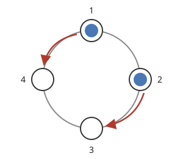

# 단순 배제 과정

# 개요

**단순 배제 과정(simple exclusion process)** 은 한 줄로 늘어선 칸 위에서 입자들이 무작위로 이웃 칸으로 옮겨 가되, 한 칸에 입자가 둘 들어갈 수 없는 연속시간 Markov 과정이다. 일차선 도로의 차나 좁은 통로의 사람처럼 앞이 막히면 기다려야 하는 움직임이 이 꼴이다. 입자 하나하나는 단순한 규칙을 따르지만, 많이 모이면 밀도가 파동처럼 움직이거나 퍼진다.

이 과정은 칸마다 입자가 있는지를 $0$ 과 $1$ 로 적은 배치 위의 [연속시간 Markov 연쇄](continuous-time-markov-chains.md)로 다루고, 그 정상분포와 큰 척도의 밀도 방정식을 구한다.

# 직관

칸 $1, 2, 3, 4$ 를 시계 방향으로 고리에 놓고 칸 $1$ 과 $2$ 에 입자를 둔다. 각 입자는 비율 $p$ 로 시계 방향 이웃 칸으로, 비율 $q$ 로 반대 방향 이웃 칸으로 옮기려 하고, 그 칸이 차 있으면 움직이지 않는다.

그림에서 칸 $1$ 의 입자는 칸 $2$ 로 갈 수 없고 칸 $4$ 로만 갈 수 있다. 칸 $2$ 의 입자는 칸 $3$ 으로만 갈 수 있다. 그러므로 이 배치를 떠나는 비율은 $p+q$ 다.

입자 둘을 칸 넷에 놓는 배치는 $6$ 개다. 입자가 이웃한 배치에서는 입자 덩어리가 하나여서 떠나는 비율이 $p+q$ 이고, 칸 $1, 3$ 처럼 떨어진 배치에서는 덩어리가 둘이어서 $2(p+q)$ 다. 들어오는 비율도 같은 수의 덩어리에서 정해지므로, 여섯 배치를 같은 확률 $1/6$ 로 두면 들어오고 나가는 확률의 흐름이 배치마다 같다. 그래서 $p$ 와 $q$ 에 상관없이 균등분포가 정상분포다.

정상 상태에서 칸 $2$ 에 입자가 있고 칸 $3$ 이 비어 있을 확률은 $(2/4)(2/3)=1/3$ 이다. 그러므로 칸 $2$ 와 $3$ 사이를 시계 방향으로 지나는 입자의 평균 흐름은 $(p-q)/3$ 이다.

# 정의

상태공간은 $\lbrace 0,1\rbrace^{\mathbb Z}$ 이고, 배치 $\eta$ 에서 $\eta(x)=1$ 은 칸 $x$ 에 입자가 있다는 뜻이다. $p,q\ge 0$ 이고 $p+q=1$ 이다. 각 $x$ 에서 $\eta(x)=1$, $\eta(x+1)=0$ 이면 비율 $p$ 로 입자가 $x$ 에서 $x+1$ 로 옮기고, $\eta(x)=1$, $\eta(x-1)=0$ 이면 비율 $q$ 로 $x-1$ 로 옮긴다. 이 Markov 과정을 단순 배제 과정이라 한다[^1]. 직관 절의 고리는 $\mathbb Z$ 대신 칸 넷의 고리를 쓴 것이다.

- $p=q=1/2$ 이면 **대칭 단순 배제 과정(symmetric simple exclusion process, SSEP)** 이다.
- $p\ne q$ 이면 **비대칭 단순 배제 과정(asymmetric simple exclusion process, ASEP)** 이다.
- $p=1$, $q=0$ 이면 **완전 비대칭 단순 배제 과정(totally asymmetric simple exclusion process, TASEP)** 이다.

# 성질

## Bernoulli 곱측도의 불변성

$0\le\rho\le 1$ 마다 칸마다 독립으로 확률 $\rho$ 로 입자를 두는 곱측도 $\nu\_\rho$ 는 모든 $p,q$ 에서 불변이다[^1]. 직관 절의 고리에서 균등분포가 불변인 것과 같은 논증이고, 칸 $x$ 와 $x+1$ 사이의 평균 흐름은 $(p-q)\rho(1-\rho)$ 다.

## 대칭 경우의 쌍대성

SSEP 에서 $u(t,x)=E\lbrack\eta\_t(x)\rbrack$ 는 [열방정식](heat-equation.md)의 이산판을 정확히 만족한다.

$$
\frac{\partial u}{\partial t}(t,x)=\frac12\bigl(u(t,x+1)+u(t,x-1)-2u(t,x)\bigr)
$$

생성작용소를 $\eta(x)$ 에 작용하면 두 입자가 부딪히는 항이 상쇄되어 $\eta$ 에 선형인 식이 남는다. 그러므로 SSEP 의 밀도 기댓값은 서로 부딪히지 않는 [무작위 걷기](random-walks.md) 하나의 분포와 같다.

## 유체역학 극한

칸 간격을 $1/N$ 로 줄이고 처음 밀도를 매끄러운 함수 $\rho\_0$ 로 준다. SSEP 에서 시간을 $N^2$ 배 늘리면 밀도는 열방정식 $\partial\_t\rho=\tfrac12\partial\_x^2\rho$ 의 해로 수렴한다. ASEP 에서 시간을 $N$ 배 늘리면 밀도는 다음 [Burgers 방정식](burgers-equation.md)의 엔트로피 해로 수렴한다[^2].

$$
\partial_t\rho+(p-q)\thinspace\partial_x\bigl(\rho(1-\rho)\bigr)=0
$$

$x\lt 0$ 에만 입자를 채운 TASEP 에서는 밀도가 $\rho(t,x)=\tfrac12(1-x/t)$ 인 희박파로 퍼진다[^2].

## 표지 입자

SSEP 의 1차원 최근접 이웃 경우에 입자 하나의 위치는 $t^{1/4}$ 의 척도로 움직이고, $t^{-1/4}$ 을 곱하면 정규분포로 수렴한다[^3]. 앞뒤 입자에 막혀 한 방향으로 오래 갈 수 없어서 독립 입자의 $t^{1/2}$ 보다 느리다. 2차원 이상이거나 최근접 이웃이 아닌 대칭 경우에는 [Kipnis–Varadhan 정리](kipnis-varadhan-theorem.md)로 위치가 $t^{1/2}$ 척도에서 [Brown 운동](brownian-motion.md)으로 수렴한다.

## TASEP 의 흐름 요동

계단 초기조건의 TASEP 에서 시각 $t$ 까지 원점을 지난 입자 수는 $t/4$ 근처에서 $t^{1/3}$ 크기로 요동하고, 정규화한 요동은 [Tracy–Widom 분포](tracy-widom.md)로 수렴한다[^4]. 이것이 [KPZ 보편성](kpz-universality.md)의 첫 정확한 예다.

# 활용

- 교통 흐름. 차를 입자로, 도로를 칸으로 둔 TASEP 의 흐름 $\rho(1-\rho)$ 는 밀도 $1/2$ 에서 가장 크고, 정체의 앞뒤 경계는 Burgers 방정식의 충격파로 나타난다.
- 생물의 분자 수송. mRNA 를 따라 움직이는 리보솜과 미세소관 위의 운동 단백질이 서로 막는 움직임을 열린 경계의 TASEP 로 계산한다.
- 상호작용 입자계의 확률론. 배치 위의 Markov 과정에서 정상분포, 유체역학 극한, 표지 입자의 극한을 구하는 방법이 이 과정에서 시작해 [zero range 과정](zero-range-process.md)과 [접촉 과정](contact-process.md)으로 옮겨 쓰인다.

[^1]: T. M. Liggett, *Interacting Particle Systems*, Springer, 1985, Chapter VIII.

[^2]: H. Rost, "Non-equilibrium behaviour of a many particle process: density profile and local equilibria", *Zeitschrift für Wahrscheinlichkeitstheorie und verwandte Gebiete* **58** (1981), 41–53.

[^3]: R. Arratia, "The motion of a tagged particle in the simple symmetric exclusion system on Z", *The Annals of Probability* **11** (1983), 362–373.

[^4]: K. Johansson, "Shape fluctuations and random matrices", *Communications in Mathematical Physics* **209** (2000), 437–476.

# 연관 문서

## 선수지식

- [연속시간 Markov 연쇄](continuous-time-markov-chains.md)

## 더 알아보기

- [Zero range 과정](zero-range-process.md)

#probability #analysis
