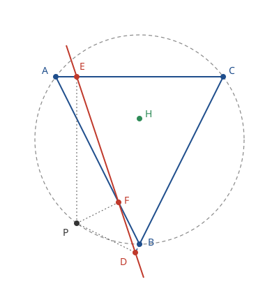

# Simson 직선

# 개요

**Simson 직선(Simson line)** 은 삼각형의 외접원 위의 점에서 세 변에 수선을 내렸을 때, 세 수선의 발이 놓이는 직선이다. 삼각형 바깥이나 안의 점 하나에서 세 변(또는 연장선)에 수선을 내리면 발 세 개가 보통 삼각형을 이루고, 그 삼각형이 언제 한 직선으로 납작해지는지를 묻는다. 답은 점이 외접원 위에 있을 때이고, 이것은 원에 내접하는 각이 같다는 사실로 증명된다.

# 직관

원점을 중심으로 하는 반지름 $5$ 의 원 위에 $A=(-4,3)$, $B=(0,-5)$, $C=(4,3)$ 을 둔다. 같은 원 위의 점 $P=(-3,-4)$ 에서 세 변의 직선에 수선을 내린다.

- $CA$ 는 직선 $y=3$ 이므로 수선의 발은 $E=(-3,3)$ 이다.
- $AB$ 는 $A+t(1,-2)$ 꼴이고, $(P-A)\cdot(1,-2)=15$ 를 $\vert(1,-2)\vert^2=5$ 로 나눈 $t=3$ 에서 발 $F=(-1,-3)$ 이 나온다.
- $BC$ 는 $B+t(1,2)$ 꼴이고, $(P-B)\cdot(1,2)=-1$ 에서 $t=-1/5$ 이므로 발은 $D=(-1/5,-27/5)$ 다. $t\lt 0$ 이라 $D$ 는 $B$ 바깥의 연장선 위에 있다.

$E$ 에서 $F$ 로 가는 벡터는 $(2,-6)$, $E$ 에서 $D$ 로 가는 벡터는 $(14/5,-42/5)$ 이고, 둘 다 기울기가 $-3$ 이다. 세 발은 직선 $y=-3x-6$ 위에 있다.

그림의 빨간 직선이 세 발 $D$, $E$, $F$ 를 지난다. 수심은 $H=A+B+C=(0,1)$ 이고, 선분 $PH$ 의 중점 $(-3/2,-3/2)$ 도 이 직선 위에 있다.

# 정의

## 수선의 발 삼각형

삼각형 $ABC$ 와 점 $P$ 가 있다. $P$ 에서 직선 $BC$, $CA$, $AB$ 에 내린 수선의 발을 $D$, $E$, $F$ 라 하고, 삼각형 $DEF$ 를 $P$ 의 **수선의 발 삼각형(pedal triangle)** 이라 한다. 직관 절의 $P$ 에서는 $D$, $E$, $F$ 가 한 직선 위에 있어 수선의 발 삼각형의 넓이가 $0$ 이다.

## Simson 직선

$P$ 가 삼각형 $ABC$ 의 외접원 위에 있을 때 $D$, $E$, $F$ 를 지나는 직선을 $P$ 의 Simson 직선이라 한다. 직관 절의 Simson 직선은 $y=-3x-6$ 이다. $P$ 가 꼭짓점이면 두 발이 그 꼭짓점과 같아지고, Simson 직선은 그 꼭짓점에서 마주 보는 변에 내린 수선이다.

# 성질

## Simson–Wallace 정리

$D$, $E$, $F$ 가 한 직선 위에 있는 것은 $P$ 가 외접원 위에 있는 것과 동치다. 이것이 **Simson–Wallace 정리(Simson–Wallace theorem)** 다.

증명의 요지. 직선 사이의 각을 $\pi$ 를 법으로 하는 유향각 $\angle(\ell,m)$ 으로 잰다. $\angle PEC$ 와 $\angle PDC$ 가 직각이므로 $P,D,C,E$ 는 $PC$ 를 지름으로 하는 원 위에 있고, 같은 이유로 $P,A,F,E$ 는 $PA$ 를 지름으로 하는 원 위에 있다. 원주각이 같다는 사실로 다음이 나온다.

$$
\angle(ED,EP)=\angle(CB,CP),\qquad\angle(EF,EP)=\angle(AB,AP)
$$

$D,E,F$ 가 한 직선 위에 있는 것은 두 왼쪽 각이 같은 것이고, 이는 두 오른쪽 각이 같은 것, 곧 $A,B,C,P$ 가 한 원 위에 있는 것과 동치다.

## 수선의 발 삼각형의 넓이

외접원의 중심을 $O$, 반지름을 $R$ 이라 하면 다음이 성립한다.

$$
\mathrm{Area}(DEF)=\frac{\vert R^2-OP^2\vert}{4R^2}\thinspace\mathrm{Area}(ABC)
$$

$OP=R$ 일 때만 넓이가 $0$ 이므로 Simson–Wallace 정리가 다시 나온다. $P=O$ 이면 세 발이 변의 중점이고 넓이는 $\mathrm{Area}(ABC)/4$ 다.

## 수심과의 관계

$P$ 의 Simson 직선은 선분 $PH$ 의 중점을 지난다. 이 중점은 [Euler 직선](euler-line.md) 문서의 구점원 위에 있다. 직관 절에서 $PH$ 의 중점 $(-3/2,-3/2)$ 이 $y=-3x-6$ 위에 있고, 구점원의 중심 $N=H/2=(0,1/2)$ 에서 거리가 $5/2=R/2$ 다.

외접원의 지름의 양 끝 $P$, $P'$ 의 Simson 직선은 서로 수직이고, 구점원 위에서 만난다.

## Steiner 삼각곡선

$P$ 가 외접원을 한 바퀴 돌면 Simson 직선은 방향이 반 바퀴 돌고, 그 직선들의 포락선은 세 첨점을 가진 곡선이다. 이 곡선을 Steiner 삼각곡선(Steiner deltoid)이라 하고, 중심이 구점원의 중심이며 구점원에 세 점에서 접한다.

# 활용

- 공선 판정. 원 위의 네 점에 대한 문제에서 세 점이 한 직선 위에 있음을 보일 때, 그 세 점을 어느 삼각형의 수선의 발로 보고 Simson–Wallace 정리를 쓴다.
- [Ptolemy 부등식](ptolemy-inequality.md)의 등호 조건. 네 점이 한 원 위에 있을 때 Ptolemy 등식이 성립한다는 것은, 수선의 발 $D$, $E$, $F$ 사이의 거리를 변의 길이로 적고 $DE+EF=DF$ 를 쓰면 나온다.
- 곡선의 포락선. Steiner 삼각곡선은 내사이클로이드의 한 예이고, 삼각형의 외접원에서 이 곡선을 만드는 것이 Simson 직선족이다.

# 연관 문서

## 선수지식

- [Euler 직선](euler-line.md)

## 더 알아보기

아직 연결한 문서가 없다.

#algebra #linear_algebra #combinatorics
