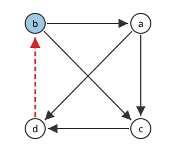

# Slater 집합

# 개요

**Slater 집합(Slater set)** 은 후보를 둘씩 다수결에 붙인 결과와 가장 적게 어긋나는 한 줄 순위들을 모두 구하고, 그 순위들의 맨 앞 후보를 모은 집합이다. 네 후보의 대결 결과가 순환을 이루면 어떤 순위를 내놓아도 결과와 어긋나는 쌍이 생긴다. Slater 집합은 어긋나는 쌍의 수를 가장 작게 하는 순위를 골라, 그 순위가 맨 앞에 두는 후보를 뽑는다.

# 직관

[토너먼트 해](tournament-solutions.md) 문서의 네 후보 $a,b,c,d$ 는 $b\to a$, $a\to c$, $c\to d$, $d\to b$, $a\to d$, $b\to c$ 의 결과를 냈다. 화살표는 이긴 후보에서 진 후보로 간다.

순위 $b,a,c,d$ 는 앞 후보가 뒤 후보를 이긴 쌍이 여섯 쌍 가운데 다섯이다. 어긋나는 쌍은 그림의 붉은 점선 $d\to b$ 하나뿐이다.

어긋나는 쌍이 없는 순위는 없다. $b\to a\to d\to b$ 가 순환이라 셋 가운데 누구를 앞에 두어도 순환의 한 화살표는 뒤로 간다. 그래서 어긋나는 쌍은 적어도 하나다.

어긋나는 쌍이 하나인 순위는 $b,a,c,d$ 뿐이다. 순환은 $b\to a\to d\to b$, $b\to c\to d\to b$, $b\to a\to c\to d\to b$ 셋이고 세 순환에 모두 들어 있는 화살표는 $d\to b$ 하나다. 이 화살표만 거꾸로 두면 남은 결과가 $b,a,c,d$ 의 순서로 맞는다. 맨 앞 후보 $b$ 하나가 Slater 집합이다.

# 정의

## Slater 순서

후보의 집합 $V$ 위의 [토너먼트](tournaments.md) $T$ 와 $V$ 의 순서 $v\_1,\dots,v\_n$ 에 대해, $i\lt j$ 이면서 $v\_j\to v\_i$ 인 쌍을 순서에 **어긋나는 쌍(backward pair)** 이라 한다. 어긋나는 쌍의 수가 가장 작은 순서를 **Slater 순서(Slater order)** 라 한다. 직관 절의 토너먼트에서 Slater 순서는 $b,a,c,d$ 하나이고 어긋나는 쌍은 $1$ 개다.

Slater 순서는 [Seymour 두 번째 이웃 추측](seymour-second-neighborhood-conjecture.md) 문서의 중앙 순서(median order)와 같다. 앞으로 가는 화살표가 가장 많은 것과 어긋나는 쌍이 가장 적은 것이 같은 조건이다.

## Slater 집합

Slater 순서들의 맨 앞 정점을 모은 집합 $\mathrm{SL}(T)$ 를 Slater 집합이라 하고, 그 원소를 **Slater 승자(Slater winner)** 라 한다. 직관 절에서 $\mathrm{SL}(T)=\lbrace b\rbrace$ 다.

나머지 모든 정점을 이긴 정점 $x$ 가 있으면, 어느 순서에서든 $x$ 를 맨 앞으로 옮기면 어긋나는 쌍이 줄어들거나 그대로이고 $x$ 가 맨 앞에 없던 순서에서는 하나 이상 준다. 그래서 $\mathrm{SL}(T)=\lbrace x\rbrace$ 이고, Slater 집합은 토너먼트 해다.

# 성질

## 구간 성질

Slater 순서 $v\_1,\dots,v\_n$ 에서 $i\lt j$ 이면 $v\_i$ 는 $v\_{i+1},\dots,v\_j$ 의 절반 이상을 이기고, $v\_j$ 는 $v\_i,\dots,v\_{j-1}$ 의 절반 이상에게 진다.

증명의 요지. $v\_i$ 를 $v\_j$ 바로 뒤로 옮기면 $v\_i$ 와 $v\_{i+1},\dots,v\_j$ 사이의 쌍만 앞뒤가 바뀐다. $v\_i$ 가 그 가운데 절반보다 적게 이기면 어긋나는 쌍이 줄어 Slater 순서라는 데 어긋난다. $v\_j$ 를 $v\_i$ 바로 앞으로 옮겨도 같다.

$j=i+1$ 로 두면 $v\_i\to v\_{i+1}$ 이므로 Slater 순서는 유향 Hamilton 경로다.

## 덮이지 않은 집합과의 포함

토너먼트 해 문서의 덮이지 않은 집합 $\mathrm{UC}(T)$ 에 대해 다음이 성립한다.

$$
\mathrm{SL}(T)\subseteq\mathrm{UC}(T)
$$

증명의 요지. Slater 순서의 맨 앞 $x=v\_1$ 을 $y=v\_j$ 가 덮는다고 하자. 구간 성질로 $y$ 는 $v\_1,\dots,v\_{j-1}$ 가운데 $(j-1)/2$ 개 이상에게 지므로, 이 $j-1$ 개 가운데 $y$ 가 이기는 것은 $(j-1)/2$ 개 이하다. 한편 $x$ 는 $v\_2,\dots,v\_j$ 의 절반 이상을 이기고 $y$ 에게 지므로 $v\_2,\dots,v\_{j-1}$ 가운데 $(j-1)/2$ 개 이상을 이긴다. $y$ 가 $x$ 를 덮으므로 $y$ 는 그 정점들과 $x$ 를 모두 이겨 $(j-1)/2+1$ 개 이상을 이기고, 모순이다.

직관 절에서 $\mathrm{SL}(T)=\lbrace b\rbrace$ 는 덮이지 않은 집합 $\lbrace a,b,d\rbrace$ 안에 있고, Copeland 집합 $\lbrace a,b\rbrace$ 안에도 있다.

## 계산의 어려움

Slater 순서를 구하는 것은 어긋나는 쌍을 거꾸로 돌려 순환을 모두 없애는 가장 작은 화살표 집합, 곧 토너먼트의 최소 되먹임 호 집합(minimum feedback arc set)을 구하는 것과 같다. N. Alon 과 P. Charbit, S. Thomassé, A. Yeo 가 각각 이 문제가 NP(nondeterministic polynomial time) 어려움을 증명했다[^1][^2]. C. Kenyon-Mathieu 와 W. Schudy 는 어긋나는 쌍의 수를 $(1+\varepsilon)$ 배 안으로 맞추는 다항 시간 근사 도식(polynomial-time approximation scheme, PTAS)을 주었다[^3].

# 활용

- 쌍 비교의 일관성. P. Slater 는 쌍 비교 실험에서 응답이 한 줄 순서와 몇 쌍이나 어긋나는지를 이 수로 재었다[^4].
- 선거 규칙. 두 후보씩의 다수결 결과만으로 당선자를 고르는 규칙이고, 덮이지 않은 집합 안에서 당선자를 고르므로 전략적 의제 설정으로 당선될 수 있는 후보 밖으로 나가지 않는다.
- 순위 집계. [Kemeny 순위](kemeny-ranking.md)는 쌍마다 다수결의 표 차이를 무게로 두고, 순서에 어긋나는 쌍의 무게 합을 최소화하는 순서와 같다. 무게를 모두 $1$ 로 두면 Slater 순서다.
- 스포츠 순위. 리그의 경기 결과에서 결과와 가장 적게 어긋나는 순위를 만든다.

[^1]: N. Alon, "Ranking tournaments", *SIAM Journal on Discrete Mathematics* 20 (2006), 137–142.
[^2]: P. Charbit, S. Thomassé, A. Yeo, "The minimum feedback arc set problem is NP-hard for tournaments", *Combinatorics, Probability and Computing* 16 (2007), 1–4.
[^3]: C. Kenyon-Mathieu, W. Schudy, "How to rank with few errors", *Proceedings of the 39th ACM Symposium on Theory of Computing* (2007), 95–103.
[^4]: P. Slater, "Inconsistencies in a schedule of paired comparisons", *Biometrika* 48 (1961), 303–312.

# 연관 문서

## 선수지식

- [토너먼트 해](tournament-solutions.md)

## 더 알아보기

아직 연결한 문서가 없다.

#graph_theory #order_theory #combinatorics #complexity
