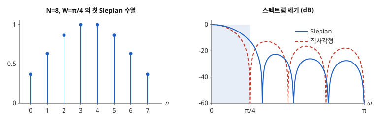

# Slepian 수열

# 개요

**Slepian 수열(Slepian sequences)** 은 길이가 정해진 수열 가운데 스펙트럼의 세기가 주어진 주파수 범위 안에 가장 많이 모이는 수열이다. 계수 3 개짜리 [창함수](window-functions.md)를 고르면서, 주파수 $\lvert\omega\rvert\le\pi/2$ 바깥으로 새는 세기의 비율을 가장 작게 하고 싶다. 직사각형 창 $(1,1,1)$ 은 7.6% 가 새고, $(1/\sqrt2,1,1/\sqrt2)$ 는 5.0% 가 새며 이보다 적게 할 수 없다. 이 수열은 대칭행렬 하나의 가장 큰 [고윳값](eigenvalues.md)에 속하는 고유벡터로 구한다.

# 직관

수열 $w=(w_0,w_1,w_2)$ 의 스펙트럼 $\hat w(\omega)=\sum_tw_te^{-i\omega t}$ 의 세기 $\lvert\hat w(\omega)\rvert^2$ 를 $\lbrack -\pi,\pi\rbrack$ 전체에서 평균하면 $w_0^2+w_1^2+w_2^2$ 이다. 같은 평균을 $\lbrack -\pi/2,\pi/2\rbrack$ 에서만 더하면

$$
\frac1{2\pi}\int_{-\pi/2}^{\pi/2}\lvert\hat w(\omega)\rvert^2d\omega=\sum_{m,n}w_mw_n\thinspace\frac1{2\pi}\int_{-\pi/2}^{\pi/2}e^{i\omega(m-n)}d\omega
$$

이다. 적분은 $m=n$ 이면 $\frac12$, $\lvert m-n\rvert=1$ 이면 $\frac1\pi$, $\lvert m-n\rvert=2$ 이면 $0$ 이다. 그래서 범위 안에 모이는 비율은

$$
\frac{w^{\mathsf T}Kw}{w^{\mathsf T}w},\qquad K=\begin{pmatrix}1/2&1/\pi&0\cr 1/\pi&1/2&1/\pi\cr 0&1/\pi&1/2\end{pmatrix}
$$

이다. 직사각형 창 $w=(1,1,1)$ 을 넣으면 $(\frac32+\frac4\pi)/3\approx 0.924$ 다.

이 비율은 $K$ 의 [Rayleigh 몫](rayleigh-quotient.md)이므로 가장 큰 값은 $K$ 의 가장 큰 고윳값이고, 그 고유벡터에서 얻는다. $K$ 의 고윳값은 $\frac12+\frac{\sqrt2}\pi$, $\frac12$, $\frac12-\frac{\sqrt2}\pi$ 이고, 가장 큰 $\frac12+\frac{\sqrt2}\pi\approx 0.950$ 의 고유벡터가 $(1/\sqrt2,1,1/\sqrt2)$ 다. $K(1/\sqrt2,1,1/\sqrt2)^{\mathsf T}$ 를 직접 곱하면 각 성분이 $\frac12+\frac{\sqrt2}\pi$ 배가 된다.

길이를 $8$ 로, 범위를 $\lvert\omega\rvert\le\pi/4$ 로 바꾸어도 같은 방법이 통한다. 아래 그림의 왼쪽이 그 경우의 가장 큰 고유벡터이고, 오른쪽은 그 스펙트럼 세기와 직사각형 창의 스펙트럼 세기다. 옅은 띠가 범위 $\lbrack 0,\pi/4\rbrack$ 이고, 띠 안에 모이는 비율은 직사각형 창이 $0.908$, 왼쪽 수열이 $0.983$ 이다. 띠 밖에서 푸른 실선이 붉은 점선보다 빨리 내려간다.

# 정의

## 집중 행렬

길이 $N$ 과 범위의 반폭 $0\lt W\lt\pi$ 를 정한다. 성분이

$$
K_{mn}=\frac{\sin\bigl(W(m-n)\bigr)}{\pi(m-n)}\quad(m\ne n),\qquad K_{nn}=\frac W\pi,\qquad 0\le m,n\le N-1
$$

인 $N\times N$ 실대칭 [Toeplitz 행렬](toeplitz-matrices.md)(Toeplitz matrix)을 집중 행렬(concentration matrix)이라 한다. 직관 절의 $K$ 는 $N=3$, $W=\pi/2$ 인 집중 행렬이다. 실수열 $w$ 의

$$
\lambda(w)=\frac{w^{\mathsf T}Kw}{w^{\mathsf T}w}=\frac{\int_{-W}^{W}\lvert\hat w(\omega)\rvert^2d\omega}{\int_{-\pi}^{\pi}\lvert\hat w(\omega)\rvert^2d\omega}
$$

를 $w$ 의 집중도(concentration)라 한다.

## Slepian 수열

$K$ 의 고윳값을 $\lambda_0\gt\lambda_1\gt\dots\gt\lambda_{N-1}$ 로 적고, $\lambda_k$ 에 속하는 노름 $1$ 의 고유벡터를 $v^{(k)}$ 라 한다. $v^{(0)},\dots,v^{(N-1)}$ 을 길이 $N$, 반폭 $W$ 의 **Slepian 수열** 또는 이산 장구 회전타원체 수열(discrete prolate spheroidal sequences, DPSS)이라 한다[^1]. 부호는 $\sum_tv^{(k)}\_t$ 나 첫 기울기가 양수가 되게 정한다. 직관 절에서 $v^{(0)}=(1/2,1/\sqrt2,1/2)$ 이고 $\lambda_0=\frac12+\frac{\sqrt2}\pi$ 다.

# 성질

## 집중도의 최대

모든 실수열 $w\ne 0$ 에 대해 $\lambda(w)\le\lambda_0$ 이고, 등호는 $w$ 가 $v^{(0)}$ 의 상수배일 때뿐이다. Rayleigh 몫의 최댓값이 가장 큰 고윳값이라는 사실에서 나온다. 더 나아가 $v^{(0)},\dots,v^{(k-1)}$ 에 직교하는 수열 가운데 집중도가 가장 큰 것이 $v^{(k)}$ 이고 그 집중도는 $\lambda_k$ 다.

## 고윳값의 합과 개수

고윳값은 모두 $0$ 과 $1$ 사이에 있다. 집중도가 비율이기 때문이다. 대각합에서

$$
\sum_{k=0}^{N-1}\lambda_k=\frac{NW}{\pi}
$$

이다. 직관 절에서 세 고윳값의 합은 $\frac32$ 다. $N$ 이 크면 고윳값은 처음 약 $NW/\pi$ 개가 $1$ 가까이, 나머지가 $0$ 가까이 몰리고, 그 사이에 걸친 고윳값은 $\log N$ 에 비례하는 개수뿐이다[^1]. 길이 $N$ 의 수열로 범위 $\lbrack -W,W\rbrack$ 에 거의 다 모이는 서로 직교하는 수열은 약 $NW/\pi$ 개다.

## 고윳값의 단순성과 대칭

$K$ 의 고윳값은 서로 다르고, $v^{(k)}$ 는 $k$ 가 짝수이면 좌우 대칭, 홀수이면 반대칭이다. $K$ 는 삼중대각행렬과 교환하고 그 삼중대각행렬의 고윳값이 서로 달라서다[^1]. 직관 절에서 $v^{(0)}$ 은 대칭, 고윳값 $\frac12$ 의 고유벡터 $(1,0,-1)/\sqrt2$ 는 반대칭이다.

## 이중 직교성

$v^{(j)}$ 와 $v^{(k)}$ 는 $\mathbb R^N$ 에서 직교하고, 스펙트럼도 범위 $\lbrack -W,W\rbrack$ 위에서 직교한다.

$$
\frac1{2\pi}\int_{-W}^{W}\hat v^{(j)}(\omega)\thinspace\overline{\hat v^{(k)}(\omega)}\thinspace d\omega=v^{(j)\mathsf T}Kv^{(k)}=\lambda_k\thinspace\delta_{jk}
$$

$K$ 가 대칭이고 $v^{(k)}$ 가 고유벡터이므로 가운데 등식에서 바로 나온다.

# 활용

- [스펙트럼 추정](spectral-estimation.md)의 다중 테이퍼 방법(multitaper method). 측정값에 $v^{(0)},\dots,v^{(J-1)}$, $J\approx NW/\pi$ 를 각각 곱해 주기도 $J$ 개를 만들고 평균한다. 이중 직교성 때문에 무상관 잡음에서 이 주기도들이 서로 거의 무상관이라 분산이 약 $1/J$ 배로 준다[^2].
- [창함수](window-functions.md)의 설계. Kaiser 창(Kaiser window)은 $v^{(0)}$ 을 0 차 변형 [Bessel 함수](bessel-functions.md) $I_0$ 로 근사한 닫힌 꼴이다.
- [표본화 정리](sampling-theorem.md)의 유한 길이 판본. 주파수가 $W$ 이하인 신호를 길이 $N$ 의 구간에서 볼 때, 그 구간 안에서 거의 다 보이는 독립 성분의 수가 약 $NW/\pi$ 개다.

[^1]: D. Slepian, "Prolate spheroidal wave functions, Fourier analysis, and uncertainty — V: The discrete case", *Bell System Technical Journal* 57 (1978), 1371–1430.
[^2]: D. J. Thomson, "Spectrum estimation and harmonic analysis", *Proceedings of the IEEE* 70 (1982), 1055–1096.

# 연관 문서

## 선수지식

- [창함수](window-functions.md)
- [Rayleigh 몫](rayleigh-quotient.md)

## 더 알아보기

아직 연결한 문서가 없다.

#signal_processing #linear_algebra #analysis
