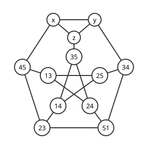

# Snark

# 개요

**snark** 는 정점마다 간선이 셋씩 붙은 그래프 가운데 간선을 세 색으로 칠할 수 없고, 칠할 수 없는 이유가 작은 부분에 모여 있지 않은 그래프다. 한 정점에서 만나는 간선끼리 다른 색이 되게 칠한다. [Petersen 그래프](petersen-graph.md)의 정점 하나를 삼각형으로 바꾼 그래프는 이렇게 칠할 수 없지만, 삼각형을 한 점으로 줄이면 Petersen 그래프가 되고 칠할 수 없는 이유는 그 Petersen 그래프에 있다. snark 는 이런 그래프를 조건으로 걸러 내고, 줄일 곳이 없는데도 칠할 수 없는 그래프만 모은다.

# 직관

[4색 정리](four-color-theorem.md)는 Tait 의 동치로 "다리가 없고 정점마다 간선이 셋씩 붙은 평면 그래프는 간선을 세 색으로 칠할 수 있다" 와 같은 진술이 된다. 평면이라는 조건을 빼면 이 진술은 거짓이고, Petersen 그래프가 첫 반례다. 반례가 Petersen 그래프 말고 더 있는지 찾으려면, 이미 아는 반례를 조금 고친 그래프부터 걸러야 한다.

아래 그림은 Petersen 그래프에서 정점 $12$ 를 지우고, 그 자리에 정점 $x,y,z$ 로 된 삼각형을 넣은 그래프다. $x$ 는 $45$ 에, $y$ 는 $34$ 에, $z$ 는 $35$ 에 이어져 있다. 그림에서 삼각형과 바깥을 잇는 간선 세 개를 보면 된다.

이 그래프를 세 색으로 칠했다고 하자. 삼각형의 세 간선은 둘씩 끝점을 공유하므로 세 색을 하나씩 받는다. 그러면 $x$ 에서 바깥으로 나가는 간선은 $x$ 에 닿은 두 삼각형 간선의 색이 아닌 색, 곧 맞은편 간선 $yz$ 의 색을 받는다. $y$, $z$ 에서 나가는 간선도 같아서, 나가는 세 간선은 서로 다른 색이다.

이제 삼각형을 한 점으로 줄여 정점 $12$ 를 되살리면, $12$ 에 붙은 세 간선이 서로 다른 색이어서 Petersen 그래프의 간선 3 색칠이 나온다. Petersen 그래프에는 간선 3 색칠이 없으므로 이 그래프에도 없다. 이 그래프가 칠해지지 않는 이유는 삼각형 바깥의 Petersen 그래프에 있다. 같은 방법으로 아무 반례의 정점을 삼각형으로 바꾸면 반례가 얼마든지 나오므로, 짧은 순환과 간선 몇 개로 끊기는 자리가 없는 반례만 snark 라 부른다.

# 정의

## 간선 3 색칠

정점마다 간선이 셋씩 붙은 그래프를 **3 정칙 그래프(cubic graph)** 라 한다. 3 정칙 그래프의 간선에 색 $1,2,3$ 을 주어 한 정점에서 만나는 세 간선이 서로 다른 색을 받게 한 것을 **간선 3 색칠(3-edge-coloring, Tait coloring)** 이라 한다. [Vizing 정리](vizing-theorem.md)의 말로는 간선 채색수 $\chi'(G)$ 가 $3$ 인 1 종 그래프다. 직관 절의 열두 정점 그래프는 $\chi'=4$ 인 2 종 그래프다.

간선 3 색칠에서 한 색의 간선들은 모든 정점을 한 번씩 짝짓는 완전 매칭이다. 나머지 두 색의 간선은 정점마다 둘씩 붙어 순환들로 나뉘고, 두 색이 번갈아 나오므로 순환의 길이가 모두 짝수다.

## 절단과 둘레

정점 집합 $S$ 의 한쪽 끝만 $S$ 에 있는 간선 전체를 $\delta(S)$ 라 한다. 간선 하나만 지워도 그래프가 둘로 갈라지면 그 간선을 **다리(bridge)** 라 한다. 지웠을 때 두 조각이 모두 순환을 가지는 간선 집합을 **순환 절단(cyclic edge cut)** 이라 하고, 순환 절단의 크기가 모두 $k$ 이상이면 **순환 $k$ 간선 연결(cyclically k-edge-connected)** 이라 한다. 가장 짧은 순환의 길이를 **둘레(girth)** 라 한다.

직관 절의 그래프에서 삼각형 $x,y,z$ 를 $S$ 로 두면 $\delta(S)$ 는 나가는 간선 세 개이고, 양쪽에 순환이 있으므로 크기 $3$ 인 순환 절단이다. 둘레는 $3$ 이다.

## snark

**snark** 는 연결된 3 정칙 그래프 가운데 다리가 없고 간선 3 색칠이 없으며, 둘레가 $5$ 이상이고 순환 4 간선 연결인 그래프다[^1]. 마지막 두 조건을 빼고 앞의 조건만 만족하는 그래프를 넓은 뜻의 snark 라 부르기도 한다.

직관 절의 열두 정점 그래프는 둘레가 $3$ 이라 snark 가 아니다. Petersen 그래프는 둘레가 $5$ 이고 순환 절단의 크기가 모두 $5$ 이상이므로 snark 다.

# 성질

## 홀짝 보조정리

3 정칙 그래프의 간선 3 색칠과 정점 집합 $S$ 에 대해, $\delta(S)$ 안의 색 $i$ 간선 수를 $c_i$ 라 하면

$$
c_1\equiv c_2\equiv c_3\equiv\vert\delta(S)\vert\pmod 2
$$

이다. 이것을 홀짝 보조정리(parity lemma)라 한다.

증명. 색 $i$ 의 간선은 완전 매칭이므로 $S$ 의 정점은 $S$ 안에서 둘씩 짝지어지거나 $\delta(S)$ 의 색 $i$ 간선으로 밖과 짝지어진다. 그래서 $c_i\equiv\vert S\vert$ 이고, $\vert\delta(S)\vert=c_1+c_2+c_3\equiv 3\vert S\vert\equiv\vert S\vert$ 이다.

## 작은 절단의 환원

홀짝 보조정리에서 다음이 나온다.

- 다리가 있는 3 정칙 그래프에는 간선 3 색칠이 없다. $\vert\delta(S)\vert=1$ 이면 $c_1,c_2,c_3$ 이 모두 홀수여야 하는데 합이 $1$ 이기 때문이다.
- 크기 $2$ 인 절단의 두 간선은 같은 색이다. $c_i$ 가 모두 짝수이고 합이 $2$ 이다.
- 크기 $3$ 인 절단의 세 간선은 서로 다른 색이다. $c_i$ 가 모두 홀수이고 합이 $3$ 이다.

크기 $3$ 인 순환 절단 $\delta(S)$ 가 있으면, $S$ 를 한 정점으로 줄인 그래프와 $S$ 의 바깥을 한 정점으로 줄인 그래프는 둘 다 더 작은 3 정칙 그래프다. 원래 그래프에 간선 3 색칠이 있는 것은 두 그래프에 모두 있는 것과 동치다. 한 방향은 위의 셋째 항목이고, 거꾸로는 두 색칠의 색 이름을 바꿔 절단의 세 간선에서 맞춘 뒤 붙이면 된다. 직관 절의 삼각형이 이 경우다.

크기 $2$ 인 절단과 길이 $4$ 인 순환도 같은 방식으로 더 작은 그래프로 줄어든다[^2]. 그래서 snark 의 정의에서 둘레와 순환 연결도의 조건이 이 환원을 걸러 낸다.

## Hamilton 순환

[Hamilton 순환](hamiltonian-cycles.md)이 있는 3 정칙 그래프에는 간선 3 색칠이 있다. 3 정칙 그래프는 차수의 합 $3\vert V\vert$ 가 짝수이므로 정점 수가 짝수이고, Hamilton 순환의 간선을 번갈아 두 색으로 칠한 뒤 나머지 간선에 셋째 색을 주면 된다. 그래서 snark 에는 Hamilton 순환이 없다.

## 홀수도

3 정칙 그래프의 완전 매칭을 지우고 남는 순환들 가운데 길이가 홀수인 것의 개수의 최솟값을 **홀수도(oddness)** 라 한다. 다리 없는 3 정칙 그래프에는 [Tutte 정리](tutte-theorem.md)의 귀결인 Petersen 정리(Petersen's theorem)로 완전 매칭이 있으므로 홀수도가 정해진다.

정점 수가 짝수이므로 홀수도는 짝수다. 간선 3 색칠이 있는 것은 홀수도가 $0$ 인 것과 동치이므로, 다리 없는 3 정칙 그래프가 snark 이면 홀수도가 $2$ 이상이다. Petersen 그래프는 어느 완전 매칭을 지워도 길이 $5$ 인 순환 둘이 남으므로 홀수도가 $2$ 다.

## 작은 snark

정점이 $10$ 개 미만인 snark 는 없고, Petersen 그래프가 가장 작다[^3]. 정점 $12$, $14$, $16$ 개인 snark 는 없고, 정점 $18$ 개인 snark 는 Blanuša 가 1946 년에 찾은 두 개뿐이다[^1][^4].

## 꽃 snark

홀수 $n\ge 5$ 에 대해 **꽃 snark(flower snark)** $J_n$ 은 다음 그래프다[^5]. 정점 하나에 잎 셋 $a_i,b_i,d_i$ 가 붙은 별을 $n$ 개 둔다. $a_1,\dots,a_n$ 을 차례로 이어 길이 $n$ 인 순환을 만들고, $b_1,\dots,b_n,d_1,\dots,d_n$ 을 차례로 이어 길이 $2n$ 인 순환을 만든다. 정점은 $4n$ 개이고 모두 차수가 $3$ 이다.

Isaacs 는 $J_n$ 이 snark 임을 보여 snark 의 무한한 모임을 구성했다. 같은 논문의 점곱(dot product)은 두 snark 에서 정점과 간선 몇 개를 떼어 내고 생긴 끝을 서로 이어 더 큰 snark 를 만든다.

# 활용

- 4색 정리. Tait 의 동치로 4색 정리는 평면 snark 가 없다는 진술과 같다.
- Tutte 의 간선 색칠 추측(Tutte's edge-colouring conjecture). Tutte 는 Petersen 그래프를 [마이너](graph-minors.md)로 갖지 않는 다리 없는 3 정칙 그래프에는 간선 3 색칠이 있다고 추측했다[^6]. 평면 그래프는 Petersen 그래프를 마이너로 갖지 않으므로 이 추측은 4색 정리를 포함한다. Robertson, Seymour, Thomas 는 이 추측을 apex 그래프와 doublecross 그래프 두 경우로 줄였고[^7], doublecross 경우는 Edwards, Sanders, Seymour, Thomas 가 증명했다[^8].
- [순환 이중 덮개 추측](cycle-double-cover-conjecture.md). 다리 없는 그래프에는 모든 간선을 정확히 두 번씩 덮는 순환들의 모임이 있다는 추측이다. 간선 3 색칠이 있는 3 정칙 그래프에서는 색 둘씩 고른 세 쌍의 간선이 각각 짝수 순환들로 나뉘고, 각 간선은 세 쌍 가운데 정확히 둘에 들어 있다. 그래서 가장 작은 반례는 snark 이다[^9].
- Fulkerson 추측(Fulkerson conjecture). 다리 없는 3 정칙 그래프에는 모든 간선을 정확히 두 번씩 덮는 완전 매칭 여섯 개가 있다는 추측이다. Petersen 그래프의 완전 매칭 여섯 개는 간선 $15$ 개를 정확히 두 번씩 덮는다. 간선 3 색칠이 있으면 세 색의 매칭을 두 번씩 쓰면 되므로, 이 추측도 간선 3 색칠이 없는 그래프에서만 확인하면 된다.

[^1]: J. J. Watkins, R. J. Wilson, "A survey of snarks", in *Graph Theory, Combinatorics, and Applications* Vol. 2, Wiley (1991), 1129–1144.
[^2]: S. Fiorini, R. J. Wilson, *Edge-Colourings of Graphs*, Pitman (1977).
[^3]: D. A. Holton, J. Sheehan, *The Petersen Graph*, Cambridge University Press (1993).
[^4]: D. Blanuša, "Problem četiriju boja", *Glasnik Matematičko-Fizički i Astronomski, Ser. II* 1 (1946), 31–42.
[^5]: R. Isaacs, "Infinite families of nontrivial trivalent graphs which are not Tait colorable", *American Mathematical Monthly* 82 (1975), 221–239.
[^6]: W. T. Tutte, "On the algebraic theory of graph colorings", *Journal of Combinatorial Theory* 1 (1966), 15–50.
[^7]: N. Robertson, P. Seymour, R. Thomas, "Tutte's edge-colouring conjecture", *Journal of Combinatorial Theory, Series B* 70 (1997), 166–183.
[^8]: K. Edwards, D. P. Sanders, P. Seymour, R. Thomas, "Three-edge-colouring doublecross cubic graphs", *Journal of Combinatorial Theory, Series B* 119 (2016), 66–95.
[^9]: F. Jaeger, "A survey of the cycle double cover conjecture", *Annals of Discrete Mathematics* 27 (1985), 1–12.

# 연관 문서

## 선수지식

- [Vizing 정리](vizing-theorem.md)
- [4색 정리](four-color-theorem.md)

## 더 알아보기

- [순환 이중 덮개 추측](cycle-double-cover-conjecture.md)

#graph_theory #combinatorics
