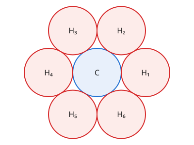

# Soddy 육구

# 개요

**Soddy 육구(Soddy's hexlet)** 는 서로 접하는 공 세 개에 모두 접하는 공을 앞의 공에 닿게 하나씩 이어 넣은 사슬이고, 이 사슬은 언제나 여섯 번째 공에서 처음 공과 닿아 닫힌다. 큰 공 안에 서로 닿는 작은 공 두 개를 넣고, 남은 틈에 세 공 모두에 닿는 구슬을 둘레를 따라 줄지어 넣는 상황이 이 꼴이다. 구슬의 크기가 저마다 달라도 일곱 번째 구슬은 들어갈 자리가 없다. 두 공의 접점을 중심으로 반전하면 두 공이 평행한 두 평면이 되고, 구슬은 같은 크기의 공이 되어 가운데 공 둘레에 여섯 개가 놓인다.

# 직관

공 $A$ 는 중심 $(1,0,1)$, 반지름 $2$ 이고, 그 안에 중심 $(1,0,-1/3)$, 반지름 $2/3$ 인 공 $B$ 와 중심 $(0,0,1)$, 반지름 $1$ 인 공 $C$ 가 있다. $A$ 와 $B$ 는 중심 사이 거리가 $4/3=2-2/3$ 이고, $A$ 와 $C$ 는 $1=2-1$ 이고, $B$ 와 $C$ 는 $5/3=2/3+1$ 이다. 그래서 세 공은 서로 접한다.

$A$ 안에 있으면서 $A$ 에 안쪽으로 접하고 $B$ 와 $C$ 에 바깥쪽으로 접하는 공을 찾는다. 중심 $(2,0,1)$, 반지름 $1$ 인 공 $H_1$ 은 $A$ 의 중심까지 $1=2-1$, $C$ 의 중심까지 $2=1+1$, $B$ 의 중심까지 $5/3=2/3+1$ 이므로 세 공에 모두 접한다. $H_1$ 에 닿는 다음 공을 세 접선 조건과 함께 구하려면 연립 이차방정식을 풀어야 하고, 이것을 되풀이해서 사슬이 닫히는지 보기는 어렵다.

$A$ 와 $B$ 의 접점 $P=(1,0,-1)$ 을 중심으로, 반지름의 제곱이 $4$ 인 구에 대한 반전을 한다. $A$ 와 $B$ 는 $P$ 를 지나므로 $P$ 를 지나지 않는 두 평면 $z=0$ 과 $z=2$ 로 옮겨지고, $C$ 는 반전구와 직교해 자기 자신으로 옮겨진다. 옮긴 그림에서 세 공에 모두 접하는 공은 두 평면 사이의 반지름 $1$ 인 공이고, 그 중심은 $C$ 의 중심 $(0,0,1)$ 에서 거리 $2$ 인 평면 $z=1$ 위의 원 위에 있다.

그림은 옮긴 그림을 평면 $z=1$ 로 자른 단면이다. 가운데 원 $C$ 에 닿는 같은 크기의 원 $H_1,\dots,H_6$ 은 중심이 $60^\circ$ 씩 떨어지고, 여섯째 원이 첫째 원에 닿아 사슬이 닫힌다.

옮긴 공 $H_k$ 의 중심은 $(2\cos\theta,2\sin\theta,1)$ 이고 $\theta=(k-1)\pi/3$ 이다. 이 공을 다시 반전하면 반지름이 $1/(2-\cos\theta)$ 인 공이 나온다. 여섯 공의 반지름은 차례로 다음과 같다.

$$
1,\quad \tfrac23,\quad \tfrac25,\quad \tfrac13,\quad \tfrac25,\quad \tfrac23
$$

$H_4$ 는 중심 $(0,0,-1/3)$, 반지름 $1/3$ 이고, $C$ 의 중심까지 $4/3=1+1/3$, $B$ 의 중심까지 $1=2/3+1/3$ 이다.

# 정의

## 구 반전

중심이 $P$ 이고 반지름이 $R$ 인 구 $\Sigma$ 가 있다. 공간의 점 $X\ne P$ 를 반직선 $PX$ 위에서 $PX\cdot PX'=R^2$ 을 만족하는 점 $X'$ 으로 보내는 사상을 $\Sigma$ 에 대한 **구 반전(sphere inversion)** 이라 한다. [원 반전](circle-inversion.md)을 공간으로 옮긴 것이고, 원 반전과 같은 계산으로 구와 평면을 구와 평면으로 보내며 접하는 두 도형을 접하는 두 도형으로 보낸다. $P$ 를 지나는 구는 $P$ 를 지나지 않는 평면으로 옮겨진다.

중심이 $c$, 반지름이 $r$ 인 구가 $P$ 를 지나지 않으면, 반전한 구의 중심과 반지름은 다음과 같다.

$$
P+\frac{R^2(c-P)}{\vert c-P\vert^2-r^2},\qquad \frac{R^2 r}{\bigl\vert\thinspace\vert c-P\vert^2-r^2\bigr\vert}
$$

직관 절에서 $R^2=4$ 이고, $C$ 는 $\vert c-P\vert^2-r^2=5-1=4$ 이므로 그대로 있다. $H_k$ 는 $\vert c-P\vert^2-r^2=8-4\cos\theta$ 이므로 반지름이 $4/(8-4\cos\theta)$ 다.

## 육구

서로 접하는 공 세 개 $A$, $B$, $C$ 가 있다. 세 공에 모두 접하는 공 $H_1,H_2,\dots$ 를 $H_k$ 가 $H_{k-1}$ 에 접하도록 차례로 놓은 것이 Soddy 육구다. 직관 절의 여섯 공 $H_1,\dots,H_6$ 이 육구다.

곡률은 반지름의 역수이고, 다른 공들이 안쪽으로 접하는 바깥 공은 곡률에 음의 부호를 붙인다. 직관 절에서 $A$, $B$, $C$ 의 곡률은 $-1/2$, $3/2$, $1$ 이다.

# 성질

## 여섯 공에서 닫힘

서로 접하는 공 세 개에 모두 접하는 공의 사슬은 어느 공에서 시작해도 여섯째 공이 첫째 공에 접해 닫힌다.

증명의 요지. $A$ 와 $B$ 의 접점을 중심으로 구 반전을 하면 $A$ 와 $B$ 는 평행한 두 평면이 된다. 두 평면 사이의 거리를 $2$ 로 맞추면 두 평면에 접하는 공은 모두 반지름 $1$ 이고 중심이 가운데 평면 위에 있다. 그 가운데 $C$ 에도 접하는 공의 중심은 $C$ 의 중심에서 거리 $2$ 인 원 위에 있고, 이웃한 두 공이 접하려면 중심이 $60^\circ$ 떨어져야 한다. 그래서 사슬은 여섯 공에서 닫히고, 반전이 접함을 지키므로 원래 그림에서도 닫힌다.

[Steiner 폐형 정리](steiner-porism.md)에서 사슬이 닫히는지가 두 원에 달려 있던 것과 달리, 육구는 세 공을 어떻게 잡아도 반전한 그림이 같은 모양이 되므로 언제나 닫힌다.

## 마주 보는 곡률

육구의 곡률을 $k_1,\dots,k_6$ 이라 하고 $A$, $B$, $C$ 의 곡률의 합을 $s$ 라 하면 다음이 성립한다.

$$
k_1+k_4=k_2+k_5=k_3+k_6=2s
$$

직관 절에서 육구의 곡률은 $1$, $3/2$, $5/2$, $3$, $5/2$, $3/2$ 이고, 마주 보는 두 곡률의 합은 모두 $4$ 이고, $s=-1/2+3/2+1=2$ 다.

증명의 요지. 서로 접하는 공 다섯 개의 곡률은 합의 제곱이 제곱의 합의 세 배라는 등식을 만족한다. 이것은 [Descartes 원 정리](descartes-circle-theorem.md)의 3 차원 꼴이다. $A$, $B$, $C$, $H_i$ 에 모두 접하는 공은 $H_{i-1}$ 과 $H_{i+1}$ 이고, 그 곡률은 이 등식을 다섯째 곡률에 대한 이차방정식으로 본 두 근이다. 두 근의 합에서 다음 점화식이 나온다.

$$
k_{i-1}+k_{i+1}=s+k_i
$$

점화식을 세 번 쓰면 $k_{i+3}=2s-k_i$ 이고, 이 식을 두 번 쓰면 $k_{i+6}=k_i$ 다. 사슬이 여섯 공에서 닫힌다는 것과 곡률이 주기 $6$ 으로 되풀이된다는 것이 같은 점화식에서 나온다.

## 접점의 원과 육구의 띠

이웃한 두 공 $H_k$, $H_{k+1}$ 의 접점 여섯 개는 한 원 위에 있다. 반전한 그림에서 이 접점들은 가운데 평면 위에서 $C$ 의 중심까지 거리가 $2\cos(\pi/6)=\sqrt3$ 인 원 위에 있고, 반전이 이 원을 원으로 보낸다.

반전한 그림의 공 $H_k$ 를 원 위에서 연속으로 돌리면 반지름 $1$ 인 공들이 [원환면](torus.md)을 쓸고 지나간다. 원래 그림에서는 이 원환면이 원환면을 구 반전한 곡면인 [Dupin 사이클라이드](dupin-cyclides.md)가 되고, 육구의 공들은 모두 이 곡면에 접한다.

# 활용

- 공 채움의 계산. 서로 닿는 공 세 개 사이에 넣는 공의 크기를 마주 보는 곡률 절의 점화식으로 차례로 구한다. 처음 두 공의 곡률만 알면 나머지 넷의 곡률이 정해진다.
- 원 사슬의 3 차원 판본. Steiner 폐형 정리와 Pappus 사슬(Pappus chain)처럼 접점을 중심으로 반전해 사슬을 평행한 두 평면 사이에 놓는 방법을 공간에서 쓴 예다.

# 연관 문서

## 선수지식

- [Steiner 폐형 정리](steiner-porism.md)
- [Descartes 원 정리](descartes-circle-theorem.md)

## 더 알아보기

- [Dupin 사이클라이드](dupin-cyclides.md)

#complex_analysis #algebra #differential_geometry
