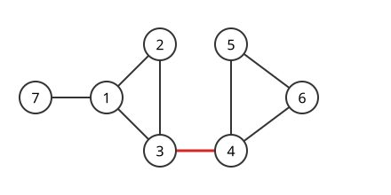

# 가장 희소한 절단

# 개요

**가장 희소한 절단(sparsest cut)** 은 그래프의 정점을 두 무리로 나눌 때, 끊는 간선의 수를 갈라지는 정점 쌍의 수로 나눈 값이 가장 작은 나눔이다. 통신망을 둘로 나누어 각각 따로 관리하려 할 때, 끊는 회선 수만 줄이면 잎처럼 매달린 정점 하나를 떼어 내는 나눔이 뽑혀 망이 거의 나뉘지 않는다. 가장 희소한 절단은 끊는 회선 수를 갈라지는 쌍의 수로 나누어 두 무리가 고르게 큰 나눔을 고르고, 그 값을 [다품종 흐름](multicommodity-flow.md)의 선형계획으로 어림한다.

# 직관

아래 그림의 그래프는 삼각형 $\lbrace 1,2,3\rbrace$ 과 $\lbrace 4,5,6\rbrace$ 이 간선 $3\text{–}4$ 로 이어지고, 정점 $7$ 이 정점 $1$ 에 매달린 그래프다. 붉은 간선이 $3\text{–}4$ 다.

간선을 하나만 끊는 나눔은 둘이다. 간선 $1\text{–}7$ 을 끊으면 $\lbrace 7\rbrace$ 과 나머지 여섯 정점으로 나뉘고, 간선 $3\text{–}4$ 를 끊으면 $\lbrace 1,2,3,7\rbrace$ 과 $\lbrace 4,5,6\rbrace$ 으로 나뉜다. 끊는 간선 수로는 두 나눔을 가를 수 없다.

갈라지는 정점 쌍을 세면 첫 나눔은 $1\cdot 6=6$ 쌍, 둘째 나눔은 $4\cdot 3=12$ 쌍이다. 끊는 간선 수를 쌍의 수로 나누면 $\tfrac16$ 과 $\tfrac1{12}$ 이다. 정점 일곱 개를 둘로 나누면 쌍은 많아야 $12$ 개이고 간선은 적어도 하나 끊어야 하므로, $\tfrac1{12}$ 이 가장 작다. 망을 고르게 나누는 둘째 나눔이 뽑힌다.

# 정의

## 희소도

용량 $c:E\to\mathbb R\_{\ge 0}$ 이 있는 그래프 $G=(V,E)$ 와 정점 쌍마다의 수요 $D(u,v)\ge 0$ 이 주어진다. 공집합도 $V$ 도 아닌 $S\subset V$ 의 **희소도(sparsity)** 는 다음과 같다.

$$
\varphi(S)=\frac{c(\delta(S))}{\sum\_{u\in S,\thinspace v\notin S}D(u,v)}
$$

$\delta(S)$ 는 $S$ 와 그 밖을 잇는 간선의 집합이다. 분모를 $D(S)$ 로 쓴다. $\varphi(S)$ 를 가장 작게 하는 $S$ 를 찾는 문제가 **가장 희소한 절단 문제(sparsest cut problem)** 이고, 최솟값을 $\varphi(G)$ 로 쓴다.

모든 쌍의 수요가 $1$ 이면 **균일(uniform)** 이라 하고, 이때 분모는 $\vert S\vert\vert V\setminus S\vert$ 다. 직관 절은 균일하고 용량이 $1$ 인 경우이고 $\varphi(G)=\tfrac1{12}$ 이다.

## 간선 확장

$h(G)=\min\_{\vert S\vert\le n/2}\vert\delta(S)\vert/\vert S\vert$ 를 **간선 확장(edge expansion)** 이라 한다. $\vert S\vert\le n/2$ 이면 $\tfrac n2\le\vert V\setminus S\vert\le n$ 이므로 균일한 경우 $h(G)/n\le\varphi(G)\le 2h(G)/n$ 이다. 직관 절에서 $h(G)=\tfrac13$ 이고 $S=\lbrace 4,5,6\rbrace$ 에서 나온다.

# 성질

## 계산의 어려움

균일한 경우에도 가장 희소한 절단을 구하는 것은 NP(nondeterministic polynomial time) 어렵다[^1]. 그래서 근사가 문제다.

## 선형계획 완화와 흐름

간선 길이 $\ell\ge 0$ 에 대한 다음 선형계획은 $\varphi(G)$ 의 하한이다.

$$
\lambda^\ast=\min\thinspace\sum\_{e\in E}c\_e\ell\_e\quad\text{subject to}\quad\sum\_{u,v}D(u,v)\thinspace\mathrm{dist}\_\ell(u,v)=1
$$

$\delta(S)$ 의 간선에 길이 $1/D(S)$ 를, 나머지 간선에 $0$ 을 주면 허용해가 되고 목적값이 $\varphi(S)$ 이므로 $\lambda^\ast\le\varphi(G)$ 다. 다품종 흐름 문서의 거리 조건에서, $\lambda^\ast$ 는 모든 수요를 $\lambda$ 배로 동시에 보낼 수 있는 가장 큰 $\lambda$, 곧 최대 동시 흐름과 같다.

정리. 수요가 있는 쌍의 끝점이 $k$ 개이면 $\varphi(G)\le O(\log k)\thinspace\lambda^\ast$ 이고, 이 상계를 이루는 절단을 다항 시간에 찾는다.

증명의 요지. 최적 길이 $\ell$ 의 최단 거리를 [Bourgain 매장 정리](bourgain-embedding-theorem.md)로 $\ell\_1$ 에 왜곡 $O(\log k)$ 로 옮긴다. $\ell\_1$ 거리는 절단 거리의 양의 결합이므로, 희소도의 비를 평균으로 보면 결합에 쓰인 절단 가운데 하나의 희소도가 $O(\log k)\thinspace\lambda^\ast$ 이하다. 균일한 경우의 $O(\log n)$ 은 Leighton 과 Rao 가 먼저 보였다[^2].

[Expander 그래프](expander-graphs.md)에서는 $\varphi(G)/\lambda^\ast$ 가 $\Omega(\log n)$ 이므로 선형계획 완화로는 이보다 나아지지 않는다.

## 반정부호 계획 완화

정점마다 벡터 $x\_v$ 를 두고 $\Vert x\_u-x\_v\Vert^2$ 이 삼각부등식을 만족하도록, 곧 [음형 거리](negative-type-metrics.md)가 되도록 한 [반정부호 계획법](semidefinite-programming.md) 완화가 있다.

정리(Arora–Rao–Vazirani). 균일한 경우 이 완화를 반올림해 희소도가 $O(\sqrt{\log n})\thinspace\varphi(G)$ 이하인 절단을 다항 시간에 찾는다[^3].

증명의 요지는 이 조건을 만족하는 벡터들 안에서, 서로 거리가 $\Omega(1/\sqrt{\log n})$ 이상 떨어진 크기 $\Omega(n)$ 의 두 집합을 찾는 것이다. 일반 수요에서는 Arora, Lee, Naor 가 $O(\sqrt{\log n}\thinspace\log\log n)$ 을 얻었다[^4].

## 근사의 하한

[유일게임 추측](unique-games.md)이 참이면 일반 수요의 가장 희소한 절단에는 상수배 근사가 없다[^5].

## 고윳값과의 관계

$d$ 정칙 그래프에서 Laplace 행렬의 둘째 고윳값을 $\lambda\_2$ 로 두면 그래프의 [Cheeger 부등식](cheeger-inequality.md) $\lambda\_2/2\le h(G)\le\sqrt{2d\lambda\_2}$ 가 성립한다. 고유벡터의 값 순서로 정점을 늘어놓고 앞부분을 자르면 이 상계를 이루는 절단이 나온다.

# 활용

- 그래프 분할과 분할 정복. 정점을 고르게 나누면서 끊는 간선을 줄이는 균형 분리(balanced separator)를 가장 희소한 절단을 되풀이해 얻고, 그 분리로 그래프 문제를 분할 정복한다. 평면 그래프에서는 [평면 분리자 정리](planar-separator-theorem.md)가 정점 $O(\sqrt n)$ 개의 균형 분리를 준다.
- 군집 분석과 영상 분할. 정규화된 절단(normalized cut)은 분모를 정점 차수의 합으로 바꾼 희소도이고, 고윳값 방법으로 어림한다.
- 회로 배치. 회로 소자를 두 영역에 나눌 때 영역 사이 배선을 줄이는 문제를 균일한 가장 희소한 절단으로 다룬다.

[^1]: D. W. Matula, F. Shahrokhi, "Sparsest cuts and bottlenecks in graphs", *Discrete Applied Mathematics* 27 (1990), 113–123.
[^2]: T. Leighton, S. Rao, "Multicommodity max-flow min-cut theorems and their use in designing approximation algorithms", *Journal of the ACM* 46 (1999), 787–832.
[^3]: S. Arora, S. Rao, U. Vazirani, "Expander flows, geometric embeddings and graph partitioning", *Journal of the ACM* 56 (2009), Article 5.
[^4]: S. Arora, J. R. Lee, A. Naor, "Euclidean distortion and the sparsest cut", *Journal of the American Mathematical Society* 21 (2008), 1–21.
[^5]: S. Khot, N. K. Vishnoi, "The unique games conjecture, integrality gap for cut problems and embeddability of negative-type metrics into ℓ1", *Journal of the ACM* 62 (2015), Article 8.

# 연관 문서

## 선수지식

- [다품종 흐름](multicommodity-flow.md)

## 더 알아보기

- [음형 거리](negative-type-metrics.md)

#graph_theory #algorithms #optimization
