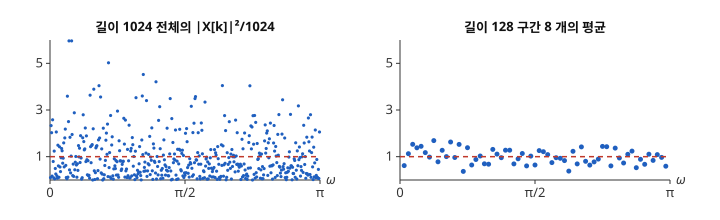

# 스펙트럼 추정

# 개요

**스펙트럼 추정(spectral estimation)** 은 유한 개의 측정값에서 신호의 세기가 주파수마다 얼마나 있는지를 추정하는 방법이다. 진동 센서로 기계를 1024 번 재고 나서, 회전축의 주파수에 잡음보다 큰 성분이 있는지 알고 싶다. 스펙트럼 추정은 측정값을 짧은 구간으로 나누고, 구간마다 [이산 Fourier 변환](fourier.md)의 절댓값 제곱을 계산해 평균한다.

# 직관

측정값 $x\lbrack 0\rbrack,\dots,x\lbrack N-1\rbrack$ 이 서로 무상관이고 평균 $0$, 분산 $1$ 인 [정규분포](normal-distribution.md)를 따른다. 자기상관은 $r_x\lbrack 0\rbrack=1$ 이고 나머지가 $0$ 이므로, [Wiener 필터](wiener-filter.md) 문서의 전력 스펙트럼 밀도는 모든 주파수에서 $S_x(\omega)=1$ 이다. 이 값을 측정값에서 다시 얻으려 한다. 자기상관은 기댓값이라 수열 하나로는 바로 계산되지 않는다.

이산 Fourier 변환 $X\lbrack k\rbrack$ 를 계산해 $\lvert X\lbrack k\rbrack\rvert^2/N$ 을 본다. $\mathbb E\lvert X\lbrack k\rbrack\rvert^2=\sum_t\sum_s\mathbb E\lbrack x\lbrack t\rbrack x\lbrack s\rbrack\rbrack e^{-2\pi ik(t-s)/N}=N$ 이므로 기댓값은 $1$ 이다. 그러나 $0\lt k\lt N/2$ 에서 $X\lbrack k\rbrack/\sqrt N$ 의 실수부와 허수부는 분산 $\frac12$ 인 독립 정규변수이고, $\lvert X\lbrack k\rbrack\rvert^2/N$ 은 평균 $1$ 인 [지수분포](exponential-distribution.md)를 따른다. 표준편차도 $1$ 이고 $N$ 을 늘려도 줄지 않는다. $N$ 을 늘리면 계산되는 주파수의 수만 늘어난다.

$N=1024$ 개를 길이 $128$ 인 구간 $8$ 개로 나눈다. 구간마다 $\lvert X\lbrack k\rbrack\rvert^2/128$ 을 계산해 $8$ 개를 평균하면, 구간들이 독립이므로 표준편차가 $1/\sqrt 8\approx 0.35$ 로 준다. 대신 계산되는 주파수의 간격이 $2\pi/1024$ 에서 $2\pi/128$ 로 넓어진다.

아래 그림은 이 측정값을 한 번 뽑아 두 방법으로 계산한 값이다. 왼쪽의 점들은 $0$ 부터 $5$ 넘게까지 흩어지고, 오른쪽의 점들은 점선 $S_x(\omega)=1$ 가까이 모인다. 오른쪽은 점의 개수가 $8$ 분의 $1$ 이다.

# 정의

## 주기도

광의 정상 과정에서 얻은 측정값 $x\lbrack 0\rbrack,\dots,x\lbrack N-1\rbrack$ 에 대해

$$
I_N(\omega)=\frac1N\Bigl\lvert\sum_{t=0}^{N-1}x\lbrack t\rbrack\thinspace e^{-i\omega t}\Bigr\rvert^2
$$

를 **주기도(periodogram)** 라 한다. 주파수 $\omega_k=2\pi k/N$ 에서는 $I_N(\omega_k)=\lvert X\lbrack k\rbrack\rvert^2/N$ 이고, [고속 Fourier 변환](fft.md)으로 $N$ 개 주파수의 값을 $O(N\log N)$ 번의 연산으로 얻는다. 직관 절의 $\lvert X\lbrack k\rbrack\rvert^2/N$ 이 주기도다.

## 창을 곱한 주기도

창함수(window function) $w\lbrack 0\rbrack,\dots,w\lbrack L-1\rbrack$ 를 곱한 주기도는

$$
\hat S(\omega)=\frac{1}{LU}\Bigl\lvert\sum_{t=0}^{L-1}w\lbrack t\rbrack\thinspace x\lbrack t\rbrack\thinspace e^{-i\omega t}\Bigr\rvert^2,\qquad U=\frac1L\sum_{t=0}^{L-1}w\lbrack t\rbrack^2
$$

이다. $U$ 로 나누어 무상관 입력에서 기댓값이 $r_x\lbrack 0\rbrack$ 가 되게 한다. 모든 $w\lbrack t\rbrack=1$ 이면 주기도와 같다. Hann 창(Hann window) $w\lbrack t\rbrack=\frac12-\frac12\cos(2\pi t/(L-1))$ 은 양 끝에서 $0$ 이 된다.

## Bartlett 방법과 Welch 방법

측정값 $N$ 개를 길이 $L$ 인 구간 $K$ 개로 나누고 구간마다 계산한 주기도를 평균한 것을 **Bartlett 방법(Bartlett's method)** 이라 한다. 직관 절은 $N=1024$, $L=128$, $K=8$ 인 Bartlett 방법이다. 구간이 서로 겹치게 하고(보통 절반) 구간마다 창을 곱한 주기도를 평균한 것을 **Welch 방법(Welch's method)** 이라 한다[^1].

# 성질

## 주기도의 기댓값

$\mathbb E\thinspace I_N(\omega)$ 는 $S_x$ 와 [Fejér 핵](fejer-kernel.md) $F_{N-1}$ 의 합성곱이다.

$$
\mathbb E\thinspace I_N(\omega)=\sum_{\lvert k\rvert\lt N}\Bigl(1-\frac{\lvert k\rvert}{N}\Bigr)r_x\lbrack k\rbrack\thinspace e^{-i\omega k}=\frac1{2\pi}\int_{-\pi}^{\pi}S_x(\omega-\theta)\thinspace F_{N-1}(\theta)\thinspace d\theta
$$

이중합 $\sum_t\sum_s r_x\lbrack t-s\rbrack e^{-i\omega(t-s)}$ 에서 $t-s=k$ 인 쌍이 $N-\lvert k\rvert$ 개이므로 첫 등식이 나온다. $\sum_k\lvert r_x\lbrack k\rbrack\rvert\lt\infty$ 이면 $N\to\infty$ 에서 $\mathbb E\thinspace I_N(\omega)\to S_x(\omega)$ 이다. 주기도는 점근적으로 불편이다.

## 누설

$F_{N-1}$ 의 중앙 봉우리는 폭이 $4\pi/N$ 이고 그 밖에 작은 봉우리가 이어진다. 그래서 한 주파수의 강한 성분이 주기도에서는 이웃 주파수로 번진다. 이 현상을 **누설(leakage)** 이라 한다. 창을 곱하면 핵이 $\lvert\sum_tw\lbrack t\rbrack e^{-i\theta t}\rvert^2$ 으로 바뀐다. Hann 창은 가장 큰 곁봉우리를 직사각형 창의 약 $-13$ dB 에서 약 $-31$ dB 로 낮추고, 중앙 봉우리의 폭을 두 배로 넓힌다.

## 비일치성

$S_x$ 가 연속이고 측정값이 정규 과정이면 $0\lt\omega\lt\pi$ 에서

$$
\mathrm{Var}\thinspace I_N(\omega)\to S_x(\omega)^2\qquad(N\to\infty)
$$

이다. 분산이 $0$ 으로 가지 않으므로 주기도는 일치 추정량(consistent estimator)이 아니다. 직관 절에서 표준편차가 $N$ 과 무관하게 $1$ 이었던 것이 이 사실의 $S_x=1$ 인 경우다.

## 분산과 분해능

Bartlett 방법에서 구간들의 주기도가 거의 독립이면 분산은 약 $S_x(\omega)^2/K$ 이다. 한편 길이 $L$ 의 구간에서 두 주파수 성분을 가르려면 간격이 약 $2\pi/L$ 이상이어야 한다. $N=KL$ 이 고정이면 분산을 줄이는 것과 주파수를 잘게 가르는 것을 함께 할 수 없다. Welch 방법은 겹치는 구간으로 $K$ 를 늘리고, 창으로 구간 양 끝을 줄여 이웃 구간 사이의 상관을 낮춘다.

# 활용

- 잡음 측정. 측정 장비의 잡음이 주파수에 고르게 퍼져 있는지, 낮은 주파수에 몰려 있는지를 Welch 추정으로 본다.
- Wiener 필터 설계. 주파수 영역의 해 $S_s/(S_s+S_v)$ 에 들어가는 신호와 잡음의 전력 스펙트럼 밀도를 이 방법으로 추정한다.
- 스펙트로그램. 음성을 짧은 구간으로 나누고 구간마다 창을 곱한 주기도를 시간 순서로 늘어놓은 그림이다. 구간 길이가 시간 분해능과 주파수 분해능을 함께 정한다. 이 계산이 [단시간 Fourier 변환](short-time-fourier-transform.md)이다.
- 주기 검출. 정상 시계열에서 다른 주파수보다 뚜렷이 큰 주기도 값을 찾아 숨은 주기를 추정한다.

[^1]: P. D. Welch, "The use of fast Fourier transform for the estimation of power spectra: A method based on time averaging over short, modified periodograms", *IEEE Transactions on Audio and Electroacoustics* 15 (1967), 70–73.

# 연관 문서

## 선수지식

- [이산 Fourier 변환](fourier.md)
- [Wiener 필터](wiener-filter.md)

## 더 알아보기

- [단시간 Fourier 변환](short-time-fourier-transform.md)

#signal_processing #statistics #probability #analysis
